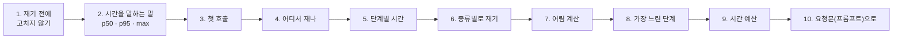
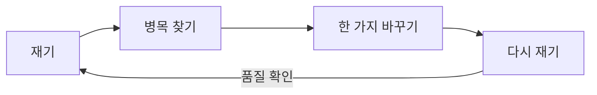
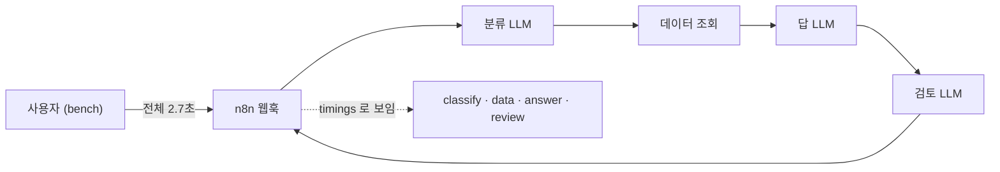
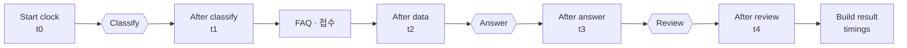

# 1단계 · 재기와 병목

- 교시: 1교시 강의 (09:00~09:50) · 2교시 [Lab 01](../../Last3Mon/72/LAB-01-Q-MEASURE-BOTTLENECK.md) 실습 5개 (10:00~10:50)
- 이 단계가 끝나면: 고치기 전에 응답 시간을 p50 · p95로 재고, 워크플로우가 단계별 시간을 결과에 남기게 해 병목을 숫자로 찾고, 시간 예산을 정해 넘었는지 기록할 수 있다.
- 숫자: 모두 강사 노트북 실측입니다 (65일차 n8n 2.42.6, OpenAI `gpt-4.1-mini`). 10/18은 수업 준비, 10/24는 실습을 5개로 늘린 뒤 다시 잰 값입니다. 출력 전부는 수업 뒤 공개되는 `Last3Mon/72/answers/LAB-TEST-RESULT.md`에 있습니다.
- 실습 가리키기: 이 문서에서 "Lab 01 예제 1"은 2교시 [Lab 01 문서](../../Last3Mon/72/LAB-01-Q-MEASURE-BOTTLENECK.md)의 그 절입니다. 파일 경로(`cases/` · `requests/` · `my-work/` · `reference/`)는 실습 폴더 `~/aio-01d4-stu/Last3Mon/72` 기준입니다.



## 0. 이 시간 (50분)

| 시간 | 절 · 개요 | 하는 일 |
| --- | --- | --- |
| 09:00~09:06 | 개요 1~6장 | 오늘 하루, 실습 기준 워크플로우, 실습 15개 |
| 09:06~09:09 | 1 · 개요 7장 | 재고 고치는 순서, 병목, 짐작과 실측이 다른 예 |
| 09:09~09:19 | 2 · 개요 8장 | 꼬리 지연과 백분위, p50 · p95 손으로 계산, 날마다 다른 기준 |
| 09:19~09:23 | 3 · 개요 9장 | 콜드 스타트, 첫 호출 다루는 법 |
| 09:23~09:29 | 4 · 5 · 개요 10~11장 | 밖에서 · 안에서 재기, 관측 3기둥, 계측, `timings` 칸 계산 |
| 09:29~09:36 | 6 · 7 · 개요 12~13장 | 종류별 실측, 암달의 법칙, 어림 계산 |
| 09:36~09:44 | 8 · 9 · 개요 13~14장 | 임계 경로와 `slowest_step`, SLI · SLO · SLA · 오류 예산, 시간 예산 |
| 09:44~09:50 | 10 · 11 · 확인 질문 | 요청문, 자주 하는 실수, 질문 |

### 2교시 Lab 01에서 이어서 하는 것

| 2교시 실습 (시각) | 이 강의의 절 | 실습에서 하는 일 | 쓰는 파일 · 명령 |
| --- | --- | --- | --- |
| 시작 (10:00) | — | 보고서 서식 복사 | `cp templates/PERF-REPORT-TEMPLATE.md my-work/PERF.md` (오늘 표를 모두 여기에 적음) |
| Lab 01 예제 1 (10:00~10:08, 에이전트 없이) | 2 · 3 | 기준 워크플로우를 5번씩 재고, 첫 호출을 따로 적기 | `bench base-helpdesk requests/faq-vpn.json -n 5` 등 셋 → `my-work/PERF.md` 1절 |
| Lab 01 예제 2 (10:08~10:20) | 4 · 5 | 에이전트에게 `timings` · `steps` · `llm_calls`를 결과에 남기게 하기 | `my-work/helpdesk.json` (기준을 복사), 테스트 `cases/lab01.json` → `PERF.md` 2절 |
| Lab 01 예제 3 (10:20~10:28, 에이전트 없이) | 6 · 7 | 질문 세 종류를 재고 LLM 몫 계산 | `bench my-helpdesk requests/faq-vpn-nocache.json` · `ticket-own` · `off-topic` → `PERF.md` 2-1절 |
| Lab 01 과제 1 (10:28~10:38) | 8 | `faq_ms` · `ticket_ms`로 나누고 `slowest_step` | 테스트 `cases/lab01-challenge.json` |
| Lab 01 과제 2 (10:38~10:50) | 9 · 10 | `budget_ms` · `over_budget` · `llm_ms` | 테스트 `cases/lab01-challenge2.json` → `PERF.md` 2-2절 |

## 1. 재기 전에 고치지 않기

### 일반 설명

성능을 고치는 일은 어느 시스템이든 같은 고리를 돕니다: **재고 → 가장 큰 곳을 찾고 → 한 가지만 바꾸고 → 다시 잰다.** "섣부른 최적화는 모든 악의 뿌리"(도널드 커누스)라는 말이 흔히 인용되는 까닭은, 재지 않고 고친 곳이 대개 병목이 아니기 때문입니다.

- **병목(bottleneck)**: 전체 시간의 대부분을 차지하는 한 곳. 병 목이 좁으면 병을 아무리 키워도 빨리 따라지지 않는 것과 같습니다.
- 단계가 **차례로** 실행되면 전체 시간 = 단계 시간의 합입니다. 그래서 가장 큰 단계를 줄여야 전체가 줄어듭니다.
- 한 번에 **한 가지만** 바꿉니다. 둘을 함께 바꾸면 무엇이 효과였는지(또는 무엇이 망가뜨렸는지) 알 수 없습니다.
- 빨라졌는지만 보지 않고 **결과가 그대로인지**도 봅니다. 빨라지려고 일을 덜 하면 품질이 떨어질 수 있습니다.

### 오늘 실습에서

"느린 것 같으니 병렬로 바꾸자", "모델을 바꾸자"는 **짐작**입니다. 66일차에 일을 두 갈래로 나눴지만 빨라지지 않았던 것을 기억합니다 (n8n v1은 갈래를 하나씩 실행). 고치기 전에 잽니다.



| 순서 | 질문 | 오늘 쓰는 것 |
| --- | --- | --- |
| 재기 | 지금 몇 초인가? 매번 같은가? | `flow.py bench` |
| 병목 찾기 | 그 시간 중 어느 단계가 대부분인가? | 결과의 `timings` |
| 바꾸기 | 그 단계를 줄이거나 건너뛸 수 있나? | 2단계 (규칙 · 캐시 · 검사 코드) |
| 다시 재기 | 빨라졌나? **답은 그대로인가?** | `bench` + 원래 테스트 |

짐작과 실측이 다른 예 (오늘 실습):

| 짐작 | 실측 (10/24) | 그래서 |
| --- | --- | --- |
| "사내 데이터 API가 느릴 것" | FAQ · 접수 조회를 합쳐 **18~43ms** | 데이터 API를 빠르게 해도 거의 그대로 |
| "IT와 상관없는 질문은 금방 끝날 것" | 점심 메뉴 질문도 **2.48초** (LLM 세 번) | 건너뛸 단계가 있다 (2단계) |
| "push 하면 바로 평소 속도" | push 직후 첫 호출 **4.4초** (10/18 6.5초) | 첫 호출은 따로 적는다 |

## 2. 시간을 말하는 말: 평균 · p50 · p95 · max

### 일반 설명

응답 시간은 거의 늘 **한쪽으로 긴 꼬리**를 가집니다. 대부분은 비슷하게 빠르고, 가끔 아주 느린 것이 섞입니다. 까닭은 여러 가지입니다: 네트워크가 잠깐 막힘, 서버가 다른 일로 바쁨(대기열), 메모리 정리(GC), LLM이 평소보다 긴 답을 씀.

- 이런 분포에서 **평균**은 꼬리에 끌려가 "보통"도 "느린 쪽"도 말해 주지 못합니다. 그래서 업계는 **백분위(percentile)** 로 말합니다: p50(중앙값), p90 · p95 · p99(느린 쪽).
- 꼬리가 중요한 까닭: 한 화면이 서비스를 여러 번 부르면 그중 하나만 느려도 화면이 느립니다. 예를 들어 한 번 부를 때 1%가 느린 서비스를 100번 부르는 화면은 1 − 0.99¹⁰⁰ ≈ **63%** 가 느린 호출을 하나 이상 만납니다 (계산 예). 큰 서비스가 p99 · p99.9까지 보는 까닭입니다.
- 백분위를 세는 방법은 도구마다 조금 다릅니다 (가장 가까운 자리를 고르는 nearest-rank, 두 자리 사이를 나누는 보간). 오늘은 nearest-rank: 작은 것부터 줄 세우고 **올림(비율 × 개수)번째**. 숫자를 비교할 때는 같은 도구 · 같은 방법으로 잰 것끼리.
- 개수가 적으면 백분위가 흔들립니다. p95를 믿으려면 적어도 수십 번, p99는 수백 번이 필요합니다.

### 오늘 실습에서

같은 요청을 여러 번 부르면 시간이 매번 조금씩 다릅니다. 그 목록을 한 숫자로 말하는 방법이 여럿입니다.

| 말 | 뜻 | 계산 (시간을 작은 것부터 줄 세움) |
| --- | --- | --- |
| 평균 | 다 더해서 개수로 나눔 | 한두 번 아주 느리면 크게 끌려감 |
| **p50** (가운데) | "보통 이 정도" | 줄의 가운데 |
| **p95** (느린 쪽) | 100번 중 95번은 이보다 빠름 | 앞에서 95% 자리 |
| max | 가장 느린 한 번 | 맨 끝 |
| 실패 수 | 답을 못 받은 횟수 | 시간 목록과 따로 |

**손으로 계산해 보기.** 10번 잰 시간이 아래와 같다고 합시다 (예시 숫자).

```text
1.1  1.2  1.2  1.3  1.3  1.4  1.4  1.5  1.6  9.8   (초, 작은 것부터)
```

| 말 | 값 | 어떻게 |
| --- | --- | --- |
| 평균 | 2.18초 | 합 21.8 ÷ 10 — 한 번의 9.8초 때문에 "보통 2초"처럼 보임 |
| p50 | 1.3초 | 가운데 (5번째) |
| p95 | 9.8초 | 10개 중 95% 자리 = 10번째 (자리 = 올림(0.95 × 10)) |
| max | 9.8초 | |

- 사용자 열 명 중 아홉은 1.6초 안에 받았고 한 명은 10초를 기다렸습니다. 평균 2초라는 말은 **아무에게도 맞지 않습니다.**
- 사용자가 "느리다"고 기억하는 것은 느린 쪽입니다. 그래서 p50과 p95를 **함께** 말합니다.
- 개수가 적으면 p95와 max가 같아집니다 (5번이면 p95 = 5번째 = max). 5번은 "대강", 20번 이상이면 p95가 의미를 갖기 시작합니다. 오늘 실습은 시간 때문에 5번입니다.

오늘 기준 워크플로우 (`base-helpdesk`, VPN 질문, push 직후 첫 호출 뒤 5번):

| 날 | 첫 호출 | p50 | p95 | 실패 |
| --- | --- | --- | --- | --- |
| 10/18 | 6.5초 | 2.61초 | 2.83초 | 0 |
| 10/23 | 6.3초 | 3.14초 | 3.22초 | 0 |
| 10/24 | 4.4초 | 2.69초 | 2.98초 | 0 |

같은 워크플로우 · 같은 질문인데 날마다 0.5초쯤 다릅니다 (OpenAI 쪽 응답 시간, 네트워크). 그래서 **바꾸기 전 · 후를 같은 날, 같은 조건으로** 잽니다. 어제 잰 숫자와 오늘 바꾼 숫자를 비교하면 안 됩니다.

## 3. 첫 호출 (콜드 스타트)

### 일반 설명

**콜드 스타트(cold start)** 는 "처음 한 번"만 드는 준비 비용입니다. 서버리스 함수(AWS Lambda 등)가 오랜만에 불릴 때, 자바 같은 언어가 처음 실행한 코드를 최적화(JIT)하기 전, 데이터베이스 연결 풀이 비어 있을 때 모두 같은 일이 생깁니다.

| 처음에만 드는 일 | 예 |
| --- | --- |
| 연결 만들기 | TCP 연결 + TLS 인증 주고받기 (왕복 몇 번), 그 뒤로는 연결을 다시 씀 |
| 불러오기 · 초기화 | 프로그램 · 설정 · 라이브러리를 메모리에 올림 |
| 비어 있는 캐시 | 처음에는 모든 것을 새로 계산 |

- 다루는 법은 셋입니다: **따로 적기**(평소 숫자와 섞지 않음), **미리 불러 두기**(워밍업), **아예 줄이기**(늘 켜 두기, 연결 재사용).
- 운영에서는 배포 직후, 서버가 늘어날 때(오토스케일), 밤새 아무도 안 쓴 뒤 아침 첫 요청이 콜드 스타트를 만납니다.

### 오늘 실습에서

n8n이 다시 켜진 뒤(오늘은 `push`할 때마다) 첫 호출은 눈에 띄게 느립니다.

| 까닭 | 설명 |
| --- | --- |
| 연결 열기 | OpenAI · 데이터 API와 처음 연결 (TLS 등) |
| 준비 | 워크플로우 · 노드를 처음 불러오고 Code 노드 실행기(runner)를 깨움 |

| 다루는 법 | 어디서 |
| --- | --- |
| 첫 호출을 **따로 적는다** | Lab 01 예제 1에서 `my-work/PERF.md` 1절 표의 "첫 호출" 칸 (`PERF.md`는 Lab 01을 시작할 때 `templates/PERF-REPORT-TEMPLATE.md`를 복사해 만든 내 보고서) |
| 재기 전에 한 번 불러 둔다 (워밍업) | 4교시 Lab 02 과제 1의 테스트 `cases/lab02-challenge.json`: 맨 위 `before`에 워밍업 호출이 있음 (과제 1에서 열어 봄) |
| 운영에서는 배포 직후 한 번 불러 둔다 | 74일차 배포에서 다시 |

> 수업 준비 때 첫 호출 때문에 시간 기대(`max_seconds`)가 있는 케이스가 흔들렸습니다. 테스트에 워밍업을 넣은 까닭입니다.

## 4. 어디서 재나

### 일반 설명

재는 자리는 크게 둘입니다.

| 재는 자리 | 무엇을 아나 | 예 |
| --- | --- | --- |
| **밖에서** (블랙박스) | 사용자가 실제로 기다린 시간, 성공 · 실패 | 부하 도구(k6 · Locust), 합성 점검(synthetic monitoring), 실제 사용자 측정(RUM) |
| **안에서** (화이트박스) | 그 시간이 어느 단계에서 쓰였나 | 로그, 단계별 시간, 추적(trace) |

업계에서 말하는 **관측 가능성(observability)** 의 세 기둥이 이것입니다.

- **지표(metrics)**: 모아서 센 숫자 (p95, 실패율, 분당 요청 수). 추세 · 알림에 씀.
- **로그(logs)**: 일이 하나 일어날 때마다 남기는 기록. 무슨 일이 있었는지 찾아볼 때.
- **추적(traces)**: 요청 **하나**가 지나간 길과 단계(span)별 시간. 어디가 느린지 볼 때.

밖에서 잰 숫자로 "느리다"를 알고, 안에서 잰 숫자로 "어디가"를 찾습니다. 둘 중 하나만으로는 모자랍니다.

### 오늘 실습에서

| 어디서 | 보이는 것 | 한계 |
| --- | --- | --- |
| `flow.py bench` (밖에서) | 사용자가 기다린 전체 시간, p50 · p95 · max, 실패 수 | 안에서 어디가 느린지는 모름 |
| n8n **Executions** 화면 | 노드마다 걸린 시간 | 한 번씩 눈으로, 여러 번 모으기 어려움 |
| 워크플로우가 남긴 `timings` | 단계마다 ms, 결과와 함께 | 직접 만들어야 함 (2교시 Lab 01 예제 2에서 만듦) |



- 밖에서 잰 시간(`bench`)과 안에서 잰 `total_ms`는 조금 다릅니다. 밖은 웹훅을 받고 돌려주는 시간까지 포함합니다. 오늘 VPN 한 번: `call` 2.7초, `total_ms` 2698ms (10/24) — 거의 같습니다.

## 5. 단계별 시간을 결과에 남기기

### 일반 설명

코드에 시간을 재는 줄을 넣는 일을 **계측(instrumentation)** 이라고 합니다. 원리는 간단합니다: 단계 앞뒤에서 시각을 읽고 차이를 남깁니다.

- 시각은 같은 시계로 읽어야 뺄 수 있습니다. 컴퓨터 시계는 시간 맞추기(NTP)로 가끔 앞뒤로 튈 수 있어서, 정밀하게 잴 때는 늘 앞으로만 가는 시계(monotonic: 자바스크립트 `performance.now()`, 파이썬 `time.monotonic()`)를 씁니다. 오늘처럼 ms 단위로 단계를 비교할 때는 `Date.now()`로 충분합니다.
- 계측에도 시간이 듭니다. 아주 짧은 단계를 아주 많이 재면 재는 비용이 커집니다. 오늘은 Code 노드 몇 개라 수 ms입니다.
- 업계 도구는 이것을 표준으로 만든 것입니다: **OpenTelemetry**는 단계(span)마다 시작 · 끝 시각과 이름을 남기고, 모아서 한 요청의 폭포 그림(waterfall)으로 보여 줍니다. 오늘 `timings`는 그 아주 작은 판입니다.
- 시간과 함께 **어느 길로 왔는지**(지나간 단계, 부른 외부 서비스 수)도 남깁니다. 시간은 길에 따라 다르기 때문입니다.

### 오늘 실습에서

단계가 끝날 때마다 Code 노드에서 `Date.now()`(지금 시각, ms)를 남기고, 마지막에 앞 시각과의 차이를 계산합니다.



| 칸 | 계산 | 10/24 VPN 한 번 |
| --- | --- | --- |
| `classify_ms` | t1 − t0 | 616 |
| `data_ms` | t2 − t1 | 18 |
| `answer_ms` | t3 − t2 | 1124 |
| `review_ms` | t4 − t3 | 920 |
| `total_ms` | 끝 − t0 | 2698 |

- 단계 칸을 더하면 2678ms. `total_ms`와 20ms 차이는 시각을 남기는 Code 노드들과 결과를 만드는 시간입니다.
- **시각 노드는 단계가 끝난 뒤에.** 앞에 두면 값이 0이나 음수가 됩니다 (Lab 01 문서 끝 "막혔을 때" 표 첫 줄).
- 지나가지 않은 단계(예: 규칙으로 분류해 Classify를 건너뜀)는 칸을 넣지 않습니다. `$('노드').isExecuted`로 먼저 확인합니다.
- `steps`(지나간 단계)와 `llm_calls`(부른 LLM 수)도 워크플로우가 정해진 값으로 남깁니다. 69일차 협업 기록과 같은 생각: **어느 길로 왔는지는 워크플로우가 안다.** LLM에게 "몇 번 불렀는지 적어"라고 하지 않습니다.

## 6. 요청 종류별로 재기 (2교시 Lab 01 예제 3)

### 일반 설명

한 서비스에 오는 요청은 종류가 섞여 있습니다(**작업 구성**, workload mix). 종류마다 지나가는 길이 다르면 시간도 다릅니다.

- 모두 섞어 잰 숫자는 "어느 종류가 느린지"를 숨깁니다. 빠른 종류가 많으면 느린 종류의 문제가 평균 · p50에 묻힙니다.
- 그래서 **종류별로 따로** 재고, 하루에 종류마다 몇 건이 오는지(비율)도 함께 봅니다. 고칠 순서는 "느림 × 건수"로 정합니다.
- 부하 시험(load test)도 실제 요청 비율을 흉내 낸 시나리오로 합니다. 한 가지 요청만 반복하면 실제와 다른 결론이 납니다.

### 오늘 실습에서

같은 워크플로우에 질문 세 종류를 5번씩 (10/24, Lab 01 예제 2에서 만든 `my-helpdesk`, 캐시 없음). Lab 01 예제 3에서 각자 같은 표를 `my-work/PERF.md` 2-1절에 채웁니다.

| 질문 종류 | p50 | p95 | classify | data | answer | review | total | LLM 몫 |
| --- | --- | --- | --- | --- | --- | --- | --- | --- |
| FAQ (VPN) | 2.91초 | 3.08초 | 616 | 18 | 1124 | 920 | 2698 | 98.6% |
| 접수 번호 (T-1002) | 2.99초 | 3.12초 | 818 | 43 | 877 | 895 | 2647 | 97.8% |
| IT 밖 (점심 메뉴) | 2.48초 | 2.84초 | 732 | 19 | 740 | 978 | 2482 | 98.7% |

(단계 칸은 ms, `uv run tools/flow.py call my-helpdesk <요청> -v` 한 번의 값. LLM 몫 = (classify + answer + review) ÷ total)

- **세 종류 모두 LLM이 98% 안팎.** 데이터 API는 20~40ms입니다.
- 점심 메뉴 질문은 데이터가 하나도 없는데도 LLM을 세 번 부르고 "찾지 못했습니다"류의 답을 씁니다. 2단계에서 줄일 수 있는 첫 후보입니다.
- 접수 번호 질문은 10/24 Lab 01 예제 2의 테스트(`cases/lab01.json`)에서 한 번 실패했습니다: 검토 LLM이 "처리 중"을 "승인 대기 중"으로 바꿔 썼습니다. **검토 LLM이 사실을 바꿔 쓸 수 있다**는 것도 4교시 Lab 02 과제 1(검토 LLM을 검사 코드로 바꾸기)의 근거입니다.

## 7. 어림 계산: 어디를 고치면 얼마나 빨라지나

### 일반 설명

어디를 고칠지 정하기 전에 "고치면 얼마나 줄어드나"를 계산해 봅니다. 이것을 정리한 것이 **암달의 법칙(Amdahl's law)** 입니다.

> 전체에서 비율 p를 차지하는 부분을 s배 빠르게 하면, 전체는 1 ÷ ((1 − p) + p ÷ s)배 빨라진다.

| 고치는 부분의 비율 p | 그 부분을 | 전체 |
| --- | --- | --- |
| 1% | 10배 빠르게 | 약 1.01배 (거의 그대로) |
| 50% | 2배 빠르게 | 약 1.33배 |
| 98% | 2배 빠르게 | 약 1.96배 |
| 98% | 없앰 | 약 50배 (남은 2%만) |

- 작은 부분을 아무리 빠르게 해도 전체는 거의 그대로입니다. **큰 덩어리부터.**
- 어림은 방향을 정하는 데 쓰고, 고친 뒤에는 반드시 다시 잽니다. 단계끼리 영향을 주기도 하기 때문입니다 (예: 앞 단계가 빨라지면 뒤 단계가 콜드 스타트를 떠안음).

### 오늘 실습에서

전체 2.7초(VPN) 중 각 단계를 **없앤다면** 얼마가 되는지 어림합니다.

| 없애는 것 | 줄어드는 시간 | 남는 시간 | 줄어드는 비율 |
| --- | --- | --- | --- |
| 데이터 조회 (18ms) | 0.02초 | 2.68초 | 0.7% |
| 분류 LLM (616ms) | 0.62초 | 2.08초 | 23% |
| 검토 LLM (920ms) | 0.92초 | 1.78초 | 34% |
| 분류 + 검토 | 1.54초 | 1.16초 | 57% |

- 데이터 조회를 열 배 빠르게 해도 사용자는 모릅니다. **큰 덩어리부터.**
- 2단계 실측과 맞춰 봅니다: 10/24 캐시 없이 VPN p50이 Lab 02 예제 2까지(규칙 + 캐시, LLM 2번) 2.22초 → Lab 02 과제 1에서 검토를 검사로 바꾼 뒤(LLM 1번) 1.12초. 어림한 "검토를 빼면 약 1초 줄어듦"과 맞습니다.
- 어림은 **방향**을 정하는 데 씁니다. 결과는 반드시 다시 잽니다.

## 8. 가장 느린 단계 (2교시 Lab 01 과제 1)

### 일반 설명

차례로 실행되는 흐름에서는 가장 오래 걸린 단계가 곧 가장 큰 병목입니다. 단계가 **동시에** 실행되는 흐름이라면, 전체 시간은 가장 긴 줄기(**임계 경로**, critical path)가 정합니다. 임계 경로 밖의 단계를 빠르게 해도 전체는 줄지 않습니다.

- 매번 사람이 화면을 열어 찾는 대신, 결과에 "가장 느린 단계"를 **계산해 남기면** 많은 요청을 모아 셀 수 있습니다 ("오늘 느린 요청의 70%는 답 단계").
- 가장 느린 단계는 실행마다 바뀔 수 있습니다. 비슷한 단계가 둘이면 1등이 자주 바뀌므로, 한 번이 아니라 **여러 번 모아서** 봅니다.

### 오늘 실습에서

`timings`에서 `total_ms`를 뺀 칸 중 가장 큰 칸의 이름을 `slowest_step`으로 결과에 남깁니다. 매번 Executions를 열지 않아도 결과만 보고 어디가 느린지 압니다.

10/24 Lab 01 과제 1 정답으로 과제 1 테스트 `cases/lab01-challenge.json`의 네 번 (ms):

| 질문 | classify | faq | ticket | answer | review | total | `slowest_step` |
| --- | --- | --- | --- | --- | --- | --- | --- |
| VPN (push 직후 첫 호출) | 1365 | 16 | 14 | 1196 | 993 | 3614 | classify |
| VPN | 774 | 17 | 13 | 971 | 815 | 2601 | answer |
| VPN | 680 | 17 | 10 | 1044 | 1007 | 2769 | answer |
| 접수 현황 | 723 | 13 | 11 | 1029 | 1162 | 2951 | review |

- 답 LLM과 검토 LLM이 비슷해서 실행마다 1등이 바뀝니다. push 직후 첫 호출에서는 분류(첫 LLM)가 1등이었습니다 (첫 호출의 준비 시간이 첫 LLM 단계에 붙음). 그래서 테스트는 `classify` · `answer` · `review` 중 하나면 통과로 봅니다.
- `slowest_step`은 LLM이 아니라 **Code가 계산**합니다. 숫자가 있으면 판단하지 않고 셉니다.
- 데이터 조회를 `faq_ms` · `ticket_ms`로 나눈 까닭: 3단계에서 "어느 쪽이 멈췄나"를 볼 때 둘을 따로 봐야 합니다.

## 9. 시간 예산 (2교시 Lab 01 과제 2)

### 일반 설명

"빠르다"는 기준이 있어야 말할 수 있습니다. 업계에서 쓰는 말은 셋입니다.

| 말 | 뜻 | 예 |
| --- | --- | --- |
| **SLI** (Service Level Indicator, 서비스 수준 지표) | 서비스가 잘 되고 있는지 **재는 숫자**. 무엇을 재나 | "3초 안에 답한 요청의 비율" |
| **SLO** (Service Level Objective, 서비스 수준 목표) | 그 지표가 지켜야 할 **목표 값**. 팀이 스스로 정함 | "한 달 동안 95% 이상" |
| **SLA** (Service Level Agreement, 서비스 수준 협약) | 고객과 맺은 **계약**. 목표를 못 지키면 어떻게 되나 (보상) | "95% 밑이면 요금 일부 돌려줌" |

- **오류 예산(error budget)** = 1 − SLO. 목표가 95%면 5%까지는 늦어도 됩니다. 예산이 남으면 새 기능을 내고, 다 쓰면 안정화에 집중합니다 (구글 SRE의 방식).
- **시간 예산 나누기**: 전체 목표(예: 3초)를 단계마다 나눠 줍니다 (분류 0.5초, 데이터 0.2초, 답 2초 …). 각 단계는 자기 몫을 넘었는지로 봅니다.
- 목표는 **사용자 쪽에서** 정합니다. "지금 2.7초니까 목표 3초"가 아니라 "사용자가 3초 넘으면 답답해하니 3초"입니다.
- 넘은 요청을 버리지 않고 **기록해서 모으는** 것이 먼저입니다. 모아야 어디를 고칠지 보입니다.

### 오늘 실습에서

"빠르다 · 느리다"는 기준이 있어야 말할 수 있습니다. 그 기준이 **시간 예산**(목표 시간)입니다.

| 말 | 뜻 | 오늘 |
| --- | --- | --- |
| 시간 예산 (`budget_ms`) | 한 요청이 이 안에 끝나야 함 | 기본 3000ms, 요청 본문으로 바꿀 수 있음 |
| 넘었나 (`over_budget`) | `total_ms > budget_ms` | 결과에 남김 (답은 그대로 보냄) |
| LLM 시간 (`llm_ms`) | 분류 · 답 · 검토의 합 | 넘었을 때 LLM 탓인지 바로 보임 |
| 목표 수준 (SLO) | "요청의 95%가 3초 안" 같은 약속 | 오늘은 씨앗만 (79일차 운영 대시보드) |

- 예산은 **사용자 쪽에서** 정합니다 ("3초 넘으면 느리다"). 워크플로우를 만든 사람이 "우리 워크플로우는 2.7초니까 예산 3초"라고 정하는 것이 아닙니다.
- 넘었다고 답을 멈추지 않습니다. 이미 거의 다 만든 답을 버리면 사용자는 더 오래 기다립니다. **기록하고, 모아서, 고칠 곳을 정합니다.**
- `llm_ms`를 `timings` 안에 넣으면 늘 가장 커서 `slowest_step`이 망가집니다. 그래서 결과 맨 바깥에 둡니다.

**세어 보기 (예시).** 하루 200건 중 `over_budget: true`가 24건이면 3초 안에 답한 비율은 (200 − 24) ÷ 200 = 88%. 목표가 95%라면 모자랍니다. 넘은 24건의 `slowest_step`을 세어 보면 무엇부터 고칠지 보입니다.

10/24 Lab 01 과제 2 정답으로 과제 2 테스트 `cases/lab01-challenge2.json` (VPN · 접수, 캐시 없이). Lab 01 과제 2에서 각자 `PERF.md` 2-2절에 같은 표를 채웁니다:

| 예산 | `total_ms` | `llm_ms` | `over_budget` |
| --- | --- | --- | --- |
| 60000 | 3357 (push 직후) | 3295 | false |
| 500 | 2609 | 2563 | true |
| 주지 않음 → 3000 | 3023 | 2973 | **true** |
| 주지 않음 → 3000 (접수 현황) | 2904 | 2858 | false |

- 기본 예산 3초에서 VPN이 3023ms로 **23ms 넘었습니다.** 지금 워크플로우는 3초 근처라 실행마다 `true` · `false`가 바뀝니다. 그래서 과제 2 테스트는 기본값일 때 `budget_ms: 3000`만 보고, 4교시 Lab 02에서 LLM을 줄이면 넉넉히 들어옵니다.
- `llm_ms`가 `total_ms`의 98%: 넘은 까닭이 LLM이라는 것이 결과만 봐도 보입니다.

## 10. 요청문(프롬프트)으로

**요청문(프롬프트)이란.** 실습에서 CLI 코딩 에이전트(codex · claude · agy)에게 보내는 글입니다. 에이전트는 이 글만 보고 n8n 워크플로우 JSON을 만들거나 고칩니다. 이 절은 이 단계에서 배운 것을 **요청문(프롬프트)에 어떤 칸으로 적을지** 실습 전에 정리하는 자리입니다. 실습 문서의 `▶ 빈칸 채우기 · 요청문(프롬프트) 뼈대`가 이 칸을 실제 문장으로 만든 것이고, 빈칸 ①~④는 그 문장 속 정확한 값입니다.

| 칸 | 에이전트에게 알려 주는 것 | 빠지면 생기는 일 |
| --- | --- | --- |
| 무엇을 | 만들거나 바꿀 기능 | 에이전트가 짐작해서 다른 것을 만듦 |
| 어디에 | 고칠 파일 · 노드 · 자리 | 엉뚱한 노드를 고치거나 새 파일을 만듦 |
| 어떤 모양으로 | 결과 JSON의 칸 이름 · 값 · 응답 코드 | 테스트가 보는 칸 이름과 달라 실패 |
| 그대로 · 하지 말 것 | 건드리면 안 되는 것 | 다른 곳까지 바뀌어 무엇 때문인지 모르게 됨 |
| 확인 | 통과해야 할 테스트 파일 | "다 됐다"를 판단할 기준이 없음 |

67~71일차의 다섯 가지(① 파일 ② 입력 ③ 처리 ④ 결과 모양 ⑤ 기대 결과)와 같은 뜻입니다. 파일 · 입력이 "어디에", 처리가 "무엇을", 결과 모양이 "어떤 모양으로", 기대 결과가 "확인"입니다. 72일차부터는 **이미 있는 워크플로우를 고치는** 요청이 많아 "그대로"가 따로 한 칸이 됐습니다.

Lab과 다른 업무로 예를 듭니다 (주문 문의 워크플로우, **실습에는 없는 예**: `my-work/order.json`은 가상의 파일). Lab 01 예제 2 · 과제 1 · 과제 2의 요청문을 쓸 때 같은 칸을 채웁니다.

아래 표의 줄(넣을 것)은 위 다섯 칸을 이 단계 주제에 맞게 쪼갠 것이고, 실습 요청문(프롬프트)을 쓸 때도 같은 줄을 채웁니다.

| 넣을 것 | 예 |
| --- | --- |
| 바탕 · 바꿀 것 | "`my-work/order.json`은 그대로 두고 결과에 필드만 더한다" |
| 시각을 남길 곳 | "주문 조회 뒤, 답 LLM 뒤" |
| 결과 모양 | `timings: {lookup_ms, answer_ms, total_ms}`, `steps`, `llm_calls` |
| 지나가지 않은 단계 | "지나가지 않은 노드는 `isExecuted`로 확인하고 빼기" |
| 예산 | "본문 `budget_ms`(없으면 2000), `over_budget`, `llm_ms`는 `timings` 밖" |
| 기대 결과 | 테스트 파일 |

표를 위에서부터 이어 읽으면 요청문(프롬프트)이 됩니다 (화살표 오른쪽은 다섯 칸 중 어디인지):

```text
my-work/order.json 은 그대로 두고 결과에 필드만 더해 줘.                       ← 그대로 · 무엇을
주문 조회 뒤와 답 LLM 뒤에 시각을 남겨,                                         ← 어디에
결과에 timings: {lookup_ms, answer_ms, total_ms}, steps, llm_calls 를 넣어 줘.  ← 어떤 모양으로
지나가지 않은 노드는 isExecuted 로 확인해 빼고,
본문 budget_ms(없으면 2000)를 넘으면 over_budget: true (llm_ms 는 timings 밖).
기대 결과 cases/<테스트 파일>.json.                                              ← 확인
```

> "빠르게 해 줘"로 시작하지 않습니다. **"재게 해 줘"** 가 먼저입니다.

## 11. 자주 하는 실수

| 실수 | 생기는 일 | 바로잡기 |
| --- | --- | --- |
| 평균 하나만 적음 | "가끔 10초"가 안 보임 | p50 · p95 · max |
| push 직후 바로 잼 | 첫 호출 4~6초가 섞임 | 첫 호출을 따로, 또는 워밍업 |
| 다른 날 숫자와 비교 | 날마다 0.5초쯤 다름 | 같은 날 전 · 후 |
| 시각 노드를 단계 앞에 | `timings`가 0 · 음수 | 단계가 끝난 뒤 |
| LLM에게 `llm_calls`를 쓰게 함 | 틀린 숫자 | 워크플로우가 `isExecuted`로 셈 |
| 빨라진 것만 봄 | 답이 바뀐 것을 놓침 | 원래 테스트도 다시 |

## 확인 질문

<details><summary>1. 5번 잰 시간이 2.4 · 2.5 · 2.6 · 2.6 · 7.9초입니다. p50 · p95 · 평균은? 사용자에게 무엇이라고 말하나요?</summary>

p50 2.6초, p95 7.9초(5개 중 5번째), 평균 3.6초. "보통 2.6초, 가끔 8초 가까이"라고 말합니다. 7.9초가 첫 호출이었는지 먼저 확인합니다.
</details>

<details><summary>2. 데이터 API를 2배 빠르게 하는 일과 검토 LLM을 없애는 일 중 무엇을 먼저 하나요?</summary>

검토 LLM. 데이터 API는 전체의 1%가 안 되어(18ms) 2배 빨라져도 0.01초입니다. 검토 LLM은 약 0.9초(34%)입니다. 대신 검토가 하던 일 중 무엇을 잃는지 적습니다 (2단계).
</details>

<details><summary>3. 시간 예산 3초를 넘은 요청에 답을 보내지 않으면 어떻게 되나요?</summary>

사용자는 3초를 기다리고도 답을 못 받습니다. 예산은 **기록하고 모아서** 고칠 곳을 정하는 데 씁니다. 답을 멈추는 것은 3단계의 timeout(외부 서비스를 기다리는 한도)이 하는 일이고, 그때도 "정해진 답"을 보냅니다.
</details>

## 정리

- [ ] 재기 → 병목 → 한 가지 바꾸기 → 다시 재기 (품질도)
- [ ] p50 · p95 · max를 함께, 첫 호출은 따로, 같은 날 전 · 후
- [ ] 단계별 시간 · 지나간 단계 · LLM 수는 워크플로우가 결과에 남긴다
- [ ] 질문 종류마다 재고, 큰 덩어리부터 어림한다 (오늘은 LLM이 98%)
- [ ] 시간 예산은 사용자 쪽에서 정하고, 넘었는지는 기록한다
