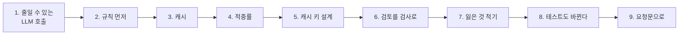
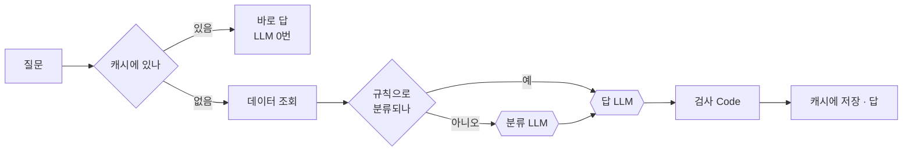
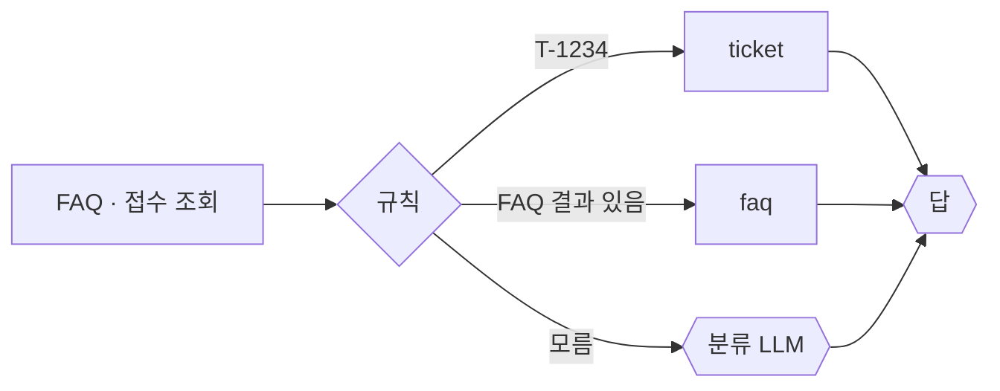
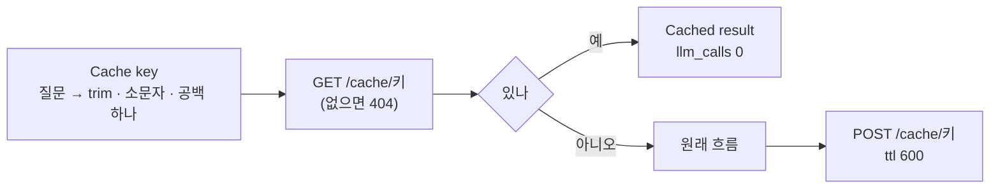
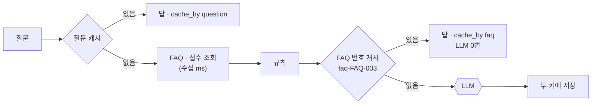

# 2단계 · 실행 흐름 최적화

- 교시: 3교시 강의 (11:00~11:50) · 4교시 [Lab 02](../../Last3Mon/72/LAB-02-Q-OPTIMIZE-FLOW.md) 실습 5개 (12:00~12:50)
- 이 단계가 끝나면: LLM 호출을 규칙 · 캐시 · 검사 코드로 줄이고, 캐시 키를 설계해 적중률을 올리고, 바꿀 때마다 다시 재서 빨라진 만큼 품질이 그대로인지 확인할 수 있다.
- 숫자: 강사 노트북 실측 (10/18 수업 준비, 10/23~24 다시 잼). 같은 표 안의 전 · 후는 같은 날 잰 값입니다.
- 실습 가리키기: "Lab 02 예제 1"은 4교시 [Lab 02 문서](../../Last3Mon/72/LAB-02-Q-OPTIMIZE-FLOW.md)의 그 절, "Lab 01 …"은 2교시 실습입니다. 파일 경로는 실습 폴더 `~/aio-01d4-stu/Last3Mon/72` 기준이고, `PERF.md`는 Lab 01을 시작할 때 만든 내 보고서 `my-work/PERF.md`입니다.

## 0. 이 시간 (50분)

| 시간 | 절 · 개요 | 하는 일 |
| --- | --- | --- |
| 11:00~11:06 | 1 · 개요 15장 | LLM 호출의 시간 · 비용, 줄이는 방법, Lab 01 숫자: LLM 98% |
| 11:06~11:16 | 2 · 3 · 개요 16~17장 | 싼 것 먼저(규칙), 캐시 방식 · TTL · 무효화 · 키, 캐시해도 되는 것 |
| 11:16~11:26 | 4 · 5 · 개요 18~19장 | 적중률 공식 · 실측, 캐시 키 설계, FAQ 번호 캐시 |
| 11:26~11:36 | 6 · 7 · 개요 20~21장 | 코드 검사와 LLM 검토, 검토 → 검사 실측, 얻은 것 · 잃은 것 |
| 11:36~11:44 | 8 · 9 | 테스트 격리, 캐시가 테스트를 바꾼 이야기, 요청문 |
| 11:44~11:50 | 확인 질문 | 질문 |

### 4교시 Lab 02에서 이어서 하는 것

바탕은 Lab 01 과제 2까지 고친 `my-work/helpdesk.json`입니다 (없으면 `cp reference/lab01-example2-timings.json my-work/helpdesk.json` 후 push).

| 4교시 실습 (시각) | 이 강의의 절 | 실습에서 하는 일 | 쓰는 파일 · 명령 |
| --- | --- | --- | --- |
| Lab 02 예제 1 (12:00~12:10) | 1 · 2 | 데이터 조회를 앞으로, 규칙으로 되면 분류 LLM을 건너뜀 | `bench my-helpdesk requests/faq-printer.json -n 5`, 테스트 `cases/lab02.json` |
| Lab 02 예제 2 (12:10~12:20) | 3 · 8 | 질문 캐시 (데이터 API `/cache`) | 테스트 `cases/lab02.json` · `cases/lab01.json`, `requests/faq-vpn-again.json` |
| Lab 02 예제 3 (12:20~12:26, 에이전트 없이) | 4 | 캐시를 쓸 때 · 안 쓸 때를 재고 적중률 계산 | `bench my-helpdesk requests/faq-vpn.json` · `faq-vpn-nocache.json` -n 5, `curl localhost:8800/cache-stats` → `PERF.md` 3-1절 |
| Lab 02 과제 1 (12:26~12:38) | 6 · 7 | 검토 LLM을 검사 Code로 (LLM 한 번, 2.5초 안) | 테스트 `cases/lab02-challenge.json` (`--repeat 3`) → `PERF.md` 3절 |
| Lab 02 과제 2 (12:38~12:50) | 5 · 7 | FAQ 번호로 두 번째 캐시 (`cache_by`) | 테스트 `cases/lab02-challenge2.json` → `PERF.md` 3절 |

## 1. 줄일 수 있는 LLM 호출

### 일반 설명

LLM 호출은 보통 워크플로우에서 가장 느리고 비싼 단계입니다.

- **시간**: 첫 글자가 나오기까지의 시간(TTFT) + 답 글자 수 × 글자 하나 만드는 시간. 답을 한 토큰씩 차례로 만들기 때문에 **답이 길수록** 오래 걸립니다. 입력(지시문 · 자료)이 길어도 첫 글자가 늦어집니다.
- **비용**: 입력 토큰과 출력 토큰 수만큼 돈이 듭니다. 호출 수가 곧 비용입니다.
- **흔들림**: 같은 질문에도 시간과 답이 조금씩 다릅니다.

줄이는 방법은 쉬운 것부터 이 순서로 생각합니다.

| 방법 | 뜻 |
| --- | --- |
| 없애기 | 규칙 · 코드로 되는 일은 LLM에게 맡기지 않음 |
| 다시 쓰기 | 같은 일의 결과를 저장해 두고 씀 (캐시) |
| 줄이기 | 짧은 지시문, 짧은 답 ("3문장 이내"), 작은 모델 |
| 동시에 | 서로 기다릴 필요 없는 호출을 함께 (도구가 지원할 때) |
| 기다림을 덜 느끼게 | 답을 나오는 대로 보여 주기 (스트리밍) |

### 오늘 실습에서

2교시 Lab 01 예제 3에서 잰 대로 시간의 98%가 LLM 세 번이었습니다. 하나씩 "꼭 LLM이어야 하나"를 묻습니다.

| LLM 호출 | 하는 일 | 10/24 VPN 한 번 | 꼭 LLM이어야 하나 |
| --- | --- | --- | --- |
| 분류 | faq · ticket · other | 616ms | 번호가 있으면 ticket, FAQ가 찾아지면 faq — **규칙으로 대부분** |
| 답 | 데이터로 답 쓰기 | 1124ms | 예 (오늘 남기는 것) |
| 검토 | 말투 다듬기 | 920ms | 말투는 답 지시문으로, 빈 답 · 길이 · 한국어는 **코드로** |

같은 답이 다시 나오는 질문(같은 FAQ)은 아예 일을 하지 않아도 됩니다 → **캐시**.

4교시 Lab 02가 하는 일이 이 그림입니다. Lab 01에서 고친 워크플로우(LLM 3번)에서 한 칸씩 바꿉니다: 규칙은 예제 1, 캐시는 예제 2, 검사 Code는 과제 1.

## 2. 규칙 먼저 (4교시 Lab 02 예제 1)

### 일반 설명

**싼 것 먼저, 모를 때만 비싼 것**: 이것을 단계적 처리(cascade) 또는 라우팅(routing)이라고 합니다. 고객센터가 자주 묻는 질문은 자동 응답으로, 나머지만 상담원에게 넘기는 것과 같습니다.

- 규칙(키워드, 번호 모양, 검색 결과 유무)은 빠르고 · 늘 같고 · 왜 그렇게 됐는지 설명할 수 있습니다. 대신 정해 둔 것밖에 모릅니다.
- 그래서 규칙은 **확실할 때만** 답하고, 모르면 LLM에게 넘깁니다. 규칙이 틀리게 답하는 비율(정밀도)이 낮아야 합니다.
- 규칙도 코드입니다. 맞는 예 · 틀리는 예 · 모르는 예를 테스트로 남겨 둡니다. 시간이 지나 질문이 바뀌면 규칙도 다시 봅니다.

### 오늘 실습에서

- 규칙을 쓰려면 **데이터 조회가 먼저** 와야 합니다 (순서를 바꿈). 데이터 조회는 20~40ms라 먼저 해도 손해가 거의 없습니다 (1단계 6절, Lab 01 예제 3에서 잰 표).
- 두 길(규칙 · LLM)이 답 노드에서 만납니다. 두 길의 끝이 같은 모양(`{category}`)을 내놓게 합니다.
- 68일차 "나누기와 유형은 LLM, 담당과 빠진 입력은 규칙"과 같은 생각입니다. **셀 수 있는 것은 규칙.**

| 10/24 | Lab 01 예제 2 워크플로우 (LLM 3번) | Lab 02 예제 1 정답: 규칙 먼저 (LLM 2번) |
| --- | --- | --- |
| 프린터 질문 bench p50 | (재지 않음) | 2.45초 |
| 테스트 `cases/lab02.json` | — | 7/9 (예제 2에서 만들 캐시 케이스가 아직 실패, 접수 답에서 검토 LLM이 "처리 중"을 바꿔 씀) |

- 수업 준비 때(10/18): 접수 질문 2.4~2.8초 → 1.9~2.3초 (LLM 3번 → 2번).
- **규칙이 틀리면?** 예를 들어 "프린터 설치 담당자가 누구예요?"처럼 FAQ 낱말(`프린터` · `설치`)이 들어 있지만 FAQ가 답이 아닌 질문은 규칙으로 `faq`가 됩니다. 반대로 FAQ 낱말이 없는 질문("회의실 화면 공유가 안 돼요")은 LLM이 분류해야 합니다. `cases/lab02.json`에 "규칙으로 모르면 LLM이 분류" 케이스가 있는 까닭입니다. 규칙도 테스트합니다.

## 3. 캐시 (4교시 Lab 02 예제 2)

### 일반 설명

**캐시**는 한 번 만든 결과를 가까운 곳에 저장해 두고, 같은 요청이 오면 다시 만들지 않고 돌려주는 것입니다. 브라우저, CDN, 데이터베이스 앞의 Redis, LLM 응답 저장이 모두 캐시입니다.

| 방식 | 하는 일 | 오늘 |
| --- | --- | --- |
| **캐시 어사이드** (cache-aside) | 일하기 전에 캐시를 보고, 없으면 일한 뒤 저장 | ✔ (워크플로우가 직접) |
| 읽기 대행 (read-through) | 캐시가 알아서 원본을 읽어 옴 | |
| 쓰기 동시 (write-through) | 원본을 바꿀 때 캐시도 함께 | |

- **수명(TTL)**: 저장한 값이 저절로 사라지는 시간. 짧으면 적중이 줄고, 길면 오래된 답이 나갑니다.
- **무효화(invalidation)**: 원본이 바뀌었을 때 캐시를 지우는 일. "컴퓨터 과학에서 어려운 것은 캐시 무효화와 이름 짓기 두 가지"라는 농담이 있을 만큼 어렵습니다.
- **키**: 답을 바꾸는 것은 **모두** 키에 들어가야 합니다 (질문, 사람마다 다르면 사람, 자료가 바뀌면 자료 판번호). 하나라도 빠지면 다른 사람 · 다른 상황의 답이 나갑니다.
- 캐시해도 되는 것: **같은 키면 언제 · 누구에게나 같은 답**. 개인 정보가 든 답, 시시각각 바뀌는 상태는 캐시하지 않습니다.

### 오늘 실습에서

| 캐시해도 되나 | 이유 |
| --- | --- |
| "VPN이 끊겨요" 같은 FAQ 답 | 같은 질문이면 같은 답 |
| "T-1002 상태" | **안 됨.** 상태가 바뀌면 예전 답이 나감 |
| 사람마다 다른 답 (본인 접수 건) | **안 됨.** 남의 답이 나갈 수 있음 |
| `no_cache: true`를 보낸 요청 | 읽지도 쓰지도 않음 (재기 · 테스트용) |

- 캐시 키: 질문을 앞뒤 공백 제거 · 소문자 · 연속 공백 하나로. `"  vpn 접속이 자꾸   끊겨요. 어떻게 하나요? "`와 `"VPN 접속이 자꾸 끊겨요. 어떻게 하나요?"`가 같은 키가 됩니다 (Lab 02 예제 2 테스트가 보내는 `requests/faq-vpn-again.json`).
- 수명(ttl): 오늘은 600초. FAQ가 바뀌면 캐시를 비워야 합니다 (`/cache-clear`).
- 캐시 조회는 **일하기 전**, 저장은 답을 만든 **뒤**.
- 10/24 Lab 02 예제 2 정답으로 `cases/lab02.json` 9/9: 같은 VPN 질문 두 번째가 **0.1초**, `llm_calls: 0`.

## 4. 적중률 (4교시 Lab 02 예제 3)

### 일반 설명

캐시의 효과는 **적중률(hit rate)** 이 정합니다.

> 평균 시간 ≈ 적중률 × 캐시 시간 + (1 − 적중률) × 원래 시간

- 캐시가 아무리 빨라도 적중률이 낮으면 평균은 거의 그대로입니다.
- 적중률은 요청이 얼마나 **반복되는지**에 달렸습니다. 실제 서비스의 요청은 흔히 일부 인기 항목에 몰리고 나머지는 드문드문 옵니다 (롱테일). 인기 항목이 많을수록 캐시가 잘 맞습니다.
- 처음 켠 캐시는 비어 있어(cold cache) 적중률이 낮습니다. 잠시 지나야 오른 값이 나옵니다.
- 도구가 세는 hits · misses가 **무엇을 세는지** 먼저 확인합니다 (조회만 해도 세는지, 저장만 하는 요청도 세는지).

### 오늘 실습에서

캐시가 빨라도 **맞는(적중) 비율**이 낮으면 평균은 거의 그대로입니다.

10/24 실측 (같은 VPN 질문 5번, 캐시를 비운 뒤). Lab 02 예제 3에서 각자 같은 표를 `PERF.md` 3-1절에 채웁니다:

| 재기 | 첫 호출 | p50 | max |
| --- | --- | --- | --- |
| 캐시 씀 (`faq-vpn`) | 2.07초 | **0.05초** | 2.07초 (첫 호출) |
| 캐시 안 씀 (`faq-vpn-nocache`) | — | 1.99초 | 2.24초 |

- 같은 질문 5번 중 첫 번만 LLM(2.07초), 나머지 넷은 캐시(0.04~0.06초). 그래서 p50은 0.05초인데 p95 · max는 첫 호출 2.07초입니다.
- 그 뒤 `/cache-stats`는 `hits 9 · misses 1`이었습니다. `no_cache` 요청도 캐시를 **조회는** 하므로(쓰지는 않음) hits로 셉니다. 숫자가 무엇을 세는지 먼저 확인합니다.

**어림 계산.** 캐시에서 오면 0.05초, 아니면 2.0초(위 표)라고 하면:

| 적중률 | 평균 (어림) | 계산 |
| --- | --- | --- |
| 0% | 2.00초 | 1.0 × 2.0 |
| 10% | 1.81초 | 0.1 × 0.05 + 0.9 × 2.0 |
| 30% | 1.42초 | 0.3 × 0.05 + 0.7 × 2.0 |
| 60% | 0.83초 | 0.6 × 0.05 + 0.4 × 2.0 |

- 하루 질문이 모두 다른 글자라면 질문 캐시의 적중률은 0%에 가깝습니다. 사람들은 같은 것을 **다른 말로** 묻습니다.
- 그래서 다음 절의 질문: **무엇을 키로** 할까?

## 5. 캐시 키 설계 (4교시 Lab 02 과제 2)

### 일반 설명

키를 **넓게** 잡으면(여러 질문이 같은 키) 적중이 늘고, **좁게** 잡으면 잘못 맞을 위험이 줄어듭니다. 키 설계는 이 둘의 저울질입니다.

- 정규화(공백 · 대소문자 정리)는 거의 위험 없이 적중을 조금 올립니다.
- 중간 결과로 키를 잡을 수도 있습니다 (오늘: FAQ 번호). 다른 말로 물어도 같은 자료로 답하는 질문이 모입니다.
- **의미 캐시(semantic cache)**: 질문을 임베딩으로 바꿔 가까운 질문이면 같은 답을 씁니다. 적중은 크게 늘지만 "비슷하지만 다른 질문"에 같은 답이 나갈 수 있어, 얼마나 가까워야 같은 것으로 볼지(임계값)를 시험으로 정합니다.
- 잘못 맞은 답(false hit)의 비용이 클수록(돈 · 개인 정보 · 안전) 키를 좁게 잡습니다.

### 오늘 실습에서

같은 답을 받아야 할 질문들이 같은 키를 갖게 하는 것이 키 설계입니다.

| 키 | 같은 키가 되는 질문 | 적중 | 잘못 맞을 위험 | 오늘 |
| --- | --- | --- | --- | --- |
| 질문 글자 그대로 | 글자가 똑같아야 | 아주 낮음 | 없음 | — |
| 질문을 고친 글자 (trim · 소문자 · 공백) | 띄어쓰기 · 대소문자만 다른 질문 | 낮음 | 거의 없음 | Lab 02 예제 2 |
| **FAQ 번호** (`faq-FAQ-003`) | 같은 FAQ로 답하는 질문 모두 | 높음 | 답이 질문마다 다르지 않음 | Lab 02 과제 2 |
| 뜻 (임베딩으로 가까운 질문) | 비슷한 뜻의 질문 | 높음 | 비슷하지만 다른 질문에 같은 답 | 오늘 하지 않음 |

FAQ 번호 캐시는 FAQ 검색이 끝나야 번호를 알 수 있으므로 **두 번째 캐시**로 둡니다.

10/24 Lab 02 과제 2 정답으로 과제 2 테스트 `cases/lab02-challenge2.json` (캐시를 비운 뒤 차례로):

| 질문 | 결과 | 시간 |
| --- | --- | --- |
| "VPN 접속이 자꾸 끊겨요. 어떻게 하나요?" (처음) | `cached: false` | 2.5초 (push 직후 첫 호출) |
| "VPN 연결이 계속 끊어지는데요" (다른 말) | `cached: true`, `cache_by: "faq"`, `llm_calls: 0` | **0.1초** |
| 첫 질문을 띄어쓰기만 바꿔 | `cached: true`, `cache_by: "question"` | 0.0초 |
| 다른 말 + `no_cache` | `cached: false` | 1.2초 |

- Lab 02 과제 2를 하기 전 워크플로우(과제 1 정답)로는 "다른 말"이 `cached: false`, LLM 1번, 1.2초였습니다 (10/24, 4/6).
- 데이터 조회는 하고 LLM만 건너뜁니다. 그래서 질문 캐시(0.1초 이하)보다는 조금 느리지만 LLM보다는 훨씬 빠릅니다.
- **잃는 것**: FAQ 번호 캐시의 답은 **처음 물은 사람의 질문**에 맞춰 쓴 답입니다. "VPN이 끊겨요"에 맞춘 답이 "VPN 설치는 어떻게 해요?"에도 나갈 수 있습니다 (둘 다 FAQ-003). 답이 FAQ 원문 요약이면 괜찮고, 질문마다 달라야 하면 이 캐시는 맞지 않습니다.
- 접수 현황은 여기서도 캐시하지 않습니다. 사람마다 · 시간마다 다르니까요.

## 6. 검토 LLM을 검사 코드로 (4교시 Lab 02 과제 1)

### 일반 설명

LLM의 답을 검사하는 방법은 둘입니다.

| 방법 | 잘하는 것 | 약한 것 |
| --- | --- | --- |
| **코드 검사** (가드레일 · 검증기) | 빠름, 늘 같음, 설명 가능: 빈 답, 길이, 형식(JSON 모양), 금지어, 언어 | 뜻은 모름 |
| **LLM 검토** (LLM-as-judge) | 뜻을 봄: 사실과 맞나, 말투, 없는 약속 | 느리고 비쌈, 흔들림, 검토가 오히려 사실을 바꿔 쓸 수 있음 |

- 업계에서는 **코드 검사를 먼저** 두고, 뜻을 꼭 봐야 하는 업무에만 LLM 검토를 남기는 경우가 많습니다.
- 말투 같은 것은 검토로 고치기보다 처음 답을 쓰는 지시문으로 정하는 것이 싸고 빠릅니다.

### 오늘 실습에서

검토 LLM이 한 일을 Executions에서 비교하면 대부분 **말투만** 바꿨습니다. 그런데 10/24에는 접수 상태 "처리 중"을 "승인 대기 중"으로 바꿔 써서 Lab 01 예제 2의 테스트 `cases/lab01.json`이 한 번 실패했습니다. 말투는 답 LLM의 지시문("합니다체, 3문장 이내")으로 정하고, 셀 수 있는 것은 코드가 봅니다.

| 검사 | 코드 | 걸리면 |
| --- | --- | --- |
| 빈 답 | `answer.trim() === ''` | `review_problems`에 `empty` |
| 한국어인가 | `/[가-힣]/.test(answer)` | `not_korean` |
| 너무 김 | `answer.length > 400` | 400자로 자르고 `too_long` |

캐시 없이 같은 VPN 질문 5번:

| 날 | Lab 02 예제 2까지 (규칙 + 캐시, LLM 2번) | Lab 02 과제 1: 검토를 검사로 (LLM 1번) |
| --- | --- | --- |
| 10/18 | p50 2.01초 · p95 2.23초 | p50 **1.15초** · p95 1.16초 |
| 10/23 | p50 2.39초 · p95 2.84초 | p50 **1.32초** · p95 1.35초 |
| 10/24 | p50 2.22초 · p95 2.45초 | p50 **1.12초** · p95 1.32초 |

- 날마다 숫자는 다르지만 **LLM 하나를 빼면 약 1초 줄어든다**는 것은 같습니다 (1단계 7절 어림과 맞음).
- Lab 02 과제 1 테스트 `cases/lab02-challenge.json`은 2.5초 안을 기대합니다. 10/24 15번 모두 통과했습니다 (`--repeat 3`, 0.9~1.6초).

## 7. 잃은 것도 적는다

### 일반 설명

성능을 위한 변경은 거의 늘 무언가와 맞바꿉니다 (속도 ↔ 정확도, 속도 ↔ 최신성, 속도 ↔ 단순함). 개발 팀은 이것을 **설계 결정 기록(ADR, Architecture Decision Record)** 으로 남깁니다: 무엇을 정했나, 왜, 다른 선택지는, 무엇을 잃었나.

- 몇 달 뒤 누군가 "왜 검토가 없지?"라고 물을 때, 기록이 없으면 같은 논의를 처음부터 다시 합니다.
- 잃은 것을 적어 두면 상황이 바뀌었을 때(예: 규제 업무가 추가됨) 무엇을 되돌려야 할지 바로 압니다.

### 오늘 실습에서

| 바꾼 것 | 얻은 것 | 잃은 것 |
| --- | --- | --- |
| 규칙 먼저 | LLM 1번 줄임 | 규칙이 틀리면 엉뚱한 분류 (규칙을 테스트로) |
| 질문 캐시 | 같은 질문 0.1초 | 오래된 답 · 남의 답 위험, 테스트가 복잡해짐 |
| FAQ 번호 캐시 | 다른 말로 물어도 LLM 0번 | 답이 질문에 맞춰지지 않음 |
| 검토 → 검사 | LLM 1번 줄임 | 뜻을 보는 검토는 사라짐 (69일차의 "사실에 없는 약속" 검사) |

Lab 02 과제 1 · 과제 2를 마칠 때 `my-work/PERF.md` 3절에 바꾼 것마다 한 줄씩, **잃은 것까지** 적습니다. 운영에서 "왜 이렇게 했지?"라고 물을 때 답이 됩니다.

## 8. 캐시는 테스트도 바꾼다

### 일반 설명

테스트끼리 **상태를 나눠 쓰면** 순서에 따라 결과가 바뀝니다 (앞 테스트가 남긴 캐시 · 데이터). 이렇게 "가끔 실패하는" 테스트를 플래키(flaky) 테스트라고 하고, 쌓이면 아무도 테스트를 믿지 않게 됩니다.

- **격리**: 테스트 앞에서 상태를 비우거나(초기화), 테스트마다 다른 키를 씁니다.
- **겉으로 드러난 결과를 본다**: "LLM을 3번 불렀나" 같은 내부 구조를 기대하면, 정당하게 고친 코드도 실패합니다. 품질 테스트는 답의 내용을, 구조는 그 구조를 만든 단계의 테스트에서만 봅니다.
- LLM 문장은 여러 표현을 허용하는 기대로 씁니다 (여러 낱말 중 하나, 숫자 · 고유명사처럼 바뀌면 안 되는 것만 정확히).

### 오늘 실습에서

> 수업 준비 때 "규칙으로 모르는 질문"이 캐시에 들어가 다음 테스트에서 0.1초로 나왔습니다. 그래서 테스트에 `no_cache: true`, 테스트 전에 캐시 비우기(`before`)를 둡니다.

| 테스트를 흔드는 것 | 오늘 한 일 |
| --- | --- |
| 앞 테스트가 남긴 캐시 | `cases/lab02*.json` 맨 위 `before`에 `/cache-clear` |
| 재는 요청이 캐시에 맞음 | `no_cache: true` (Lab 02 예제 3 · 과제 1의 `bench`가 쓰는 `requests/faq-vpn-nocache.json`) |
| 구조를 보는 기대 (`llm_calls: 3`, `steps`에 `review`) | 품질 테스트는 **답의 내용**만, 구조는 그 단계 테스트에서만 |
| LLM 문장 | 여러 표현 중 하나 (`찾지 못` · `확인되지` · `없습니다` · `존재하지`) |

> 수업 준비 때 처음 쓴 품질 테스트에 `llm_calls: 3`, `steps`에 `review` 같은 **구조**가 들어 있어 정당하게 빨라진 워크플로우가 실패했습니다.

## 9. 요청문으로

Lab과 다른 업무로 예를 듭니다 (사내 식당 메뉴 안내 워크플로우, **실습에는 없는 예**). Lab 02 예제 1 · 2 · 과제 1 · 2의 요청문을 쓸 때 같은 칸을 채웁니다.

| 넣을 것 | 예 |
| --- | --- |
| 무엇을 줄이나 | "날짜가 있으면 규칙으로, 없을 때만 LLM이 날짜를 읽게" |
| 캐시 키 | "날짜 + 식당 이름. 질문 글자가 아니라" |
| 캐시하지 않는 것 | "오늘 남은 수량 (바뀜)" |
| 결과에 남길 것 | `cached`, `cache_by`, `llm_calls` |
| 품질 확인 | "빨라진 뒤에도 원래 테스트가 통과" |

> "빠르게 해 줘"가 아니라 **"이 LLM 호출을 이 조건일 때 건너뛰어 줘"** 처럼 한 가지씩.

## 확인 질문

1. 캐시를 붙였더니 같은 질문은 0.1초가 됐습니다. 하루 평균은 얼마나 줄까요?

적중률에 달렸습니다. 같은 질문이 하루 10%라면 평균 2.0초 → 약 1.81초 (4절 표). 적중률을 먼저 잽니다 (`/cache-stats`의 hits · misses).

2. "T-1002 상태"를 FAQ 번호 캐시처럼 접수 번호로 캐시하면 안 되나요?

안 됩니다. 접수 상태는 시간에 따라 바뀌고, 사람마다(본인 건) 다릅니다. 캐시해도 되는 것은 **같은 키면 언제 · 누구에게나 같은 답**인 것뿐입니다.

3. 검토 LLM을 지웠더니 1초 빨라지고 테스트도 통과했습니다. 끝인가요?

잃은 것을 적어야 끝입니다. 검토가 하던 "뜻을 보는" 일(사실에 없는 약속, 무례한 말투)은 이제 아무도 안 봅니다. 그것이 필요한 업무라면 검토를 남기고 다른 곳을 줄입니다.

## 정리

- [ ] 병목인 LLM 호출을 규칙 · 캐시 · 검사 코드로 줄인다
- [ ] 캐시하면 안 되는 답이 있다 (바뀌는 것, 사람마다 다른 것)
- [ ] 캐시의 효과는 적중률이 정한다. 적중률은 키 설계가 정한다
- [ ] 한 가지씩 바꾸고, 바꿀 때마다 같은 날 다시 잰다
- [ ] 빨라진 만큼 품질을 원래 테스트로, 잃은 것도 적는다
