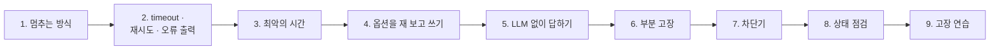
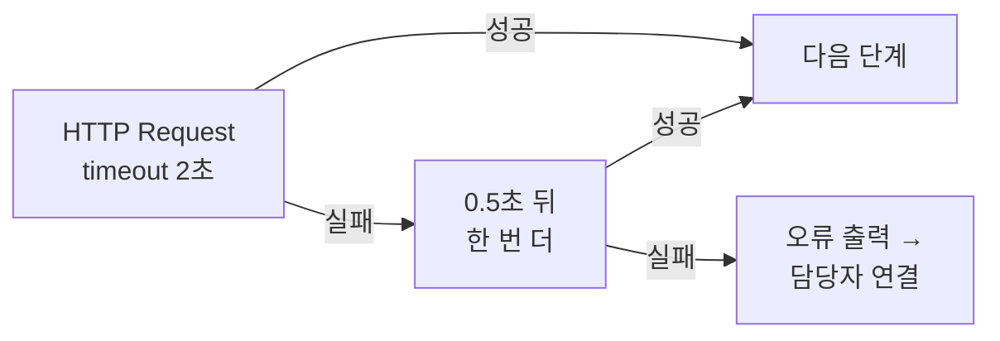
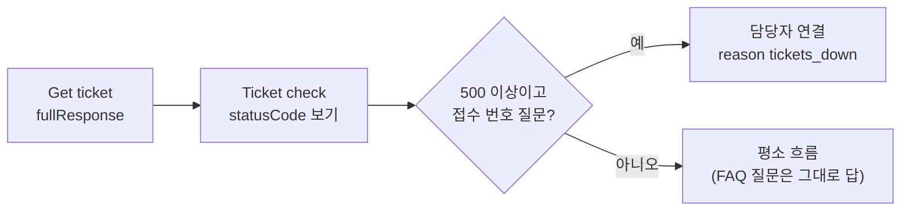
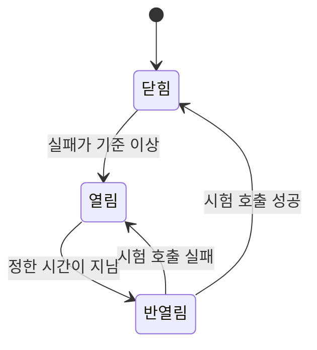
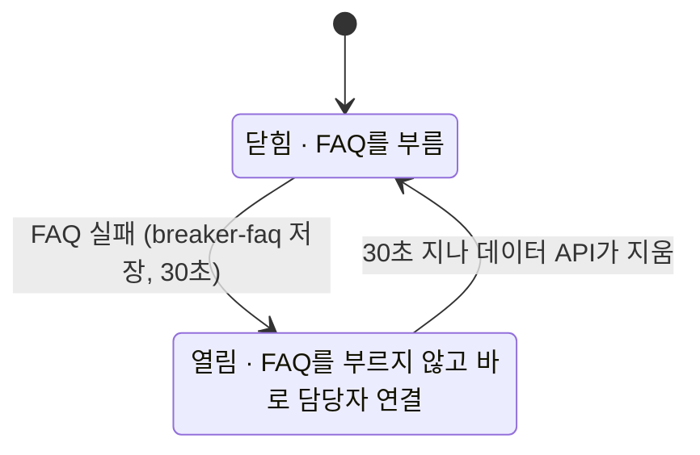
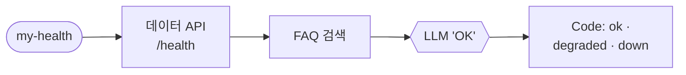

# 3단계 · 운영 관점의 안정성

- 교시: 5교시 강의 (14:00~14:50) · 6교시 [Lab 03](../../Last3Mon/72/LAB-03-Q-STABILITY.md) 실습 5개 (15:00~15:50)
- 이 단계가 끝나면: 데이터 API나 LLM이 느려지거나 멈췄을 때 정해진 시간 안에 정해진 답을 하도록 timeout · 재시도 · 대체 경로를 넣고, 일부만 멈춘 고장(부분 고장)을 그 부분만 넘기고, 차단기로 멈춘 곳을 잠깐 부르지 않고, 무엇이 멈췄는지 알려 주는 상태 점검을 만들 수 있다.
- 숫자: 강사 노트북 실측 (10/18 수업 준비, 10/23~24 다시 잼). 고장은 72일차 데이터 API의 고장 스위치(`flow.py fault`)와 `flow.py llm down`으로 일부러 냈습니다.
- 실습 가리키기: "Lab 03 예제 1"은 6교시 [Lab 03 문서](../../Last3Mon/72/LAB-03-Q-STABILITY.md)의 그 절, "Lab 02 …"는 4교시 실습입니다. 파일 경로는 실습 폴더 `~/aio-01d4-stu/Last3Mon/72` 기준이고, `PERF.md`는 Lab 01을 시작할 때 만든 내 보고서 `my-work/PERF.md`입니다.

## 0. 이 시간 (50분)

| 시간 | 절 · 개요 | 하는 일 |
| --- | --- | --- |
| 14:00~14:07 | 1 · 개요 22장 | 멈추는 모양 넷, 연쇄 장애, 고치기 전에 겪은 일 |
| 14:07~14:17 | 2 · 3 · 개요 23장 | timeout · 재시도 · backoff · 멱등성 · 오류 출력, 최악의 시간 |
| 14:17~14:21 | 4 · 개요 24장 | 옵션 직접 확인, `neverError` · `fullResponse` 실측 |
| 14:21~14:29 | 5 · 6 · 개요 25~26장 | 대안(fallback), LLM 없이 답하기, 우아한 저하 · 격벽, 접수 API만 멈췄을 때 |
| 14:29~14:40 | 7 · 8 · 개요 27~28장 | 차단기 3상태와 실측, 상태 점검 |
| 14:40~14:45 | 9 | 카오스 엔지니어링, 고장 연습 명령 · 규칙 |
| 14:45~14:50 | 확인 질문 | 질문 |

### 6교시 Lab 03에서 이어서 하는 것

바탕은 Lab 02까지 고친 `my-work/helpdesk.json`입니다 (없으면 `cp reference/lab02-example2-cache.json my-work/helpdesk.json` 후 push). 실습마다 **고치기 전에 고장을 먼저 겪고** 고칩니다.

| 6교시 실습 (시각) | 이 강의의 절 | 실습에서 하는 일 | 쓰는 파일 · 명령 |
| --- | --- | --- | --- |
| Lab 03 예제 1 (15:00~15:10) | 1 · 2 · 3 · 4 | FAQ 느림 · 오류를 겪고 timeout · 재시도 · 오류 출력 → `Data down` | `fault faq slow` · `error`, 테스트 `cases/lab03.json` → `PERF.md` 4절 |
| Lab 03 예제 2 (15:10~15:20) | 5 | LLM이 멈추면 데이터로 `간단 답변` | `llm down` · `up`, 테스트 `cases/lab03-llm-down.json` |
| Lab 03 예제 3 (15:20~15:30) | 4 · 6 | 접수 API만 멈출 때 그 부분만 넘기기 (`fullResponse` · `Ticket check`) | `fault tickets error`, 테스트 `cases/lab03-ticket.json` → `PERF.md` 4절 |
| Lab 03 과제 1 (15:30~15:40) | 8 | 상태 점검 워크플로우 `my-health` | 새 파일 `my-work/health.json`, 테스트 `cases/lab03-challenge.json` → `PERF.md` 5절 |
| Lab 03 과제 2 (15:40~15:50) | 7 · 9 | 차단기 `breaker-faq` (30초) | 테스트 `cases/lab03-challenge2.json` → `PERF.md` 4~6절, `my-work/TEST-REPORT.md` |

## 1. 멈추는 방식

### 일반 설명

외부 서비스(데이터베이스, API, LLM)는 반드시 언젠가 멈춥니다. 멈추는 모양은 크게 넷입니다.

| 모양 | 뜻 | 예 |
| --- | --- | --- |
| 오류 (fail-fast) | 바로 실패를 알려 줌 | HTTP 500, 연결 거부 |
| **느림** (fail-slow) | 답은 오는데 아주 늦게, 또는 끝없이 | 과부하, 잠금 대기 |
| 일부만 | 기능 하나만 멈춤 | 접수 API만 고장 |
| 계속 | 한동안 멈춘 상태가 이어짐 | 장애 30분 |

- **느림이 오류보다 위험한** 경우가 많습니다. 기다리는 동안 일꾼(스레드 · 실행)이 붙잡혀 다른 요청도 밀리고, 결국 멀쩡한 기능까지 느려집니다. 이것이 번지는 것을 **연쇄 장애(cascading failure)** 라고 합니다.
- 그래서 안정성 설계의 첫 원칙은 **빨리 실패하기(fail fast)**: 오래 기다리지 말고, 정해진 시간 안에 정해진 답을 합니다.

### 오늘 실습에서

일부러 고장을 내 본 결과 (고치기 전, 4교시 Lab 02 예제 2 정답 `reference/lab02-example2-cache.json`). Lab 03의 각 실습 첫머리에서 각자 같은 고장을 먼저 겪습니다:

| 고장 | 사용자가 겪은 것 | 날 |
| --- | --- | --- |
| FAQ가 느림 (8초 뒤 답) | **9.0초** · **13.2초** · **11.5초** 기다린 뒤 평소 답 (기다리는 한도가 없음) | 10/18 · 10/23 · 10/24 |
| FAQ가 오류 (500) | 0.1~0.2초 만에 **HTTP 500** `Error in workflow` | 10/18 · 10/23 |
| LLM 키가 틀림 | 1.3초 만에 **HTTP 500** | 10/23 |
| 접수 API만 오류 (500) | 접수 질문도, **FAQ 질문도** `담당자 연결` (Lab 03 예제 2까지 고친 워크플로우, 6절) | 10/24 |

| 멈추는 방식 | 무엇이 나쁜가 |
| --- | --- |
| 느림 | 사용자는 기다리고, 그동안 n8n도 일을 붙잡고 있음. 오류보다 나쁠 수 있음 |
| 오류 (500) | 사용자에게 아무것도 알려 주지 않음 |
| 일부만 멈춤 | 멀쩡한 기능까지 같이 멈추면 고장이 커 보임 |
| 계속 멈춤 | 사람마다 같은 시간을 기다리고, 멈춘 서비스에 요청이 계속 감 |

오늘 3단계는 이 넷을 차례로 다룹니다: timeout(느림) → 오류 출력과 정해진 답(오류) → 부분 고장 → 차단기(계속 멈춤).

## 2. timeout · 재시도 · 오류 출력 (6교시 Lab 03 예제 1)

### 일반 설명

밖을 부르는 모든 곳에 세 가지를 정합니다.

- **timeout**: 얼마나 기다릴지. 없으면 끝없이 기다릴 수 있습니다. 보통 그 서비스의 평소 p99보다 조금 길게 잡습니다.
- **재시도(retry)**: 잠깐 끊긴(일시적) 고장에만 효과가 있습니다. 계속 고장 난 곳에 재시도하면 기다림만 늘고, 힘든 서비스에 요청을 더 보내 회복을 늦춥니다(재시도 폭풍).
  - 재시도 사이 기다림은 **지수적으로 늘리고**(0.5초 → 1초 → 2초, exponential backoff) **조금씩 무작위로 흩어**(jitter) 모두가 같은 순간에 다시 부르지 않게 합니다.
  - **같은 요청을 두 번 보내도 결과가 같은가(멱등성, idempotency)** 를 먼저 봅니다. 조회(GET)는 괜찮지만 "주문 만들기"(POST)를 재시도하면 주문이 두 번 생길 수 있습니다. 이럴 때는 요청마다 고유 키(idempotency key)를 붙여 서버가 중복을 알아보게 합니다.
- **실패했을 때 갈 곳**: 오류를 그대로 사용자에게 던지지 않고, 정해진 답 · 담당자 연결 · 간단한 답으로 보냅니다. 그리고 왜 그 길로 갔는지(`reason`)를 남겨 나중에 셀 수 있게 합니다.

### 오늘 실습에서

| 설정 | n8n | 오늘 | 어디에 쓰나 |
| --- | --- | --- | --- |
| 기다리는 한도 | `options.timeout` (ms) | 2000 | `parameters.options` 안 |
| 다시 해 보기 | `retryOnFail` · `maxTries` · `waitBetweenTries` | 2번, 0.5초 | 노드 바로 아래 (`parameters` 밖) |
| 실패해도 멈추지 않기 | `onError: continueErrorOutput` | 오류 출력 → `Data down` | 노드 바로 아래, 연결은 `main`의 1번 칸 |

- timeout이 없으면 n8n은 **끝없이** 기다립니다. 외부를 부르는 노드에는 모두 timeout을 둡니다.
- 정해진 답에는 `reason`(`data_api_down`)을 둡니다. 운영자가 나중에 "오늘 데이터 고장으로 넘긴 것이 몇 건"인지 셀 수 있게.
- 캐시를 FAQ 조회 **앞에** 둔 덕에, FAQ가 멈춰도 캐시에 있는 질문은 0.1초에 답했습니다 (10/23 Lab 03 예제 1 테스트 `cases/lab03.json` 4/4).

## 3. 최악의 시간 계산

### 일반 설명

재시도까지 넣었으면 **최악의 시간**을 미리 계산합니다.

> 최악 ≈ 시도 횟수 × timeout + (시도 횟수 − 1) × 재시도 사이 기다림

- 이 값이 사용자 쪽 시간 예산(1단계 9절)보다 길면 설정이 틀린 것입니다.
- 여러 층이 겹치면 **바깥 timeout이 안쪽보다 길어야** 합니다. 안쪽이 아직 재시도 중인데 바깥이 먼저 포기하면, 안쪽 일은 헛수고가 되고 결과도 버려집니다.
- 큰 시스템은 요청에 "남은 시간"(deadline)을 실어 보내, 안쪽 단계가 남은 시간보다 오래 기다리지 않게 합니다.

### 오늘 실습에서

| 설정 | 계산 | 최악 |
| --- | --- | --- |
| timeout 2초, 2번, 기다림 0.5초 | 2 + 0.5 + 2 | **4.5초** |
| timeout 2초, 3번, 기다림 0.5초 | 2 + 0.5 + 2 + 0.5 + 2 | 7.0초 |
| timeout 5초, 2번, 기다림 1초 | 5 + 1 + 5 | 11초 |

- 실측: FAQ 느림에서 **4.6~4.7초** 뒤 `담당자 연결` (10/18 4.6초, 10/23 4.7초). 계산 4.5초 + 다른 단계.
- Lab 03 예제 1 테스트 `cases/lab03.json`의 FAQ 느림 케이스는 7초 안을 기대합니다. retry를 3번으로 늘리면 7.0초라 아슬아슬합니다.
- **재시도는 공짜가 아닙니다.** 느린 서비스에 재시도를 늘리면 기다림도 늘고, 이미 힘든 서비스에 요청을 더 보냅니다. 재시도는 "잠깐 끊긴" 고장에 쓰는 것이지 "계속 느린" 고장에 쓰는 것이 아닙니다 (그것은 7절 차단기).

## 4. 옵션은 재 보고 쓴다: `neverError` · `fullResponse`

### 일반 설명

라이브러리 · 도구의 옵션은 **이름이 주는 느낌과 실제 동작이 다를** 수 있고, 판(version)마다 바뀌기도 합니다. 안정성에 쓰는 옵션은 특히 그렇습니다. 고장이 났을 때만 동작하므로 평소에는 틀린 줄 모릅니다.

- 문서를 읽고, **작은 시험으로 직접 확인**합니다: 일부러 404 · 500 · 느림을 만들어 어디로 가는지, 몇 초 걸리는지.
- 확인한 판번호와 결과를 적어 둡니다. 판을 올리면 다시 확인합니다.

### 오늘 실습에서

캐시 조회는 "없음"을 404로 받습니다. 404에서 워크플로우가 멈추지 않게 `neverError`를 켰습니다. 그런데 이 옵션은 정확히 무엇을 하나요? 문서를 읽는 것만으로는 헷갈려서 **작은 시험 워크플로우로 재 봤습니다** (10/24, `retryOnFail` 3번 · 기다림 1초, 접수 API. 강사가 따로 잰 것으로 실습에는 없습니다. 이 결과를 Lab 03 예제 3에서 씁니다).

| 설정 | 404 (없는 번호) | 500 (접수 API 고장) |
| --- | --- | --- |
| 없음 | 재시도 뒤 **오류 출력** (2.1초) | 재시도 뒤 오류 출력 (2.1초) |
| `neverError` | 재시도 뒤 **보통 출력** (2.2초) | 재시도 뒤 **오류 출력** (2.2초) |
| `neverError` + `fullResponse` | 바로 보통 출력, `statusCode: 404` (0.1초) | 바로 보통 출력, `statusCode: 500` (0.1초) |

배운 것:

- 이 n8n(2.42.6)에서 `neverError`는 4xx만 보통 결과로 받고, **500은 여전히 실패**입니다. 수업 준비 때(10/18) 교안에는 "500도 성공으로 본다"고 적었는데, 재 보니 틀렸습니다. **옵션은 이름이나 기억으로 짐작하지 않고 잽니다.**
- `neverError`라도 `retryOnFail`이 켜져 있으면 **404도 재시도를 다 하고** 보통 결과로 받습니다. 시간을 버립니다.
- `fullResponse`를 함께 켜면 상태 코드를 받아 **워크플로우가 직접** 나눌 수 있습니다. 대신 결과 모양이 `{statusCode, body}`로 바뀌어 뒤에서 읽는 곳도 바꿔야 합니다.

## 5. LLM 없이 답하기 (6교시 Lab 03 예제 2)

### 일반 설명

핵심 서비스가 멈췄을 때 쓸 **대안(fallback)** 을 미리 정합니다. 흔한 순서는 이렇습니다.

| 순서 | 대안 | 대가 |
| --- | --- | --- |
| 1 | 다른 모델 · 다른 회사 LLM | 키 · 비용 · 품질을 하나 더 관리 |
| 2 | 저장해 둔 답 (캐시) | 있는 질문만 |
| 3 | 데이터 원문 그대로 · 정해진 답 | 덜 친절함 |
| 4 | 사람에게 넘기기 | 사람 시간 |

- 대안으로 답할 때는 **평소와 같은 척하지 않습니다.** "지금은 간단히 안내합니다"를 알리고, 결과에도 구분(`route`)을 남깁니다.
- 대안도 테스트합니다. 쓰지 않던 대안은 막상 필요할 때 고장 나 있기 쉽습니다.

### 오늘 실습에서

LLM이 실패하는 시점에는 데이터(FAQ · 접수 건)를 이미 조회했습니다.

| 질문 | LLM이 멈췄을 때 | `route` | 10/23 |
| --- | --- | --- | --- |
| FAQ가 있음 | FAQ 원문 + "자동 답변 기능을 잠시 쓸 수 없어 FAQ 원문으로 안내합니다." | `간단 답변` | 3.6초 (분류 LLM이 실패할 때까지) |
| 접수 번호 | "T-1002 접수 건은 현재 '처리 중' 상태입니다. …" | `간단 답변` | 0.4초 |
| 그 밖 | 담당자에게 | `담당자 연결` | 1.2초 |

- `route`를 다르게 두면 운영자가 "오늘 간단 답변이 몇 건이었나"를 셀 수 있습니다 (77일차 로그 분석).
- 다른 모델 · 다른 회사의 LLM으로 바꾸는 방법도 있지만, 키 · 비용 · 품질을 또 관리해야 합니다. **데이터로 답할 수 있는 것은 데이터로.**
- Lab 03 예제 2 테스트 `cases/lab03-llm-down.json`: 고치기 전 1/4 (빈 질문만), 고친 뒤 4/4.
- 사용자에게 **평소 답과 같은 척하지 않습니다.** "잠시 쓸 수 없다"를 알립니다.

## 6. 부분 고장: 멈춘 부분만 넘기기 (6교시 Lab 03 예제 3)

### 일반 설명

**우아한 저하(graceful degradation)** 는 일부가 고장 나도 전체를 멈추지 않고, 고장 난 기능만 줄여서 계속 서비스하는 것입니다. 쇼핑몰의 추천 기능이 멈춰도 검색 · 결제는 되게 하는 것이 예입니다.

- 이것을 위한 설계를 **격벽(bulkhead)** 이라고 부릅니다. 배의 칸막이처럼, 한 칸에 물이 들어도 다른 칸은 멀쩡하게 의존 서비스마다 실패를 따로 다룹니다.
- 흔한 실수는 모든 실패를 **한 군데로** 모으는 것입니다. 그러면 어느 부분이 멈췄든 모든 요청이 같은 실패 길로 갑니다.
- 실패를 "어느 서비스의, 어떤 실패인지"(상태 코드, timeout)로 구분해 받고, 그 서비스가 필요한 요청만 대안으로 보냅니다.

### 오늘 실습에서

접수 API만 멈추면 어떻게 될까요? Lab 03 예제 2까지 만든 워크플로우로 겪어 봤습니다 (10/24). Lab 03 예제 3 첫머리에서 각자 `fault tickets error`로 같은 것을 겪습니다.

| 질문 | Lab 03 예제 2까지 | Lab 03 예제 3 정답 |
| --- | --- | --- |
| 접수 번호 (T-1002) | `담당자 연결`, `reason: data_api_down` (0.6초) | `담당자 연결`, `reason: tickets_down` (0.1초) |
| **FAQ (VPN)** | `담당자 연결` (0.6초) — FAQ는 멀쩡한데 | **`자동 답변`**, 답에 "인증서" (1.1초) |
| 없는 번호 (T-9999, 평소) | `자동 답변` | `자동 답변` (404는 고장이 아님) |

(Lab 03 예제 3 테스트 `cases/lab03-ticket.json`: 예제 2까지의 워크플로우 2/4 → 예제 3 정답 4/4)

- 왜 FAQ 질문까지 넘어갔나: 모든 질문이 접수 조회를 지나가고, 오류 출력은 "어느 질문인지"를 모르고 한 길로 보냅니다.
- 고치는 법: 실패를 **보통 결과로 받아**(`fullResponse`) 상태 코드와 질문을 함께 보고 나눕니다.
- 원칙: **고장 난 부분만 줄이고, 나머지는 평소대로.** 이것을 "우아한 저하(graceful degradation)"라고 부릅니다.
- 덤: Lab 03 예제 1에서 `Get ticket`에 재시도를 켠 뒤로, 접수 번호가 없는 질문(`/tickets/NONE` → 404)도 0.5초 기다렸다가 한 번 더 부르고 있었습니다 (4절 표: `neverError`에서도 404를 재시도). `fullResponse`로 바꾸면 404는 바로 옵니다.

  | 10/24 VPN 질문의 `data_ms` | 값 |
  | --- | --- |
  | Lab 02 예제 2 (재시도 없음) | 32~76ms |
  | Lab 03 예제 1 정답 (재시도 켬) | **605ms** |
  | Lab 03 예제 3 정답 (`fullResponse`) | 38ms |

  안정성을 위해 넣은 설정이 **평소 요청을 0.5초 느리게** 만들고 있었습니다. 고친 뒤에는 평소 시간도 다시 잽니다.

## 7. 차단기: 멈춘 곳은 잠깐 부르지 않기 (6교시 Lab 03 과제 2)

### 일반 설명

**차단기(circuit breaker)** 는 전기 차단기에서 온 이름입니다. 계속 실패하는 서비스를 잠시 **부르지 않아서** 사용자의 기다림을 없애고, 힘든 서비스가 회복할 틈을 줍니다 (마이클 나이가드 『Release It!』에서 널리 알려짐).

| 상태 | 하는 일 |
| --- | --- |
| 닫힘 (closed) | 평소처럼 부르고 실패를 셈 |
| 열림 (open) | 부르지 않고 바로 대안 |
| 반열림 (half-open) | 몇 번만 시험 삼아 불러 보고 결과로 닫거나 다시 엶 |

- 정할 것: 몇 번(또는 몇 %) 실패하면 열지, 얼마나 열어 둘지, 반열림에서 몇 번 시험할지.
- 차단기 상태는 요청들이 **함께 보는 곳**에 둡니다 (같은 프로그램의 메모리, 여러 서버라면 Redis 같은 저장소).
- 자바의 resilience4j, 서비스 메시 Envoy · Istio의 outlier detection 같은 도구가 이 일을 합니다.

### 오늘 실습에서

Lab 03 예제 1 뒤에도 FAQ가 계속 느리면, **사람마다** 4.6초씩 기다린 뒤 담당자로 넘어갑니다. 멈춘 것을 이미 알았는데도요.

| 차단기 | 오늘 |
| --- | --- |
| 기억하는 곳 | 데이터 API 캐시 `breaker-faq` (워크플로우는 요청마다 새로 시작하므로, 기억은 바깥에) |
| 여는 때 | FAQ 검색의 오류 출력 (timeout · 500) |
| 열려 있으면 | FAQ를 부르지 않고 바로 `담당자 연결`, `reason: breaker_open` |
| 닫히는 때 | ttl 30초. 그 뒤 첫 질문이 다시 FAQ를 불러 보고, 아직 멈춰 있으면 또 엶 |

10/24 Lab 03 과제 2 정답으로 과제 2 테스트 `cases/lab03-challenge2.json` (FAQ 느림 8초):

| 차례 | 질문 | 결과 | 시간 |
| --- | --- | --- | --- |
| 1 | 평소 VPN | `자동 답변` | 2.7초 (push 직후) |
| 2 | FAQ 느림 · 처음 | `담당자 연결`, `reason: data_api_down` | 4.8초 |
| 3 | FAQ 느림 · 다음 질문 | `담당자 연결`, `reason: breaker_open` | **0.1초** |
| 4 | FAQ가 돌아오고 캐시를 비운 뒤 | `자동 답변` | 1.1초 |

(Lab 03 예제 3 정답으로는 3번이 4.6초 · `data_api_down`이라 3/4)

- 차단기는 사용자를 기다리게 하지 않는 것과 함께, **멈춘 서비스에 요청을 더 보내지 않는** 일도 합니다. 되살아나는 중인 서비스에 요청이 몰리면 다시 넘어집니다.
- 30초는 정한 값입니다. 짧으면 자주 다시 불러 보고(기다리는 사람이 늘고), 길면 되살아난 뒤에도 한동안 담당자로 넘깁니다.
- 질문 캐시에 있는 질문은 차단기를 보기 **전에** 답하므로, 차단기가 열려 있어도 답합니다.

## 8. 상태 점검 (6교시 Lab 03 과제 1: `my-work/health.json`, 웹훅 `my-health`)

### 일반 설명

상태 점검(health check)은 "지금 이 서비스를 믿고 일을 맡겨도 되나"를 묻는 작은 요청입니다. 쿠버네티스는 이것을 세 가지로 나눕니다.

| 점검 | 묻는 것 | 실패하면 |
| --- | --- | --- |
| liveness | 프로그램이 살아 있나 | 다시 시작 |
| readiness | 지금 요청을 받을 준비가 됐나 (의존 서비스 포함) | 요청을 보내지 않음 |
| startup | 처음 켜지는 중인가 | 다른 점검을 잠시 미룸 |

- 얕은 점검(살아만 있나)은 싸지만 "살아 있는데 일은 못 하는" 상태를 놓칩니다. 깊은 점검(실제 일과 같은 길)은 정확하지만 비싸므로 짧은 timeout과 적당한 간격으로.
- 점검 결과는 사람과 기계가 함께 읽습니다: 알림 시스템, 부하 분산기, 대시보드. 그래서 **코드가 정한 모양**(`ok` · `degraded` · `down`)으로 돌려줍니다.
- 밖에서 주기적으로 실제 요청을 흉내 내 보내는 것을 합성 점검(synthetic monitoring)이라고 합니다.

### 오늘 실습에서

| 원칙 | 이유 | 10/23 |
| --- | --- | --- |
| 점검마다 짧은 timeout | 점검이 8초를 기다리면 점검이 아님 | FAQ 느림에서도 점검 3.1초 |
| 하나가 실패해도 다음 점검 | 무엇이 멀쩡한지까지 알아야 함 (`continueRegularOutput`) | FAQ 오류 → `degraded` 1.0초 |
| 상태는 코드가 | LLM이 멈췄을 수도 있음 | LLM 멈춤 → `degraded` 0.9초 |
| 실제 일과 같은 길로 | `/health`만 보면 FAQ 고장을 모름 | `/health`는 고장 스위치와 상관없이 ok |

| `status` | 기준 (Lab 03 과제 1 정답) |
| --- | --- |
| `ok` | 셋 모두 참 |
| `degraded` | 데이터 API나 LLM 중 하나라도 참 (일부는 됨) |
| `down` | 둘 다 거짓 |

- 운영에서는 Schedule Trigger로 5분마다 점검하고 `degraded`면 알립니다 (76일차 에러 처리).
- 점검 결과와 차단기는 함께 씁니다: 점검이 FAQ를 `false`로 보면 차단기를 미리 열어 둘 수도 있습니다 (오늘은 하지 않음).

## 9. 고장 연습

### 일반 설명

**카오스 엔지니어링(chaos engineering)** 은 일부러 고장을 내서 시스템이 예상대로 버티는지 확인하는 방법입니다. 넷플릭스의 Chaos Monkey(운영 서버를 무작위로 끔)가 유명하고, 클라우드에는 AWS Fault Injection Service 같은 도구도 있습니다. 팀이 날을 잡아 함께 하는 연습을 게임 데이(game day)라고 부릅니다.

- 순서: **가설**("FAQ가 멈춰도 5초 안에 담당자 연결") → 작은 범위로 고장 내기 → 관찰 · 기록 → 되돌리기 → 고치기.
- 고장의 범위(blast radius)를 작게 시작하고, **언제든 멈출 수 있는 스위치**를 먼저 준비합니다.
- 연습이 끝나면 반드시 원래대로 돌리고 확인합니다. 되돌리지 않은 연습 고장이 진짜 장애가 됩니다.

### 오늘 실습에서

| 명령 | 하는 일 |
| --- | --- |
| `flow.py fault faq slow` · `error` · `fault tickets error` · `fault all ok` | 데이터 API 고장 스위치 |
| `flow.py llm down` · `llm up` | OpenAI Credential을 틀린 키로 · 되돌리기 (재시작 없이 바로) |
| `curl -s -XPOST localhost:8800/cache-clear` | 캐시 · 차단기 비우기 |

- Lab 03 테스트 파일(`cases/lab03*.json`)은 `before`로 고장을 켜고 `after`로 **반드시** 끕니다 (실패해도). 손으로 고장을 켰다면 실습이 끝날 때 `fault all ok` · `llm up`.
- 운영에서 처음 겪는 고장은 비쌉니다. 일부러, 미리, 정해진 시간에 연습합니다.
- 연습 순서: **고치기 전에 먼저 겪는다** → 고친다 → 같은 고장으로 다시 겪는다 → 평소 테스트도 다시.
- 끝나면 `doctor` → `ready` (고장 스위치 · OpenAI 키가 평소대로).

## 확인 질문

1. timeout 3초, 재시도 3번, 기다림 1초면 최악은 몇 초인가요? Lab 03 예제 1 테스트 `cases/lab03.json`의 7초 안 기대를 지키나요?

3 + 1 + 3 + 1 + 3 = 11초. 지키지 못합니다. 느린 고장에 재시도를 늘리면 기다림이 늘어납니다. 계속 느리면 차단기(7절)를 씁니다.

2. 접수 API만 멈췄는데 VPN 질문도 담당자로 갔습니다. 왜, 그리고 어떻게 고치나요?

모든 질문이 접수 조회를 지나가고, `Get ticket`의 오류 출력이 질문을 가리지 않고 `Data down`으로 보냈기 때문입니다. `fullResponse`로 상태 코드를 보통 결과로 받아, "500이고 접수 번호 질문"일 때만 담당자로 보냅니다.

3. 차단기를 n8n 워크플로우 안의 변수로 기억하면 안 되나요?

웹훅 워크플로우는 요청마다 새로 시작해 앞 요청의 값을 갖고 있지 않습니다. 그래서 바깥(오늘은 데이터 API 캐시, 운영에서는 Redis 같은 저장소)에 둡니다. 저장할 때 ttl을 주면 닫는 일도 저절로 됩니다.

## 정리

- [ ] 느림 · 오류 · LLM 멈춤 · 일부만 멈춤을 일부러 겪어 본다
- [ ] timeout · 재시도 · 오류 출력으로 정해진 시간 안에 정해진 답, 최악의 시간을 계산한다
- [ ] 옵션은 짐작하지 않고 재 본다 (`neverError`는 500을 막지 않는다)
- [ ] 데이터로 답할 수 있으면 LLM 없이, 멈춘 부분만 넘기고, `route` · `reason`으로 구분
- [ ] 계속 멈추면 차단기로 잠깐 부르지 않는다
- [ ] 상태 점검은 짧게, 끝까지, 코드로

> 다음: 8교시 [4단계 정리](04-STAGE4-WRAPUP.md) — 1~3단계 전체의 의미 · 효과 · 회사에서 쓰는 법.
