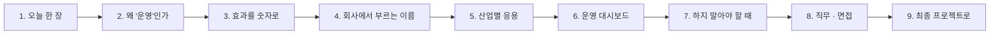

# 4단계 · 정리: 오늘 한 일의 의미 · 효과 · 실전 응용

- 교시: 8교시 17:10~17:45 (35분, 바이브 코딩 발표 10분 뒤) · 자료: 이 문서 + [개요](00-DAY72-OVERVIEW.md) 30장
- 이 시간이 끝나면: 오늘 1~3단계에서 한 일이 **무엇을 위한 것이었는지**, 숫자로 **얼마나 효과가 있었는지**, 회사에서는 같은 생각을 **어떤 이름과 도구로** 쓰는지 말할 수 있고, 최종 프로젝트에 무엇을 가져갈지 정할 수 있다.
- 숫자: 오늘 교안의 실측(강사 노트북, 10/18 · 10/23~24)입니다. "예시"라고 적은 계산은 가정을 둔 어림입니다.

## 0. 이 시간 (35분)

| 시간 | 절 | 하는 일 |
| --- | --- | --- |
| 17:10~17:15 | 1 · 2 | 오늘 한 장, 만들기와 운영하기 |
| 17:15~17:20 | 3 | 오늘 숫자로 본 효과, 하루 1,000건이면 (예시) |
| 17:20~17:28 | 4 · 5 | 같은 생각의 업계 이름 · 도구, 산업별 응용 예 |
| 17:28~17:33 | 6 · 7 | 운영 지표 여섯 개, 하지 말아야 할 때 |
| 17:33~17:40 | 8 · 9 | 직무와 면접 질문, 최종 프로젝트 체크리스트 |
| 17:40~17:45 | 10 · 토론 | 다음 일차와의 연결, 질문 둘 |

## 1. 오늘 한 장

| 단계 | 한 일 | 오늘 숫자 |
| --- | --- | --- |
| 1단계 · 재기 | p50 · p95 · 첫 호출, 단계별 `timings`, 종류별 재기, 시간 예산 | 기준 VPN p50 2.69초 · 첫 호출 4.4초, **LLM이 시간의 98%** |
| 2단계 · 빠르게 | 규칙 먼저, 질문 캐시, 적중률, FAQ 번호 캐시, 검토를 검사로 | 캐시 없이 VPN p50 2.22 → **1.12초**, 캐시 적중 **0.05초**, 다른 말 질문 1.2 → **0.1초** |
| 3단계 · 멈춰도 답하게 | timeout · 재시도 · 오류 출력, LLM 없이 답, 부분 고장, 차단기, 상태 점검 | FAQ 느림 11.5초 → **4.6초** 담당자 연결 → 다음 사람 **0.1초**(차단기), LLM 멈춤 HTTP 500 → `간단 답변` |
| 바이브 코딩 | 재는 도구 `tbench` (TODO → SPEC → IMP-PLAN → 설치) | 요구 14개 |

한 문장으로: **재고 나서 고치고, 고친 만큼 다시 재고, 멈출 때를 미리 정해 둔다.**

## 2. 왜 "운영"인가: 만들기와 운영하기

64~71일차는 **동작하는 워크플로우를 만드는 일**이었습니다. 오늘은 그것을 **날마다 쓰는 사람들 앞에 계속 두는 일**입니다.

| | 만들기 (64~71일차) | 운영하기 (오늘 · 72일차부터) |
| --- | --- | --- |
| 질문 | "답이 맞나?" | "얼마나 빨리, 얼마나 자주 맞나? 멈추면?" |
| 기준 | 테스트 케이스 통과 | 시간 예산 · 실패율 · 비용 · 복구 시간 |
| 실패 | 고치면 끝 | 언젠가 반드시 옴 → **어떻게 실패할지**를 정함 |
| 보는 사람 | 만든 사람 | 쓰는 사람, 운영자, 비용을 내는 사람 |

- 회사에서 AI 서비스가 "시범(PoC)은 좋았는데 실제로 못 쓰는" 까닭은 대개 정확도보다 **느림 · 비용 · 장애 · 설명할 수 없음**입니다. 오늘 한 일은 이 넷을 다룹니다.
- LLM은 같은 질문에도 매번 다른 시간 · 다른 문장으로 답합니다 (오늘 검토 LLM이 "처리 중"을 바꿔 쓴 일). 그래서 일반 서비스보다 **재기 · 기록 · 대체 경로**가 더 중요합니다.

## 3. 효과를 숫자로

### 3.1 오늘 실측 전 · 후

| 무엇 | 전 | 후 | 바꾼 것 |
| --- | --- | --- | --- |
| VPN 질문 p50 (캐시 없이) | 2.69초 (LLM 3번, 기준) | 1.12초 (LLM 1번) | 규칙 먼저 + 검토를 검사로 |
| 같은 질문 다시 | 2.07초 | 0.05초 | 질문 캐시 |
| 다른 말로 같은 FAQ | 1.2초 | 0.1초 | FAQ 번호 캐시 |
| FAQ가 8초 느릴 때 | 11.5초 기다린 뒤 평소 답 | 4.6초 → 담당자 연결 | timeout 2초 · 재시도 1번 |
| FAQ가 계속 느릴 때, 다음 사람 | 4.6초 | 0.1초 | 차단기 30초 |
| 접수 API만 멈췄을 때 VPN 질문 | 담당자 연결 | 평소 답 | 부분 고장 처리 |
| LLM 키가 틀렸을 때 | HTTP 500 | FAQ 원문 · 상태 그대로 (`간단 답변`) | 데이터로 대체 |

### 3.2 하루 1,000건이면 (예시)

가정: 하루 질문 1,000건, 그중 규칙으로 분류되는 FAQ · 접수 질문 80%, 나머지 20%.

| 단계 | 질문당 LLM 호출 | 하루 LLM 호출 |
| --- | --- | --- |
| 기준 (분류 · 답 · 검토) | 3 | 3,000 |
| 규칙 먼저 + 검토를 검사로 | 규칙 1 · 나머지 2 | 0.8 × 1,000 × 1 + 0.2 × 1,000 × 2 = **1,200** |
| + 캐시 (FAQ 질문의 30%가 캐시에서 온다고 하면) | 캐시 0 | 1,200 − (FAQ 질문 수 × 0.3)만큼 더 줄어듦 |

- LLM 호출 수는 **비용과 거의 비례**합니다 (75일차에 토큰과 가격으로 다시 계산).
- 기다리는 시간: 사용자 1,000명이 질문마다 1.5초씩 덜 기다리면 하루 **약 25분**(1,500초)입니다. 사내 도구에서 "빨라졌다"는 사람들의 일하는 시간입니다.
- 이 어림은 **가정**에 달려 있습니다. 실제 비율은 운영 기록(77일차 로그)에서 세어 다시 계산합니다.

## 4. 회사에서는 같은 생각을 이렇게 부른다

오늘 한 일에는 업계에서 쓰는 이름이 있습니다. 이름을 알면 문서 · 도구 · 채용 공고를 읽을 수 있습니다.

| 오늘 한 일 | 업계에서 부르는 이름 | 자주 보는 도구 · 자료 |
| --- | --- | --- |
| p50 · p95 · max | 지연 시간 백분위 (latency percentiles), 꼬리 지연 (tail latency) | Prometheus 히스토그램, Grafana |
| 시간 예산 · `over_budget` | SLI · **SLO** (목표 수준) · 에러 예산 (error budget) | Google SRE 책의 SLO 장 |
| 단계별 `timings` · `steps` | 분산 추적 (tracing), 스팬 (span) | OpenTelemetry, Datadog · New Relic 같은 APM |
| LLM 호출마다 시간 · 입출력 기록 | LLM 관측 (LLM observability) | LangSmith, Langfuse, Arize Phoenix |
| `bench` · `tbench` | 부하 · 성능 시험 (load testing), 성능 기준 검사 (CI performance gate) | k6, Locust, JMeter |
| 규칙 먼저, 모를 때만 LLM | 라우팅 · 캐스케이드 (싼 방법부터) | 연구 예: FrugalGPT (LLM 캐스케이드) |
| 질문 캐시 · FAQ 번호 캐시 | 응답 캐시, 의미 캐시 (semantic cache) | Redis, GPTCache. 모델 쪽에는 프롬프트 캐싱 (OpenAI · Anthropic 등) |
| 검토 LLM을 검사 코드로 | 가드레일, 출력 검증 (validator) | Guardrails AI, NVIDIA NeMo Guardrails (73일차) |
| timeout · 재시도 | 복원력 패턴: 시간 제한, 지수 백오프 + 지터 재시도 | 각 언어의 재시도 라이브러리, AWS 아키텍처 글 |
| 오류 출력 → 정해진 답, LLM 없이 답 | 대체 경로 (fallback), 우아한 저하 (graceful degradation) | |
| 접수 API만 넘기기 | 격벽 (bulkhead), 부분 장애 격리 | |
| 차단기 `breaker-faq` | **서킷 브레이커** (circuit breaker) | resilience4j (Java), Polly (.NET), Envoy · Istio의 이상 감지 |
| 다른 회사 모델로 바꾸기 (오늘은 안 함) | 모델 게이트웨이 · 멀티 프로바이더 대체 | LiteLLM, OpenRouter |
| `my-health` | 헬스 체크, liveness · readiness, 합성 모니터링 | Kubernetes probe, 외부 감시 서비스 |
| `fault` · `llm down` 고장 연습 | **카오스 엔지니어링**, 게임 데이 | Netflix Chaos Monkey, Gremlin, AWS Fault Injection Service |

- 이름은 달라도 순서는 같습니다: **재고 → 목표를 정하고 → 넘으면 알리고 → 멈출 때를 정해 둔다.**
- 오늘은 n8n 노드와 데이터 API 캐시로 직접 만들었습니다. 회사에서는 이것을 플랫폼(게이트웨이 · 서비스 메시 · 관측 도구)이 대신해 주는 경우가 많습니다. 그래도 **무엇을 설정해야 하는지**는 오늘 만든 사람이 압니다.

## 5. 산업별 응용 (예)

아래는 오늘 한 일을 다른 업무에 옮긴 예입니다 (실제 특정 회사의 사례가 아니라 흔한 모양).

| 업무 | 오늘의 무엇을 | 이렇게 |
| --- | --- | --- |
| 은행 · 통신사 고객 상담 챗봇 | 규칙 먼저 · 캐시 · 시간 예산 · 담당자 연결 | "요금제 변경 방법" 같은 FAQ는 캐시, 본인 계좌 · 요금은 **캐시 금지**, 3초 예산을 넘는 비율을 날마다 보고, LLM 장애 때 상담원 연결 |
| 쇼핑몰 주문 문의 | 부분 고장 · 차단기 | 배송 조회 API가 멈추면 배송 질문만 "잠시 뒤"로, 환불 규정 질문은 평소대로 |
| 사내 IT · 인사 헬프데스크 (오늘) | 전부 | 같은 FAQ로 묶어 캐시, 접수 현황은 캐시 금지, 상태 점검을 5분마다 |
| 제조 설비 알림 요약 | timeout · 데이터로 대체 · 상태 점검 | LLM이 늦으면 원래 알림 문장을 그대로 보내고, 설비 데이터 API 점검을 따로 |
| 병원 · 금융처럼 규제가 있는 곳 | **검토를 지우지 않는 판단** | 빨라지는 것보다 "사실에 없는 약속"을 막는 검토가 중요하면 검토 LLM을 남기고 다른 곳을 줄임 (7절) |
| 사내 문서 RAG (71일차) | 캐시 키 설계 · 적중률 | 같은 규정 섹션으로 답하는 질문은 섹션 번호로 캐시, 규정이 바뀌면 캐시 비우기 |

**토론 거리**: 내 회사(또는 가고 싶은 회사)의 AI 기능 하나를 골라, 위 표의 한 줄을 채워 봅니다.

## 6. 운영 대시보드에 올릴 숫자 여섯

오늘 결과에 남긴 칸만으로 운영 지표가 됩니다 (79일차 `tops` · 운영 대시보드에서 실제로 모읍니다).

| 지표 | 결과의 어느 칸에서 | 무엇을 알 수 있나 |
| --- | --- | --- |
| 종류별 p50 · p95 | `timings.total_ms`, `category` | 어느 종류가 느린가 |
| 예산을 넘은 비율 | `over_budget` | SLO를 지키나 |
| LLM 호출 수 (요청당) | `llm_calls` | 비용 (75일차) |
| 캐시 적중률 | `cached`, `cache_by` | 키 설계가 맞나 |
| 대체 경로 비율 (까닭별) | `route`, `reason` | 무엇이 자주 멈추나 (`data_api_down` · `tickets_down` · `breaker_open` · `llm_down`) |
| 상태 점검 | `my-health`의 `status` | 지금 무엇이 멀쩡한가 |

- 오늘 `reason`을 꼭 넣게 한 까닭이 이것입니다. **까닭이 기록되지 않은 실패는 고칠 수 없습니다.**

## 7. 하지 말아야 할 때 (흔한 실수)

| 하기 쉬운 일 | 왜 위험한가 | 대신 |
| --- | --- | --- |
| 재기 전에 최적화 | 데이터 API(1%)를 고치느라 하루를 씀 | 1단계 어림 계산부터 |
| 사람마다 다른 답을 캐시 | 남의 계좌 · 접수 건이 나감 (사고) | 캐시 키에 사람이 들어가면 캐시하지 않음 |
| 무엇이든 재시도 | 같은 접수를 두 번 만들 수 있음 (POST) | "다시 해도 같은 결과"인 요청만 재시도, 아니면 중복 방지 키(idempotency key) |
| 재시도 · timeout을 크게 | 최악의 시간이 11초를 넘음 | 최악의 시간을 계산하고 예산 안으로 |
| 차단기를 오래 열어 둠 | 되살아났는데도 계속 담당자로 넘김 | 짧게(오늘 30초), 열리고 닫힌 횟수를 기록 |
| 규제 업무에서 검토를 지움 | 빨라졌지만 틀린 약속이 나감 | 품질 기준이 먼저, 그다음 속도 |
| 옵션을 기억으로 씀 | 오늘 `neverError`처럼 생각과 다르게 동작 | 작은 시험으로 재 보고 씀 |

## 8. 직무와 면접

오늘 한 일은 다음 직무들이 날마다 하는 일입니다: **AI · LLM 애플리케이션 엔지니어, MLOps · LLMOps 엔지니어, SRE(사이트 신뢰성 엔지니어), 백엔드 · 플랫폼 엔지니어.** 채용 공고의 "성능 최적화", "장애 대응", "관측성(observability)", "SLO 운영"이 오늘 내용입니다.

면접에서 흔히 받는 질문과 오늘 숫자로 답하는 법:

1. "응답이 느리다는 불만이 들어오면 무엇부터 하나요?"

평균이 아니라 p50 · p95를 종류별로 재고, 단계별 시간으로 병목을 찾습니다. 오늘 실측: LLM이 98%, 데이터 API 1% 미만이라 LLM 호출 수를 줄였고, VPN p50이 2.22초에서 1.12초가 됐습니다. 고친 뒤에는 원래 품질 테스트를 다시 돌렸습니다.

2. "LLM 제공사가 장애일 때 서비스는 어떻게 되나요?"

LLM 노드의 실패를 오류 출력으로 받아, 이미 조회한 데이터(FAQ 원문 · 접수 상태)로 답하고 `route`를 `간단 답변`으로 구분해 셉니다. 다른 제공사로 바꾸는 방법도 있지만 키 · 비용 · 품질을 또 관리해야 해서, 데이터로 답할 수 있는 것은 데이터로 했습니다.

3. "캐시를 넣으면 무엇이 위험한가요?"

바뀌는 답(접수 상태)과 사람마다 다른 답이 다른 사람에게 나가는 것. 그리고 테스트가 앞 테스트의 캐시 때문에 흔들리는 것. 그래서 캐시 금지 대상을 정하고, 테스트 앞에 캐시를 비웠습니다. 효과는 적중률로 재고, 키를 FAQ 번호로 바꿔 다른 말 질문도 0.1초로 만들었습니다 (잃는 것: 질문에 맞춘 답).

4. "서킷 브레이커는 왜 필요하고 무엇을 정해야 하나요?"

멈춘 서비스를 사람마다 기다리지 않게 하고, 되살아나는 서비스에 요청을 몰지 않으려고. 여는 조건(실패), 열려 있을 때의 답, 닫히는 때(오늘은 30초 ttl)를 정합니다. 오늘 다음 질문이 4.6초에서 0.1초가 됐습니다.

5. "재시도는 몇 번이 좋나요?"

정답은 없고 **최악의 시간**으로 정합니다. timeout 2초 · 2번 · 기다림 0.5초면 4.5초, 3번이면 7초. 시간 예산 안에 들어오는 만큼만, "잠깐 끊긴" 고장에만. 계속 느리면 재시도 대신 차단기입니다.

## 9. 최종 프로젝트로 가져갈 것

최종 프로젝트(85일차~)의 워크플로우에 아래를 넣으면 "운영을 생각한 프로젝트"가 됩니다.

- [ ] 결과에 `timings` · `steps` · `llm_calls` · `route` · `reason` (설명할 수 있는 결과)
- [ ] 주요 요청 종류별 p50 · p95를 **바꾸기 전 · 후 같은 날** 재서 보고서에 (`tbench compare`)
- [ ] 시간 예산 하나 (예: 3초)와 넘은 비율
- [ ] 캐시해도 되는 것 · 안 되는 것 표
- [ ] 외부 호출마다 timeout, 실패하면 정해진 답, 최악의 시간 계산
- [ ] LLM이 멈췄을 때의 답 (데이터로, 또는 담당자 연결)
- [ ] 상태 점검 워크플로우 하나
- [ ] 고장 연습 한 번 (켜고 → 겪고 → 고치고 → 되돌리기)과 그 기록

## 10. 다음 일차와의 연결

| 일차 | 오늘의 무엇을 잇나 |
| --- | --- |
| 73 | 입력 · 출력 검증과 보안 — 오늘 검토를 검사로 바꾼 자리에 "지시문 공격 · 개인정보" 검사 |
| 74 | 배포 — `tbench --max-p95`로 배포 전 성능 검사, 배포 직후 워밍업 |
| 75 | 비용 — `llm_calls`를 토큰 · 가격으로 |
| 76 | 에러 처리 — 상태 점검을 Schedule로, `degraded`면 알림 |
| 77 | 로그 분석 — `route` · `reason` · `over_budget`을 모아 세기 |
| 79 | 운영 대시보드 · `tops` — 6절의 지표 여섯 |

## 토론 (5분)

1. 오늘 바꾼 것 중 **내 업무 · 관심 분야에서 가장 먼저 쓸 것** 하나와 그 까닭.
2. 오늘 "빨라진 것"과 "잃은 것" 중, 내가 운영자라면 되돌리고 싶은 것이 있나요?

## 정리

- [ ] 오늘 한 일은 **운영**: 느림 · 비용 · 장애 · 설명할 수 없음을 다룬다
- [ ] 효과는 같은 날 전 · 후 숫자로, 큰 그림은 가정을 밝힌 어림으로
- [ ] 같은 생각을 업계에서는 SLO · 추적 · 캐시 · 가드레일 · 서킷 브레이커 · 카오스 엔지니어링이라고 부른다
- [ ] 결과에 남긴 칸이 곧 운영 지표가 된다 (`reason`까지)
- [ ] 최종 프로젝트에 체크리스트 8개를 가져간다
