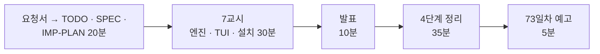

# 7·8교시 · 바이브 코딩 (`tbench`)

- 교시: 7교시 16:00~16:50 (각자 만들기), 8교시 17:00~17:50 (발표 10분 · [4단계 정리](04-STAGE4-WRAPUP.md) 35분 · 예고 5분)
- 과제: [VIBE-REQ-TBENCH](../../Last3Mon/72/VIBE-REQ-TBENCH.md)(요청서, 요청의 말 ①~⑫) → [VIBE-Q-TBENCH](../../Last3Mon/72/VIBE-Q-TBENCH.md)의 8단계: `Doc/TODO.md` → `Doc/SPEC.md` → `Doc/IMP-PLAN.md`(엔진 · TUI 단계) → 단계별 구현 → 확인 → `uv tool install` → 다른 폴더에서 사용 → 수업 뒤 `VIBE-A-TBENCH.md` 공개
- 요구 14개(R1~R14). 50분 안에는 **엔진 1단계(R1 · R6 · R7 · R8) + TUI 1단계(R2) + 설치(R14)**, 나머지는 IMP-PLAN의 다음 단계로 집에서.
- 68 · 69 · 71일차와 같은 흐름입니다: 사람의 말(요청서)을 **확인할 수 있는 요구**로 바꾸는 일을 학생이 먼저 하고, VIBE-Q는 그 다음 단계(비교 대상)로 씁니다.
- 오늘은 `tbench`: URL · 웹훅을 N번 불러 응답 시간 p50 · p95 · max, 실패 수를 표와 스파크라인으로 보여 주고, 바꾸기 전 · 후를 비교하는 TUI. 오늘 `flow.py bench`로 한 일을 내 도구로.

## 1. 7교시 · 각자 만들기 (50분)

| 시간 | 단계 | 확인 |
| --- | --- | --- |
| 16:00~16:09 | 0 준비 · 1 요청서 → `Doc/TODO.md` (에이전트 없이) | 할 일 ①~⑫ · 꼭 / 나중 |
| 16:09~16:15 | 2 `Doc/SPEC.md` → VIBE-Q 요구 표(R1~R14)와 비교 · commit | 요구마다 확인 방법 |
| 16:15~16:20 | 3 `Doc/IMP-PLAN.md` (엔진 1~3단계 · TUI 1~2단계 · 설치) · commit | 단계마다 체크리스트 |
| 16:20~16:44 | 4 구현: 엔진 1단계(R1 · R6 · R7 · R8) → TUI 1단계(R2), 막히면 5 문제 해결 팁 | 단계마다 `pytest` · 직접 실행 · commit |
| 16:44~16:50 | 6 확인 · 7 `uv tool install --editable .` · 8 다른 폴더에서 `tbench` | `cd ~/aio-01d4-stu/Last3Mon/72 && tbench ...` |

16:00에 화면에 띄울 것: 요청서의 ①~⑫와 예 하나(① → TODO 한 줄 → R1). "평균 하나로는 '가끔 느리다'가 안 보입니다. 몇 번째 값 · 실패 수로 바꿉니다." 16:09 "SPEC으로", 16:15 "IMP-PLAN으로 · 엔진과 TUI를 나눠서", 16:20 "에이전트 켜기 · 엔진 1단계만", 16:44 "설치하고 다른 폴더에서"를 알립니다.

| 볼 것 | 막혔을 때 한마디 |
| --- | --- |
| TODO · SPEC 없이 VIBE-Q를 통째로 붙여 넣었나 | "요청서로 Doc/TODO.md부터. 확인 방법이 없으면 됐는지 모릅니다" |
| IMP-PLAN이 한 덩어리 · 첫 요청에 14개 | "엔진 1단계만. 단계마다 확인 · 체크 · commit" |
| `tbench`를 다른 폴더에서 못 찾음 | "`uv tool list`, `uv tool update-shell` 뒤 새 터미널" |
| SPEC에 부탁만 ("빠르게 재", "보기 좋게") | "1~10초 열 개면 p95가 몇이어야 하나요? 숫자로" |
| 다 끝난 뒤에야 화면이 나옴 | "worker로 부르고 결과마다 표에 더하게" |
| p95 계산이 들쭉날쭉 | "계산 방법 하나를 정해 테스트로 고정" |
| 테스트가 진짜 n8n을 부름 | "pytest 안에서 가짜 서버 (일부러 느리게 · 가끔 500)" |
| 다른 요청끼리 비교 | "저장할 때 url · 본문 해시를 같이" |
| 실행해 보지 않고 다음 요청 | "에이전트가 됐다고 해도 직접 `uv run tbench`" |

수업 준비 때 tbench를 미리 만들어 보지는 않았습니다. 강사 바이브 코딩(4절)은 8교시가 4단계 정리로 바뀌어 **시간이 남으면 · 수업 뒤** 하고, 걸린 시간을 정답본(`VIBE-A-TBENCH.md`)에 남깁니다.

## 2. 8교시 · 발표 (10분)

- 1~2명. **자기 실습 워크플로우의 바꾸기 전 · 후를 tbench로 비교한 사람**을 먼저 고릅니다.
- 3분 발표 · 2분 질문: **내 SPEC과 VIBE-Q가 달랐던 곳** / IMP-PLAN을 어떻게 나눴나 / 잘 먹힌 요청문 / 안 먹힌 요청문 / 에이전트가 틀린 곳 / 비교 표 시연.

## 3. 강사 정리 (8교시 4단계 정리 안에서, 1절 표와 함께)

| | n8n 실습 | tbench |
| --- | --- | --- |
| 재기 | `flow.py bench`, 결과의 `timings` | 직접 만든 p50 · p95 |
| 첫 호출 | push 뒤 느림 → 워밍업 (Lab 01 예제 1 · Lab 02 과제 1) | 첫 호출 표시 · 빼고 계산 |
| 비교 | `my-work/PERF.md` 3절에 한 줄씩 (4교시 Lab 02) | `tbench compare` |
| 고장 | `fault` · `llm down` (6교시 Lab 03) | 가짜 서버 (느림 · 500) |
| 같은 조건 | 같은 요청 파일, `no_cache` | url · 본문 해시 · n 확인 |

## 4. 강사 바이브 코딩 (시간이 남으면 · 수업 뒤, 15분)

| 주제 | 요청문 요지 | 보여 줄 것 |
| --- | --- | --- |
| 단계별 시간 그래프 | "응답 JSON에 timings가 있으면 단계별 평균을 막대로" | 오늘 Lab의 `timings`를 tbench가 읽음 |
| 목표 시간 검사 | "--max-p95 2.5 를 넘으면 종료 코드 1 (CI에서 쓰게)" | 74일차 배포 전 검사(릴리스 게이트)의 씨앗 |
| tops 연결 | "결과 저장 형식을 JSON Lines로, 79일차 tops가 읽게" | 도구끼리 같은 형식 |

걸린 시간과 결과를 `Last3Mon/72/VIBE-A-TBENCH.md`에 적어 둡니다.

## 5. 보충 · 팁 (읽을거리, 4단계 정리 7절과 함께)

| 팁 | 설명 |
| --- | --- |
| 요청서 → 요구가 먼저 | 확인 방법(몇 번째 값 · 실패 수 · 같은 칸)이 있는 요구가 있어야 에이전트의 "완료"를 판단할 수 있음 |
| 재는 도구도 테스트 | 가짜 서버로 "3번째마다 500"이 실패 2개로 세지는지 |
| 같은 조건에서 비교 | 요청 · 횟수 · 캐시 상태 · 첫 호출 |
| 평균 대신 p95 | 사용자는 느린 쪽을 기억한다 |
| 화면은 굳지 않게 | 오래 걸리는 일은 worker |
| 단계마다 `git commit` | 에이전트가 망가뜨려도 돌아갈 곳 |

## 6. 73일차 예고 (5분)

- 오늘: 빠르게, 멈춰도 답하게. 내일: **입력·출력 검증과 응답 필터링, Workflow 보안** — 질문에 숨은 지시문 공격, 답에 섞인 개인정보 · 내부 정보를 막습니다.
- 바이브 코딩: `tscan` (폴더 · git staged 파일에서 API 키 · `.env` 값 · 주민번호 · 전화번호를 찾아 가린 채로 보여 주고, pre-commit 훅으로 등록). 오늘 `tbench`는 지우지 마세요. 79일차 `tops`에서 씁니다.

## 확인 (강사)

- [ ] 16:00 요청서 → TODO(에이전트 없이) → SPEC → IMP-PLAN 20분을 지켰다, 16:20부터 엔진 1단계.
- [ ] 7교시 시작 전 가짜 서버로 테스트하라는 말을 화면에 띄웠다.
- [ ] 수업 뒤: `VIBE-A-TBENCH.md`의 "자주 빠뜨리는 것"·강사 바이브 코딩 시간을 채우고 **학생 저장소에 VIBE-A만** 올린다 (LAB-A · `answers/`는 요청할 때).
- [ ] 발표자 1~2명, 강사 정리 표, 강사 바이브 코딩 1개(시간 기록), 팁, 예고.
- [ ] 수업이 끝날 때 학생들의 고장 스위치 · OpenAI 키가 평소대로인지 (`doctor`).
