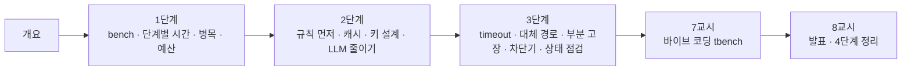

# 72일차 · Workflow 실행 흐름 최적화와 운영 관점 개선 (바이브 코딩)

- 일자: 2026-10-26 (72일차)
- 교과목: 노코드 멀티 에이전트 워크플로우 설계 및 운영
- 단원: 운영·확장 관점의 AI 워크플로우 설계 고도화
- 학습 내용: Workflow 실행 흐름 최적화, 운영 관점 개선 전략 적용
- 실습 폴더: [Last3Mon/72](../../Last3Mon/72/README.md)
- 실습 환경: 65일차 n8n 2.42.6 + OpenAI API(`gpt-4.1-mini`) + 72일차 데이터 API(고장 스위치 · 캐시) + **CLI 코딩 에이전트**
- **실습 준비: [00-DAY72-PREP.md](00-DAY72-PREP.md) (수업 전날까지 1~2절 완료)**

## 오늘의 시간표

| 교시 | 시간 | 내용 | 자료 |
| --- | --- | --- | --- |
| 1 | 09:00~09:50 | 오늘의 개요 · **1단계 강의** · 재기와 병목 | [개요](00-DAY72-OVERVIEW.md) 1~14장, [1단계](01-STAGE1-MEASURE-BOTTLENECK.md) |
| 2 | 10:00~10:50 | **Lab 01** 실습 5개 (bench · 단계별 시간 · 종류별 재기 · 가장 느린 단계 · 시간 예산) | [Lab 01](../../Last3Mon/72/LAB-01-Q-MEASURE-BOTTLENECK.md) |
| 3 | 11:00~11:50 | **2단계 강의** · 실행 흐름 최적화 | 개요 15~21장, [2단계](02-STAGE2-OPTIMIZE-FLOW.md) |
| 4 | 12:00~12:50 | **Lab 02** 실습 5개 (규칙 먼저 · 캐시 · 적중률 · LLM 한 번 · FAQ 번호 캐시) | [Lab 02](../../Last3Mon/72/LAB-02-Q-OPTIMIZE-FLOW.md) |
| - | 13:00~14:00 | 점심 |  |
| 5 | 14:00~14:50 | **3단계 강의** · 운영 관점의 안정성 | 개요 22~28장, [3단계](03-STAGE3-STABILITY.md) |
| 6 | 15:00~15:50 | **Lab 03** 실습 5개 (timeout · LLM 없이 · 접수 API만 고장 · 상태 점검 · 차단기) | [Lab 03](../../Last3Mon/72/LAB-03-Q-STABILITY.md) |
| 7 | 16:00~16:50 | 바이브 코딩 · `tbench` 만들기 (각자, 요청서 → TODO → SPEC → IMP-PLAN → 구현 → 설치) | [VIBE-REQ-TBENCH](../../Last3Mon/72/VIBE-REQ-TBENCH.md) → [VIBE-Q-TBENCH](../../Last3Mon/72/VIBE-Q-TBENCH.md), [진행](05-VIBE-CODING.md) |
| 8 | 17:00~17:50 | 바이브 코딩 발표 10분 · **4단계 정리 35분** (의미 · 효과 · 실전 응용) · 73일차 예고 5분 | [진행](05-VIBE-CODING.md), [4단계 정리](04-STAGE4-WRAPUP.md) |

## 자료 목록

| 파일 | 내용 |
| --- | --- |
| `00-DAY72-PREP.md` | 실습 준비: n8n · 72일차 판 데이터 API 켜기, 기준 워크플로우 게시, `flow.py doctor` (수업 전) |
| `00-DAY72-OVERVIEW.md` | 개요 30장 (PPT 대신 Markdown, 가로줄로 장 구분, 실습 15개 한눈에) |
| `01-STAGE1-MEASURE-BOTTLENECK.md` | 재기 전에 고치지 않기, p50 · p95 손 계산, 첫 호출, 어디서 재나, 단계별 시간, 종류별 실측, 어림 계산, 가장 느린 단계, 시간 예산(SLO), 확인 질문 |
| `02-STAGE2-OPTIMIZE-FLOW.md` | 줄일 수 있는 LLM, 규칙 먼저, 캐시(무엇을 캐시하면 안 되나), 적중률 어림, 캐시 키 설계(FAQ 번호), 검토를 검사로, 잃은 것, 테스트도 바뀐다, 확인 질문 |
| `03-STAGE3-STABILITY.md` | 멈추는 방식, timeout · 재시도 · 오류 출력, 최악의 시간, `neverError` · `fullResponse` 실측, LLM 없이 답, 부분 고장, 차단기, 상태 점검, 고장 연습, 확인 질문 |
| `04-STAGE4-WRAPUP.md` | 8교시 35분 · 정리: 오늘 한 장, 왜 운영인가, 효과를 숫자로, 업계 이름 · 도구 (SLO · 추적 · 캐시 · 가드레일 · 서킷 브레이커 · 카오스), 산업별 응용, 운영 지표 여섯, 하지 말아야 할 때, 직무 · 면접 질문, 최종 프로젝트 체크리스트 |
| `05-VIBE-CODING.md` | 7교시 바이브 코딩 진행 (tbench), 8교시 발표, 강사 바이브 코딩(시간이 남으면), 팁 |
