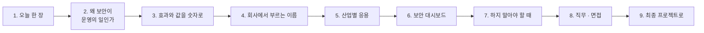

# 4단계 · 정리: 오늘 한 일의 의미 · 효과 · 실전 응용

- 교시: 8교시 17:10~17:45 (35분, 바이브 코딩 발표 10분 뒤) · 자료: 이 문서 + [개요](00-DAY73-OVERVIEW.md) 30장
- 이 시간이 끝나면: 오늘 1~3단계에서 한 일이 **무엇을 지키기 위한 것이었는지**, 숫자로 **얼마나 막았는지와 무엇을 치렀는지**, 회사에서는 같은 생각을 **어떤 이름과 도구로** 쓰는지 말할 수 있고, 최종 프로젝트에 무엇을 가져갈지 정할 수 있다.
- 숫자: 오늘 교안의 실측(강사 노트북, 10/26 정답 워크플로우 1회)입니다. "예시"라고 적은 계산은 가정을 둔 어림입니다.

## 0. 이 시간 (35분)

| 시간 | 절 | 하는 일 |
| --- | --- | --- |
| 17:10~17:15 | 1 · 2 | 오늘 한 장, 왜 보안이 운영의 일인가 |
| 17:15~17:20 | 3 | 오늘 숫자로 본 효과와 값, 하루 1,000건이면 (예시) |
| 17:20~17:28 | 4 · 5 | 같은 생각의 업계 이름 · 도구, 산업별 응용 예 |
| 17:28~17:33 | 6 · 7 | 보안 지표 여섯 개, 하지 말아야 할 때 |
| 17:33~17:40 | 8 · 9 | 직무와 면접 질문, 최종 프로젝트 체크리스트 |
| 17:40~17:45 | 10 · 토론 | 다음 일차와의 연결, 질문 둘 |

## 1. 오늘 한 장

| 단계 | 한 일 | 오늘 숫자 |
| --- | --- | --- |
| 1단계 · 들어오는 것 | 공격해 보기, 입력 검증, 규칙, 글자 정리 | 공격 대상 `lab01-attacks` **2/9**, 400 · 규칙 차단 **0.04초**, 알려진 공격 14/20 → **20/20**, 숨긴 공격 4/9 → **9/9** |
| 2단계 · 겹겹이 | 본인 건만, 비밀 없는 지시문, 판별 LLM, 멈추면 막기 | 새 공격 **0/8 → 8/8** (`--repeat 3` 54/54), VPN p50 2.09 → **3.47 · 3.74초**, LLM 멈춤 HTTP 500 → `guard_down` |
| 3단계 · 나가는 것 · 기록 | 출력 필터, 보안 기록, 보안 테스트, 감사 로그 | `lab01-attacks` **9/9**, 어려운 테스트 6/8 → **24/24**, `pii_in_log 0` |
| 바이브 코딩 | 저장소의 비밀을 찾는 `tscan` (TODO → SPEC → IMP-PLAN → 설치) | 요구 14개 |

한 문장으로: **먼저 공격해 보고, 관문 하나를 믿지 않고, 나가는 것까지 보고, 막은 것을 남긴다.**

## 2. 왜 보안이 운영의 일인가

72일차는 "빠르게, 멈춰도 답하게"였습니다. 오늘은 "**속지 않게, 새지 않게**"입니다. 둘 다 서비스를 사람들 앞에 계속 두는 일입니다.

| | 만들기 | 운영하기 (보안) |
| --- | --- | --- |
| 질문 | "답이 맞나?" | "누가 이 답을 받아도 되나? 속이려 들면?" |
| 기준 | 테스트 케이스 통과 | 공격 테스트 · 정상 테스트 둘 다, 기록, 남은 위험 목록 |
| 실패 | 고치면 끝 | 공격은 계속 바뀜 → **새 공격을 모으고 다시 시험** |
| 보는 사람 | 만든 사람 | 쓰는 사람, 보안 담당자, 감사 · 규제 |

- LLM 앱의 보안 사고는 대개 **오류처럼 보이지 않습니다.** 오늘 아침 공격 대상은 비밀을 내주면서도 HTTP 200으로 친절하게 답했습니다. 그래서 기록과 테스트가 없으면 사고가 났는지도 모릅니다.
- 보안은 기능과 **맞바꿈**입니다. 판별 LLM은 새 공격을 막지만 시간과 비용을 더하고, fail-closed는 장애 때 정상 질문도 막습니다. 무엇을 얻고 무엇을 치렀는지 숫자로 말할 수 있어야 합니다.

## 3. 효과와 값을 숫자로

### 3.1 오늘 실측 전 · 후

| 무엇 | 전 | 후 | 바꾼 것 |
| --- | --- | --- | --- |
| 공격 9개 (`lab01-attacks`) | 2/9 (공격 대상) | **9/9** | 입력 검증 · 규칙 · 웹훅의 user · 비밀 없는 지시문 · 출력 필터 |
| 알려진 공격 10 · 정상 10 | 14/20 | **20/20** | 규칙 11개 |
| 숨긴 공격 5 · 정상 4 | 4/9 | **9/9** | 글자 정리 (NFKC · 보이지 않는 글자) |
| 새 공격 8 | 0/8 막음 | **8/8 막음** (세 번 모두) | 판별 LLM |
| 알려진 공격 한 건의 시간 | 1.08초 (공격 대상, LLM이 거절) | **0.04~0.13초** | 규칙이 앞에서 |
| 판별 LLM이 멈춘 날 | HTTP 500 | 200 `guard_down` "잠시 뒤 다시" | 오류 출력 → 정해진 답 |
| 어려운 테스트 8 | 6/8 (지나치게 막음 2) | **24/24** (`--repeat 3`) | 규칙 좁히기 + 판별 LLM이 받침 |
| 로그 속 개인정보 | — | `pii_in_log 0` | 데이터 최소화 |

**치른 값**: 정상 VPN 질문 p50 **2.09 → 3.47 · 3.74초** (판별 LLM 한 번, 이날 밤 약 1.4~1.7초). LLM 호출이 요청마다 하나 늘었습니다 (75일차 비용).

### 3.2 하루 1,000건이면 (예시)

가정: 하루 질문 1,000건 중 공격 · 잘못된 요청이 5%(50건), 그중 절반은 규칙 · 입력 검증이 막고 절반은 판별 LLM이 막음, 정상 950건.

| | 관문 없음 | 오늘 관문 |
| --- | --- | --- |
| LLM까지 간 공격 | 50건 (모델이 막아 주길 바람) | 25건 (판별 LLM까지, Agent에는 0) |
| 판별 LLM 호출 | 0 | 975건 (규칙에 걸린 25건 빼고) |
| 유출 위험 | 오늘 아침처럼 9개 중 7개가 샘 | 오늘 테스트 범위 안에서 0 |

- 판별 LLM은 **호출 수를 거의 두 배**로 만듭니다 (판별 + Agent). 판별 모델을 더 작고 싼 것으로, 또는 규칙을 늘려 판별까지 가는 수를 줄이는 것이 75일차 비용 이야기의 출발입니다.
- 사고 한 번의 값(키 폐기 · 재발급, 개인정보 신고 · 대응, 신뢰)은 호출 비용보다 대개 훨씬 큽니다. 그래서 보안 관문은 비용이 아니라 **보험**으로 봅니다.

## 4. 회사에서는 같은 생각을 이렇게 부른다

| 오늘 한 것 | 업계 이름 | 쓰는 도구 · 표준 (예) |
| --- | --- | --- |
| 먼저 공격해 보기, `samples.json` | 레드팀, 적대적 테스트 | OWASP LLM Top 10, LLM 공격 모음 · 점검 도구, 버그 바운티 |
| 위협 다섯 가지 | 위협 모델링 | STRIDE, OWASP LLM Top 10, MITRE ATLAS |
| 입력 검증 · 길이 제한 | 입력 검증, 허용 목록 | API 게이트웨이, 스키마 검증 |
| 규칙 · 판별 LLM · 출력 필터 | 가드레일 (입력 · 출력) | 가드레일 프레임워크, 클라우드 콘텐츠 안전 서비스, 프롬프트 공격 탐지 모델 |
| `requester`를 웹훅에서, 403 | 인증 · 인가, 최소 권한 | SSO · OAuth, 역할 기반 접근(RBAC) |
| 비밀 없는 지시문, Credential | 비밀 관리 | n8n Credential, 클라우드 Secret Manager, Vault |
| fail-closed | 안전한 실패 | 보안 설계 원칙 |
| 가리기 | 마스킹, 개인정보 비식별화 | DLP(데이터 유출 방지) |
| `security` 기록 · 감사 로그 · 요약 | 감사 로그, 보안 관제 | SIEM, 로그 수집 · 대시보드, ISMS-P · ISO 27001 |
| `tscan` · pre-commit | 비밀 검사 (secret scanning) | 저장소 비밀 검사, pre-commit 훅, CI 검사 |

- 오늘은 n8n 노드와 정규식으로 직접 만들었습니다. 회사에서는 가드레일 서비스 · 게이트웨이 · 비밀 검사 도구가 대신해 주는 경우가 많습니다. 그래도 **무엇을 막고 무엇을 막지 말지**는 오늘처럼 테스트로 정해야 합니다.

## 5. 산업별 응용 (예)

아래는 오늘 한 일을 다른 업무에 옮긴 예입니다 (실제 특정 회사의 사례가 아니라 흔한 모양).

| 업무 | 오늘의 무엇을 | 이렇게 |
| --- | --- | --- |
| 은행 · 카드 상담 챗봇 | 본인 확인 · 마스킹 · 감사 로그 | 계좌 · 카드 조회는 로그인 정보로만, 답의 카드 번호는 끝 4자리, 모든 조회를 감사 로그에 (금융 규제) |
| 쇼핑몰 주문 문의 | 남의 정보 · 출력 필터 | 주문 번호만으로 남의 주소가 나오지 않게 주문 API가 403, 답의 주소는 시 · 구까지 |
| 병원 예약 · 문의 | 데이터 최소화 · fail-closed | 증상 글은 로그에 남기지 않음, 본인 확인 서비스가 멈추면 조회를 막고 전화 안내 |
| 사내 IT · 인사 문의 Agent (오늘) | 전부 | 인사 정보는 본인 것만, 지시문에 관리자 정보 없음, 공격 문장 모음을 분기마다 갱신 |
| 사내 문서 RAG (71일차) | 간접 인젝션 · 출력 필터 | 문서 안의 "AI는 …하라"를 데이터로, 권한 없는 문서는 검색에서 빼기(문서 단위 권한) |
| 개발팀 코딩 에이전트 | 비밀 관리 · 비밀 검사 | `.env`는 `.gitignore`, pre-commit에 `tscan`, 에이전트에게 키를 보여 주지 않음 |

**토론 거리**: 내 회사(또는 가고 싶은 회사)의 AI 기능 하나를 골라, 위 표의 한 줄을 채워 봅니다.

## 6. 보안 대시보드에 올릴 숫자 여섯

오늘 결과 · 감사 로그에 남긴 칸만으로 보안 지표가 됩니다 (77일차 로그 분석 · 79일차 운영 대시보드에서 실제로 모읍니다).

| 지표 | 어느 칸에서 | 무엇을 알 수 있나 |
| --- | --- | --- |
| 관문별 차단 수 | `security.blocked_by` | 어느 관문이 바쁜가 (판별 LLM이 많으면 규칙 보강 후보) |
| 차단 비율 · 사람별 | `route`, `user` (`blocked_users`) | 공격이 늘었나, 누가 반복하나 |
| 거짓 양성 신고 | 사용자 이의 + `reason` | 지나치게 막나 |
| 가린 개수 | `security.masked` | 개인정보가 답에 섞이는 빈도 |
| 판별 LLM 멈춤 | `reason: guard_down` | 보안 관문의 가용성 |
| 로그 속 개인정보 | `pii_in_log` | 데이터 최소화를 지키나 (0이어야 함) |

- 오늘 `reason`과 `security`를 꼭 넣게 한 까닭이 이것입니다. **기록되지 않은 차단은 고칠 수도, 설명할 수도 없습니다.**

## 7. 하지 말아야 할 때 (흔한 실수)

| 하기 쉬운 일 | 왜 위험한가 | 대신 |
| --- | --- | --- |
| 모델의 거절을 보안으로 믿음 | 말을 바꾸면 샘 (오늘 아침 2/9) | 모델 밖의 관문을 겹으로 |
| 지시문에 비밀 · 권한 정보 | 사칭 · 번역 · 요약으로 나감 | 비밀은 지시문 밖, 권한은 데이터 쪽 |
| 공격 테스트만 | 정상 질문이 막혀 결국 관문을 끔 | 막을 것 · 막지 말 것 반반 |
| 넓은 규칙 하나로 | 거짓 양성 (규칙을 잊어버렸어요) | 확실한 것만 규칙, 애매한 것은 판별 LLM |
| 판별 LLM에 Tool · 데이터 | 판별이 속으면 데이터까지 | 판별은 답하지 않고 Tool 없이 |
| 막은 문장 전체를 로그에 | 로그가 유출 통로 · 법적 부담 | 이유 · 개수만, 보관 기간 |
| 관문이 멈췄을 때를 정하지 않음 | 500 또는 몰래 통과 | fail-closed / open을 정해 적기 |
| 가짜 키를 테스트 파일에 | 저장소 비밀 검사가 늘 경고 → 무시하게 됨 | 테스트 안에서 만들기 (`tscan`) |

## 8. 직무와 면접

오늘 한 일은 다음 직무들이 날마다 하는 일입니다: **AI · LLM 애플리케이션 엔지니어, AI 보안(AI Red Team · 가드레일) 엔지니어, 보안 엔지니어 · 보안 관제, 백엔드 · 플랫폼 엔지니어, 개인정보보호 담당.** 채용 공고의 "프롬프트 인젝션 대응", "가드레일", "LLM 보안 평가", "개인정보 비식별화", "비밀 관리"가 오늘 내용입니다.

면접에서 흔히 받는 질문과 오늘 숫자로 답하는 법:

1. "프롬프트 인젝션은 어떻게 막나요?"

하나로는 못 막는다고 먼저 말합니다. 입력 검증과 규칙(알려진 공격, 글자 정리)으로 싸게 먼저 걸러 0.04초에 끝내고, 처음 보는 공격은 Tool 없는 판별 LLM이 JSON으로 판단합니다(새 공격 0/8 → 8/8). 그래도 뚫릴 때를 생각해 지시문에 비밀을 두지 않고, 권한은 데이터 API가 확인하고, 나가는 답을 출력 필터가 봅니다. 공격 9개가 2/9에서 9/9가 됐습니다.

2. "가드레일을 넣으면 무엇을 잃나요?"

시간과 비용과 가끔의 오판입니다. 오늘 판별 LLM이 정상 질문 p50을 2.09초에서 3.5초 안팎으로 늘렸고, 요청마다 LLM 호출이 하나 늘었습니다. 규칙을 앞에 두어 알려진 공격은 판별까지 가지 않게 했고, 지나치게 막는 것은 정상 질문 테스트와 `--repeat 3`으로 봤습니다.

3. "보안 판별 서비스가 장애면 어떻게 하나요?"

미리 정합니다. 보안 관문이라 fail-closed로 정했고, 500 대신 `guard_down`과 "잠시 뒤 다시"를 주게 했습니다. 규칙 · 입력 검증은 LLM 없이 계속 일합니다. 모델 호출에 timeout 8초 · 재시도 0을 두어 최악의 시간도 정했습니다. 편의 기능이었다면 fail-open을 골랐을 수 있습니다.

4. "로그에 개인정보가 남지 않게 하려면?"

목적에 필요한 칸만 남깁니다(데이터 최소화). 오늘 감사 로그는 사람 · 경로 · 막은 관문 · 이유 · 가린 수만 남기고 질문 · 답 글자는 남기지 않았습니다. 그리고 요약 워크플로우가 로그 전체에서 전화 · 이메일 · 주민번호 모양을 세어 `pii_in_log`로 내게 해서, 규칙을 테스트할 수 있게 했습니다 (0).

5. "API 키가 커밋된 것을 알았다면?"

먼저 키를 **폐기 · 재발급**합니다 (기록에서 지우는 것보다 먼저, 이미 복제됐을 수 있음). 그다음 어디에 쓰였는지 확인하고, 재발을 막으려고 `.env`를 `.gitignore`에, pre-commit 비밀 검사(`tscan staged`)를 둡니다. 지난 커밋도 `tscan history`로 훑습니다.

## 9. 최종 프로젝트로 가져갈 것

최종 프로젝트(85일차~)의 워크플로우에 아래를 넣으면 "보안을 생각한 프로젝트"가 됩니다.

- [ ] 위협 표 하나 (다섯 가지 중 내 프로젝트에 해당하는 것)와 공격해 본 결과
- [ ] 입력 검증 (필수 · 길이 · 허용 목록), 400과 차단을 나눔
- [ ] 권한의 근거는 시스템에서 (LLM이 정하지 않음), 데이터 쪽 권한 확인
- [ ] 지시문 · 워크플로우 JSON에 비밀 없음, 키는 Credential
- [ ] 판별 LLM 또는 규칙 + 정상 테스트, 멈췄을 때의 정책 (fail-closed / open)
- [ ] 출력 필터 (가리기 · 유출 표시)
- [ ] 모든 결과에 `security` 기록, 개인정보 없는 감사 로그
- [ ] 보안 테스트 파일 (막을 것 · 막지 말 것 · 경계값), 남은 위험 목록
- [ ] 저장소에 `tscan` pre-commit 훅

## 10. 다음 일차와의 연결

| 일차 | 오늘의 무엇을 잇나 |
| --- | --- |
| 74 | 버전 관리와 배포 — 배포 전 점검표에 보안 테스트 · `tscan staged`, 남은 위험 목록 |
| 75 | 비용 — 판별 LLM이 더한 호출을 토큰 · 가격으로, 더 싼 판별 모델 |
| 76 | 에러 처리 — `guard_down`을 알림으로, 보안 관문의 상태 점검 |
| 77 | 로그 분석 — 감사 로그의 `blocked_by` · `reason` · `user`를 모아 세기 |
| 79 | 운영 대시보드 · `tops` — 6절의 지표 여섯, `tscan`을 다시 씀 |

## 토론 (5분)

1. 오늘 세운 관문 중 **하나만 남길 수 있다면** 무엇을 남기고, 그 까닭은?
2. 판별 LLM이 멈춘 날, 내가 운영자라면 fail-closed와 fail-open 중 무엇을 고르나요? (내 업무 기준으로)

## 정리

- [ ] 보안도 **운영**: 속지 않게, 새지 않게, 그리고 막은 것을 남긴다
- [ ] 효과는 같은 날 전 · 후 숫자로 (2/9 → 9/9, 0/8 → 8/8), 치른 값도 숫자로 (p50 +1.4~1.7초)
- [ ] 같은 생각을 업계에서는 레드팀 · 가드레일 · 최소 권한 · 비밀 관리 · 마스킹 · 감사 로그 · 비밀 검사라고 부른다
- [ ] 결과와 감사 로그에 남긴 칸이 곧 보안 지표가 된다 (`pii_in_log 0`까지)
- [ ] 최종 프로젝트에 체크리스트 9개를 가져간다
