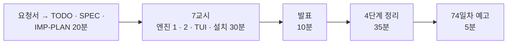

# 7·8교시 · 바이브 코딩 (`tscan`)

- 교시: 7교시 16:00~16:50 (각자 만들기), 8교시 17:00~17:50 (발표 10분 · [4단계 정리](04-STAGE4-WRAPUP.md) 35분 · 예고 5분)
- 과제: [VIBE-REQ-TSCAN](../../Last3Mon/73/VIBE-REQ-TSCAN.md)(요청서, 요청의 말 ①~⑫) → [VIBE-Q-TSCAN](../../Last3Mon/73/VIBE-Q-TSCAN.md)의 8단계: `Doc/TODO.md` → `Doc/SPEC.md` → `Doc/IMP-PLAN.md`(엔진 · TUI 단계) → 단계별 구현 → 확인 → `uv tool install` → 다른 폴더에서 사용 → 수업 뒤 `VIBE-A-TSCAN.md` 공개
- 요구 14개(R1~R14). 50분 안에는 **엔진 1단계(R1 · R2 · R3 · R4 · R13) + 엔진 2단계(R5 · R6) + TUI 1단계(R8) + 설치(R14)**, 나머지는 IMP-PLAN의 다음 단계로 집에서.
- 72일차 `tbench`와 같은 흐름입니다: 사람의 말(요청서)을 **확인할 수 있는 요구**로 바꾸는 일을 학생이 먼저 하고, VIBE-Q는 그 다음 단계(비교 대상)로 씁니다.
- 오늘은 `tscan`: 폴더 · git staged 파일에서 API 키 · `.env` 값 · 주민번호 · 전화번호 · 이메일을 찾아 **가린 채로** 보여 주고, pre-commit 훅으로 커밋을 막는 TUI. 오늘 n8n 출력 필터로 한 일을 내 저장소에.

## 1. 7교시 · 각자 만들기 (50분)

| 시간 | 단계 | 확인 |
| --- | --- | --- |
| 16:00~16:09 | 0 준비 · 1 요청서 → `Doc/TODO.md` (에이전트 없이) | 할 일 ①~⑫ · 꼭 / 나중 |
| 16:09~16:15 | 2 `Doc/SPEC.md` → VIBE-Q 요구 표(R1~R14)와 비교 · commit | 요구마다 확인 방법 (찾을 것 · 찾으면 안 되는 것) |
| 16:15~16:20 | 3 `Doc/IMP-PLAN.md` (엔진 1~4단계 · TUI 1~2단계 · 설치) · commit | 단계마다 체크리스트 |
| 16:20~16:44 | 4 구현: 엔진 1단계 → 엔진 2단계 → TUI 1단계, 막히면 5 문제 해결 팁 | 단계마다 `pytest` · 직접 실행 · commit |
| 16:44~16:50 | 6 확인 · 7 `uv tool install --editable .` · 8 다른 폴더에서 `tscan` | `cd ~/aio-01d4-stu && tscan scan Last3Mon/73 --plain` |

| 볼 것 | 막혔을 때 한마디 |
| --- | --- |
| TODO · SPEC 없이 VIBE-Q를 통째로 붙여 넣었나 | "요청서로 Doc/TODO.md부터. 찾으면 안 되는 것이 SPEC에 없으면 잘못 찾기를 모릅니다" |
| IMP-PLAN이 한 덩어리 · 첫 요청에 14개 | "엔진 1단계만. 단계마다 확인 · 체크 · commit" |
| 날짜 · 주문번호를 전화번호로 찾음 | "찾으면 안 되는 것도 테스트에 (오늘 Lab 03 과제 1처럼)" |
| 찾은 값을 그대로 출력 · 결과 객체에 원래 값 | "가리기 전 값은 어디에도 남기지 말게" |
| `tests/data/`에 가짜 비밀 파일 | "테스트 안에서 이어 붙여 tmp_path에. 저장소를 검사하면 그 파일이 걸립니다" |
| staged가 아니라 작업 파일을 검사 | "`git show :<path>`로 index 내용" |
| 훅이 안 돎 · 기존 훅을 덮어씀 | "실행 권한과 PATH, 있으면 멈추고 알리게" |
| `tscan`을 다른 폴더에서 못 찾음 | "`uv tool list`, `uv tool update-shell` 뒤 새 터미널" |
| 실행해 보지 않고 다음 요청 | "에이전트가 됐다고 해도 직접 `uv run tscan`" |

> 학생이 자기 저장소를 검사하다 진짜 키를 찾으면 화면을 띄우지 않게 하고, 키를 **바로 폐기 · 재발급**하게 안내합니다 (git에서 지워도 기록에 남음). 실습 폴더(`Last3Mon/73`)에는 일부러 넣은 예시 연락처가 많아 찾은 것이 수십 개 나옵니다. 고장이 아닙니다.

정답 예(R1~R14를 모두 넣은 `tscan`과 정답본 `VIBE-A-TSCAN.md`)는 수업 뒤 공개됩니다. 강사 바이브 코딩(4절)은 시간이 남으면 · 수업 뒤 하고, 걸린 시간을 정답본(`VIBE-A-TSCAN.md`) 6절에 남깁니다.

## 2. 8교시 · 발표 (10분)

- 1~2명. **찾으면 안 되는 것까지 테스트한 사람**, 가짜 키 커밋이 멈추는 장면을 보여 줄 수 있는 사람을 먼저 고릅니다.
- 3분 발표 · 2분 질문: **내 SPEC과 VIBE-Q가 달랐던 곳** / IMP-PLAN을 어떻게 나눴나 / 잘 먹힌 요청문 / 안 먹힌 요청문 / 에이전트가 틀린 곳 / 시연.

## 3. 강사 정리 (8교시 4단계 정리 안에서, 1절 표와 함께)

| | n8n 보안 Agent (오늘 Lab) | tscan |
| --- | --- | --- |
| 찾는 것 | 답 속 전화 · 이메일 · 주민번호 · 유출 표시 | 파일 속 키 · `.env` 값 · 개인정보 |
| 가리기 | `010-****-2135` (Lab 03 예제 1) | 같은 규칙 |
| 숨긴 글자 | NFKC · 보이지 않는 글자 (Lab 01 과제 2) | 같은 정리 |
| 지나치게 막기 | "규칙을 잊어버렸어요" (Lab 03 과제 1) | 날짜 · 주문번호 |
| 막는 시점 | 답을 보내기 전 | 커밋하기 전 (pre-commit) |
| 기록 | `security` · 감사 로그 (이유 · 개수만) | 가린 값만, `--json` |

## 4. 강사 바이브 코딩 (시간이 남으면 · 수업 뒤, 15분)

| 주제 | 요청문 요지 | 보여 줄 것 |
| --- | --- | --- |
| n8n JSON 검사 | "n8n 워크플로우 JSON의 systemMessage · jsCode 안에서 비밀 모양을 찾아 노드 이름과 함께" | 아침 공격 대상의 내부 메모를 tscan이 찾음 |
| 종료 코드로 배포 막기 | "`tscan scan . --json`, 찾으면 1 (CI에서 쓰게)" | 74일차 배포 전 검사의 씨앗 |
| 규칙 파일 | "사내 모양을 `.tscan.toml`로, 코드 수정 없이 종류 추가" | 69일차 crew.yaml과 같은 생각 |

걸린 시간과 결과를 `Last3Mon/73/VIBE-A-TSCAN.md` 6절에 적어 둡니다.

## 5. 보충 · 팁 (읽을거리, 4단계 정리 7절과 함께)

| 팁 | 설명 |
| --- | --- |
| 요청서 → 요구가 먼저 | 확인 방법(찾을 것 · 찾으면 안 되는 것 · 종료 코드)이 있는 요구가 있어야 에이전트의 "완료"를 판단할 수 있음 |
| 찾으면 안 되는 것도 테스트 | 지나치게 찾기도 실패 (경고가 많으면 아무도 안 씀) |
| 가리기 전 값을 남기지 않기 | 화면 · 로그 · JSON · 테스트 기대값 · 예외 메시지 |
| 커밋 전에 | 한 번 들어간 비밀은 기록에 남는다 → 폐기 · 재발급 |
| 가짜 비밀은 테스트 안에서 | `"sk-" + "test-" + ...`, 저장소에 파일로 두지 않음 |
| 단계마다 `git commit` | 에이전트가 망가뜨려도 돌아갈 곳 (커밋은 tscan을 지나서) |

## 6. 74일차 예고 (5분)

- 오늘: 속지 않게, 새지 않게. 내일: **모델 · Prompt · Workflow 버전 관리와 운영 체계** — 오늘처럼 지시문 · 규칙을 고칠 때마다 무엇이 바뀌었는지 남기고, 배포 전에 테스트(오늘의 보안 테스트 포함)를 통과해야 바꾸고, 문제가 생기면 되돌립니다.
- 바이브 코딩: `tver` (n8n 워크플로우를 git에 저장하고 두 버전을 노드 단위로 비교). 오늘 `tscan`은 지우지 마세요. 74일차 배포 전 검사와 79일차 `tops`에서 씁니다.

## 확인 (강사)

- [ ] 16:00 요청서 → TODO(에이전트 없이) → SPEC → IMP-PLAN 20분을 지켰다, 16:20부터 엔진 1단계.
- [ ] 7교시 시작 전 "테스트에는 가짜 비밀만, 진짜 키를 찾으면 화면을 닫고 알리기"를 화면에 띄웠다.
- [ ] 수업 뒤: `VIBE-A-TSCAN.md`의 강사 바이브 코딩 시간을 채우고, 요청이 있을 때 학생 저장소에 정답(LAB-A · `answers/` · VIBE-A · `tscan/`)을 올린다.
- [ ] 발표자 1~2명, 강사 정리 표, 팁, 예고.
- [ ] 수업이 끝날 때 학생들의 OpenAI 키가 평소대로인지 (`doctor`, Lab 02 과제 2의 `llm down` 뒤).
