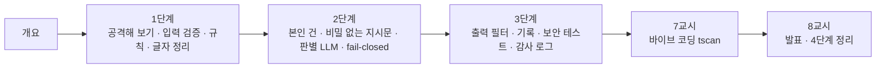

# 73일차 · 입력·출력 검증, 응답 필터링과 Workflow 보안 (바이브 코딩)

- 일자: 2026-10-27 (73일차)
- 교과목: 노코드 멀티 에이전트 워크플로우 설계 및 운영
- 단원: 운영·확장 관점의 AI 워크플로우 설계 고도화
- 학습 내용: 입력·출력 검증 및 응답 필터링, Workflow 보안 적용
- 실습 폴더: [Last3Mon/73](../../Last3Mon/73/README.md)
- 실습 환경: 65일차 n8n 2.42.6 + OpenAI API(`gpt-4.1-mini`) + 73일차 데이터 API(직원 목록 · 접수 건 연락처 · 감사 로그) + **CLI 코딩 에이전트**
- **실습 준비: [00-DAY73-PREP.md](00-DAY73-PREP.md) (수업 전날까지 1~2절 완료)**

## 오늘의 시간표

| 교시 | 시간 | 내용 | 자료 |
| --- | --- | --- | --- |
| 1 | 09:00~09:50 | 오늘의 개요 · **1단계 강의** · 위협과 입력 검증 | [개요](00-DAY73-OVERVIEW.md) 1~14장, [1단계](01-STAGE1-THREATS-AND-INPUT.md) |
| 2 | 10:00~10:50 | **Lab 01** 실습 5개 (공격해 보기 · 입력 검증 · 관문이 아낀 시간 · 알려진 공격 10 · 숨긴 공격) | [Lab 01](../../Last3Mon/73/LAB-01-Q-THREATS-AND-INPUT.md) |
| 3 | 11:00~11:50 | **2단계 강의** · 겹겹이 막기 | 개요 15~21장, [2단계](02-STAGE2-LAYERED-DEFENSE.md) |
| 4 | 12:00~12:50 | **Lab 02** 실습 5개 (본인 건만 · 비밀 없는 지시문 · 새 공격 재기 · 판별 LLM · 멈추면 막기) | [Lab 02](../../Last3Mon/73/LAB-02-Q-LAYERED-DEFENSE.md) |
| - | 13:00~14:00 | 점심 |  |
| 5 | 14:00~14:50 | **3단계 강의** · 출력 필터와 보안 테스트 | 개요 22~28장, [3단계](03-STAGE3-OUTPUT-AND-TESTS.md) |
| 6 | 15:00~15:50 | **Lab 03** 실습 5개 (출력 필터 · 보안 기록 · 관문별 시간 · 어려운 보안 테스트 · 감사 로그) | [Lab 03](../../Last3Mon/73/LAB-03-Q-OUTPUT-AND-TESTS.md) |
| 7 | 16:00~16:50 | 바이브 코딩 · `tscan` 만들기 (각자, 요청서 → TODO → SPEC → IMP-PLAN → 구현 → 설치) | [VIBE-REQ-TSCAN](../../Last3Mon/73/VIBE-REQ-TSCAN.md) → [VIBE-Q-TSCAN](../../Last3Mon/73/VIBE-Q-TSCAN.md), [진행](05-VIBE-CODING.md) |
| 8 | 17:00~17:50 | 바이브 코딩 발표 10분 · **4단계 정리 35분** (의미 · 효과 · 실전 응용) · 74일차 예고 5분 | [진행](05-VIBE-CODING.md), [4단계 정리](04-STAGE4-WRAPUP.md) |

## 자료 목록

| 파일 | 내용 |
| --- | --- |
| `00-DAY73-PREP.md` | 실습 준비: n8n · 73일차 판 데이터 API 켜기, 공격 대상 게시, `flow.py doctor` (수업 전) |
| `00-DAY73-OVERVIEW.md` | 개요 30장 (PPT 대신 Markdown, 가로줄로 장 구분, 실습 15개 한눈에) |
| `01-STAGE1-THREATS-AND-INPUT.md` | LLM 앱의 새 위험(OWASP LLM Top 10), 위협 다섯 가지 · 직접 · 간접 인젝션, 레드팀, 입력 검증 · 허용 목록, 400과 차단, 관문이 아낀 시간, 규칙의 두 실패, 유니코드 정규화, 확인 질문 |
| `02-STAGE2-LAYERED-DEFENSE.md` | 겹겹이 막기(스위스 치즈), 최소 권한 · 인증 · 인가, 비밀 관리, 지시와 데이터의 경계, 차단 목록의 한계, 판별 LLM(가드레일), 관문의 비용과 순서, fail-closed · fail-open, 확인 질문 |
| `03-STAGE3-OUTPUT-AND-TESTS.md` | 출력 가드레일, 마스킹 · 유출 차단, 보안 기록, 관문별 시간과 기록, 보안 테스트(거짓 양성 · 경계값 · 레드팀 자동화), 감사 로그, 데이터 최소화, 남은 위험, 확인 질문 |
| `04-STAGE4-WRAPUP.md` | 8교시 35분 · 정리: 오늘 한 장, 왜 보안이 운영의 일인가, 효과와 값을 숫자로, 업계 이름 · 도구, 산업별 응용, 보안 지표 여섯, 하지 말아야 할 때, 직무 · 면접 질문, 최종 프로젝트 체크리스트 |
| `05-VIBE-CODING.md` | 7교시 바이브 코딩 진행 (tscan), 8교시 발표, 강사 바이브 코딩(시간이 남으면), 팁 |
