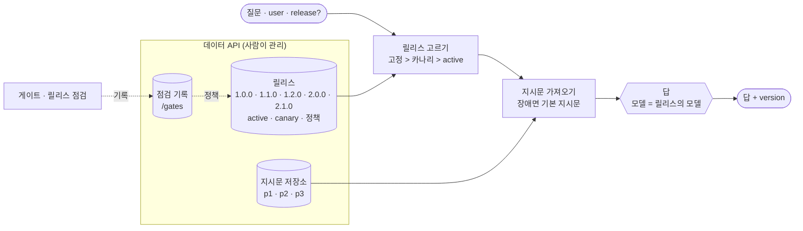
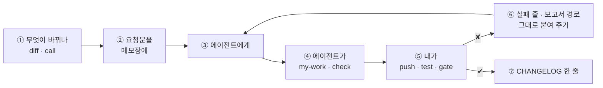
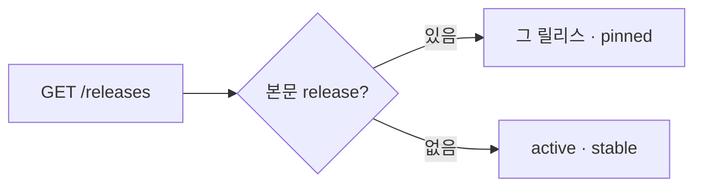
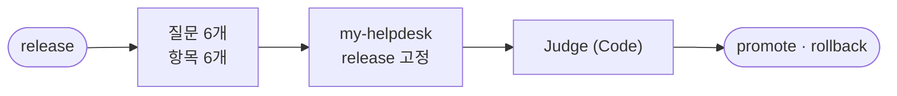
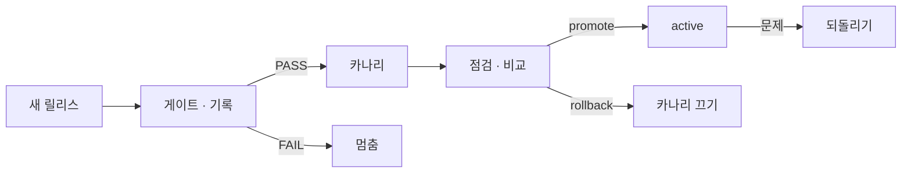

# 74일차 개요 · 모델·Prompt·Workflow 버전 관리와 운영 체계

> 노코드 멀티 에이전트 워크플로우 설계 및 운영 · 2026-10-28
> 30장 · 각 장은 가로줄(`---`)로 나뉩니다. 1교시에는 1~6장을 보고, 나머지 장은 각 단계 강의(1 · 3 · 5교시) 때 함께 띄웁니다.
> 숫자는 모두 강사 노트북 실측입니다 (65일차 n8n 2.42.6, OpenAI `gpt-4.1-mini` · `gpt-5.4-nano`, 10/27 정답 워크플로우를 학생 순서대로 1회).

| 장 | 범위 | 띄우는 때 |
| --- | --- | --- |
| 1~6 | 표지 · 목표 · 시간표 · 버전이 붙은 헬프데스크 · 일하는 순서 · 실습 15개 | 1교시 시작 |
| 7~14 | 1단계 · 무엇이 바뀌나 | 1교시 강의 |
| 15~21 | 2단계 · 릴리스와 배포 전 게이트 | 3교시 강의 |
| 22~28 | 3단계 · 배포 · 되돌리기 · 카나리 | 5교시 강의 |
| 29~30 | 바이브 코딩 · 정리와 예고 (8교시 35분 정리는 [04-STAGE4-WRAPUP](04-STAGE4-WRAPUP.md)) | 7교시 · 8교시 |

---

## 1 / 30 · 표지


**74일차**

# 모델·Prompt·Workflow 버전 관리와 운영 체계

무엇이 바뀌었는지 남기고, 내보내기 전에 시험하고, 언제든 되돌린다

<sub>노코드 멀티 에이전트 워크플로우 설계 및 운영 · 2026-10-28</sub>

---

## 2 / 30 · 오늘 할 수 있게 될 세 가지

| | 목표 | 내용 |
| --- | --- | --- |
| 1 | **바뀐 것을 읽고 남긴다** | 모델 · 지시문 · 흐름을 구분해 diff로 읽고, 흔들림과 바뀜을 반복해서 가르고, 답마다 `version`, 지시문은 저장소에서 |
| 2 | **내보내기 전에 시험한다** | 릴리스를 밖에서 읽고 후보는 고정해서, 게이트로 PASS/FAIL, 기준선, 강한 테스트, 망가진 릴리스는 크게 실패 |
| 3 | **조금씩 내보내고 되돌린다** | 값 하나로 배포 · 되돌리기, 카나리, 나쁜 카나리 끄기, 점검을 한 곳에서, 점검을 지난 것만 배포 |

---

## 3 / 30 · 오늘의 시간표

| 교시 | 시간 | 내용 |
| --- | --- | --- |
| 1 | 09:00~09:50 | 개요 · **1단계 강의** · 무엇이 바뀌나 |
| 2 | 10:00~10:50 | **Lab 01 실습 5개** · diff · version · 흔들림 · 저장소 · 저장소가 멈추면 |
| 3 | 11:00~11:50 | **2단계 강의** · 릴리스와 배포 전 게이트 |
| 4 | 12:00~12:50 | **Lab 02 실습 5개** · 릴리스 읽기 · 게이트 · 기준선 · 강한 테스트 · 망가진 릴리스 |
| - | 13:00~14:00 | 점심 |
| 5 | 14:00~14:50 | **3단계 강의** · 배포 · 되돌리기 · 카나리 |
| 6 | 15:00~15:50 | **Lab 03 실습 5개** · 배포 · 카나리 · 나쁜 카나리 · 점검 · 점검 기록 |
| 7 | 16:00~16:50 | 바이브 코딩 `tver`: 요청서 → TODO → SPEC → IMP-PLAN → 만들기 → 설치 |
| 8 | 17:00~17:50 | 발표 · **4단계 정리** (의미 · 효과 · 회사에서 쓰는 법) · 75일차 예고 |

---

## 4 / 30 · 오늘의 헬프데스크: 버전이 붙은



- 72 · 73일차와 같은 IT 문의 헬프데스크 (FAQ · 접수 건). 오늘은 **답을 바꾸는 것**(모델 · 지시문)을 워크플로우 밖에서 버전으로 다룹니다.

---

## 5 / 30 · 일하는 순서 (오늘은 "바뀐 것 → 버전 → 게이트")



- 배포 · 카나리 · 되돌리기 · 정책은 **내가** `flow.py release`로. 끝나면 `release helpdesk --reset`.
- 후보는 `--set release=...`로 고정해 시험. 모든 명령이 `-v`를 받습니다.

---

## 6 / 30 · 오늘의 실습 15개

| | 예제 1 | 예제 2 | 예제 3 | 과제 1 | 과제 2 |
| --- | --- | --- | --- | --- | --- |
| Lab 01 | v1 → v2 diff (에이전트 없이) | 답마다 `version` | 흔들림인가 바뀜인가 (에이전트 없이) | 지시문을 저장소에서 | 저장소가 멈추면 기본 지시문 |
| Lab 02 | 릴리스 읽기 · 후보 고정 | 약한 golden 게이트 (에이전트 없이) | 기준선: 시간 · 반복 (에이전트 없이) | 나쁜 릴리스를 막는 게이트 | 망가진 릴리스는 400 |
| Lab 03 | 배포 · 되돌리기 (에이전트 없이) | 카나리 | 나쁜 카나리 끄기 (에이전트 없이) | 릴리스 점검 워크플로우 | 점검 기록 · 지난 것만 배포 |

- 실습 문서에 복사해 붙일 요청문은 없습니다. 막히면 `▶`, 요청문은 **빈칸 4개**를 채워서.

---

## 7 / 30 · 1단계 · 왜 버전 관리인가

| 질문 | 필요한 것 |
| --- | --- |
| 어제와 오늘 사이에 **무엇이** 바뀌었나 | 변경 기록 · diff |
| 이 답은 **어느 버전이** 냈나 | 답 · 로그의 버전 (추적성) |
| 어제로 **돌아갈 수** 있나 | 지워지지 않은 이전 버전 (되돌리기) |
| 같은 입력이면 같은 결과인가 | 재현성 |

- 일반 소프트웨어: 코드가 같으면 결과가 같다. **LLM 앱: 코드가 같아도 모델 · 지시문이 바뀌면 다르다.** → MLOps · LLMOps.

---

## 8 / 30 · 1단계 · 바뀌는 것 셋 (+ 공급자가 바꾸는 모델)

| 바뀌는 것 | 누가 | 오늘 |
| --- | --- | --- |
| 모델 | 개발자, **공급자** | 릴리스의 `model` |
| 지시문 | 기획 · 운영 · 개발자 | 저장소 p1 · p2 · p3 |
| 흐름 | 개발자 | 워크플로우 JSON |

**10/27 수업 준비 중 실제로**: v2의 `gpt-4.1-nano`가 OpenAI에서 **지원 종료** → 워크플로우는 그대로인데 HTTP 500. `gpt-5.4-nano`로 바꿈. 모델 이름도 버전이고, 사라집니다.

---

## 9 / 30 · 1단계 · 차이 읽기 (Lab 01 예제 1)

```text
+ node 'Review check' (code)
~ 'Answer' parameters.options.systemMessage: changed (307 → 419 chars)
~ 'Answer model' parameters.model.value: gpt-4.1-mini → gpt-5.4-nano
~ 'Question webhook' parameters.path: rel-v1 → rel-v2
+ link Answer → Review check (main)  ...  7 change(s)
```

- 노드 단위 diff: 위치 · id 같은 뜻 없는 차이는 빼고. v2는 VPN 1.0초 · `[FAQ-003]` (v1 2.8초).
- **셋이 한꺼번에** 바뀌어 원인을 모릅니다. 한 번에 하나.

---

## 10 / 30 · 1단계 · 흔들림인가 바뀜인가 (Lab 01 예제 3)

| `lab01-compare --repeat 3` | v1 | v2 |
| --- | --- | --- |
| 해결 낱말 · 접수 현황 (3케이스) | ✔ × 9 | ✔ × 9 |
| 출처 번호 (2케이스) | ✘ × 6 | ✔ × 6 |
| 합계 | 9/15 | 15/15 |

- 세 번 모두 같은 쪽 → **신호**(바뀐 것). 나왔다 안 나왔다 → **잡음**(흔들림).
- VPN `bench -n 5`: v1 p50 1.23초 · v2 0.98초. 빨라진 원인은 아직 모름.

---

## 11 / 30 · 1단계 · 답마다 버전 (Lab 01 예제 2)

```json
{"route": "자동 답변", "answer": "…",
 "version": {"release": "1.0.0", "prompt_version": "p1", "model": "gpt-4.1-mini"}}
```

- 출처 표시(provenance): 이 답을 **무엇이** 냈나.
- 모델 이름은 **한 곳**(릴리스 정보)에서 정하고 모델 노드와 결과가 **같은 곳을 읽게**. `lab01` 3/3.

---

## 12 / 30 · 1단계 · 지시문은 저장소로 (Lab 01 과제 1)

| 지시문이 워크플로우 안에 | 지시문이 저장소에 |
| --- | --- |
| 한 문장 고쳐도 push · 재시작 | 새 버전을 더함 |
| 흐름 변경과 섞임 | p1 → p2만 따로 |
| 예전 것을 찾기 어려움 | p1 · p2 · p3 나란히 (불변) |

- 업계: Prompt Hub · Langfuse · PromptLayer · MLflow Prompt Registry — 이름 + 불변 버전 + 꼬리표.
- `lab01-challenge` 2/3 → 3/3 (`prompt_source: registry`).

---

## 13 / 30 · 1단계 · 저장소가 멈추면 (Lab 01 과제 2)

| `lab01-challenge2` | 고치기 전 | 고친 뒤 |
| --- | --- | --- |
| 저장소 고장 (500) | ✘ HTTP 500 · 0.1초 | ✔ `fallback` · 1.3초 |
| 저장소 느림 (8초) | ✘ 9.1초 기다림 | ✔ `fallback` · 3.0초 |
| 평소 · 되돌린 뒤 | ✔ ✔ | ✔ ✔ |

- 부르는 곳이 늘면 장애점도 는다 (72일차). timeout 2초 + **마지막으로 잘 됐던 지시문(p1)**.

---

## 14 / 30 · 1단계 · 막을까, 계속 갈까

| | 73일차 판별 LLM | 오늘 지시문 저장소 |
| --- | --- | --- |
| 멈추면 위험 | 공격이 지나감 | 조금 예전 지시문 |
| 고른 쪽 | fail-closed (`guard_down`) | fail-open (`fallback`) |

- 계속 갔다는 사실은 **남깁니다** (`prompt_source`). 아무도 모르는 계속 가기는 사고를 숨깁니다 → 21장.

---

## 15 / 30 · 2단계 · 릴리스 = 지시문 + 모델

| 릴리스 | 지시문 | 모델 | 1.0.0과 다른 것 |
| --- | --- | --- | --- |
| 1.0.0 | p1 | mini | (기준) |
| 1.1.0 | p2 | mini | 지시문만 (출처 번호) |
| 1.2.0 | p3 | mini | 지시문만 (한 문장 · 포털로) |
| 2.0.0 | p2 | 5.4-nano | 1.1.0과 비교하면 모델만 |
| 2.1.0 | p9 | mini | 없는 지시문 (21장) |

- **한 릴리스에 한 가지.** 한 번 낸 릴리스는 바꾸지 않음 (불변 결과물).

---

## 16 / 30 · 2단계 · 밖에서 읽고, 후보는 고정 (Lab 02 예제 1)



- 배포 = 값 하나 (원격 설정 · 기능 플래그와 같은 생각). 없는 릴리스는 400.
- 고정의 문은 **좁게** (73일차: 공격면). `lab02` 1/5 → 5/5.

---

## 17 / 30 · 2단계 · 게이트 (Lab 02 예제 2)

| 약한 golden (200 · route만) | 결과 |
| --- | --- |
| 1.0.0 · 1.1.0 · 2.0.0 | 6/6 PASS |
| **1.2.0** | **6/6 PASS** |

1.2.0의 답: **"IT 포털에서 프린터 문제 해결 방법을 확인해 주세요."**

- 품질 게이트 = 평가 세트 + 판정 규칙 + 기준 + 기록. 종료 코드 0/1로 파이프라인이 멈춤.

---

## 18 / 30 · 2단계 · 게이트는 테스트만큼만 (Lab 02 과제 1)

| 릴리스 | 약한 golden | 강한 golden (해결 낱말 · 상태 · 떠넘기기) |
| --- | --- | --- |
| 1.0.0 · 1.1.0 | PASS | 9/9 PASS |
| **1.2.0** | **PASS** | **1/9 FAIL** |
| 2.0.0 | PASS | 9/9 PASS |

- 기대는 **데이터에서 사람이** (지금 답을 베끼지 않음). 금지 문구 "포털을 참고"는 "포털**에서**"를 놓침 → 해결 낱말이 더 튼튼.

---

## 19 / 30 · 2단계 · 기준선 (Lab 02 예제 3)

| VPN `bench -n 5` | p50 | p95 |
| --- | --- | --- |
| 1.0.0 (mini) | 1.23초 | 1.42초 |
| 2.0.0 (5.4-nano) | 1.12초 | 1.24초 |

- golden 1.0.0 × 3번 = **18/18** → 흔들리지 않는 게이트. `--max-p95 3`은 약 두 배 여유.
- 기준은 감이 아니라 **재서**. 흔들리는 테스트는 게이트를 무너뜨림.

---

## 20 / 30 · 2단계 · 작은 모델로 바꿔도 될까

| 저울 | 2.0.0 |
| --- | --- |
| 품질 (강한 golden) | 9/9 PASS |
| 속도 | p95 1.3초 (게이트), VPN p50 1.12초 |
| 비용 | 75일차 |

- 게이트 PASS = **게이트가 보는 것은** 괜찮다. 말투 · 드문 질문은? → 카나리로 먼저 (3단계).

---

## 21 / 30 · 2단계 · 망가진 릴리스는 크게 실패 (Lab 02 과제 2)

| 2.1.0 (p9, 저장소에 없음) | 고치기 전 | 고친 뒤 |
| --- | --- | --- |
| 고정해서 물으면 | 200 (기본 지시문이 받아 줌) | **400 `release broken`** |
| 강한 golden 게이트 | **9/9 PASS** (위험) | 0/9 FAIL |

- 장애(5xx · 시간 초과) → 견딘다. 설정 오류(4xx) → **fail fast**. 조용한 실패가 가장 비싸다.

---

## 22 / 30 · 3단계 · 배포와 되돌리기 (Lab 03 예제 1)

| 되돌리기 | 걸리는 일 |
| --- | --- |
| 예전 JSON을 찾아 push | 분 단위 · 재시작 · 다른 것도 섞임 |
| **`active` 값 하나** | 명령 한 줄, 다음 요청부터 |

- 배포(올려 두기) ≠ 릴리스(켜기). 먼저 되돌리고 원인을 찾는다. **되돌리기는 연습한다.**
- DORA: 배포 빈도 · 리드 타임 · 변경 실패율 · 복구 시간(MTTR). `lab03` 2/2.

---

## 23 / 30 · 3단계 · 배포 전략

| 전략 | 피해 반경 | 되돌리기 |
| --- | --- | --- |
| 한 번에 | 100% | 느릴 수 있음 |
| 블루그린 | 100% (한 번에 넘김) | 빠름 |
| **카나리** | 일부 (1~5%부터) | 끄면 끝 |
| 그림자 | 0% (답은 버림) | 필요 없음 |
| A/B | 나눔 | "더 좋은가"를 봄 |

---

## 24 / 30 · 3단계 · 카나리: 같은 사람은 같은 쪽 (Lab 03 예제 2)

| 50% 카나리 | bucket (이름 글자 코드 합 % 100) | 받는 릴리스 |
| --- | --- | --- |
| 최유진 · 정우성 | 0 · 42 | 카나리 |
| 한지훈 · 이준호 · 박서연 · 김민지 | 52 · 56 · 57 · 80 | active |

- 무작위로 나누지 않음 (고정 배정, sticky bucketing). 순서: **고정 > 카나리 > active**. `lab03-canary` 3/6 → 6/6.

---

## 25 / 30 · 3단계 · 나쁜 카나리를 보고 끄기 (Lab 03 예제 3)

| 1.2.0 50% 카나리 (`lab03-watch`) | 결과 |
| --- | --- |
| 켠 상태 | **4/6** — 카나리 둘이 "대기열" 없는 답 |
| `--no-canary` 뒤 | 6/6 |

- 카나리는 **보는 것까지** (카나리 분석). 전원 배포였다면 6/6명이 영향.

---

## 26 / 30 · 3단계 · 점검을 한 곳에서 (Lab 03 과제 1)



| `my-release-check` | 결과 |
| --- | --- |
| 1.1.0 · 2.0.0 | `promote` 6/6 |
| 1.2.0 | `rollback` 0/6 |

---

## 27 / 30 · 3단계 · 판단을 남기고, 정책으로 (Lab 03 과제 2)

| 정책 켬 (`require_gate`) | 고치기 전 | 고친 뒤 |
| --- | --- | --- |
| 점검 결과 | 말만 함 | `/gates`에 기록 · `recorded` |
| 1.1.0 배포 | **409 not gated** (기록 없음) | 200 |
| 1.2.0 배포 · 2.0.0 카나리 | 409 | 409 |

- 판단 · 기록 · 실행을 나눔 (점검은 배포하지 않음). 코드로 된 정책.

---

## 28 / 30 · 3단계 · 운영 체계



- 누가 · 언제 · 어떤 순서로 · 무엇을 남기나 · 문제면(런북) · 연습. `CHANGELOG.md` · `RELEASE.md`.

---

## 29 / 30 · 7교시 · 바이브 코딩 `tver`

- n8n 워크플로우를 **git에 버전으로 저장**하고 두 버전을 **노드 단위로 비교**하는 TUI. 오늘 `flow.py diff`를 내 도구로.
- 순서: [요청서](../../Last3Mon/74/VIBE-REQ-TVER.md) → `Doc/TODO.md` → `Doc/SPEC.md` → `Doc/IMP-PLAN.md` → 단계별 구현 → `uv tool install` → 다른 폴더에서.
- 요구 14개 (R1~R14). 50분 안에 엔진 1 · 2단계 · TUI 1단계 · 설치.


---

## 30 / 30 · 오늘의 정리 · 75일차 예고

| 오늘 | 한 줄 |
| --- | --- |
| 1단계 | 바뀐 것을 읽고(diff), 반복해서 재고, 답마다 버전, 지시문은 저장소 (멈추면 기본 지시문) |
| 2단계 | 릴리스를 밖에서 읽고 고정해서 시험, 게이트는 테스트만큼만, 기준은 재서, 설정 오류는 크게 실패 |
| 3단계 | 값 하나로 배포 · 되돌리기, 카나리는 보고 끈다, 점검을 남기고 정책으로 지킨다 |

**75일차 · 사용량과 비용**: 오늘 2.0.0(작은 모델)을 게이트로 품질 · 속도만 봤습니다. 내일은 **토큰 · 가격**으로 비용을 재고, 같은 게이트를 지키면서 비용을 줄입니다.
