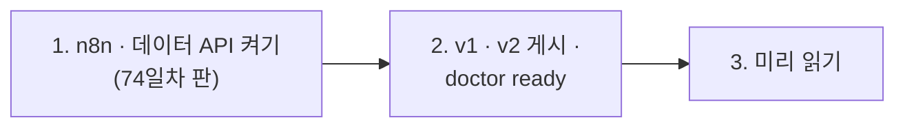

# 74일차 실습 준비 · 수업 전에 미리 해 두면 좋은 것

- 수업일: 2026-10-28 (74일차) · 모델·Prompt·Workflow 버전 관리와 운영 체계
- 준비 시간: 약 10분
- 먼저 WSL에서 `cd ~/aio-01d4-stu && git pull`로 오늘 자료를 받습니다 (수강생 저장소: https://gl.isitsoft.kr/publicproj/aio-01d4-stu).
- **수업 전날까지** 1~2절을 끝내 주세요.



---

## 1. n8n과 데이터 API 켜기 (전날 필수, 3분)

오늘은 **74일차 판 데이터 API**(73일차 + 지시문 저장소 + 릴리스 + 점검 기록 · 배포 정책)를 씁니다. 같은 이름이라 이 폴더에서 다시 만들면 바뀝니다.

```bash
sudo systemctl disable --now ollama 2>/dev/null   # WSL에 설치한 Ollama가 있으면 끄고 자동 시작도 끔
cd ~/aio-01d4-stu/Last3Mon/65/n8n
docker compose rm -sf ollama                      # Ollama 컨테이너가 있으면 지움 (없으면 그냥 지나감)
docker compose start
cd ~/aio-01d4-stu/Last3Mon/74/data-api
docker compose up -d --force-recreate
sleep 3                                                   # 데이터 API가 뜰 때까지
curl -s localhost:8800/releases/helpdesk | head -c 80     # {"name": "helpdesk", "active": "1.0.0", ...
```

- **66일차부터 LLM은 OpenAI API 키(`Last3Mon/.env`, Credential `OpenAI (.env)`)만 씁니다.** 오늘은 같은 키로 작은 모델 `gpt-5.4-nano`도 씁니다 (10/27 수업 준비 중 `gpt-4.1-nano`가 OpenAI에서 지원 종료되어 바꿈 — 1단계 강의 2절).
- `network day65-n8n_default not found` → n8n이 켜져 있지 않음. 위 n8n 부분부터 다시.

## 2. v1 · v2 게시와 준비 확인 (전날 필수, 3분)

오늘 비교할 두 버전을 게시해 둡니다 (만들지 않고 게시만).

```bash
cd ~/aio-01d4-stu/Last3Mon/74
uv run tools/flow.py push reference/helpdesk-v1.json reference/helpdesk-v2.json
uv run tools/flow.py call rel-v1 requests/faq-vpn.json
uv run tools/flow.py doctor
```

```text
✔ n8n container day65-n8n-n8n-1
✔ n8n http://localhost:5678
✔ data API http://localhost:8800
✔ releases /releases/helpdesk · gates /gates/helpdesk (day 74 data API)
✔ n8n → http://data-api:8800
✔ credential 'OpenAI (.env)' (openAiCourse0001)
✔ node catalog (for check)
✔ CLI coding agent: codex, claude, agy
ready
```

| ✘ 항목 | 할 일 |
| --- | --- |
| n8n container · data API | 1절 |
| releases · gates | 데이터 API가 예전 판 → 1절 `--force-recreate` |
| `! release state is not the start state` | `uv run tools/flow.py release helpdesk --reset` |
| credential | `cd ~/aio-01d4-stu/Last3Mon/65/n8n && bash register-credentials.sh` |
| CLI coding agent | [67일차 준비](../67/00-DAY67-PREP.md) 2절 |

---

## 3. 미리 읽어 오면 좋은 내용 (선택, 약 5분)

### 3.1 어제와 오늘 답이 다르다

어제 잘 되던 헬프데스크가 오늘 이상한 답을 합니다. 누가 지시문을 고쳤나요, 모델을 바꿨나요, 노드를 바꿨나요? 언제부터였나요? 되돌리려면 무엇으로 되돌리나요? 오늘은 이 질문에 바로 답할 수 있게 만듭니다.

### 3.2 용어

| 용어 | 한 줄 설명 |
| --- | --- |
| 릴리스 | 한 번에 내보내는 묶음 (오늘은 지시문 버전 + 모델) |
| 게이트 | 배포 전에 통과해야 하는 테스트와 기준 (통과율 · p95) |
| 카나리 | 새 릴리스를 일부 사용자에게만 먼저 내보내기 |
| 되돌리기 (롤백) | 문제가 생긴 릴리스를 이전 것으로 바꾸기 |
| 고정 (pin) | 특정 요청만 특정 릴리스로 보내기 (후보 시험) |
| 기본 지시문 (fallback) | 지시문 저장소가 멈췄을 때 대신 쓰는, 워크플로우 안에 둔 검증된 지시문 |

### 3.3 7교시 요청서

[VIBE-REQ-TVER](../../Last3Mon/74/VIBE-REQ-TVER.md)를 한 번 읽어 옵니다. 운영팀장이 원하는 것 열두 가지 중 "꼭"은 무엇일까요?

## 4. 당일 준비물

- 충전된 노트북과 충전기, WSL의 Docker, Windows Terminal(WSL) 창 **두 개**, 웹 브라우저
- 68일차 `~/vibe/tflow` (7교시 `tver`의 바탕, 없어도 됨), 73일차 `~/vibe/tscan` (키 모양 찾기, 없어도 됨)

## 확인

- [ ] `curl -s localhost:8800/releases/helpdesk`에 `active 1.0.0`
- [ ] `call rel-v1`이 답을 돌려줌
- [ ] `uv run tools/flow.py doctor` → 마지막 줄 `ready`
