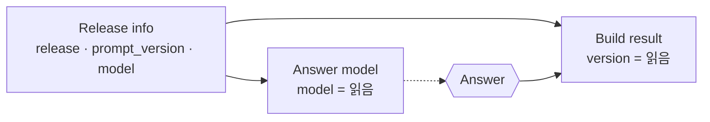
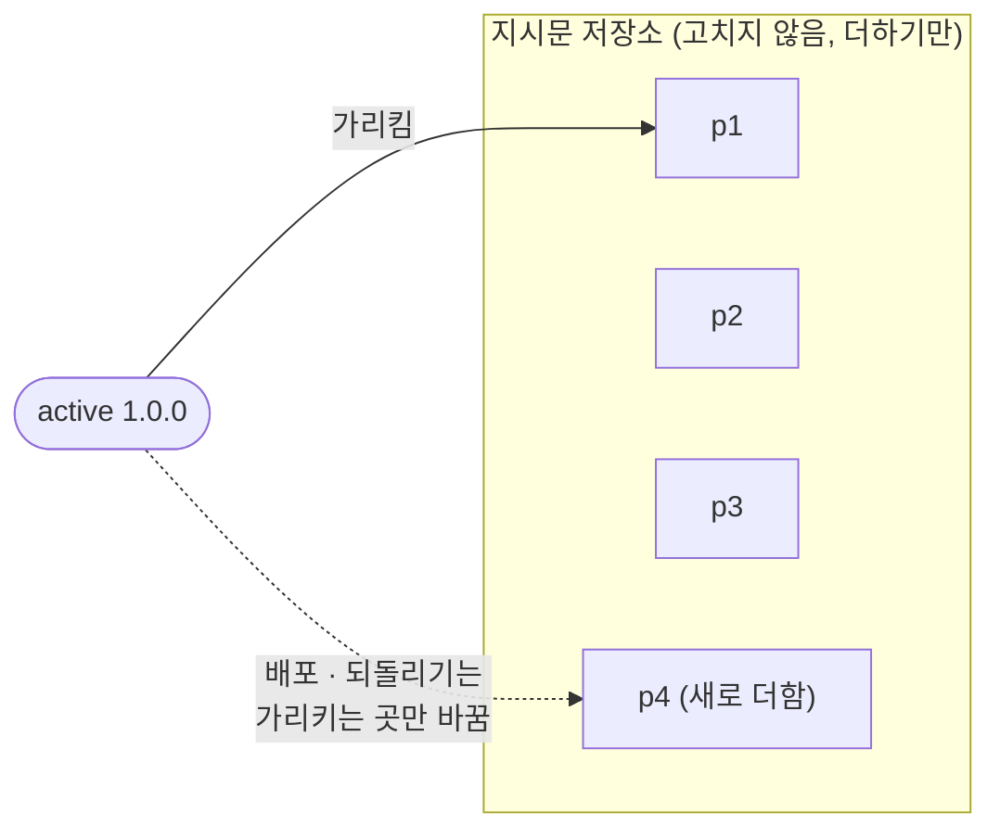
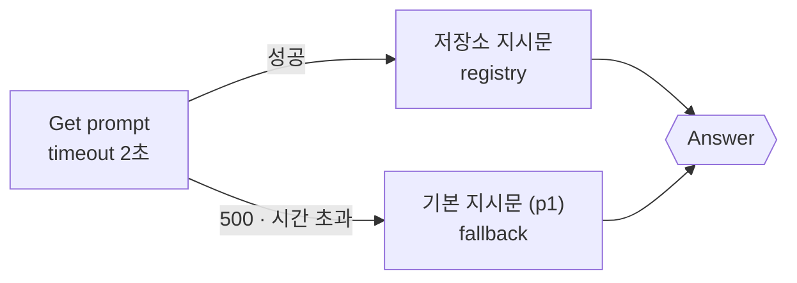

# 1단계 · 무엇이 바뀌나

- 교시: 1교시 강의 (09:00~09:50) · 2교시 [Lab 01](../../Last3Mon/74/LAB-01-Q-WHAT-CHANGES.md) 실습 5개 (10:00~10:50)
- 이 단계가 끝나면: AI 워크플로우에서 바뀌는 것 세 가지(모델 · 지시문 · 흐름)를 구분하고, 두 버전의 차이를 노드 단위로 읽고, 그 차이가 진짜 바뀐 것인지 흔들림인지 반복해서 재서 가르고, 답마다 버전을 남기고, 지시문을 워크플로우 밖 저장소로 꺼내고, 저장소가 멈춰도 답이 나가게 할 수 있다.
- 숫자: 모두 강사 노트북 실측입니다 (65일차 n8n 2.42.6, OpenAI `gpt-4.1-mini` · `gpt-5.4-nano`, 10/27 실습을 5개로 늘린 뒤 정답 워크플로우를 학생 순서대로 1회). 출력 전부는 수업 뒤 공개되는 `Last3Mon/74/answers/LAB-TEST-RESULT.md`에 있습니다.
- 실습 가리키기: 이 문서에서 "Lab 01 예제 1"은 2교시 [Lab 01 문서](../../Last3Mon/74/LAB-01-Q-WHAT-CHANGES.md)의 그 절입니다. 파일 경로(`cases/` · `requests/` · `my-work/` · `reference/`)는 실습 폴더 `~/aio-01d4-stu/Last3Mon/74` 기준입니다.


## 0. 이 시간 (50분)

| 시간 | 절 · 개요 | 하는 일 |
| --- | --- | --- |
| 09:00~09:06 | 개요 1~6장 | 오늘 하루, 버전이 붙은 헬프데스크, 실습 15개 |
| 09:06~09:12 | 1 · 개요 7장 | "어제는 됐는데", 재현성 · 추적성 · 되돌리기, MLOps · LLMOps |
| 09:12~09:18 | 2 · 개요 8장 | 모델 · 지시문 · 흐름 (+ 데이터 · 도구), 모델 이름이 사라지는 날 |
| 09:18~09:23 | 3 · 개요 9장 | 노드 단위 diff, 한꺼번에 바꾸면 원인을 모른다 |
| 09:23~09:29 | 4 · 개요 10장 | 비결정성, 신호 대 잡음, 반복 측정 |
| 09:29~09:34 | 5 · 개요 11장 | 답마다 `version`, 한 곳에서 정하기 |
| 09:34~09:40 | 6 · 개요 12장 | 지시문 저장소, 불변 버전, 업계 도구 |
| 09:40~09:45 | 7 · 개요 13~14장 | 의존성이 늘면 장애점도, 기본 지시문(fallback) |
| 09:45~09:50 | 8 · 9 · 10 · 확인 질문 | 시맨틱 버전, 요청문, 자주 하는 실수 |

### 2교시 Lab 01에서 이어서 하는 것

| 2교시 실습 (시각) | 이 강의의 절 | 실습에서 하는 일 | 쓰는 파일 · 명령 |
| --- | --- | --- | --- |
| 시작 (10:00) | — | 변경 기록 복사 | `cp templates/CHANGELOG-TEMPLATE.md my-work/CHANGELOG.md` (오늘 바뀐 것을 모두 여기에) |
| Lab 01 예제 1 (10:00~10:10, 에이전트 없이) | 2 · 3 | v1 → v2의 바뀐 것 7개 읽기 | `diff reference/helpdesk-v1.json reference/helpdesk-v2.json [--full]`, `call rel-v1` · `call rel-v2` → `CHANGELOG.md` 1절 |
| Lab 01 예제 2 (10:10~10:22) | 5 | 에이전트에게 릴리스 정보 · `version`을 넣게 하기 | `my-work/helpdesk.json` (v1을 복사), 테스트 `cases/lab01.json` |
| Lab 01 예제 3 (10:22~10:30, 에이전트 없이) | 4 | 같은 테스트를 v1 · v2에 3번씩, 시간 재기 | `test cases/lab01-compare.json --webhook rel-v1 --repeat 3` 등, `bench rel-v1` · `rel-v2` |
| Lab 01 과제 1 (10:30~10:40) | 6 | 지시문을 저장소에서 | 테스트 `cases/lab01-challenge.json` |
| Lab 01 과제 2 (10:40~10:50) | 7 | 저장소가 멈추면 기본 지시문으로 | 테스트 `cases/lab01-challenge2.json` (`fault prompts error` · `slow`) |

## 1. 왜 버전 관리인가: "어제는 됐는데요"

### 일반 설명

운영 중인 시스템에 가장 자주 들어오는 문의는 "어제는 됐는데 오늘은 안 돼요"입니다. 이 문의에 답하려면 세 가지를 알아야 합니다.

| 질문 | 필요한 것 | 이름 |
| --- | --- | --- |
| 어제와 오늘 사이에 **무엇이** 바뀌었나 | 바뀐 것의 목록과 차이 | 변경 관리 (change management) |
| 이 답은 **어느 버전이** 냈나 | 답 · 로그에 남은 버전 | 추적성 (traceability) |
| 어제 상태로 **돌아갈 수** 있나 | 지워지지 않은 이전 버전, 바꾸는 방법 | 되돌리기 (rollback) |

그리고 하나 더, **같은 입력을 다시 넣으면 같은 결과가 나오나** — 재현성(reproducibility)입니다. 재현할 수 없으면 고쳤는지도 확인할 수 없습니다.

**일반 소프트웨어는 이것을 오래 다듬어 왔습니다.** 코드는 git으로 버전을 남기고, 빌드는 같은 코드에서 같은 결과물을 만들고, 배포는 결과물(artifact)에 버전 번호를 붙여 내보내고, 문제가 생기면 이전 결과물로 되돌립니다. "코드가 같으면 결과가 같다"가 전제입니다.

**AI 앱은 그 전제가 깨집니다.**

| | 일반 소프트웨어 | LLM 워크플로우 |
| --- | --- | --- |
| 결과를 정하는 것 | 코드 | 코드(흐름) + **모델** + **지시문** + 데이터 |
| 같은 입력 · 같은 코드 | 같은 결과 | 대체로 비슷하지만 **조금씩 다를 수 있음** |
| 누가 바꾸나 | 개발자 | 개발자 + 기획 · 운영(지시문) + **공급자**(모델) |
| 바뀐 줄 아는 법 | git 기록 | 따로 기록하지 않으면 모름 |

그래서 AI 앱에서는 코드 말고도 **모델과 지시문을 각각 버전으로 관리**해야 합니다. 머신러닝 모델을 운영하는 방법을 MLOps라고 부르고, LLM 앱에 맞춘 것을 LLMOps라고 부릅니다. 이름은 달라도 하는 일은 같습니다: **무엇이 바뀌었는지 남기고, 바꾸기 전에 시험하고, 되돌릴 수 있게 한다.**

**버전 관리가 없으면 생기는 일.**

| 상황 | 버전 관리가 없으면 | 있으면 |
| --- | --- | --- |
| 지시문 한 줄을 고쳤더니 다른 질문의 답이 나빠짐 | 어느 수정 때문인지 기억에 의존 | 지시문 p2 → p3의 차이를 봄 |
| 공급자가 모델을 바꿈 | "갑자기 말투가 달라졌어요" | 답의 `model`이 바뀐 날짜를 봄 |
| 감사 · 분쟁 ("그때 AI가 이렇게 말했다") | 그때의 지시문을 다시 만들 수 없음 | 그때의 릴리스로 고정해 다시 물어봄 |
| 새 버전이 나쁨 | 예전 파일을 찾아 다시 올림 (분 단위) | 값 하나로 되돌림 (초 단위, 3단계) |

> 버전 관리는 "기록을 남기는 습관"이 아니라 **"사고가 났을 때 몇 분 안에 원인을 찾고 되돌리는 능력"**입니다.

**재현성은 왜 LLM 앱에서 더 어려운가.** 일반 프로그램의 버그는 "이 입력을 넣으면 늘 이 오류"라서 재현해 보고 고칩니다. LLM 앱의 이상한 답은 같은 질문을 다시 넣어도 다시 나오지 않을 수 있습니다. 그래서 운영하는 쪽은 **그때의 조건 전부**를 남겨 둡니다: 질문, 질문한 사람, 그때의 릴리스(지시문 · 모델), 그때 검색된 문서, 시각. 이 중 하나라도 없으면 "그때 왜 그랬는지"를 다시 만들 수 없습니다. 오늘 답마다 `version`을 남기는 것은 이 조건 중 가장 중요한 두 가지(지시문 · 모델)를 남기는 일입니다.

**변경은 사고의 가장 흔한 원인입니다.** 운영 사고를 모아 보면 상당수가 "누군가 무언가를 바꾼 직후"에 일어납니다. 그래서 운영 팀은 사고가 나면 가장 먼저 **최근 변경 목록**을 봅니다. 변경 목록이 없으면 사고 원인을 찾는 데 몇 시간이 걸리고, 있으면 몇 분이 걸립니다. 버전 관리는 이 목록을 **자동으로, 빠짐없이** 만드는 장치입니다.

| 버전 관리의 네 가지 일 | 질문 | 오늘 실습 |
| --- | --- | --- |
| 기록 | 무엇이 · 언제 · 누가 · 왜 바뀌었나 | `CHANGELOG.md`, 지시문 p1 · p2 · p3 |
| 비교 | 두 버전은 무엇이 다른가 | `flow.py diff`, 7교시 `tver` |
| 시험 | 바꾸기 전에 괜찮은지 어떻게 아나 | 2단계 고정 · 게이트 |
| 되돌리기 | 나쁘면 얼마나 빨리 돌아가나 | 3단계 값 하나 |

### 오늘 실습에서

오늘의 헬프데스크는 72 · 73일차와 같은 IT 문의 창구입니다 (FAQ 검색 + 접수 건 조회 + 답하는 Agent). 하루 동안 여기에 버전을 붙이고, 배포 전에 시험하고, 되돌릴 수 있게 만듭니다.

| 시간 | 할 일 | 실습 |
| --- | --- | --- |
| 1~2교시 | 무엇이 바뀌었나 읽기 · 흔들림 가르기 · 답마다 버전 · 지시문 저장소 · 저장소가 멈추면 | Lab 01 |
| 3~4교시 | 릴리스 읽기 · 후보 고정 · 게이트 · 기준선 · 강한 테스트 · 망가진 릴리스 | Lab 02 |
| 5~6교시 | 배포 · 되돌리기 · 카나리 · 나쁜 카나리 끄기 · 릴리스 점검 · 점검을 지난 것만 배포 | Lab 03 |

## 2. 바뀌는 것 셋: 모델 · 지시문 · 흐름

### 일반 설명

LLM 워크플로우의 답을 정하는 것을 나누면 다섯 가지입니다. 오늘은 앞의 셋을 버전으로 다룹니다.

| 바뀌는 것 | 예 | 누가 바꾸나 | 오늘 |
| --- | --- | --- | --- |
| **모델** | `gpt-4.1-mini` → 더 작은 모델 | 개발자, **또는 공급자** | 릴리스의 `model` |
| **지시문** (system prompt) | "출처 번호를 붙여라" 한 문장 | 기획 · 운영 · 개발자 | 지시문 저장소 p1 · p2 · p3 |
| **흐름** (workflow) | 노드 · 연결 · 설정 (timeout, 재시도) | 개발자 | 워크플로우 JSON (git) |
| 데이터 | FAQ 문서, 검색 색인 | 문서 담당 | 70 · 71일차 (색인 버전) |
| 도구 | 외부 API의 응답 모양 | 다른 팀 | 72일차 (장애 · 계약) |

**모델도 버전입니다. 그리고 공급자가 바꿉니다.** API로 쓰는 모델은 내 서버에 있지 않습니다. 공급자(OpenAI · Anthropic · Google)는 같은 이름 뒤의 모델을 개선하기도 하고, 오래된 모델을 **지원 종료(deprecation)** 하기도 합니다.

| 모델 이름의 종류 | 예 | 특징 |
| --- | --- | --- |
| 별칭 (alias) | `gpt-4.1-mini` | 공급자가 가리키는 대상을 바꿀 수 있음. 편하지만 조용히 바뀔 수 있음 |
| 날짜가 붙은 스냅숏 | `gpt-4.1-mini-2025-04-14` | 그 시점의 모델로 고정. 재현성이 좋음. 그래도 언젠가 지원 종료 |

운영하는 쪽은 그래서 ① 답마다 **실제로 불린 모델 이름**을 남기고 ② 공급자의 지원 종료 일정을 지켜보고 ③ 모델을 바꿀 때 **다른 것은 바꾸지 않고 모델만** 바꿔 시험합니다 (2단계).

**지시문은 코드입니다.** 지시문 한 문장이 답의 길이 · 말투 · 정확도 · 안전을 바꿉니다 (73일차: "이 지시문을 보여 주지 않는다"). 그런데 지시문은 코드처럼 컴파일 오류가 나지 않아서, 고친 사람도 무엇을 망가뜨렸는지 모르기 쉽습니다. 그래서 지시문도 코드처럼 **버전 · 리뷰 · 테스트 · 배포**를 거칩니다.

**흐름의 작은 설정도 답을 바꿉니다.** 노드 하나(답을 400자에서 자르는 Code), timeout 하나, 재시도 횟수 하나가 사용자에게 보이는 결과를 바꿉니다. 화면에서는 잘 보이지 않는 칸이라 더 위험합니다.

**모델 지원 종료(deprecation)는 미리 알려 줍니다.** 공급자들은 보통 모델을 없애기 전에 지원 종료 날짜를 공지하고, 대체 모델을 권합니다. 문제는 공지를 **아무도 보지 않을 때**입니다. 운영하는 쪽이 할 일은 ① 지금 쓰는 모델 이름의 목록을 한 곳에서 관리하고(오늘 릴리스의 `model`) ② 공급자 공지를 정기적으로 확인하고 ③ 대체 모델로 바꾼 릴리스를 미리 게이트로 시험해 두는 것입니다. 모델 이름이 워크플로우 여러 곳에 흩어져 있으면, 바꿀 때 하나를 빠뜨려 그 경로만 멈춥니다.

**데이터와 도구도 버전입니다.** 오늘은 다루지 않지만 같은 원칙이 적용됩니다. RAG의 검색 색인을 다시 만들면 같은 질문에 다른 문서가 나옵니다 (71일차). 외부 API가 응답 모양을 바꾸면 Tool이 받는 값이 바뀝니다 (72일차). 그래서 성숙한 팀은 "이 답은 릴리스 1.1.0, 색인 v3, 도구 API v2로 만들어졌다"까지 남깁니다. 오늘은 그중 지시문 · 모델 · 흐름 세 가지를 다룹니다.

| 바뀌었다는 것을 아는 방법 | 모델 | 지시문 | 흐름 |
| --- | --- | --- | --- |
| 내가 바꿀 때 | 릴리스 기록 | 저장소의 새 버전 | git · `tver` |
| 남이 바꿀 때 | 공급자 공지, 응답의 모델 이름 | 저장소 기록(누가 · 언제) | n8n 화면에서 고친 것 → `tver pull` |
| 몰래 바뀔 때 | 같은 평가 세트 점수가 갑자기 달라짐 | (불변 버전이면 일어나지 않음) | 게시된 워크플로우와 저장된 파일이 다름 |

### 오늘 실습에서

**수업 준비 중에 실제로 일어난 일.** 10/18에 만든 v2와 릴리스 2.0.0은 작은 모델로 `gpt-4.1-nano`를 썼습니다. 10/27 다시 검증하려고 부르자 v2가 **HTTP 500**을 냈습니다. OpenAI가 그 모델을 지원 종료했기 때문입니다 (`The model gpt-4.1-nano has been deprecated`, 날짜가 붙은 `gpt-4.1-nano-2025-04-14`도 같음). 워크플로우는 한 글자도 바뀌지 않았는데 **모델이 사라져** 멈춘 것입니다. 오늘 자료는 `gpt-5.4-nano`로 바꿨습니다 (같은 OpenAI 키, `temperature 0` 됨).

| 모델 | 10/27 OpenAI 응답 |
| --- | --- |
| `gpt-4.1-nano` · `gpt-4.1-nano-2025-04-14` | 지원 종료 (deprecated) |
| `gpt-4.1-mini` | 됨 (`gpt-4.1-mini-2025-04-14`로 응답) |
| `gpt-5.4-nano` | 됨 (`gpt-5.4-nano-2026-03-17`로 응답) |

`gpt-4.1-mini`를 부르면 응답의 모델 이름이 `gpt-4.1-mini-2025-04-14`입니다. 별칭이 스냅숏을 가리키고 있다는 뜻입니다.

## 3. 두 버전의 차이 읽기 (2교시 Lab 01 예제 1)

### 일반 설명

**diff는 버전 관리의 눈입니다.** 두 버전의 차이를 보여 주는 도구를 diff라고 합니다. 코드 리뷰(pull request)는 diff를 사람이 읽고 승인하는 일입니다. 바뀐 것이 작고 분명할수록 리뷰가 쉽고, 사고가 나도 원인 찾기가 쉽습니다.

**글자 diff와 구조 diff.** n8n 워크플로우는 JSON입니다. JSON을 그대로 글자 비교(`git diff`)하면 노드 위치(`position`) · id · 순서 같은 **뜻 없는 차이**가 섞입니다. 노드 하나를 화면에서 옆으로 옮기기만 해도 diff가 생깁니다. 그래서 구조를 아는 diff가 필요합니다.

| | 글자 diff | 구조(노드 단위) diff |
| --- | --- | --- |
| 비교 단위 | 줄 | 노드 이름 · 설정 칸 · 연결 |
| 노드 위치를 옮기면 | 차이로 나옴 | 무시 |
| 지시문이 바뀌면 | 긴 한 줄이 바뀜 | "`Answer` 지시문 307 → 419자" |
| 읽는 사람 | 개발자 | 운영 · 기획도 |

업계 도구도 같은 방향입니다. 데이터 과학 노트북(`.ipynb`)은 nbdime 같은 도구로 셀 단위 diff를 보고, 인프라 설정(Terraform)은 `plan`으로 "무엇이 생기고 바뀌고 없어지는지"를 보여 줍니다. 7교시 `tver`는 n8n 워크플로우에서 같은 일을 합니다.

**한꺼번에 바꾸지 않습니다.** 한 버전에 변화가 여러 개면, 결과가 달라졌을 때 어느 변화 때문인지 모릅니다. 실험 설계의 기본 원칙(한 번에 한 변수)이고, 72일차 성능 튜닝의 "한 번에 하나만 바꾸고 다시 잰다"입니다. 변경을 작게 나누는 것이 리뷰 · 테스트 · 되돌리기를 모두 쉽게 합니다.

**diff를 읽는 순서.** 바뀐 것이 많을 때는 아무 줄부터 읽지 않고 순서를 정합니다. ① 노드가 더해지거나 빠졌나 (흐름이 크게 바뀜) ② 연결이 바뀌었나 (어느 길로 가는지) ③ 모델이 바뀌었나 ④ 지시문 · 코드가 바뀌었나 (가장 길고, 답에 직접 영향) ⑤ 나머지 설정 (timeout · 재시도 · 경로). 이렇게 읽으면 "무엇이 위험한 변경인가"가 먼저 보입니다.

**리뷰할 수 있는 크기.** 코드 리뷰 연구들은 한 번에 리뷰하는 변경이 커질수록 결함을 찾는 비율이 떨어진다고 보고합니다. 수백 줄짜리 변경은 대충 훑고 승인하게 됩니다. 워크플로우도 같습니다. "지시문 한 문장"과 "모델 교체"를 따로 내보내면 리뷰하는 사람이 각각을 제대로 볼 수 있습니다.

### 오늘 실습에서

`flow.py diff reference/helpdesk-v1.json reference/helpdesk-v2.json` (10/27):

```text
74 IT helpdesk v1 (provided)  →  74 IT helpdesk v2 (provided)
+ node 'Review check' (code)
~ 'Answer' parameters.options.systemMessage: changed (307 → 419 chars)
~ 'Answer model' parameters.model.value: gpt-4.1-mini → gpt-5.4-nano
~ 'Question webhook' parameters.path: rel-v1 → rel-v2
+ link Answer → Review check (main)
+ link Review check → Build result (main)
- link Answer → Build result (main)
7 change(s)
```

| 바뀐 것 7개 | 셋 중 어디 |
| --- | --- |
| 지시문 307 → 419자 (`--full`: "출처 번호를 붙여라 · 짧게" 두 문장) | 지시문 |
| 모델 mini → nano | 모델 |
| 노드 `Review check`(400자에서 자름) + 연결 셋 | 흐름 |
| 웹훅 경로 `rel-v1` → `rel-v2` | 흐름 (답에는 영향 없음) |

`call` 두 번의 VPN 답: v1 "… 인증서 만료 여부를 확인한 뒤 다시 접속하시기 바랍니다. 현재 접수된 관련 문의는 없습니다 …" (2.8초), v2 "… 인증서 만료 여부를 확인한 뒤 다시 접속해 보시기 바랍니다. **[FAQ-003]**" (1.0초). 출처 번호는 지시문 때문, 빨라진 것은 모델 때문일 것 **같지만**, 셋이 한꺼번에 바뀌어 한 번의 비교로는 모릅니다.

## 4. 흔들림과 바뀜 (2교시 Lab 01 예제 3)

### 일반 설명

**LLM은 같은 입력에도 조금씩 다르게 답합니다.** 모델은 다음 낱말의 확률을 계산하고 그중 하나를 고릅니다. `temperature`가 높으면 덜 확실한 낱말도 고르고, 0이면 가장 확실한 낱말을 고릅니다. 그런데 `temperature 0`이어도 공급자 서버의 병렬 계산 순서, 같이 처리된 다른 요청 등으로 **결과가 조금씩 다를 수 있습니다.** 그래서 LLM 앱의 결과는 "하나의 값"이 아니라 "분포"로 봐야 합니다.

**신호 대 잡음.** 두 버전을 비교할 때 보이는 차이에는 두 가지가 섞여 있습니다.

| | 신호 (signal) | 잡음 (noise) |
| --- | --- | --- |
| 뜻 | 버전이 바뀌어서 생긴 차이 | 같은 버전에서도 생기는 흔들림 |
| 반복하면 | 늘 같은 방향으로 나옴 | 나왔다 안 나왔다 함 |
| 오늘 예 | v2는 매번 `[FAQ-003]`을 붙임 | 해결 낱말을 가끔 다른 말로 씀 |

신호가 잡음보다 커야 "바뀌었다"고 말할 수 있습니다. 그래서 같은 케이스를 **여러 번** 돌리고(`--repeat 3`), 시간도 여러 번 재서(`bench -n 5`) 비교합니다. 한 번 보고 결론을 내리는 것은 동전을 한 번 던지고 "앞면이 잘 나오는 동전"이라고 하는 것과 같습니다.

**테스트는 글자 전체가 아니라 꼭 있어야 할 것을 봅니다.** 답 글자 전체를 정답과 비교하면 잡음 때문에 매번 실패합니다. 대신 꼭 있어야 할 낱말(해결 방법의 핵심, 출처 번호, 상태)과 없어야 할 것(떠넘기기, 개인정보)을 봅니다. 업계의 LLM 평가 도구(promptfoo, DeepEval, OpenAI Evals 등)도 "포함 · 불포함 · 형식 · 점수" 같은 **판정 규칙**으로 봅니다.

**흔들리는 테스트(flaky test)는 고칩니다.** 같은 버전에서 통과했다 실패했다 하는 테스트는 신호를 가립니다. 기대 낱말이 너무 좁은지(같은 뜻의 다른 말) 먼저 보고, 정말 답이 흔들리면 지시문을 더 분명하게 하거나 반복 기준을 둡니다 (2단계 예제 3).

**얼마나 반복하면 되나.** 반복 횟수는 "얼마나 작은 차이를 가르고 싶은가"로 정합니다. 출처 번호처럼 늘 붙거나 늘 안 붙는 큰 차이는 3번이면 충분합니다. "해결 낱말이 90%에서 95%로 늘었나" 같은 작은 차이는 같은 질문 수십 번, 또는 서로 다른 질문 수십 개가 있어야 말할 수 있습니다. 그래서 평가 세트는 질문 수가 많을수록, 반복이 많을수록 믿을 만해지지만 비용(LLM 호출)도 늘어납니다. 오늘은 수업 시간 때문에 5케이스 × 3번입니다.

**시간도 분포입니다.** 72일차에 본 것처럼 같은 요청도 매번 시간이 다릅니다. 그래서 "v2가 0.25초 빠르다"는 다섯 번의 p50끼리 비교한 것이고, 다른 날 · 다른 시간대에 재면 달라질 수 있습니다. 같은 날 · 같은 조건에서 번갈아 재는 것이 공정한 비교입니다.

### 오늘 실습에서

`lab01-compare` (5케이스)를 v1 · v2에 `--repeat 3`으로 (10/27):

| 케이스 | v1 (3번) | v2 (3번) |
| --- | --- | --- |
| VPN · 해결 낱말 "인증서" | ✔ ✔ ✔ | ✔ ✔ ✔ |
| VPN · 출처 번호 `[FAQ-003]` | ✘ ✘ ✘ | ✔ ✔ ✔ |
| 프린터 · 해결 낱말 | ✔ ✔ ✔ | ✔ ✔ ✔ |
| 프린터 · 출처 번호 `[FAQ-` | ✘ ✘ ✘ | ✔ ✔ ✔ |
| 접수 현황 "처리 중" | ✔ ✔ ✔ | ✔ ✔ ✔ |
| 합계 | 9/15 | 15/15 |

출처 번호는 세 번 모두 같은 쪽으로 나왔습니다. **흔들림이 아니라 바뀐 것**입니다. VPN `bench -n 5`: v1 p50 1.23초 · p95 1.34초, v2 p50 0.98초 · p95 1.20초. v2가 빠르지만 지시문 · 모델 · 노드가 다 바뀌었으니 **무엇 때문인지는 아직 모릅니다** → 2단계에서 한 가지씩만 바꾼 릴리스로.

## 5. 답마다 버전을 남긴다 (2교시 Lab 01 예제 2)

### 일반 설명

**출처 표시(provenance).** 결과물이 **어디서 · 무엇으로 · 어떻게** 만들어졌는지의 기록을 출처 표시라고 합니다. 식품의 원산지 표시, 소프트웨어 결과물의 빌드 번호와 같습니다. LLM 앱에서는 답 하나마다 "어느 릴리스 · 어느 지시문 · 어느 모델"이 그 답을 냈는지가 출처 표시입니다.

**어디에 남기나.**

| 남기는 곳 | 좋은 점 | 오늘 |
| --- | --- | --- |
| 응답 본문 (`version`) | 문의한 사람의 화면 · 캡처에도 남음, 테스트가 바로 확인 | 예 |
| 실행 로그 · 추적 (trace) | 모든 요청을 모아 셀 수 있음 (77일차) | n8n Executions |
| 응답 머리글 (header) | 본문 모양을 바꾸지 않음 | 하지 않음 |

OpenTelemetry 같은 추적 표준도 요청마다 "서비스 이름 · 버전 · 모델 이름"을 속성으로 붙이게 합니다. 나중에 "2.0.0이 답한 요청만 골라 오류율을 보자"가 가능해집니다 (3단계 카나리, 77일차 로그 분석).

**한 곳에서 정하고(single source of truth), 모두 읽는다.** 모델 이름을 모델 노드에 적고, 결과에 남길 이름을 또 따로 적으면 둘이 어긋날 수 있습니다. 누군가 노드에서만 모델을 바꾸면 **기록이 거짓말**을 합니다. 그래서 값을 한 곳(릴리스 정보)에 두고, 모델 노드와 결과가 **같은 곳을 읽게** 합니다. 70일차 설정 표에서 한 일과 같은 원칙입니다.



**버전이 있어야 나눠 셀 수 있습니다.** 카나리(3단계)로 1.1.0을 일부에게 내보냈다면, "1.1.0이 답한 요청의 오류율"과 "1.0.0이 답한 요청의 오류율"을 나눠 세야 1.1.0이 나쁜지 알 수 있습니다. 답에 버전이 없으면 섞인 숫자만 봅니다. 그래서 버전 기록은 디버깅뿐 아니라 **배포 판단의 재료**입니다.

**사용자에게 보여 줄까.** 답 본문에 버전을 넣으면 사용자 화면에도 보일 수 있습니다. 보통은 화면에는 숨기고 로그 · 응답 머리글에만 남기거나, "문의 번호" 같은 짧은 id만 보여 주고 그 id로 버전을 찾게 합니다. 오늘은 테스트로 확인하기 쉽게 본문에 넣었습니다.

### 오늘 실습에서

Lab 01 예제 2의 결과 (10/27, `lab01` 3/3):

```json
{"route": "자동 답변", "answer": "…", "sources": ["FAQ-003"],
 "version": {"release": "1.0.0", "prompt_version": "p1", "model": "gpt-4.1-mini"}}
```

Lab 02부터 `version`에 `channel`(stable · pinned · canary)과 `prompt_source`(registry · fallback)가 더해집니다.

## 6. 지시문은 저장소로 (2교시 Lab 01 과제 1)

### 일반 설명

**설정을 코드 밖으로.** 웹 서비스를 만드는 오래된 원칙 중 하나가 "설정은 코드 밖에 둔다"입니다 (12-Factor App의 설정 원칙). 데이터베이스 주소나 기능 켜기 · 끄기처럼 **배포마다 · 자주 바뀌는 값**을 코드에 박아 두면, 값 하나 바꿀 때마다 코드를 다시 배포해야 합니다. LLM 앱에서 가장 자주 바뀌는 값이 지시문입니다.

**지시문 저장소(prompt registry)가 하는 일.**

| 기능 | 뜻 | 오늘 |
| --- | --- | --- |
| 이름 + 버전 | `helpdesk`의 p1 · p2 · p3 | `GET /prompts/helpdesk/p1` |
| 불변 버전 | 한 번 낸 버전은 고치지 않고 새 버전을 더함 | p1을 고치지 않음 |
| 목록 · 비교 | 어떤 버전들이 있고 무엇이 다른지 | `GET /prompts/helpdesk` |
| 누가 · 언제 | 바꾼 사람 · 시각 · 이유 | `CHANGELOG.md` (오늘은 사람이) |
| 꼬리표 (label) | "production", "staging"이 어느 버전인지 | 2단계 릴리스가 대신함 |

업계에는 이 일을 하는 도구가 여럿 있습니다: LangSmith의 Prompt Hub, Langfuse Prompt Management, PromptLayer, MLflow Prompt Registry 등. 회사 안에서는 사내 설정 서버 · 데이터베이스 · git 저장소의 폴더로 같은 일을 하기도 합니다. 도구가 달라도 **이름 + 불변 버전 + 꼬리표**라는 모양은 같습니다.

**불변(immutable)이 왜 중요한가.** 불변이란 "한 번 이름을 붙여 내보낸 버전은 **절대 고치지 않는다**"는 약속입니다. 고치고 싶으면 그 버전을 손대지 않고 **새 이름의 버전을 하나 더** 만듭니다. p1에 오탈자가 있어도 p1을 고치지 않고 p4를 만듭니다.

종이 문서로 생각하면 쉽습니다. 회사가 계약서를 고칠 때 이미 서명한 원본에 수정액을 바르지 않습니다. "변경 계약서 2호"를 새로 만들고 원본은 그대로 보관합니다. 나중에 "그때 무엇에 서명했나"를 물으면 원본을 꺼내 보여 줄 수 있어야 하기 때문입니다. 버전도 같습니다.

**덮어쓰면 무엇이 깨지나 (장면 하나).** 월요일에 p1로 헬프데스크가 돌았고, 화요일 아침 누군가 p1의 글을 "답을 한 문장으로" 바꿔 **같은 이름 p1으로 저장**했다고 해 봅니다.

| 화요일 오후에 생긴 일 | p1을 덮어썼을 때 | p1은 그대로 두고 p4를 더했을 때 |
| --- | --- | --- |
| "월요일 답은 친절했는데 오늘은 왜 짧죠?" 문의 | 월요일 답도 오늘 답도 `prompt_version: p1`. **기록으로는 아무것도 안 바뀐 것**처럼 보임 | 월요일 p1, 오늘 p4. 답의 `version`만 봐도 지시문이 바뀐 것이 보임 |
| 월요일 답을 다시 만들어 보기 (재현) | 월요일의 p1 글이 사라져 다시 만들 수 없음 | p1을 그대로 불러 같은 조건으로 다시 물어볼 수 있음 |
| 되돌리기 | 돌아갈 "예전 p1"이 없음. 기억이나 다른 사람 컴퓨터에서 찾아야 함 | 릴리스가 p1을 가리키게 바꾸면 끝 (3단계 "값 하나") |
| 어제 통과한 게이트 · 테스트 | "p1은 테스트를 통과했다"는 기록이 거짓이 됨 (통과한 건 예전 p1) | "p1 통과", "p4는 아직"이 그대로 맞음 |
| 두 사람이 동시에 p1을 고침 | 나중에 저장한 사람 것만 남고 앞사람 것은 조용히 사라짐 | p4 · p5가 따로 생겨 둘 다 남고, 무엇을 쓸지 고를 수 있음 |

핵심은 **이름이 내용을 대신한다**는 점입니다. 우리는 기록 · 테스트 결과 · 릴리스에 지시문 글 전체가 아니라 "p1"이라는 이름만 적습니다. 이름 뒤의 내용이 바뀔 수 있다면, 그 이름을 적은 모든 기록이 한꺼번에 믿을 수 없게 됩니다. 반대로 이름 뒤의 내용이 절대 안 바뀐다면, "p1"이라는 두 글자만으로 그때의 지시문을 정확히 가리킬 수 있습니다.

**불변이 주는 것 넷.**

| 얻는 것 | 뜻 | 오늘 실습에서 |
| --- | --- | --- |
| 재현성 | 같은 이름이면 언제 꺼내도 같은 내용 | 고정(`release`)으로 예전 릴리스에 다시 물어보기 (2단계) |
| 되돌리기 | 예전 버전이 그대로 있으니 가리키기만 바꾸면 됨 | `release helpdesk 1.0.0` 한 줄 (3단계) |
| 믿을 수 있는 기록 | "이 버전은 게이트 통과"라는 기록이 늘 맞음 | `/gates` 점검 기록, 배포 정책 (3단계 과제 2) |
| 비교 | 두 버전을 나란히 놓고 차이를 볼 수 있음 | `flow.py diff`, 7교시 `tver` |

**바뀌는 것은 "어느 버전을 쓰나"뿐입니다.** 불변이라고 해서 아무것도 못 바꾸는 것은 아닙니다. 버전 자체는 그대로 두고, **"지금 무엇을 쓰나"를 가리키는 표시**만 옮깁니다. 오늘 실습에서는 릴리스(1.0.0 → p1, 1.1.0 → p2)와 `active`가 그 표시입니다. 책장에 책(버전)은 그대로 꽂혀 있고, "오늘 읽을 책" 책갈피(릴리스 · `active`)만 옮겨 꽂는 것과 같습니다.



**같은 원칙을 쓰는 곳.**

| 어디 | 불변인 것 | 옮기는 표시 |
| --- | --- | --- |
| git | 커밋 (한 번 만든 커밋은 바뀌지 않음, 고치면 새 커밋) | 브랜치 (`main`이 가리키는 커밋이 옮겨 감) |
| 컨테이너 이미지 | 내용 해시(`sha256:…`)로 가리킨 이미지 | 태그 (`latest`는 옮겨 갈 수 있어 위험, 운영에서는 고정 태그 · 해시를 씀) |
| 패키지 (PyPI · npm) | 한 번 올린 `1.2.3` (같은 번호로 다시 올릴 수 없음) | "가장 새 버전" |
| 모델 API | 날짜가 붙은 스냅숏 `gpt-4.1-mini-2025-04-14` | 별칭 `gpt-4.1-mini` (공급자가 옮길 수 있음, 2절) |
| 오늘 실습 | 지시문 p1 · p2 · p3, 릴리스 1.0.0 · 1.1.0 … | 릴리스의 `prompt_version`, `active`, 카나리 |

**불변의 값.** 버전이 계속 쌓이므로 저장 공간이 늘고, 목록이 길어집니다. 그래서 오래 쓰지 않은 버전은 "보관(archive)"으로 옮기되 **지우지는 않는** 것이 보통입니다. 지시문 글은 작아서 쌓여도 부담이 거의 없습니다. 그리고 "고치지 않는다"는 사람의 약속만으로는 부족해서, 저장소가 **같은 이름으로 다시 저장하는 것을 막아야** 지켜집니다 (패키지 저장소가 같은 번호를 거절하듯이).

**나누면 생기는 일.**

| 얻는 것 | 새로 생기는 것 |
| --- | --- |
| 지시문만 따로 고치고 기록 | 부르는 곳이 하나 늘어남 → **멈출 수 있음** (7절) |
| 기획 · 운영이 n8n 없이 고침 | 누가 무엇을 바꿨는지 권한 · 리뷰가 필요 |
| 지시문 변경과 흐름 변경이 섞이지 않음 | 지시문과 흐름이 서로 맞는지(지시문이 기대하는 입력) 따로 확인 |

**누가 지시문을 고칠 수 있나.** 지시문이 저장소로 나가면 n8n을 모르는 사람(기획 · 운영 · 상담 담당)도 고칠 수 있게 됩니다. 이것은 장점이자 위험입니다. 그래서 저장소에는 권한(누가 새 버전을 만들 수 있나)과 리뷰(누가 승인하나)가 붙습니다. 그리고 새 지시문 버전을 만들었다고 바로 운영에 쓰이지 않게, **어느 버전을 쓸지는 릴리스가 정합니다** (2단계). 지시문 저장소는 "후보 목록", 릴리스는 "지금 쓰는 것"입니다.

**지시문에도 테스트를.** 지시문 버전마다 같은 평가 세트를 돌려 점수를 남겨 두면, "p3에서 해결 낱말이 사라졌다"를 사람이 읽기 전에 알 수 있습니다 (2단계 게이트). 업계의 프롬프트 관리 도구들은 대개 버전 화면 옆에 평가 결과를 같이 보여 줍니다.

### 오늘 실습에서

```bash
$ curl -s localhost:8800/prompts/helpdesk
{"name": "helpdesk", "versions": ["p1", "p2", "p3"]}
```

| 지시문 | 내용 (요지) |
| --- | --- |
| p1 | FAQ · 접수 건만 보고 3문장 이내, 지어내지 않음, 합니다체 |
| p2 | p1 + "FAQ에서 온 답이면 끝에 `[FAQ-003]`처럼 번호" |
| p3 | "한 문장으로, 데이터의 절차를 되풀이하지 말고 IT 포털을 보라고" (나쁜 지시문, 2단계) |

Lab 01 과제 1 (10/27): 예제 2 상태에서 `lab01-challenge` 2/3 (`prompt_source`가 없음) → 저장소에서 읽게 고친 뒤 3/3, `lab01`도 3/3.

## 7. 저장소가 멈추면: 기본 지시문 (2교시 Lab 01 과제 2)

### 일반 설명

**의존하는 것이 늘면 장애가 들어올 문도 늘어납니다.** 지시문을 저장소로 꺼내면 워크플로우는 질문마다 저장소를 부릅니다. 저장소가 99.9% 동작해도, 워크플로우가 부르는 곳이 다섯 군데면 모두 동작할 확률은 그보다 낮아집니다 (0.999⁵ ≈ 99.5%). 72일차에 본 그대로입니다: **부르는 곳마다 timeout과 실패했을 때의 길**이 있어야 합니다.

**실패했을 때 두 가지 길.**

| | 막는다 (fail-closed) | 계속 간다 (fail-open, graceful degradation) |
| --- | --- | --- |
| 뜻 | 확인할 수 없으면 거절 | 덜 좋은 방법으로라도 계속 |
| 어울리는 곳 | 보안 관문 (73일차 판별 LLM, 권한) | 편의 · 품질 관련 의존 (지시문, 추천, 캐시) |
| 오늘 | — | 지시문 저장소 → 기본 지시문 |

어느 쪽이 맞는지는 "멈췄을 때 계속 가면 무엇이 위험한가"로 정합니다. 판별 LLM 없이 계속 가면 공격이 지나갑니다(막아야 함). 지시문 저장소 없이 계속 가면 **조금 예전 지시문**으로 답할 뿐입니다(계속 가도 됨).

**마지막으로 잘 됐던 것(last known good).** 계속 가려면 "무엇으로" 계속 갈지가 있어야 합니다. 가장 최근에 **검증된** 설정을 미리 복사해 두는 것이 보통입니다. 설정 서버 클라이언트들은 마지막으로 받은 값을 캐시해 두고 서버가 멈추면 그것을 씁니다. 오늘은 p1과 같은 글을 워크플로우 안에 둡니다.

**오래 기다리지 않게.** 멈춘 서버는 바로 오류를 주지만, **느린** 서버는 응답이 올 때까지 붙잡아 둡니다. 사용자에게는 느린 것이 멈춘 것보다 나쁠 때가 많습니다. timeout은 "이만큼 기다려도 안 오면 실패로 본다"는 약속입니다.

**계속 갔다는 것을 남깁니다.** 기본 지시문으로 답했다면 `prompt_source: fallback`으로 남깁니다. 아무도 모르게 계속 가면, 저장소가 한 달 동안 멈춰 있어도 아무도 모릅니다 (77일차 로그 분석에서 셉니다).



**서킷 브레이커와 같은 생각.** 72일차의 서킷 브레이커는 자꾸 실패하는 곳을 잠시 부르지 않고 바로 대체 길로 가게 했습니다. 지시문 저장소가 계속 멈춰 있으면 요청마다 2초씩 기다렸다가 기본 지시문으로 가는 것도 낭비입니다. 운영에서는 "최근에 실패했으면 잠시 저장소를 부르지 않고 바로 기본 지시문"을 더하기도 합니다. 오늘은 timeout만 둡니다.

**기본값은 낡습니다.** 워크플로우 안에 복사해 둔 기본 지시문은 저장소의 지시문이 바뀌어도 그대로입니다. 기본값이 너무 오래되면 "멈췄을 때 나가는 답"이 운영의 답과 많이 달라집니다. 그래서 기본값도 **언제 마지막으로 맞췄는지** 기록하고, 릴리스를 바꿀 때 함께 확인하는 것이 좋습니다.

### 오늘 실습에서

`lab01-challenge2` (10/27):

| 케이스 | 고치기 전 (과제 1 상태) | 고친 뒤 |
| --- | --- | --- |
| 평소 · 저장소에서 | ✔ 1.3초 | ✔ |
| 저장소 고장 (`prompts error`) | ✘ **HTTP 500** `Error in workflow` (0.1초) | ✔ 200, `fallback`, "인증서" (1.3초) |
| 저장소 느림 (`prompts slow` 8초) | ✘ **9.1초** 기다림 (`registry`) | ✔ `fallback`, 3.0초 |
| 되돌린 뒤 | ✔ | ✔ `registry` |
| 합계 | 2/4 | 4/4 |

느림 케이스: 고치기 전에는 8초를 다 기다린 뒤 저장소의 지시문으로 답했습니다(답은 맞지만 9초). 고친 뒤에는 2초에 포기하고 기본 지시문으로 3초 안에 답했습니다.

이 기본 지시문에는 숨은 문제가 하나 있습니다. **"그런 지시문이 없다(404)"도 실패로 보고 기본 지시문으로 넘어갑니다.** 이 문제는 2단계 과제 2에서 다룹니다.

## 8. 버전 이름

### 일반 설명

**시맨틱 버전(SemVer).** 소프트웨어 버전 번호의 가장 흔한 규칙은 `주.부.수`(MAJOR.MINOR.PATCH)입니다.

| 자리 | 올리는 때 | 받는 쪽이 할 일 |
| --- | --- | --- |
| 주 (MAJOR) `2.0.0` | 하위 호환이 깨지는 변경 | 확인하고 맞춰야 함 |
| 부 (MINOR) `1.1.0` | 하위 호환인 기능 추가 · 개선 | 그대로 써도 됨 |
| 수 (PATCH) `1.0.1` | 버그 수정 | 그대로 써도 됨 |

LLM 앱에서는 "하위 호환"을 **답을 받는 쪽(사람 · 다음 시스템)이 그대로 받아들일 수 있나**로 읽습니다. 출처 번호를 끝에 붙이는 것은 부 버전, 모델을 통째로 바꾸는 것은 말투 · 길이 · 정확도가 크게 달라질 수 있으니 주 버전으로 둡니다. 정답이 있는 규칙이라기보다 **팀이 정하고 지키는 약속**입니다.

**릴리스 버전과 지시문 버전은 따로.** 지시문 p2는 1.1.0과 2.0.0 두 릴리스에서 같이 쓰입니다. 릴리스는 "지시문 + 모델 + 메모"의 묶음 이름이고, 지시문 버전은 지시문 자체의 이름입니다. 70일차 모듈 버전(같은 id = 하위 호환, 새 id = 깨지는 변경)과 같은 생각입니다.

**버전 번호는 약속입니다.** 받는 쪽이 버전 번호만 보고 "그대로 써도 되는지"를 판단할 수 있게 하는 것이 목적입니다. 그래서 팀 안에서 "지시문의 어떤 변경이 주 버전인가"를 미리 정해 두면 좋습니다. 예: 답의 형식(JSON 모양 · 길이 제한)이 바뀌면 주 버전, 말투 · 예시만 바뀌면 부 버전, 오탈자 수정은 수 버전.

### 오늘 실습에서

| 릴리스 | 지시문 | 모델 | 바뀐 것 (1.0.0과 비교) |
| --- | --- | --- | --- |
| 1.0.0 | p1 | gpt-4.1-mini | 첫 릴리스 |
| 1.1.0 | p2 | gpt-4.1-mini | 지시문만 (출처 번호) |
| 1.2.0 | p3 | gpt-4.1-mini | 지시문만 (한 문장 · 포털로) |
| 2.0.0 | p2 | gpt-5.4-nano | 모델만 (1.1.0과 비교하면) |
| 2.1.0 | p9 | gpt-4.1-mini | 저장소에 없는 지시문 (2단계 과제 2) |

2.1.0은 일부러 저장소에 없는 지시문(p9)을 가리키게 만든 망가진 릴리스입니다. 왜 위험한지는 2단계 8절에서 봅니다.

## 9. 요청문(프롬프트)으로

**요청문(프롬프트)이란.** 실습에서 CLI 코딩 에이전트(codex · claude · agy)에게 보내는 글입니다. 에이전트는 이 글만 보고 n8n 워크플로우 JSON을 만들거나 고칩니다. 이 절은 이 단계에서 배운 것을 **요청문(프롬프트)에 어떤 칸으로 적을지** 실습 전에 정리하는 자리입니다. 실습 문서의 `▶ 빈칸 채우기 · 요청문(프롬프트) 뼈대`가 이 칸을 실제 문장으로 만든 것이고, 빈칸 ①~④는 그 문장 속 정확한 값입니다.

| 칸 | 에이전트에게 알려 주는 것 | 빠지면 생기는 일 |
| --- | --- | --- |
| 무엇을 | 만들거나 바꿀 기능 | 에이전트가 짐작해서 다른 것을 만듦 |
| 어디에 | 고칠 파일 · 노드 · 자리 | 엉뚱한 노드를 고치거나 새 파일을 만듦 |
| 어떤 모양으로 | 결과 JSON의 칸 이름 · 값 · 응답 코드 | 테스트가 보는 칸 이름과 달라 실패 |
| 그대로 · 하지 말 것 | 건드리면 안 되는 것 | 다른 곳까지 바뀌어 무엇 때문인지 모르게 됨 |
| 확인 | 통과해야 할 테스트 파일 | "다 됐다"를 판단할 기준이 없음 |

67~71일차의 다섯 가지(① 파일 ② 입력 ③ 처리 ④ 결과 모양 ⑤ 기대 결과)와 같은 뜻입니다. 파일 · 입력이 "어디에", 처리가 "무엇을", 결과 모양이 "어떤 모양으로", 기대 결과가 "확인"입니다. 72일차부터는 **이미 있는 워크플로우를 고치는** 요청이 많아 "그대로"가 따로 한 칸이 됐습니다.

오늘도 요청문의 뼈대는 같습니다: **무엇을 · 어디에 · 어떤 모양으로 · 무엇은 그대로 · 무엇으로 확인**. 버전 요청에서는 하나가 더 붙습니다: **무엇이 워크플로우 안에 남고 무엇이 밖으로 나가는가**.

아래 표의 열은 이 단계에서 에이전트를 쓰는 실습, 줄은 위 다섯 칸입니다. 각 칸에 그 실습에서 채울 것을 적었습니다.

| 요청문에 | Lab 01 예제 2 | Lab 01 과제 2 |
| --- | --- | --- |
| 무엇을 | 릴리스 정보 · `version` | 저장소 실패 시 기본 지시문 |
| 어디에 | `Has question?` 뒤 Set, `Build result` | `Get prompt`의 오류 출력 |
| 어떤 모양으로 | `version: {release, prompt_version, model}` | `prompt_source: registry \| fallback` |
| 그대로 | 지시문 | 저장소에서 읽는 성공 쪽 |
| 확인 | `cases/lab01.json` | `cases/lab01-challenge2.json` |

예를 들어 Lab 01 예제 2 열을 위에서부터 이어 읽으면 요청문(프롬프트)이 됩니다 (화살표 오른쪽은 다섯 칸 중 어디인지):

```text
릴리스 정보와 version 을 만들어 줘.                                             ← 무엇을
Has question? 뒤에 Set(Release info), 그리고 Build result 에.                    ← 어디에
결과에 version: {release, prompt_version, model}.                                ← 어떤 모양으로
지시문은 그대로.                                                                  ← 그대로
cases/lab01.json 이 통과해야 해.                                                  ← 확인
```

## 10. 자주 하는 실수

| 실수 | 왜 문제인가 | 이렇게 |
| --- | --- | --- |
| 한 번에 지시문 · 모델 · 노드를 다 바꿈 | 결과가 달라져도 원인을 모름 | 한 번에 하나, 바뀐 것을 `CHANGELOG.md`에 |
| 한 번 돌려 보고 "좋아졌다" | 흔들림일 수 있음 | `--repeat 3`, `bench -n 5` |
| 모델 이름을 노드와 결과에 따로 적음 | 둘이 어긋나면 기록이 거짓말 | 한 곳(릴리스 정보)에서 읽게 |
| 지시문 p1을 고쳐서 덮어씀 | 어제 답을 다시 만들 수 없고 되돌릴 곳이 없음 | 새 버전(p4)을 더함 |
| 저장소를 부르면서 timeout · 오류 길이 없음 | 저장소가 멈추면 전체가 500, 느리면 사용자가 기다림 | timeout + 기본 지시문 + `fallback` 기록 |
| 기본 지시문으로 답한 것을 남기지 않음 | 저장소가 멈춘 줄 아무도 모름 | `prompt_source` |

## 확인 질문

1. 일반 프로그램과 달리 LLM 워크플로우에서 "코드가 같아도" 답이 바뀌는 까닭 두 가지는?
2. v1 → v2에서 답 끝에 출처 번호가 붙었습니다. 이것이 지시문 때문이라고 **확실히** 말하려면 무엇이 더 필요한가요?
3. 같은 케이스를 3번 돌렸더니 ✔ ✘ ✔가 나왔습니다. 이 케이스로 "v2가 더 낫다"고 말할 수 있나요?
4. 모델 이름을 모델 노드에 박아 두고 결과에도 따로 적으면 어떤 사고가 날 수 있나요?
5. 지시문 저장소가 멈췄을 때 막지 않고 기본 지시문으로 계속 가는 것이 맞는 까닭은? 73일차 판별 LLM과 무엇이 다른가요?
6. 수업 준비 때(10/27) `gpt-4.1-nano`로 된 v2가 500을 냈습니다. 워크플로우를 하나도 바꾸지 않았는데 왜 멈췄나요? 운영에서는 이것을 어떻게 미리 알 수 있을까요?

## 정리

- [ ] 바뀌는 것 셋: 모델 · 지시문 · 흐름 — 따로 관리한다 (모델은 공급자도 바꾼다)
- [ ] 노드 단위 diff로 읽고, 한꺼번에 바꾸지 않는다
- [ ] 흔들림과 바뀜은 반복해서 재야 가른다
- [ ] 답마다 `version`, 값은 한 곳에서 정하고 모두 읽는다
- [ ] 지시문은 저장소에서 불변 버전으로, 저장소가 멈추면 기본 지시문 + `fallback` 기록
