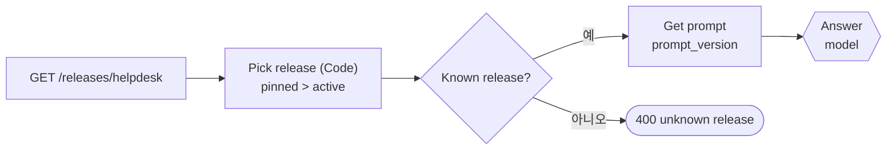
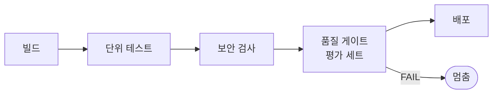
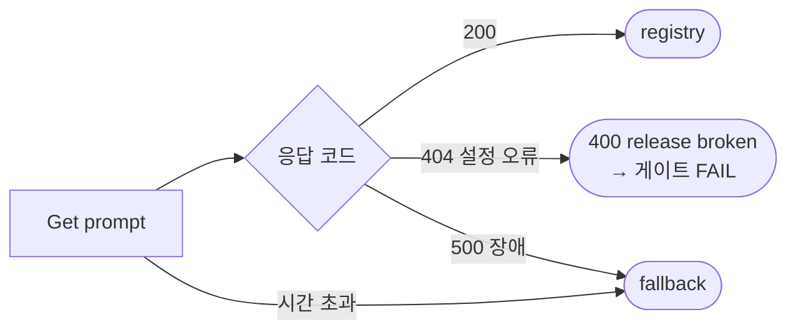

# 2단계 · 릴리스와 배포 전 게이트

- 교시: 3교시 강의 (11:00~11:50) · 4교시 [Lab 02](../../Last3Mon/74/LAB-02-Q-RELEASE-GATE.md) 실습 5개 (12:00~12:50)
- 이 단계가 끝나면: 지시문과 모델을 릴리스로 묶어 밖에서 관리하고, 후보 릴리스를 운영을 건드리지 않고 시험하고, 게이트로 배포 여부를 숫자로 정할 수 있다. 게이트의 기준을 재서 정하고, 게이트가 약하면 나쁜 릴리스도 통과한다는 것을 알고 테스트를 강하게 고친다. 망가진 릴리스는 장애와 구분해 크게 실패하게 한다.
- 숫자: 모두 강사 노트북 실측입니다 (65일차 n8n 2.42.6, OpenAI `gpt-4.1-mini` · `gpt-5.4-nano`, 10/27 정답 워크플로우를 학생 순서대로 1회). 출력 전부는 수업 뒤 공개되는 `Last3Mon/74/answers/LAB-TEST-RESULT.md`에 있습니다.
- 실습 가리키기: "Lab 02 예제 1"은 4교시 [Lab 02 문서](../../Last3Mon/74/LAB-02-Q-RELEASE-GATE.md)의 그 절입니다.


## 0. 이 시간 (50분)

| 시간 | 절 · 개요 | 하는 일 |
| --- | --- | --- |
| 11:00~11:06 | 1 · 개요 15장 | 릴리스 = 지시문 + 모델, 한 릴리스에 한 가지, 불변 결과물 |
| 11:06~11:12 | 2 · 개요 16장 | 설정과 코드의 분리, 원격 설정 · 기능 플래그 |
| 11:12~11:17 | 3 · 개요 16장 | 후보 시험: 고정(pin) · 스테이징 · 그림자 |
| 11:17~11:24 | 4 · 개요 17장 | 품질 게이트, CI/CD, 평가 세트(golden set) |
| 11:24~11:31 | 5 · 개요 18장 | 게이트는 테스트만큼만, 기대는 데이터에서 |
| 11:31~11:36 | 6 · 개요 19장 | 기준선, 흔들리는 테스트, SLO |
| 11:36~11:40 | 7 · 개요 20장 | 모델 교체 판단: 품질 · 속도 · 비용 |
| 11:40~11:46 | 8 · 개요 21장 | 장애와 설정 오류, fail fast |
| 11:46~11:50 | 9 · 10 · 확인 질문 | 요청문, 자주 하는 실수 |

### 4교시 Lab 02에서 이어서 하는 것

| 4교시 실습 (시각) | 이 강의의 절 | 실습에서 하는 일 | 쓰는 파일 · 명령 |
| --- | --- | --- | --- |
| 시작 (12:00) | — | 릴리스 점검표 복사 | `cp templates/RELEASE-CHECKLIST-TEMPLATE.md my-work/RELEASE.md` |
| Lab 02 예제 1 (12:00~12:12) | 1 · 2 · 3 | 운영 릴리스를 데이터 API에서 읽고, 본문 `release`면 고정 | `my-work/helpdesk.json`, 테스트 `cases/lab02.json` |
| Lab 02 예제 2 (12:12~12:20, 에이전트 없이) | 4 · 5 | 약한 golden으로 네 릴리스 게이트, 1.2.0 답 읽기 | `gate cases/golden.json --set release=...` × 4 → `RELEASE.md` 1절 |
| Lab 02 예제 3 (12:20~12:27, 에이전트 없이) | 6 · 7 | 1.0.0 · 2.0.0 시간, golden 3번 반복 | `bench my-helpdesk requests/faq-vpn.json -n 5 --set release=...`, `gate ... --repeat 3` |
| Lab 02 과제 1 (12:27~12:40) | 5 · 7 | 1.2.0을 막는 `my-golden`, 2.0.0 판단 | `cases/my-golden.json`, `gate` × 4 |
| Lab 02 과제 2 (12:40~12:50) | 8 | 망가진 릴리스 2.1.0은 400, 장애는 기본 지시문 | 테스트 `cases/lab02-challenge2.json`, `gate cases/my-golden.json --set release=2.1.0` |

## 1. 릴리스 = 지시문 + 모델 (+ 메모)

### 일반 설명

**릴리스(release)는 "함께 내보내는 것의 묶음"에 붙인 이름입니다.** 일반 소프트웨어에서 릴리스는 빌드된 결과물(artifact: 실행 파일, 컨테이너 이미지)에 버전 번호를 붙인 것입니다. 결과물은 **한 번 만들면 바꾸지 않습니다(불변).** 같은 버전 번호면 언제 꺼내도 같은 것이어야, 시험한 것과 배포한 것이 같다고 믿을 수 있습니다.

LLM 앱의 릴리스는 "흐름 + 지시문 + 모델 + 그 밖의 설정(temperature, 검색 개수 …)"의 묶음입니다. 오늘은 흐름(워크플로우)은 그대로 두고 **지시문 버전 + 모델 이름**을 묶어 릴리스로 부릅니다.

| 일반 소프트웨어 | 오늘의 릴리스 |
| --- | --- |
| 결과물 (이미지 · 실행 파일) | `{prompt_version, model, note}` |
| 버전 번호 | `1.0.0` · `1.1.0` · `2.0.0` |
| 릴리스 노트 | `note`, `CHANGELOG.md` |
| 결과물 저장소 (registry) | 데이터 API `/releases/helpdesk` |

**한 릴리스에 한 가지 변화.** 1단계에서 v2는 셋이 한꺼번에 바뀌어 원인을 알 수 없었습니다. 릴리스를 **한 가지씩만** 다르게 만들면, 두 릴리스를 비교했을 때 차이는 그 한 가지 때문입니다. 작고 잦은 릴리스가 크고 드문 릴리스보다 안전한 까닭입니다 (문제가 생겨도 원인이 작고, 되돌릴 것도 작음).

**릴리스에 무엇을 넣을까.** 오늘은 지시문 버전과 모델 이름 둘이지만, 실제로는 답에 영향을 주는 설정을 모두 묶습니다: temperature, 최대 길이, 검색할 문서 수, 색인 버전, 도구 목록. 묶음에 빠진 설정이 있으면, 그 설정이 바뀌었을 때 "릴리스는 같은데 답이 다르다"가 생깁니다. 반대로 너무 많이 묶으면 사소한 변경에도 새 릴리스를 만들어야 합니다. 기준은 **"이것이 바뀌면 다시 시험해야 하나"**입니다.

**릴리스 노트.** 각 릴리스에는 "무엇이 왜 바뀌었는지" 한두 줄을 남깁니다 (오늘 `note`). 몇 달 뒤 "2.0.0은 왜 만들었지?"에 답하는 것이 이 한 줄입니다. 좋은 릴리스 노트는 변경 · 이유 · 영향(누가 무엇을 다르게 받나) · 시험 결과를 담습니다.

### 오늘 실습에서

| 릴리스 | 지시문 | 모델 | 1.0.0과 다른 것 |
| --- | --- | --- | --- |
| 1.0.0 | p1 | gpt-4.1-mini | (기준) |
| 1.1.0 | p2 | gpt-4.1-mini | **지시문만** (출처 번호) |
| 1.2.0 | p3 | gpt-4.1-mini | **지시문만** (한 문장 · 포털로) |
| 2.0.0 | p2 | gpt-5.4-nano | 1.1.0과 비교하면 **모델만** |
| 2.1.0 | p9 | gpt-4.1-mini | 저장소에 없는 지시문 (8절) |

## 2. 설정을 밖에서 읽는다 (4교시 Lab 02 예제 1)

### 일반 설명

**설정과 코드의 분리.** Lab 01의 릴리스 정보는 워크플로우 안의 Set 노드였습니다. 1.1.0을 내보내려면 값을 고치고 push 해야 합니다. 이것은 "설정이 코드 안에 있는" 상태입니다. 값을 **밖(데이터 API)에서 매번 읽게** 하면 배포는 그 값을 바꾸는 일이 됩니다.

**업계에서는 이것을 원격 설정 · 기능 플래그라고 부릅니다.**

| 이름 | 하는 일 | 대표 도구 |
| --- | --- | --- |
| 원격 설정 (remote config) | 앱을 다시 배포하지 않고 값을 바꿈 | Firebase Remote Config, AWS AppConfig |
| 기능 플래그 (feature flag) | 기능을 켜고 끄거나 일부에게만 켬 | LaunchDarkly, Unleash, Flagsmith |
| 모델 · 지시문 라우팅 | 요청마다 어느 모델 · 지시문을 쓸지 | LLM 게이트웨이 (LiteLLM, Portkey 등) |

이 도구들은 공통으로 ① 값을 한 곳에 두고 ② 앱이 짧은 간격으로(또는 요청마다) 읽고 ③ 바꾼 기록을 남기고 ④ 일부 사용자에게만 다른 값을 줄 수 있게 합니다 (④는 3단계 카나리).

**고르는 규칙은 코드가.** "본문에 `release`가 있으면 그것, 없으면 `active`"는 틀리면 안 되는 규칙입니다. 73일차 "틀리면 안 되는 값은 LLM이 정하지 않는다"처럼 Code 노드가 정합니다.

**읽는 비용과 캐시.** 요청마다 설정을 읽으면 바꾼 즉시 반영되지만, 설정 서버를 그만큼 자주 부릅니다. 그래서 많은 도구가 설정을 몇 초 ~ 몇 분 캐시합니다. 캐시가 길면 배포 · 되돌리기가 그만큼 늦게 반영됩니다. 오늘은 요청마다 읽어 "다음 요청부터 바로"를 확인합니다. 운영에서는 "되돌리기가 몇 초 안에 반영돼야 하나"로 캐시 시간을 정합니다.

**설정이 바뀐 기록.** 원격 설정 도구들은 값을 바꿀 때마다 누가 · 언제 · 무엇을 바꿨는지 남깁니다. 배포가 "값 하나"가 되면 배포 기록은 곧 **설정 변경 기록**입니다. 오늘 데이터 API는 지금 값만 들고 있고 기록은 남기지 않습니다 — 그래서 `CHANGELOG.md`에 사람이 적고, 3단계 과제 2에서 점검 기록을 데이터 API에 남깁니다.

### 오늘 실습에서



Lab 02 예제 1 (10/27): 고치기 전(Lab 01 과제 2 상태) `lab02` 1/5 — 고정 케이스가 모두 1.0.0으로 답함. 고친 뒤 5/5, `lab01-challenge` 3/3 · `lab01-challenge2` 4/4 그대로.

## 3. 후보는 고정해서 시험한다

### 일반 설명

**운영을 건드리지 않고 새 버전을 시험하는 방법들.**

| 방법 | 뜻 | 좋은 점 | 비용 |
| --- | --- | --- | --- |
| 스테이징 (staging) | 운영과 같은 모양의 별도 환경 | 운영과 완전히 분리 | 환경을 하나 더 유지 |
| 고정 (pin) | 같은 운영 환경에서 **요청이 버전을 지정** | 환경 하나로 충분, 바로 시험 | 지정하는 문을 아무에게나 열면 위험 |
| 그림자 (shadow) | 실제 요청을 새 버전에도 보내고 답은 버리고 비교만 | 실제 질문으로 시험 | 요청마다 두 배 비용 |

오늘은 **고정**을 씁니다. 본문에 `release: "1.1.0"`을 넣은 요청만 1.1.0으로 답하고, 나머지 운영 요청은 계속 1.0.0입니다. `flow.py test --set release=1.1.0`이 테스트의 모든 요청에 이 칸을 더합니다.

**고정의 문은 좁게.** 누구나 `release`를 지정할 수 있으면, 아직 검증 안 된 릴리스(또는 망가진 릴리스)를 아무나 쓸 수 있습니다. 73일차 관점으로는 **공격면**이 하나 늘어난 것입니다. 실제 서비스에서는 이 칸을 운영자 · 테스트 계정만 쓸 수 있게 막습니다 (인증된 사용자의 권한으로 판단).

**없는 버전은 거절한다.** 모르는 릴리스를 지정했을 때 조용히 `active`로 답하면, 테스트는 엉뚱한 릴리스를 시험하고 PASS를 받습니다. 400 `unknown release`로 **분명히 실패**해야 테스트를 쓴 사람이 오타를 압니다 (8절과 같은 원칙).

**환경을 나누는 까닭.** 개발 · 스테이징 · 운영을 나누는 것은 "시험하다 운영을 망가뜨리지 않기" 위해서입니다. 하지만 환경이 늘면 환경끼리 설정이 어긋납니다 (스테이징에서는 됐는데 운영에서는 안 됨). 고정(pin)은 운영 환경 **그대로** 후보를 시험하므로 이 어긋남이 없습니다. 대신 후보가 운영의 데이터 · 외부 시스템을 실제로 건드립니다 — 오늘 헬프데스크는 읽기만 하니 괜찮지만, 접수 건을 **만드는** 워크플로우라면 시험 요청에 "시험용" 표시를 붙여 실제로 만들지 않게 해야 합니다.

| 후보 시험이 건드리는 것 | 오늘 | 조심할 때 |
| --- | --- | --- |
| 읽기 (FAQ · 접수 건 조회) | 예 | 괜찮음 |
| 쓰기 (접수 만들기 · 메일 보내기) | 없음 | 시험 표시 · 가짜 대상 · 그림자로 |
| 비용 (LLM 호출) | 게이트 한 번에 6~9번 | 반복 · 여러 릴리스면 곱해짐 (75일차) |

### 오늘 실습에서

| `lab02` 케이스 | 기대 | 결과 (10/27) |
| --- | --- | --- |
| 운영 중인 릴리스 | 1.0.0 · `stable` · p1 | ✔ |
| 1.1.0 고정 | 1.1.0 · `pinned` · p2 · `[FAQ-003]` | ✔ |
| 2.0.0 고정 | `gpt-5.4-nano` | ✔ |
| 없는 릴리스 9.9.9 | 400, `known` | ✔ |
| 빈 질문 | 400 | ✔ |

## 4. 게이트: 배포 전에 숫자로 (4교시 Lab 02 예제 2)

### 일반 설명

**품질 게이트(quality gate).** 소프트웨어 배포 파이프라인(CI/CD)에는 "여기를 지나야 다음 단계로"인 관문이 여러 개 있습니다: 빌드가 되나, 단위 테스트를 통과하나, 보안 검사, 성능 기준. 각 관문은 **기준을 숫자로** 정하고 PASS/FAIL을 냅니다. 사람의 "괜찮아 보이는데요"를 숫자로 바꾸는 장치입니다.



**LLM 앱의 게이트는 평가 세트(evaluation set)로.** 정해 둔 질문과 기대(판정 규칙)의 모음을 평가 세트, 또는 **골든 세트(golden set)**라고 부릅니다. 새 지시문 · 모델을 내보내기 전에 평가 세트를 돌려 기준을 넘는지 봅니다. promptfoo, DeepEval, Ragas, OpenAI Evals, LangSmith Evaluation 같은 도구가 이 일을 합니다. 도구가 달라도 구조는 같습니다: **질문 목록 + 판정 규칙 + 기준(통과율 · 점수 · 시간) + 결과 기록**.

| 게이트 기준 | 뜻 | 오늘 |
| --- | --- | --- |
| 통과율 | 케이스 중 통과한 비율 | `--min-pass 1.0` (모두) |
| 처리시간 | 케이스 시간의 p95 | `--max-p95 3` (초) |
| 종료 코드 | 자동화가 다음 단계를 정함 | PASS 0 · FAIL 1 |
| 기록 | 누가 언제 무엇으로 게이트를 돌렸나 | `/gates/helpdesk` (3단계 과제 2에서 씀) |

**게이트는 자동화의 문.** 종료 코드가 0이면 다음 단계(배포)가 이어지고, 1이면 멈춥니다. 사람이 결과를 읽지 않아도 파이프라인이 멈춥니다. 그래서 게이트가 **무엇을 확인하는지**가 매우 중요합니다 (5절).

**평가 세트를 어떻게 모으나.** 처음에는 대표 질문 몇십 개로 시작하고, 운영하면서 **실제로 문제가 됐던 질문**을 더해 갑니다. 사고가 났던 질문을 평가 세트에 넣으면 같은 사고가 다시 나지 않는지 늘 확인할 수 있습니다 (회귀 테스트). 평가 세트는 한 번 만들고 끝나는 것이 아니라 **서비스와 함께 자라는 자산**입니다.

| 평가 세트에 넣을 것 | 예 |
| --- | --- |
| 자주 오는 질문 | VPN · 비밀번호 · 프린터 |
| 꼭 지켜야 할 것 | 접수 상태 · 예정일을 정확히, 지어내지 않음 |
| 사고가 났던 질문 | "포털만 보라"는 답이 나갔던 프린터 질문 |
| 경계 · 예외 | 빈 질문, 없는 접수 번호, 남의 건 (73일차) |

### 오늘 실습에서

운영팀의 `golden.json`(6케이스, `status 200` · `route 자동 답변`만 확인)으로 네 릴리스 (10/27):

| 릴리스 | 결과 | p95 |
| --- | --- | --- |
| 1.0.0 | 6/6 PASS | 1.6초 |
| 1.1.0 | 6/6 PASS | 1.1초 |
| **1.2.0** | **6/6 PASS** | 1.5초 |
| 2.0.0 | 6/6 PASS | 2.0초 |

1.2.0의 프린터 답: **"IT 포털에서 프린터 문제 해결 방법을 확인해 주세요."** — HTTP 200, `자동 답변`. 게이트는 PASS입니다.

## 5. 게이트는 테스트만큼만 막는다 (4교시 Lab 02 과제 1)

### 일반 설명

**PASS의 뜻은 테스트가 정합니다.** 게이트는 테스트를 돌릴 뿐입니다. 테스트가 "200이 왔나"만 보면 PASS는 "200이 왔다"는 뜻입니다. 나쁜 릴리스를 막지 못한 게이트는 게이트가 고장 난 것이 아니라 **테스트가 약한 것**입니다.

**테스트 오라클 문제.** 테스트를 쓰려면 "맞는 답이 무엇인지"를 알아야 합니다. 이것을 오라클(oracle)이라고 합니다. LLM 답은 정답 글자가 하나가 아니라서 오라클을 정하기 어렵습니다. 그래서 정답 전체 대신 **판정 규칙**을 씁니다.

| 판정 규칙 | 예 | 잡는 것 |
| --- | --- | --- |
| 꼭 있어야 할 낱말 (`contains`) | VPN 답에 "인증서" | 해결 방법을 빼먹은 답, 떠넘기기 |
| 없어야 할 말 (`not_contains`) | "포털을 확인" | 특정 문구 (글자가 정확해야) |
| 값 비교 (`equals`) | `route` = 자동 답변 | 갈래가 틀림 |
| 형식 | JSON · 길이 | 모양이 깨짐 |
| LLM 채점 | "이 답이 질문을 해결하나 1~5점" | 글자로 못 잡는 품질 (79일차, 채점도 흔들림) |

**기대는 데이터에서, 사람이.** 기대 낱말을 지금 답에서 베끼면, 지금 답이 틀린 것도 정답이 됩니다. 기대는 **원천 데이터**(FAQ의 해결 방법, 접수 건의 상태 · 예정일)를 보고 사람이 정합니다. 에이전트에게 테스트 파일을 쓰게 해도 되지만, 기대 낱말은 사람이 정해 요청문에 적습니다.

**굿하트의 법칙.** "숫자가 목표가 되면 그 숫자는 더 이상 좋은 숫자가 아니다." 게이트를 통과시키려고 테스트를 느슨하게 고치거나, 테스트에만 맞춘 지시문을 쓰면 게이트는 의미를 잃습니다. 그래서 오늘 규칙: **테스트를 통과시키려고 기대 결과를 바꾸지 않는다** (AGENTS.md 8절).

**좋은 판정 규칙의 조건.** ① 맞는 답이면 통과한다 (같은 뜻의 다른 표현도) ② 틀린 답이면 실패한다 ③ 같은 답이면 늘 같은 판정이다. ①이 약하면 정상 릴리스가 FAIL(지나치게 막기), ②가 약하면 나쁜 릴리스가 PASS(덜 막기), ③이 약하면 흔들리는 테스트. 73일차 보안 테스트의 "막을 것 · 막지 말 것"과 같은 균형입니다.

### 오늘 실습에서

강한 golden(`my-golden`, 9케이스: 해결 낱말 6 · 상태 · 예정일 · 떠넘기기 금지) (10/27):

| 릴리스 | 약한 golden | 강한 golden | p95 |
| --- | --- | --- | --- |
| 1.0.0 | 6/6 PASS | 9/9 PASS | 1.4초 |
| 1.1.0 | 6/6 PASS | 9/9 PASS | 1.7초 |
| **1.2.0** | **6/6 PASS** | **1/9 FAIL** | 1.3초 |
| 2.0.0 | 6/6 PASS | 9/9 PASS | 1.3초 |

1.2.0이 통과한 하나는 **"포털로 떠넘기지 않기"**(`not_contains: "IT 포털을 확인" · "포털을 참고"`)입니다. 실제 답은 "IT 포털**에서** … 확인해 주세요"라서 걸리지 않았습니다. 금지 문구는 글자가 정확해야 하고, 실제로 1.2.0을 막은 것은 **해결 낱말(`contains`)**이었습니다.

## 6. 기준선: 기준은 재서 정한다 (4교시 Lab 02 예제 3)

### 일반 설명

**기준선(baseline).** "3초 안"이라는 기준은 지금 운영 중인 버전이 보통 몇 초인지 알아야 의미가 있습니다. 성능 · 품질 기준은 **지금을 재서** 정하고, 흔들림만큼 여유를 둡니다.

| 기준을 정하는 법 | 예 | 특징 |
| --- | --- | --- |
| 감으로 | "3초면 되겠지" | 근거 없음, 너무 느슨하거나 빡빡함 |
| 기준선 대비 | "1.0.0 p95의 1.5배 이내" | 지금보다 많이 나빠지는 것만 막음 |
| 서비스 목표(SLO)에서 | "문의 95%는 5초 안에 답" | 사용자에게 한 약속에서 내려옴 (78일차) |
| 회귀 기준 | "1.0.0보다 통과율이 떨어지면 FAIL" | 새 버전이 나빠지지 않았는지 |

**흔들리는 테스트는 게이트를 무너뜨립니다.** 같은 릴리스로 돌려도 가끔 FAIL이 나는 테스트가 있으면, 사람들은 FAIL을 보고 "또 흔들렸네" 하고 다시 돌립니다. 그러다 진짜 FAIL도 무시하게 됩니다. 그래서 기준을 정할 때 **같은 릴리스로 여러 번** 돌려 흔들리지 않는지 먼저 봅니다.

**재는 횟수.** 다섯 번으로 잰 p95는 다섯 개 중 가장 느린 값입니다 (72일차 nearest-rank). 한 번 튄 값이 그대로 기준이 됩니다. 실제 기준을 정할 때는 수십 번 이상 재고, 다른 시간대에도 잽니다. 오늘은 수업 시간과 비용 때문에 다섯 번입니다.

**흔들림을 줄이는 방법.** 흔들리는 케이스를 찾으면 바로 지우지 않고 원인을 봅니다. 기대 낱말이 너무 좁으면(같은 뜻의 다른 말) 낱말을 더하고, 질문이 애매하면(두 FAQ에 걸침) 질문을 분명하게 하고, 정말 모델이 흔들리면 반복 기준("3번 중 3번")을 둡니다. 흔들리는 케이스를 그냥 지우면 평가 세트가 점점 쉬운 질문만 남습니다.

### 오늘 실습에서

VPN `bench -n 5` (10/27, 같은 워크플로우에서 `--set release`만 바꿈):

| 릴리스 | 모델 | p50 | p95 |
| --- | --- | --- | --- |
| 1.0.0 | gpt-4.1-mini | 1.23초 | 1.42초 |
| 2.0.0 | gpt-5.4-nano | 1.12초 | 1.24초 |

1.0.0의 golden을 `--repeat 3`: **18/18**, p95 1.5초. 흔들리지 않으므로 이 golden의 FAIL은 믿을 수 있습니다. 1.0.0 p95가 1.4~1.6초 근처이니 `--max-p95 3`은 약 두 배 여유입니다.

## 7. 작은 모델로 바꿔도 될까

### 일반 설명

**모델 교체는 세 가지 저울.** 더 작은 · 싼 모델로 바꾸는 결정은 품질 · 속도 · 비용을 함께 봅니다.

| 저울 | 재는 법 | 오늘 |
| --- | --- | --- |
| 품질 | 같은 평가 세트의 통과율 | 강한 golden |
| 속도 | p50 · p95 | `bench` |
| 비용 | 요청당 토큰 × 단가 | 75일차 |

**게이트를 통과했다 = 게이트가 보는 것은 괜찮다.** 평가 세트에 없는 것(말투 · 길이 · 드문 질문 · 긴 대화 · 다른 언어)은 게이트가 보지 않습니다. 그래서 모델 교체는 바로 전원에게가 아니라 **일부에게 먼저**(카나리, 3단계) 내보내고 실제 사용을 봅니다.

**공급자의 모델 일정도 판단에 들어갑니다.** 1단계에서 본 것처럼 모델은 지원 종료됩니다. 지금 쓰는 모델의 종료 일정, 대체 모델로 옮기는 데 드는 시험 비용도 판단 재료입니다. 10/27 수업 준비 때 `gpt-4.1-nano`가 그랬습니다.

**같은 값이면 더 싼 것.** 품질 기준을 넘는 모델이 여럿이면 더 싸고 빠른 것을 고릅니다. 그런데 "기준을 넘는다"는 평가 세트 안의 이야기입니다. 작은 모델은 평가 세트에 없는 어려운 질문 · 긴 대화 · 드문 언어에서 먼저 무너지는 경우가 많습니다. 그래서 모델을 작게 바꿀 때는 평가 세트에 **어려운 질문**을 일부러 더해 두고, 카나리로 실제 질문을 봅니다.

**섞어 쓰기.** 모든 질문에 같은 모델을 쓸 필요는 없습니다. 쉬운 질문(FAQ 그대로)은 작은 모델, 어려운 질문(여러 문서 · 판단)은 큰 모델로 보내는 라우팅도 흔합니다 (75일차 비용). 이때도 릴리스는 "어떤 규칙으로 어느 모델에 보내나"까지 묶어 버전으로 둡니다.

### 오늘 실습에서

2.0.0 (`gpt-5.4-nano`): 강한 golden 9/9 PASS, p95 1.3초, VPN p50 1.12초 (1.0.0 1.23초). 게이트로는 "내보내도 됨". 판단 한 줄 예: "품질 · 속도는 게이트 기준 통과 → 카나리 10%로 먼저, 비용은 75일차에 잰 뒤 배포".

## 8. 망가진 릴리스는 크게 실패하게 (4교시 Lab 02 과제 2)

### 일반 설명

**실패에는 두 종류가 있습니다.**

| | 장애 (outage) | 설정 오류 (misconfiguration) |
| --- | --- | --- |
| 예 | 저장소 서버가 멈춤 · 느림 (500, 시간 초과) | 릴리스가 **없는 지시문**을 가리킴 (404) |
| 다시 하면 | 될 수도 있음 (잠깐의 문제) | 절대 안 됨 (설정이 틀림) |
| 맞는 대응 | 견딘다: 기본 지시문으로 계속 (graceful degradation) | **크게 실패한다 (fail fast)**: 분명한 오류로 멈춤 |
| HTTP로 보면 | 5xx, 응답 없음 | 4xx |

**견디는 장치가 오류를 숨깁니다.** 1단계 과제 2에서 만든 기본 지시문은 저장소의 **모든** 실패를 받아 줍니다. 그래서 2.1.0(p9)처럼 설정이 틀린 릴리스도 기본 지시문(p1)으로 멀쩡하게 답합니다. 운영팀은 2.1.0의 새 지시문이 나간다고 믿지만, 실제로는 1.0.0의 지시문이 나갑니다. 게이트도 PASS를 줍니다(p1의 답이니까). **조용한 실패(silent failure)**가 가장 비싼 실패입니다. 늦게 발견되고, 발견했을 때는 원인이 멀리 있습니다.

**fail fast.** 다시 해도 안 될 오류는 가능한 한 **일찍, 분명하게** 실패해야 합니다. 그래야 게이트가 배포 **전에** 잡습니다. 컴파일 오류, 설정 파일 검사(schema validation), 시작할 때 필수 값 확인 같은 것이 모두 fail fast입니다.

**응답 코드로 가릅니다.** HTTP는 이미 둘을 나눠 줍니다: 4xx는 "요청이 틀렸다(다시 해도 안 됨)", 5xx는 "서버가 아프다(다시 하면 될 수도)". 72일차 재시도 원칙("4xx는 다시 하지 않는다")과 같은 구분을 여기서는 **기본 지시문으로 갈지**에 씁니다.



**설정은 배포 전에 검사합니다.** 2.1.0 같은 망가진 릴리스는 사실 **릴리스를 올릴 때** 막을 수도 있습니다: "릴리스가 가리키는 지시문 버전이 저장소에 있는가, 모델 이름이 공급자 목록에 있는가"를 확인하는 검사입니다. 설정 파일의 형식 검사(스키마 검증)와 같은 일입니다. 오늘은 워크플로우에서 404를 크게 실패하게 만들어 게이트가 잡게 했지만, 운영에서는 둘 다 둡니다 — 올릴 때 한 번, 쓸 때 한 번.

### 오늘 실습에서

`lab02-challenge2` (10/27):

| 케이스 | 고치기 전 (예제 1 상태) | 고친 뒤 |
| --- | --- | --- |
| 망가진 릴리스 2.1.0 | ✘ **200** (기본 지시문으로 답, 1.3초) | ✔ 400 `release broken` · `p9` |
| 평소 · 1.1.0 | ✔ | ✔ `registry` · `[FAQ-003]` |
| 저장소 고장 · 1.1.0 | ✔ `fallback` | ✔ `fallback` |
| 저장소 고장 · 없는 릴리스 9.9.9 | ✔ 400 | ✔ 400 |
| 운영(active 1.0.0) | ✔ | ✔ |
| 합계 | 4/5 | 5/5 |

그리고 같은 강한 golden으로 2.1.0을 게이트: 고치기 전 **9/9 PASS** (p95 1.5초, 위험!) → 고친 뒤 FAIL (모든 케이스 400). 게이트가 잡지 못하던 설정 오류를 워크플로우가 크게 실패하게 만들자 게이트가 잡았습니다.

## 9. 요청문(프롬프트)으로

**요청문(프롬프트)이란.** 실습에서 CLI 코딩 에이전트(codex · claude · agy)에게 보내는 글입니다. 에이전트는 이 글만 보고 n8n 워크플로우 JSON을 만들거나 고칩니다. 이 절은 이 단계에서 배운 것을 **요청문(프롬프트)에 어떤 칸으로 적을지** 실습 전에 정리하는 자리입니다. 실습 문서의 `▶ 빈칸 채우기 · 요청문(프롬프트) 뼈대`가 이 칸을 실제 문장으로 만든 것이고, 빈칸 ①~④는 그 문장 속 정확한 값입니다.

| 칸 | 에이전트에게 알려 주는 것 | 빠지면 생기는 일 |
| --- | --- | --- |
| 무엇을 | 만들거나 바꿀 기능 | 에이전트가 짐작해서 다른 것을 만듦 |
| 어디에 | 고칠 파일 · 노드 · 자리 | 엉뚱한 노드를 고치거나 새 파일을 만듦 |
| 어떤 모양으로 | 결과 JSON의 칸 이름 · 값 · 응답 코드 | 테스트가 보는 칸 이름과 달라 실패 |
| 그대로 · 하지 말 것 | 건드리면 안 되는 것 | 다른 곳까지 바뀌어 무엇 때문인지 모르게 됨 |
| 확인 | 통과해야 할 테스트 파일 | "다 됐다"를 판단할 기준이 없음 |

67~71일차의 다섯 가지(① 파일 ② 입력 ③ 처리 ④ 결과 모양 ⑤ 기대 결과)와 같은 뜻입니다. 파일 · 입력이 "어디에", 처리가 "무엇을", 결과 모양이 "어떤 모양으로", 기대 결과가 "확인"입니다. 72일차부터는 **이미 있는 워크플로우를 고치는** 요청이 많아 "그대로"가 따로 한 칸이 됐습니다.

아래 표의 열은 이 단계에서 에이전트를 쓰는 실습, 줄은 위 다섯 칸입니다. 각 칸에 그 실습에서 채울 것을 적었습니다.

| 요청문에 | Lab 02 예제 1 | Lab 02 과제 1 | Lab 02 과제 2 |
| --- | --- | --- | --- |
| 무엇을 | 릴리스를 밖에서 읽고 고정 | 강한 golden (테스트만) | 404는 400, 장애는 기본 지시문 |
| 어디에 | `Release info` 대신 `Get release` → `Pick release` → `Known release?` | `cases/my-golden.json` | `Get prompt` 응답 옵션, 다음 Code · If |
| 어떤 모양 | `channel` stable · pinned, 400 `known` | `contains` 해결 낱말 · `not_contains` | 400 `{error: release broken, release, prompt_version}` |
| 그대로 | 기본 지시문 | 워크플로우 | 시간 초과 쪽 기본 지시문 |
| 확인 | `lab02` · `lab01-challenge` · `lab01-challenge2` | `gate` × 4 | `lab02-challenge2`, `gate my-golden 2.1.0` FAIL |

예를 들어 Lab 02 과제 2 열을 위에서부터 이어 읽으면 요청문(프롬프트)이 됩니다 (화살표 오른쪽은 다섯 칸 중 어디인지):

```text
지시문 저장소가 404 면 기본 지시문으로 넘어가지 말고 크게 실패하게,
장애(500 · 시간 초과)일 때만 기본 지시문으로 답하게 해 줘.                       ← 무엇을
Get prompt 의 응답 옵션을 바꾸고 그 다음에 Code · If 를 넣어서.                    ← 어디에
404 면 HTTP 400 {error: 'release broken', release, prompt_version}.               ← 어떤 모양으로
시간 초과 쪽 기본 지시문(Fallback prompt)은 그대로.                              ← 그대로
cases/lab02-challenge2.json 이 통과하고, gate my-golden --set release=2.1.0 은 FAIL 이어야 해.  ← 확인
```

과제 1은 **테스트를 쓰는 요청**입니다. 기대 낱말은 내가 데이터에서 정해 요청문에 적습니다. 에이전트가 지금 답을 보고 기대를 만들게 하지 않습니다.

## 10. 자주 하는 실수

| 실수 | 왜 문제인가 | 이렇게 |
| --- | --- | --- |
| 한 릴리스에 지시문과 모델을 같이 바꿈 | 결과가 달라도 원인을 모름 | 한 릴리스에 한 가지 |
| 후보를 운영(active)으로 바꿔서 시험 | 시험하는 동안 직원 모두가 후보를 받음 | 고정(`--set release=`)으로 |
| 게이트 PASS면 끝 | 게이트가 보는 것만 괜찮다는 뜻 | 테스트가 무엇을 보는지 읽기, 카나리로 |
| 지금 답을 보고 기대를 만듦 | 지금 틀린 것도 정답이 됨 | 데이터에서 사람이 |
| 게이트가 FAIL이라 기대를 느슨하게 | 게이트가 의미를 잃음 | 답이 틀렸는지 먼저 확인, 같은 뜻이면 낱말을 더함 |
| 기준을 감으로 | 너무 느슨하거나 같은 릴리스도 FAIL | 기준선을 재고, 흔들리지 않는지 반복 |
| 모든 실패를 기본값으로 받음 | 설정 오류가 숨어 게이트도 통과 | 4xx는 크게 실패, 5xx · 시간 초과만 견딤 |

## 확인 질문

1. 릴리스 1.1.0과 2.0.0을 비교하면 무엇의 영향만 보이나요? 1.0.0과 2.0.0을 비교하면?
2. 본문 `release`로 고정하는 문을 모든 직원에게 열어 두면 생길 수 있는 문제는?
3. 약한 golden에서 1.2.0이 PASS였습니다. 게이트가 고장 난 것인가요?
4. 1.2.0의 답 "IT 포털에서 … 확인해 주세요"를 `not_contains: "포털을 참고"`가 못 잡았습니다. 무엇으로 잡았고, 그것이 더 튼튼한 까닭은?
5. 2.0.0이 강한 golden을 통과했습니다. 바로 전원에게 배포해도 되나요? 무엇을 더 봐야 하나요?
6. 2.1.0은 고치기 전 강한 golden을 9/9로 통과했습니다. 왜 그랬고, 어떻게 고쳤나요? "장애"와 "설정 오류"를 가르는 기준은?

## 정리

- [ ] 릴리스 = 지시문 + 모델, 한 릴리스에 한 가지 변화, 한 번 낸 릴리스는 바꾸지 않는다
- [ ] 운영 릴리스는 밖에서 읽고, 후보는 고정으로 시험한다 (고정의 문은 좁게)
- [ ] 게이트는 통과율 · p95로 PASS/FAIL — 그러나 테스트만큼만 막는다, 기대는 데이터에서 사람이
- [ ] 기준은 기준선을 재서, 흔들리지 않는지 반복해서
- [ ] 장애는 견디고, 설정 오류는 크게 실패하게 — 그래야 게이트가 잡는다
