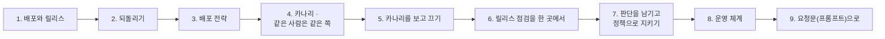
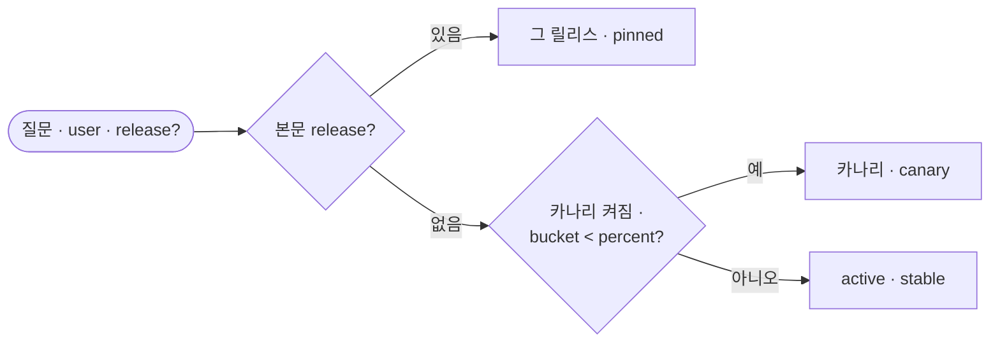
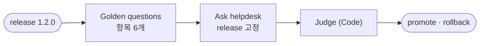
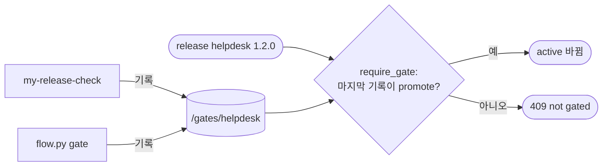
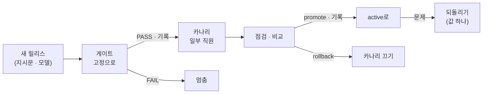

# 3단계 · 배포 · 되돌리기 · 카나리

- 교시: 5교시 강의 (14:00~14:50) · 6교시 [Lab 03](../../Last3Mon/74/LAB-03-Q-DEPLOY-AND-ROLLBACK.md) 실습 5개 (15:00~15:50)
- 이 단계가 끝나면: 배포와 되돌리기를 값 하나로 하고, 새 릴리스를 일부 사용자에게만 먼저 내보내고, 나쁜 카나리를 보고 끄고, 내보낼지 되돌릴지를 판단하는 점검을 n8n 워크플로우로 만들고, 점검을 지난 릴리스만 배포되게 하는 운영 체계를 설명할 수 있다.
- 숫자: 모두 강사 노트북 실측입니다 (65일차 n8n 2.42.6, OpenAI `gpt-4.1-mini` · `gpt-5.4-nano`, 10/27 정답 워크플로우를 학생 순서대로 1회). 출력 전부는 수업 뒤 공개되는 `Last3Mon/74/answers/LAB-TEST-RESULT.md`에 있습니다.
- 실습 가리키기: "Lab 03 예제 1"은 6교시 [Lab 03 문서](../../Last3Mon/74/LAB-03-Q-DEPLOY-AND-ROLLBACK.md)의 그 절입니다.



## 0. 이 시간 (50분)

| 시간 | 절 · 개요 | 하는 일 |
| --- | --- | --- |
| 14:00~14:05 | 1 · 개요 22장 | 배포(deploy)와 릴리스(release)를 나누기 |
| 14:05~14:11 | 2 · 개요 22장 | 되돌리기 · 앞으로 고치기, MTTR, DORA 지표 |
| 14:11~14:17 | 3 · 개요 23장 | 한 번에 · 블루그린 · 카나리 · 점진 · 그림자 |
| 14:17~14:24 | 4 · 개요 24장 | 고정 배정(sticky bucketing), 해시, 순서 |
| 14:24~14:30 | 5 · 개요 25장 | 카나리 분석, 피해 반경, 무엇을 보나 |
| 14:30~14:37 | 6 · 개요 26장 | 점검을 한 곳에서, 지속적 배포 |
| 14:37~14:43 | 7 · 개요 27장 | 판단과 실행 분리, 코드로 된 정책, 변경 관리 |
| 14:43~14:47 | 8 · 개요 28장 | 운영 체계: 사람 · 시간 · 기록 · 연습 |
| 14:47~14:50 | 9 · 10 · 확인 질문 | 요청문, 자주 하는 실수 |

### 6교시 Lab 03에서 이어서 하는 것

| 6교시 실습 (시각) | 이 강의의 절 | 실습에서 하는 일 | 쓰는 파일 · 명령 |
| --- | --- | --- | --- |
| Lab 03 예제 1 (15:00~15:08, 에이전트 없이) | 1 · 2 | 배포 · 되돌리기를 값 하나로 | `release helpdesk 1.1.0` → `call` → `release helpdesk 1.0.0`, `test cases/lab03.json` → `RELEASE.md` 3절 |
| Lab 03 예제 2 (15:08~15:20) | 3 · 4 | 카나리: 이름 bucket < percent | `my-work/helpdesk.json`, 테스트 `cases/lab03-canary.json` |
| Lab 03 예제 3 (15:20~15:27, 에이전트 없이) | 5 | 나쁜 카나리(1.2.0 50%)를 보고 끄기 | `test cases/lab03-watch.json`, `release helpdesk --no-canary`, `--no-before`로 다시 |
| Lab 03 과제 1 (15:27~15:40) | 6 | 릴리스 점검 `my-release-check` | `my-work/release-check.json`, 테스트 `cases/lab03-challenge.json` |
| Lab 03 과제 2 (15:40~15:50) | 7 · 8 | 점검을 기록하고, 지난 것만 배포 | 테스트 `cases/lab03-challenge2.json` (`release helpdesk --require-gate on`) |

## 1. 배포와 릴리스를 나눈다 (6교시 Lab 03 예제 1)

### 일반 설명

**배포(deploy)와 릴리스(release)는 다른 일입니다.** 일상에서는 섞어 쓰지만, 운영에서는 나눠 생각합니다.

| | 배포 (deploy) | 릴리스 (release) |
| --- | --- | --- |
| 뜻 | 새 코드 · 설정을 운영 환경에 **올려 두는** 일 | 사용자가 그것을 **실제로 받게** 하는 일 |
| 오늘 | 데이터 API에 릴리스 1.1.0과 지시문 p2를 올려 둠 (이미 되어 있음) | `active`를 1.1.0으로 바꿈 |
| 위험 | 올리기만 해서는 사용자가 영향을 안 받음 | 바꾸는 순간 사용자가 영향을 받음 |

둘을 나누면, 새 버전을 **미리 올려 두고**(배포) 원하는 때에 · 원하는 사람에게만 **켤 수 있습니다**(릴리스). 기능 플래그 · 카나리가 모두 이 분리 위에 서 있습니다. 오늘 수업에서 "배포"라고 부르는 `flow.py release helpdesk 1.1.0`은 엄밀히는 이 표의 **릴리스**에 해당합니다.

**값 하나로 바꾼다.** 2단계에서 워크플로우가 `active`를 매번 읽게 했기 때문에, 릴리스는 데이터 API의 값 하나를 바꾸는 일입니다. push도, n8n 재시작도 없습니다. 바꾸는 일이 작고 빠르면 자주 · 안전하게 할 수 있습니다.

**작게, 자주.** 한 달에 한 번 크게 내보내는 팀은 그날 무엇이 잘못됐는지 찾기 어렵고, 되돌리면 한 달 치 변경이 다 사라집니다. 하루에 여러 번 작게 내보내는 팀은 문제가 생겨도 원인이 작고, 되돌릴 것도 작습니다. 그래서 "배포가 무섭다"는 팀일수록 배포를 **더 자주, 더 작게** 하라는 것이 업계의 오랜 조언입니다. 오늘 릴리스가 한 가지씩만 바뀌는 것도 같은 생각입니다.

**배포 시각도 정합니다.** 금요일 밤 · 연휴 전날 · 큰 행사 직전 배포를 피하는 팀이 많습니다. 문제가 생겼을 때 대응할 사람이 없거나, 문제의 영향이 가장 큰 때이기 때문입니다. 반대로 "배포가 안전하다면 언제 해도 괜찮아야 한다"는 의견도 있습니다 — 둘 다 맞고, 안전장치(카나리 · 값 하나 되돌리기)가 늘수록 배포 시각의 제약을 줄일 수 있습니다.

### 오늘 실습에서

Lab 03 예제 1 (10/27): `release helpdesk 1.1.0` → 다음 요청의 `version.release` 1.1.0, 답 끝 `[FAQ-003]` → `release helpdesk 1.0.0` → 다음 요청부터 1.0.0. 명령은 바로 끝났고 push · 재시작은 없었습니다. `lab03` 2/2.

## 2. 되돌리기

### 일반 설명

**되돌리기(rollback)와 앞으로 고치기(roll forward).** 새 버전이 나쁠 때 할 수 있는 일은 둘입니다.

| | 되돌리기 | 앞으로 고치기 |
| --- | --- | --- |
| 뜻 | 이전 버전으로 돌아감 | 고친 새 버전을 빨리 내보냄 |
| 빠르기 | 이전 버전이 남아 있으면 가장 빠름 | 고치고 시험하는 시간이 듦 |
| 언제 | 원인을 모를 때, 피해가 클 때 (먼저 멈추기) | 원인이 작고 분명할 때, 되돌릴 수 없을 때 (데이터 변경) |

사고 때는 대개 **먼저 되돌리고, 그다음 원인을 찾습니다.** 원인을 찾는 동안 사용자가 계속 피해를 보지 않게 하는 것이 먼저입니다.

**되돌릴 수 있으려면.** ① 이전 릴리스가 **지워지지 않고 남아 있어야** 하고(1단계 불변 버전) ② 되돌리는 방법이 **쉽고 연습되어 있어야** 합니다. 한 번도 해 보지 않은 되돌리기는 사고 날 처음 해 보게 되고, 그날 실패합니다. 그래서 운영 팀은 되돌리기를 **연습**합니다 (오늘 `RELEASE.md` 3절).

**DORA 지표.** 소프트웨어 운영 성과를 재는 널리 쓰이는 지표 네 개가 있습니다 (DevOps Research and Assessment 연구에서 나옴).

| 지표 | 뜻 | 오늘 실습과 |
| --- | --- | --- |
| 배포 빈도 | 얼마나 자주 내보내나 | 값 하나라서 자주 할 수 있음 |
| 변경 리드 타임 | 고친 것이 운영에 나가기까지 | 게이트 · 카나리 · 점검이 이 안에 |
| 변경 실패율 | 배포 중 문제를 일으킨 비율 | 게이트 · 점검이 줄임 |
| 복구 시간 (MTTR) | 문제가 난 뒤 회복까지 | 되돌리기 · `--no-canary`가 줄임 |

좋은 팀은 **자주 · 작게** 내보내면서도 **실패율이 낮고 복구가 빠릅니다.** 오늘 만드는 것(작은 릴리스, 게이트, 값 하나 되돌리기, 카나리)이 이 네 숫자를 함께 좋게 하는 도구입니다.

**되돌릴 수 없는 변경.** 모든 것이 값 하나로 되돌아가지는 않습니다. 데이터베이스 구조를 바꿨거나, 사용자에게 이미 메일을 보냈거나, 외부 시스템에 접수 건을 만들었다면 되돌리기만으로는 원래대로 돌아가지 않습니다. 그래서 되돌릴 수 없는 변경은 따로 표시하고, 더 조심해서(더 작은 카나리, 더 긴 관찰) 내보냅니다. 오늘의 지시문 · 모델 변경은 다행히 되돌릴 수 있는 쪽입니다 — 이미 나간 답은 되돌릴 수 없지만, 다음 답부터는 돌아갑니다.

**되돌리기를 정하는 기준을 미리.** 사고 때 "되돌릴까 말까"를 그 자리에서 토론하면 늦습니다. 미리 정해 둡니다: 오류율이 평소의 두 배를 넘으면, p95가 기준을 넘으면, 사용자 신고가 몇 건 넘으면 **묻지 않고 되돌린다.** 되돌리는 것은 실패가 아니라 정해진 절차라는 문화가 있어야 사람들이 망설이지 않습니다.

### 오늘 실습에서

| 되돌리기 방법 | 오늘 |
| --- | --- |
| 예전 JSON을 찾아 push | 하지 않음 (n8n 재시작, 그 사이 다른 것도 바뀔 수 있음) |
| `active` 값 하나 | `release helpdesk 1.0.0`, 다음 요청부터 바로 |
| 확인 | `call my-helpdesk requests/faq-vpn.json -v`의 `version.release` |

## 3. 배포 전략

### 일반 설명

새 버전을 **누구에게 · 얼마나 · 어떤 순서로** 내보낼지가 배포 전략입니다.

| 전략 | 방법 | 좋은 점 | 나쁜 점 |
| --- | --- | --- | --- |
| 한 번에 (big bang) | 모두를 한 번에 새 버전으로 | 단순 | 나쁘면 모두가 피해 |
| 블루그린 (blue-green) | 새 환경(green)을 옆에 띄우고 트래픽을 한 번에 넘김 | 되돌리기가 빠름 (blue로) | 환경 두 벌, 여전히 모두가 한 번에 |
| 카나리 (canary) | 일부 사용자에게만 먼저 | 피해 반경이 작음, 실제 사용으로 확인 | 나누는 규칙 · 비교하는 일이 필요 |
| 점진 배포 (progressive) | 카나리 비율을 1 → 5 → 25 → 100%로 | 문제를 일찍, 작게 | 시간이 걸림 |
| 그림자 (shadow) | 실제 요청을 새 버전에도 보내고 답은 버림 | 사용자 영향 0 | 비용 두 배, 답의 품질은 따로 판단 |
| A/B 시험 | 두 버전을 나눠 받고 **성과**를 비교 | 무엇이 더 나은지 숫자로 | 통계적으로 충분한 사람 수 · 기간 |

카나리와 A/B는 모양이 비슷하지만 목적이 다릅니다. **카나리는 "나쁘지 않은가"(안전)**, **A/B는 "더 좋은가"(성과)** 를 봅니다.

**LLM 앱에서 카나리가 특히 맞는 까닭.** 지시문 · 모델 변경은 평가 세트(게이트)가 다 잡지 못합니다. 사용자의 실제 질문은 훨씬 다양합니다. 그래서 게이트를 지난 뒤에도 **실제 사용자 일부**에게 먼저 내보내 봅니다.

**LLM 앱에서 그림자 배포의 쓰임.** 새 모델 · 지시문을 실제 질문으로 시험하고 싶지만 사용자에게 보이면 위험할 때 그림자 배포를 씁니다. 실제 질문을 새 릴리스에도 보내 답을 기록만 하고, 나중에 사람이나 채점기가 운영 답과 비교합니다. 비용이 두 배라 일부 요청만 보내는 경우가 많습니다. 카나리 전에 그림자로 한 번 걸러 내는 팀도 있습니다.

**전략은 섞어 씁니다.** 실제로는 하나만 쓰지 않습니다. 예: 그림자로 실제 질문 품질을 먼저 보고 → 사내 직원 카나리 → 고객 1% → 5% → 25% → 전원, 문제가 생기면 그 단계에서 끄기. 단계가 많을수록 안전하지만 느립니다. 무엇을 얼마나 조심할지는 **변경의 위험**으로 정합니다 — 오탈자 수정과 모델 교체는 같은 길을 걸을 필요가 없습니다.

### 오늘 실습에서

오늘은 **카나리**를 씁니다. 직원 여섯 명이라 50%로 둘이 카나리가 되게 했습니다. 실제 서비스에서는 1~5%로 시작하는 것이 보통입니다.

## 4. 카나리: 같은 사람은 같은 쪽 (6교시 Lab 03 예제 2)

### 일반 설명

**누구를 카나리로 할지 정하는 규칙.** 요청마다 무작위로 고르면 같은 사람이 질문할 때마다 다른 버전의 답을 받습니다. 대화가 이어질 때 말투 · 형식이 바뀌고, 문제가 생겼을 때 누가 어느 버전을 받았는지 추적하기 어렵습니다. 그래서 **바뀌지 않는 값**(사용자 id · 이름 · 사번 · 기기 id)으로 나눕니다. 이것을 고정 배정(sticky bucketing)이라고 합니다.

**해시로 고르게 나눕니다.** 사용자 id를 해시 함수에 넣어 0~99의 숫자(bucket)로 바꾸고, `bucket < percent`면 카나리로 정합니다. 해시는 같은 입력에 늘 같은 출력이 나오고(고정), 여러 입력을 고르게 흩습니다(공정). 기능 플래그 도구들이 대개 이렇게 합니다. 비율을 10% → 30%로 올리면 원래 카나리였던 10%는 그대로 카나리에 남고 20%가 새로 들어옵니다(이미 받은 사람이 왔다 갔다 하지 않음).

**오늘의 해시는 단순합니다.** 이름 글자 코드의 합 % 100. 실제 해시보다 고르지 않지만(비슷한 이름은 비슷한 bucket), 손으로 계산해 볼 수 있고 `flow.py`와 워크플로우가 같은 결과를 내는지 확인하기 쉽습니다. 운영에서는 SHA-256 같은 해시를 씁니다.

**정하는 순서.** 오늘 순서는 **고정 > 카나리 > active**입니다. 고정이 가장 먼저여야 테스트 · 점검이 카나리에 섞이지 않습니다. 카나리 대상인 최유진도 `release: 1.0.0`을 고정하면 1.0.0을 받습니다.



**카나리 대상을 고르는 다른 기준.** 무작위 비율 말고도 대상을 고르는 방법이 있습니다: 사내 직원부터(가장 너그러운 사용자), 특정 지역 · 특정 고객군, 신청한 사람(베타 테스터). 무엇으로 고르든 원칙은 같습니다 — **누가 어느 버전을 받는지 정해져 있고, 기록되고, 언제든 끌 수 있다.**

**나누는 값이 바뀌면.** 고정 배정은 "나누는 값이 바뀌지 않는다"에 기댑니다. 사용자가 로그인하지 않아 매번 다른 id로 오거나, 이름을 바꾸면 다른 쪽으로 옮겨 갑니다. 그래서 가장 오래 바뀌지 않는 값(사번 · 계정 id)을 고르고, 없으면 기기 · 세션 id로 대신합니다. 오늘은 이름이라 같은 사람이 이름 철자를 다르게 보내면 다른 bucket이 됩니다 — 운영에서는 이름 대신 id를 씁니다.

### 오늘 실습에서

| 50% 카나리 (1.1.0) | bucket | 받는 릴리스 |
| --- | --- | --- |
| 최유진 | 0 | 1.1.0 (canary) |
| 정우성 | 42 | 1.1.0 (canary) |
| 한지훈 · 이준호 · 박서연 | 52 · 56 · 57 | 1.0.0 (stable) |
| 김민지 | 80 | 1.0.0 (stable) |

`lab03-canary` (10/27): 고치기 전(Lab 02 상태) 3/6 — 카나리 대상 둘과 "같은 사람은 늘 같은 쪽"이 stable로 답함. 고친 뒤 6/6, `lab02` 5/5, `lab02-challenge2` 5/5.

## 5. 카나리를 보고 끄기 (6교시 Lab 03 예제 3)

### 일반 설명

**카나리는 보는 것까지가 카나리입니다.** 일부에게 내보내기만 하고 아무도 보지 않으면 그냥 느린 배포입니다. 카나리 쪽과 운영 쪽을 **같은 지표로 비교**하고, 차이가 기준을 넘으면 멈춥니다. 이것을 **카나리 분석(canary analysis)**이라고 하고, 넷플릭스 · 구글이 만든 Kayenta 같은 도구는 이 비교를 자동으로 해서 "계속 / 멈춤"을 냅니다.

| 비교하는 것 | 일반 서비스 | LLM 앱에서 더 |
| --- | --- | --- |
| 오류율 | 5xx 비율 | 모델 오류 · 시간 초과 |
| 시간 | p50 · p95 | LLM 호출 시간 |
| 품질 | (보통 없음) | 해결 낱말 · 사용자 평가(👍👎) · 사람이 읽은 샘플 · 이관 비율 |
| 비용 | 서버 비용 | 요청당 토큰 (75일차) |

**피해 반경(blast radius).** 문제가 생겼을 때 영향을 받는 범위입니다. 전원 배포의 피해 반경은 100%, 5% 카나리는 5%입니다. 카나리 비율 · 기간 · 대상(사내 직원부터)을 정하는 것은 피해 반경을 정하는 일입니다.

**끄는 일은 되돌리기보다 작습니다.** 카나리를 끄면(`--no-canary`) 카나리 대상도 다시 `active`를 받습니다. `active`는 처음부터 바뀌지 않았으므로 운영 사용자에게는 아무 일도 없습니다. 아직 릴리스하지 않은 것을 **거두는** 일입니다.

**언제 넓히나.** 카나리를 얼마 동안 보고 넓힐지는 "문제가 드러나는 데 걸리는 시간"으로 정합니다. 오류는 몇 분이면 보이지만, "답이 미묘하게 나빠짐"은 사용자 평가가 쌓이는 며칠이 필요할 수 있습니다. 그래서 점진 배포는 보통 1% → 5% → 25% → 100%처럼 단계를 두고, 단계마다 기준(오류율 · p95 · 평가)을 넘으면 다음으로, 못 넘으면 끕니다. 이 판단을 사람이 하면 느리고, 자동으로 하면 기준을 잘 정해야 합니다.

**비교할 짝을 같게.** 카나리 쪽과 운영 쪽을 비교할 때 두 무리가 비슷해야 공정합니다. 카나리에 신입 직원만 몰렸다면 질문 종류가 달라 오류율도 다를 수 있습니다. 해시로 고르게 나누는 까닭이 이것이고, 오늘 `lab03-watch`처럼 **같은 질문을 양쪽에** 보내 비교하는 것도 한 방법입니다. 표본이 작으면(오늘 여섯 명) 차이가 커야만 알아볼 수 있다는 것도 기억합니다.

### 오늘 실습에서

`lab03-watch` (1.2.0을 50% 카나리로, 여섯 직원이 같은 프린터 질문) (10/27):

| | 카나리 2명 (최유진 · 정우성) | 운영 4명 | 합계 |
| --- | --- | --- | --- |
| 켠 상태 | ✘ ✘ "대기열" 없음 (1.2.0의 한 문장 답) | ✔ ✔ ✔ ✔ | 4/6 |
| `--no-canary` 뒤 | ✔ ✔ | ✔ ✔ ✔ ✔ | 6/6 |

전원에게 1.2.0을 바로 냈다면 여섯 명 모두 "포털에서 확인하세요"를 받았을 것입니다. 카나리라서 두 명, 끄는 데는 명령 한 줄.

## 6. 릴리스 점검을 한 곳에서 (6교시 Lab 03 과제 1)

### 일반 설명

**노트북마다 다른 결과.** `flow.py gate`는 각자의 노트북에서 돕니다. 사람마다 다른 테스트 파일 · 다른 기준 · 다른 시각에 돌리면 같은 릴리스에 다른 결과가 나옵니다. "내 노트북에서는 PASS였는데요"가 생깁니다.

**한 곳에서, 같은 기준으로.** 회사에서는 이 일을 CI/CD 서버(GitHub Actions, GitLab CI, Jenkins)가 합니다. 누가 요청하든 같은 환경 · 같은 테스트 · 같은 기준으로 돌고 결과가 남습니다. 오늘은 n8n 워크플로우 `my-release-check`가 그 자리를 맡습니다.

**지속적 배포(continuous delivery/deployment).** 바뀐 것이 생기면 자동으로 게이트 → 카나리 → 분석 → 확대 → 배포까지 이어지는 흐름을 지속적 배포라고 합니다. 사람은 기준을 정하고 예외를 판단합니다. 오늘은 점검(판단)까지 자동, 릴리스(실행)는 사람이 합니다.

**점검은 고정으로 묻습니다.** 점검이 `release` 없이 헬프데스크를 부르면 운영 중인 릴리스(1.0.0)가 답합니다. 1.2.0을 점검한다면서 1.0.0을 채점하게 됩니다. 그래서 고정하고, 답의 `version.release`가 점검하는 릴리스와 같은지도 채점에 넣습니다.

**점검도 버전입니다.** 릴리스 점검 워크플로우의 질문 · 기대 낱말이 바뀌면 같은 릴리스의 판정도 바뀝니다. 그래서 점검 기록에는 "어느 점검(어떤 질문 세트)으로 판단했나"도 남겨야 합니다 (오늘 `source` 칸). 점검을 고칠 때도 바꾼 이유와 시험 결과를 남깁니다.

**자동과 사람의 경계.** 무엇을 자동으로 하고 무엇을 사람이 할지는 팀의 신뢰 수준에 따라 다릅니다. 처음에는 점검만 자동이고 배포는 사람이(오늘), 점검이 믿을 만해지면 카나리까지 자동, 나중에는 전 과정 자동에 사람은 기준만 정합니다. 어느 단계든 **자동이 내린 판단을 사람이 볼 수 있게 남기는 것**은 같습니다.

### 오늘 실습에서



`lab03-challenge` (10/27): 1.1.0 → `promote` 6/6 (3.1초), 1.2.0 → `rollback` 0/6 (1.6초), 본문에 `release`가 없으면 400. `call my-release-check '{"release": "2.0.0"}'` → `promote` 6/6 (1.8초).

## 7. 판단을 남기고, 정책으로 지킨다 (6교시 Lab 03 과제 2)

### 일반 설명

**판단과 실행 사이의 틈.** 과제 1의 점검은 `rollback`이라고 **말할** 뿐입니다. 사람이 점검을 안 보거나 잘못 보면 그 릴리스가 그대로 나갑니다. 사고 보고서에 흔히 나오는 문장이 "점검에서는 경고가 떴지만 배포는 진행되었다"입니다.

**틈을 닫는 방법 셋.**

| 방법 | 뜻 | 오늘 |
| --- | --- | --- |
| 기록 | 판단을 남김 (누가 · 언제 · 무엇으로 · 결과) | `POST /gates/helpdesk` |
| 확인 | 실행하는 쪽이 기록을 보고 결정 | 데이터 API의 배포 정책 `require_gate` |
| 분리 | 판단하는 쪽은 실행하지 않음 | 워크플로우는 `/releases`에 POST하지 않음 |

**코드로 된 정책(policy as code).** "점검을 지난 것만 배포한다"를 문서나 약속으로 두면 바쁜 날 지켜지지 않습니다. 배포를 **받는 곳**이 규칙을 지키게 하면(조건이 안 맞으면 거절) 누가 실수해도 막힙니다. 쿠버네티스의 입장 제어(admission control), 저장소의 브랜치 보호 규칙("리뷰 승인 없이 main에 합치지 못함"), 배포 승인 단계가 모두 같은 생각입니다.

**판단하는 쪽은 실행하지 않습니다.** 점검 워크플로우가 직접 `active`를 바꾸게 하면 편하지만, 점검이 고장 나거나 속으면 나쁜 릴리스가 **저절로** 나갑니다. 판단(점검) · 기록(데이터 API) · 실행(사람의 `flow.py release`)을 나누면 하나가 틀려도 나머지가 받칩니다. 73일차 "판별 LLM에는 Tool을 주지 않는다"(최소 권한)와 같은 원칙입니다.

**변경 관리(change management).** 큰 조직에서는 운영 변경마다 "무엇을 · 왜 · 어떤 시험을 거쳤고 · 실패하면 어떻게 되돌리나"를 기록하고 승인받습니다 (ITIL의 변경 관리, 금융권의 변경 통제). 오늘의 점검 기록 + 정책 + `CHANGELOG.md`가 그 작은 판입니다. 감사 때 "이 릴리스는 언제 누가 무슨 근거로 내보냈나"에 답할 수 있습니다.

**정책은 예외 길도 정합니다.** 급한 보안 수정처럼 점검을 기다릴 수 없는 경우가 있습니다. 좋은 정책은 예외를 막지 않고 **예외를 기록하게** 합니다: 누가 · 왜 · 어떤 승인으로 정책을 건너뛰었는지. 예외가 기록되면 나중에 "예외가 너무 잦다 → 점검이 너무 느리다"를 알 수 있습니다. 오늘 실습의 `--require-gate off`도 그런 예외 길이지만, 누가 껐는지는 남지 않습니다 — 운영에서는 남겨야 합니다.

**감사 질문에 답하기.** 감사나 사고 조사에서 받는 질문은 대개 정해져 있습니다: 이 릴리스는 언제 운영에 나갔나? 누가 승인했나? 무엇으로 시험했나? 결과는? 문제가 나서 언제 되돌렸나? 오늘의 점검 기록 · `CHANGELOG.md` · 답의 `version`이 이 질문들에 하나씩 답합니다.

**기록은 바꾸지 않습니다.** 점검 · 배포 기록은 나중에 고칠 수 없게(덧붙이기만) 두는 것이 원칙입니다. 기록을 고칠 수 있으면 "점검을 지났다"를 나중에 만들어 넣을 수 있습니다. 오늘 `/gates`는 덧붙이기만 하고 지우기(`clear`)는 테스트용으로만 씁니다 — 운영에서는 지우기를 막거나 지운 사실도 남깁니다.

### 오늘 실습에서



`lab03-challenge2` (10/27, `before`: 기록 비우기 · reset · 정책 켜기):

| 케이스 | 고치기 전 (과제 1 정답) | 고친 뒤 |
| --- | --- | --- |
| 1.2.0 점검 · 기록 | ✘ `recorded` 없음 | ✔ `rollback` · `recorded` true |
| 1.1.0 점검 · 기록 | ✘ `recorded` 없음 | ✔ `promote` · `recorded` true |
| 1.2.0 배포 거부 (409 기대) | ✔ 409 (기록이 아예 없어서) | ✔ 409 (마지막 기록이 rollback) |
| 1.1.0 배포 | **멈춤**: 409 `not gated` · `last_gate: null` | ✔ 200, `version.release` 1.1.0 |
| 2.0.0 카나리 거부 (409 기대) | (앞에서 멈춰 돌지 않음) | ✔ 409, 최유진도 1.1.0 · `stable` |

고치기 전에는 점검이 `promote`라고 **말했지만** 아무 데도 남기지 않아, 정책이 1.1.0의 배포도 막았습니다. 점검 → 기록 → 정책이 이어져야 배포가 됩니다.

## 8. 운영 체계

### 일반 설명

**운영 체계는 도구 + 사람 + 시간 + 기록입니다.**

| 정할 것 | 예 |
| --- | --- |
| 누가 | 배포 · 되돌리기 권한이 있는 사람, 지시문을 고칠 수 있는 사람, 승인하는 사람 |
| 언제 | 업무 시간에만 배포 (밤 · 금요일 오후 금지), 큰 행사 전 동결 |
| 어떤 순서로 | 게이트 → 카나리 → 점검 → 확대 → 배포, 단계마다 기준 |
| 무엇을 남기나 | `CHANGELOG.md`, 점검 기록, 답의 `version` |
| 문제가 생기면 | 되돌리기 절차(런북), 알림을 받을 사람(온콜), 사후 검토 |
| 얼마나 자주 연습하나 | 되돌리기 · 카나리 끄기 연습 (오늘 `RELEASE.md` 3절) |

**런북(runbook).** "이런 일이 생기면 이 순서로"를 적은 문서입니다. 사고가 나면 사람은 당황해서 평소 알던 것도 잊습니다. 명령어 한 줄까지 적힌 런북이 있으면 처음 당번을 서는 사람도 되돌릴 수 있습니다.



**사후 검토(postmortem)는 탓하지 않습니다.** 사고 뒤에는 무엇이 일어났고 왜 막지 못했는지를 적습니다. 목적은 사람을 탓하는 것이 아니라 **장치를 고치는 것**입니다 — "점검 결과를 놓쳤다"면 사람을 다그치는 대신 오늘처럼 정책으로 막습니다. 사고에서 나온 질문은 평가 세트에 더하고(2단계), 되돌리기가 느렸다면 런북을 고칩니다.

**온콜과 알림.** 문제가 생기면 누가 알게 되나도 운영 체계입니다. 카나리의 오류율이 기준을 넘으면, 정책이 배포를 막으면, 지시문 저장소가 계속 기본 지시문으로 답하면 — 그 일을 알아야 할 사람에게 알림이 가야 합니다 (76일차). 알림은 너무 많으면 무시되고(73일차 "경고가 수백 개면 아무도 안 써요"), 너무 적으면 사고를 늦게 압니다. "사람이 무언가를 해야 하는 일"만 알립니다.

### 오늘 실습에서

| 문서 | 내용 |
| --- | --- |
| `CHANGELOG.md` | 릴리스마다 무엇이 · 왜 · 게이트 결과 · 배포 · 되돌림 |
| `RELEASE.md` | 게이트 결과 표, 배포 순서 점검표, 되돌리기 · 카나리 끄기 연습 기록 |
| `/gates/helpdesk` | 점검 · 게이트 기록 (`release helpdesk`가 릴리스마다 마지막 점검을 보여 줌) |

79일차 `tops`(운영 대시보드)와 최종 프로젝트에서 이 순서를 그대로 씁니다.

## 9. 요청문(프롬프트)으로

**요청문(프롬프트)이란.** 실습에서 CLI 코딩 에이전트(codex · claude · agy)에게 보내는 글입니다. 에이전트는 이 글만 보고 n8n 워크플로우 JSON을 만들거나 고칩니다. 이 절은 이 단계에서 배운 것을 **요청문(프롬프트)에 어떤 칸으로 적을지** 실습 전에 정리하는 자리입니다. 실습 문서의 `▶ 빈칸 채우기 · 요청문(프롬프트) 뼈대`가 이 칸을 실제 문장으로 만든 것이고, 빈칸 ①~④는 그 문장 속 정확한 값입니다.

| 칸 | 에이전트에게 알려 주는 것 | 빠지면 생기는 일 |
| --- | --- | --- |
| 무엇을 | 만들거나 바꿀 기능 | 에이전트가 짐작해서 다른 것을 만듦 |
| 어디에 | 고칠 파일 · 노드 · 자리 | 엉뚱한 노드를 고치거나 새 파일을 만듦 |
| 어떤 모양으로 | 결과 JSON의 칸 이름 · 값 · 응답 코드 | 테스트가 보는 칸 이름과 달라 실패 |
| 그대로 · 하지 말 것 | 건드리면 안 되는 것 | 다른 곳까지 바뀌어 무엇 때문인지 모르게 됨 |
| 확인 | 통과해야 할 테스트 파일 | "다 됐다"를 판단할 기준이 없음 |

67~71일차의 다섯 가지(① 파일 ② 입력 ③ 처리 ④ 결과 모양 ⑤ 기대 결과)와 같은 뜻입니다. 파일 · 입력이 "어디에", 처리가 "무엇을", 결과 모양이 "어떤 모양으로", 기대 결과가 "확인"입니다. 72일차부터는 **이미 있는 워크플로우를 고치는** 요청이 많아 "그대로"가 따로 한 칸이 됐습니다.

아래 표의 열은 이 단계에서 에이전트를 쓰는 실습, 줄은 위 다섯 칸입니다. 각 칸에 그 실습에서 채울 것을 적었습니다.

| 요청문에 | Lab 03 예제 2 | Lab 03 과제 1 | Lab 03 과제 2 |
| --- | --- | --- | --- |
| 무엇을 | 카나리 | 릴리스 점검 | 점검 기록 |
| 어디에 | `Pick release` | 새 파일 `my-work/release-check.json` | `Judge`와 `Send verdict` 사이 |
| 어떤 모양 | bucket 식, `channel canary` | `{release, passed, total, failed, seconds, verdict}` | `POST /gates/helpdesk`, `recorded` |
| 그대로 · 하지 말 것 | 고정이 가장 먼저 | 운영(active)을 건드리지 않음 (고정으로) | 워크플로우가 `/releases`에 POST하지 않음 |
| 확인 | `lab03-canary`, `lab02` | `lab03-challenge` | `lab03-challenge2` |

예를 들어 Lab 03 과제 2 열을 위에서부터 이어 읽으면 요청문(프롬프트)이 됩니다 (화살표 오른쪽은 다섯 칸 중 어디인지):

```text
릴리스 점검 결과를 기록해 줘.                                                    ← 무엇을
my-work/release-check.json 의 Judge 와 Send verdict 사이에.                       ← 어디에
POST http://data-api:8800/gates/helpdesk, 결과에 recorded: true|false.            ← 어떤 모양으로
워크플로우에서 /releases 에는 POST 하지 마 (배포는 사람이).                       ← 하지 말 것
cases/lab03-challenge2.json 이 통과해야 해.                                        ← 확인
```

## 10. 자주 하는 실수

| 실수 | 왜 문제인가 | 이렇게 |
| --- | --- | --- |
| 되돌리기를 "예전 파일 다시 올리기"로 | 느리고, 그 사이 다른 것도 바뀜 | 값 하나, 이전 릴리스를 남겨 둠 |
| 되돌리기를 한 번도 연습하지 않음 | 사고 날 처음 해 보고 실패 | `RELEASE.md` 3절처럼 연습 기록 |
| 카나리를 무작위로 나눔 | 같은 사람이 매번 다른 답, 추적 어려움 | 바뀌지 않는 값의 해시 |
| 카나리를 켜고 보지 않음 | 그냥 느린 배포 | 같은 질문 · 같은 지표로 비교 |
| 카나리가 고정보다 먼저 | 테스트 · 점검이 카나리에 섞임 | 고정 > 카나리 > active |
| 점검이 고정 없이 헬프데스크를 부름 | 운영 릴리스를 채점 | `release`를 고정, `version.release` 확인 |
| 점검 결과를 남기지 않음 | 판단과 실행 사이에 틈 | 기록 + 정책 |
| 점검 워크플로우가 직접 배포 | 점검이 틀리면 나쁜 릴리스가 저절로 | 판단 · 기록 · 실행을 나눔 |

## 확인 질문

1. 배포(deploy)와 릴리스(release)를 나누면 무엇을 할 수 있게 되나요?
2. 원인을 모르는 사고가 났을 때 되돌리기와 앞으로 고치기 중 무엇을 먼저 하나요? 왜?
3. 카나리를 요청마다 무작위로 나누면 생기는 문제 두 가지는?
4. `lab03-watch`에서 1.2.0 카나리에 영향 받은 사람은 몇 명이었고, 전원 배포였다면 몇 명이었나요?
5. 릴리스 점검이 헬프데스크를 부를 때 `release`를 고정하지 않으면 무엇을 점검하게 되나요?
6. 점검 워크플로우가 `promote`면 바로 `active`를 바꾸게 하면 편할 텐데, 오늘은 왜 그렇게 하지 않았나요?

## 정리

- [ ] 배포와 릴리스를 나누고, 릴리스 · 되돌리기는 값 하나로 (이전 릴리스는 남겨 둔다)
- [ ] 사고 때는 먼저 되돌리고 원인을 찾는다, 되돌리기는 연습해 둔다
- [ ] 카나리는 바뀌지 않는 값으로 나눠 같은 사람은 같은 쪽, 그리고 **보고** 나쁘면 끈다
- [ ] 점검은 한 곳에서, 고정으로
- [ ] 판단을 기록하고, 배포를 받는 곳이 정책으로 지킨다 — 판단하는 쪽은 실행하지 않는다
