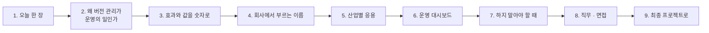

# 4단계 · 정리: 오늘 한 일의 의미 · 효과 · 실전 응용

- 교시: 8교시 17:10~17:45 (35분, 바이브 코딩 발표 10분 뒤) · 자료: 이 문서 + [개요](00-DAY74-OVERVIEW.md) 30장
- 이 시간이 끝나면: 오늘 1~3단계에서 한 일이 **무엇을 지키기 위한 것이었는지**, 숫자로 **무엇을 잡았고 무엇을 치렀는지**, 회사에서는 같은 생각을 **어떤 이름과 도구로** 쓰는지 말할 수 있고, 최종 프로젝트에 무엇을 가져갈지 정할 수 있다.
- 숫자: 오늘 교안의 실측(강사 노트북, 10/27 정답 워크플로우 1회)입니다. "예시"라고 적은 계산은 가정을 둔 어림입니다.

## 0. 이 시간 (35분)

| 시간 | 절 | 하는 일 |
| --- | --- | --- |
| 17:10~17:15 | 1 · 2 | 오늘 한 장, 왜 버전 관리가 운영의 일인가 |
| 17:15~17:20 | 3 | 오늘 숫자로 본 효과와 값, 한 달에 릴리스 열 번이면 (예시) |
| 17:20~17:28 | 4 · 5 | 같은 생각의 업계 이름 · 도구, 산업별 응용 예 |
| 17:28~17:33 | 6 · 7 | 운영 지표 여섯 개, 하지 말아야 할 때 |
| 17:33~17:40 | 8 · 9 | 직무와 면접 질문, 최종 프로젝트 체크리스트 |
| 17:40~17:45 | 10 · 토론 | 다음 일차와의 연결, 질문 둘 |

## 1. 오늘 한 장

| 단계 | 한 일 | 오늘 숫자 |
| --- | --- | --- |
| 1단계 · 바뀐 것 | diff로 읽기, 반복해서 재기, 답마다 `version`, 지시문 저장소, 저장소가 멈추면 기본 지시문 | v1 → v2 **7개** 바뀜, 출처 번호 v1 **0/6** · v2 **6/6** (3번씩), 저장소 고장 HTTP 500 → **200 `fallback`**, 느림 9.1초 → **3.0초** |
| 2단계 · 내보내기 전 | 릴리스를 밖에서, 후보 고정, 게이트, 기준선, 강한 테스트, 망가진 릴리스 | 약한 golden 1.2.0 **PASS** → 강한 golden **1/9 FAIL**, 1.0.0 3번 **18/18**, 2.1.0 게이트 **PASS → FAIL** |
| 3단계 · 내보내기 | 값 하나 배포 · 되돌리기, 카나리, 나쁜 카나리 끄기, 점검, 점검 기록 · 정책 | 나쁜 카나리 영향 **2/6명** → 끈 뒤 6/6, 점검 1.1.0 promote · 1.2.0 rollback, 정책이 1.2.0 배포 **409** |
| 바이브 코딩 | 워크플로우 버전 저장 · 비교 `tver` (TODO → SPEC → IMP-PLAN → 설치) | 요구 14개 |

한 문장으로: **바뀐 것을 남기고, 내보내기 전에 숫자로 시험하고, 조금씩 내보내고, 언제든 값 하나로 되돌린다.**

## 2. 왜 버전 관리가 운영의 일인가

72일차는 "빠르게, 멈춰도 답하게", 73일차는 "속지 않게, 새지 않게"였습니다. 오늘은 "**바꿔도 망가지지 않게**"입니다. 서비스는 만들고 끝이 아니라 **계속 바뀝니다**. 지시문을 다듬고, 더 싼 모델로 옮기고, 공급자가 모델을 지원 종료합니다.

| | 만들기 | 운영하기 (변경 관리) |
| --- | --- | --- |
| 질문 | "지금 답이 맞나?" | "이걸 바꾸면 무엇이 달라지나? 나쁘면 어떻게 돌아가나?" |
| 기준 | 테스트 통과 | 같은 테스트로 **전 · 후 비교**, 기준선, 반복 |
| 실패 | 고치면 끝 | **먼저 되돌리고** 원인을 찾음, 기록으로 설명 |
| 바꾸는 사람 | 나 | 나 + 기획 · 운영(지시문) + **공급자**(모델) |

- LLM 앱의 변경 사고는 대개 **오류처럼 보이지 않습니다.** 1.2.0은 HTTP 200으로 친절하게 "포털을 보세요"라고 답했고, 2.1.0은 기본 지시문으로 멀쩡해 보였습니다. 테스트와 기록이 없으면 사고가 났는지도 모릅니다.
- 변경 관리는 속도와 **맞바꿈**이 아니라 속도의 **조건**입니다. 되돌리기가 값 하나면 자주 바꿔도 무섭지 않습니다.

## 3. 효과와 값을 숫자로

### 3.1 오늘 실측 전 · 후

| 무엇 | 전 | 후 | 바꾼 것 |
| --- | --- | --- | --- |
| 나쁜 릴리스(1.2.0)를 게이트가 막나 | 6/6 **PASS** (약한 golden) | **1/9 FAIL** | 해결 낱말 · 상태를 보는 강한 golden |
| 망가진 릴리스(2.1.0)를 게이트가 막나 | 9/9 **PASS** (기본 지시문이 숨김) | **0/9 FAIL** | 404는 400 `release broken` |
| 지시문 저장소 고장 | HTTP 500 | 200 · `fallback` (1.3초) | timeout + 오류 출력 + 기본 지시문 |
| 지시문 저장소 느림 (8초) | 9.1초 | 3.0초 | timeout 2초 |
| 나쁜 카나리의 피해 | (전원 배포라면 6/6명) | **2/6명**, 명령 한 줄로 끔 | 카나리 50% + 보고 끄기 |
| 점검 rollback인 릴리스 배포 | 사람이 놓치면 나감 | **409** `not gated` | 점검 기록 + 배포 정책 |
| 되돌리기 | 예전 JSON을 찾아 push (n8n 재시작) | 값 하나, 다음 요청부터 | 릴리스를 밖에서 읽기 |

**치른 값**: 질문마다 데이터 API를 두 번 더 부릅니다(릴리스 · 지시문). VPN p50은 릴리스 · 지시문을 읽는 1.0.0(Lab 02 예제 3)이 1.23초, 둘 다 읽지 않는 v1(Lab 01 예제 3)도 1.23초였습니다 — 5번씩 잰 값으로는 차이가 보이지 않았습니다 (같은 노트북 안의 데이터 API). 대신 **부르는 곳이 늘어** timeout · 기본 지시문 · 404 처리를 만들어야 했습니다 (Lab 01 과제 2, Lab 02 과제 2).

### 3.2 한 달에 릴리스 열 번이면 (예시)

가정: 지시문 · 모델 변경을 한 달에 10번 내보냄, 그중 2번은 무언가를 망가뜨림(오늘 1.2.0 · 2.1.0처럼), 하루 문의 1,000건.

| | 게이트 · 카나리 · 되돌리기 없음 | 오늘의 운영 체계 |
| --- | --- | --- |
| 나쁜 변경 2번이 사용자에게 | 2번 모두 전원에게 (하루 1,000건씩) | 게이트가 1.2.0 · 2.1.0 같은 것을 배포 전에 멈춤 |
| 게이트를 지나 버린 문제 | (해당 없음) | 카나리 5%면 하루 약 50건만 영향, 끄면 끝 |
| 되돌리는 시간 | 파일 찾기 · push · 확인 (분 단위) | 값 하나 (초 단위) |
| 원인 찾기 | "누가 무엇을 바꿨지?" | 답의 `version` · `CHANGELOG.md` · 점검 기록 |

- 게이트 · 카나리는 **문제를 0으로 만들지 않습니다.** 게이트는 테스트만큼만, 카나리는 비율만큼만 줄입니다. 그래서 둘을 **겹으로** 둡니다 (73일차 겹겹이 막기와 같은 생각).

## 4. 회사에서는 같은 생각을 이렇게 부른다

| 오늘 한 것 | 업계 이름 | 쓰는 도구 · 표준 (예) |
| --- | --- | --- |
| `flow.py diff`, `tver` | 구조 diff, 코드 리뷰 | git · pull request, nbdime, `terraform plan` |
| 답마다 `version` | 출처 표시, 추적성 | OpenTelemetry 속성, LLM 관측 도구 (LangSmith · Langfuse 등) |
| 지시문 저장소 p1 · p2 · p3 | 프롬프트 관리 · 레지스트리 | LangSmith Prompt Hub, Langfuse, PromptLayer, MLflow Prompt Registry |
| 릴리스를 밖에서 읽기 | 원격 설정, 기능 플래그 | LaunchDarkly, Unleash, Flagsmith, Firebase Remote Config, AWS AppConfig |
| 기본 지시문 · `fallback` | 우아한 저하, last known good | 설정 클라이언트 캐시, 서킷 브레이커 (72일차) |
| 게이트 · golden | 품질 게이트, 평가 세트, 회귀 테스트 | promptfoo, DeepEval, Ragas, OpenAI Evals, CI(GitHub Actions · GitLab CI) |
| 404는 크게 실패 | fail fast, 설정 검증 | 스키마 검사, 시작 시 확인 |
| 값 하나 배포 · 되돌리기 | 배포와 릴리스 분리, 롤백 | 블루그린, 기능 플래그 끄기 |
| 카나리 · bucket | 카나리 배포, 점진 배포, 고정 배정 | Argo Rollouts, Flagger, Kayenta(카나리 분석), 기능 플래그 % 배포 |
| 점검 기록 · `require_gate` | 변경 관리, 코드로 된 정책, 배포 승인 | 브랜치 보호 규칙, 쿠버네티스 입장 제어 · OPA, ITIL 변경 관리 |
| `CHANGELOG.md` · `RELEASE.md` | 릴리스 노트, 런북 | Keep a Changelog, 운영 런북 |

- 오늘은 n8n 노드 · 작은 데이터 API · `flow.py`로 직접 만들었습니다. 회사에서는 도구가 대신해 주는 경우가 많습니다. 그래도 **무엇을 버전으로 두고, 무엇으로 시험하고, 어떤 기준으로 내보낼지**는 오늘처럼 사람이 정합니다.

## 5. 산업별 응용 (예)

아래는 오늘 한 일을 다른 업무에 옮긴 예입니다 (실제 특정 회사의 사례가 아니라 흔한 모양).

| 업무 | 오늘의 무엇을 | 이렇게 |
| --- | --- | --- |
| 은행 · 보험 상담 챗봇 | 게이트 · 점검 기록 · 정책 | 지시문 변경마다 규제 문구 평가 세트(약관 고지 · 금지 표현)를 통과해야 배포, 승인 기록을 감사에 제출 |
| 쇼핑몰 상품 설명 생성 | 카나리 · 모델 교체 | 더 싼 모델을 상품 5%에만 먼저, 클릭률 · 반품 문의를 운영 쪽과 비교 |
| 콜센터 상담 요약 | 답마다 `version` · 되돌리기 | 요약마다 릴리스를 남겨, 이상한 요약이 나온 날 그 릴리스만 골라 다시 만들고 되돌림 |
| 사내 IT 헬프데스크 (오늘) | 전부 | 지시문은 운영팀이 저장소에서, 배포는 게이트 · 카나리 · 점검 뒤 |
| 사내 문서 RAG (71일차) | 데이터 버전 · 게이트 | 색인을 다시 만들 때 hit@k 게이트, 문제면 이전 색인으로 값 하나 되돌림 |
| 의료 · 법률 문서 보조 | fail fast · 고정 | 지시문 · 모델 이름이 틀리면 조용히 기본값으로 가지 않고 멈춤, 검토자는 고정 릴리스로 재현 |

**토론 거리**: 내 회사(또는 가고 싶은 회사)의 AI 기능 하나를 골라, 위 표의 한 줄을 채워 봅니다.

## 6. 운영 대시보드에 올릴 숫자 여섯

오늘 답 · 기록에 남긴 칸만으로 운영 지표가 됩니다 (77일차 로그 분석 · 79일차 운영 대시보드에서 실제로 모읍니다).

| 지표 | 어느 칸에서 | 무엇을 알 수 있나 |
| --- | --- | --- |
| 릴리스별 요청 수 · 오류율 | `version.release`, HTTP 상태 | 카나리 쪽이 운영 쪽보다 나쁜가 |
| 채널별 비율 | `version.channel` | 카나리가 의도한 비율로 나가나 |
| 기본 지시문 비율 | `version.prompt_source = fallback` | 지시문 저장소가 자주 멈추나 |
| 릴리스별 p95 | `version.release` + 시간 | 새 릴리스가 느려졌나 |
| 게이트 · 점검 결과 | `/gates` (`verdict`, `passed/total`) | 배포 전 실패율, 어느 테스트에서 떨어지나 |
| 배포 · 되돌리기 기록 | `CHANGELOG.md`, 릴리스 변경 시각 | DORA: 배포 빈도 · 변경 실패율 · 복구 시간 |

- 오늘 `version`에 `channel` · `prompt_source`까지 넣게 한 까닭이 이것입니다. **어느 버전이 답했는지 모르면 무엇을 되돌릴지도 모릅니다.**

## 7. 하지 말아야 할 때 (흔한 실수)

| 하기 쉬운 일 | 왜 위험한가 | 대신 |
| --- | --- | --- |
| 지시문 · 모델 · 노드를 한 번에 | 원인을 모름 (v2) | 한 릴리스에 한 가지 |
| 한 번 돌려 보고 "좋아졌다" | 흔들림일 수 있음 | `--repeat 3`, 기준선 |
| 지시문을 덮어써서 고침 | 재현 · 되돌리기 불가 | 새 버전을 더함 (불변) |
| 상태 코드만 보는 게이트 | 1.2.0 같은 답이 PASS | 데이터에서 정한 해결 낱말 |
| 게이트가 FAIL이라 기대를 느슨하게 | 게이트가 의미를 잃음 | 답이 틀렸는지 먼저 |
| 모든 실패를 기본값으로 받음 | 설정 오류가 숨음 (2.1.0) | 4xx는 크게 실패 |
| 카나리를 켜고 보지 않음 | 느린 배포일 뿐 | 같은 질문 · 같은 지표로 비교 |
| 점검 워크플로우가 직접 배포 | 점검이 틀리면 저절로 나감 | 판단 · 기록 · 실행을 나눔 |
| 모델 이름을 하드코딩하고 잊음 | 공급자가 지원 종료하면 멈춤 (수업 준비 때 gpt-4.1-nano) | 한 곳에서, 종료 일정을 지켜봄, 바꿀 때는 모델만 |

## 8. 직무와 면접

오늘 한 일은 다음 직무들이 날마다 하는 일입니다: **AI · LLM 애플리케이션 엔지니어, MLOps · LLMOps 엔지니어, 플랫폼 · DevOps · SRE, 백엔드 엔지니어, AI 서비스 운영 · 품질 담당.** 채용 공고의 "프롬프트 버전 관리", "LLM 평가 · 회귀 테스트", "카나리 · 점진 배포", "기능 플래그", "CI/CD", "변경 관리"가 오늘 내용입니다.

면접에서 흔히 받는 질문과 오늘 숫자로 답하는 법:

1. "프롬프트를 바꿨더니 다른 질문의 답이 나빠졌습니다. 어떻게 막나요?"

지시문을 워크플로우 밖 저장소에서 불변 버전(p1 · p2 · p3)으로 관리하고, 지시문만 바꾼 릴리스를 만들어 고정 요청으로 평가 세트를 돌립니다. 오늘 상태 코드만 보는 golden은 나쁜 1.2.0을 6/6 PASS로 통과시켰고, 데이터에서 정한 해결 낱말을 보는 golden으로 바꾸자 1/9 FAIL로 막았습니다. 1.0.0을 3번 돌려 18/18로 흔들리지 않는 것도 확인했습니다.

2. "더 싼 모델로 바꿔도 되는지 어떻게 판단하나요?"

모델만 바꾼 릴리스(오늘 2.0.0 = 1.1.0의 지시문 + 작은 모델)를 같은 평가 세트로 게이트하고, 시간 · 비용을 같은 날 같이 잽니다. 2.0.0은 강한 golden 9/9, VPN p50 1.12초(1.0.0 1.23초)였습니다. 게이트는 평가 세트에 있는 것만 보므로, 통과해도 바로 전원이 아니라 카나리로 먼저 내보냅니다.

3. "배포한 버전에 문제가 생기면?"

먼저 되돌리고 그다음 원인을 찾습니다. 워크플로우가 운영 릴리스를 데이터 API에서 읽게 해서 되돌리기가 값 하나이고, 다음 요청부터 바뀝니다. 아직 카나리 단계면 카나리만 끕니다 — 오늘 1.2.0 50% 카나리는 두 명에게만 나갔고 `--no-canary` 한 줄로 6/6으로 돌아왔습니다. 되돌릴 이전 릴리스와 지시문은 지우지 않고 남겨 둡니다.

4. "설정 서버가 멈추면 서비스도 멈추나요?"

멈추지 않게 timeout과 마지막으로 잘 됐던 설정을 둡니다. 오늘 지시문 저장소가 500이면 HTTP 500이던 것을 기본 지시문으로 1.3초에 답하게 했고, 8초 느림은 2초에 포기해 3.0초에 답했습니다. 단, 404처럼 설정 자체가 틀린 것은 기본값으로 숨기지 않고 400으로 크게 실패하게 해서 게이트가 잡게 했습니다 — 안 그러면 망가진 2.1.0이 게이트를 9/9로 통과했습니다.

5. "점검에서 떨어진 버전이 실수로 배포되는 것은 어떻게 막나요?"

점검 결과를 기록하고, 배포를 받는 쪽이 기록을 확인하는 정책을 둡니다. 오늘 정책을 켜면 마지막 점검이 promote인 릴리스만 active · 카나리가 되고, 아니면 409를 돌려줍니다. 점검 워크플로우는 기록만 하고 배포는 하지 않습니다(판단과 실행 분리). 브랜치 보호 규칙이나 배포 승인 단계와 같은 생각입니다.

## 9. 최종 프로젝트로 가져갈 것

최종 프로젝트(85일차~)의 워크플로우에 아래를 넣으면 "운영을 생각한 프로젝트"가 됩니다.

- [ ] 답(또는 로그)마다 `version` (릴리스 · 지시문 · 모델 · 채널)
- [ ] 지시문은 워크플로우 밖에서 불변 버전으로, 모델 이름은 한 곳에서
- [ ] 의존하는 저장소 · 설정에 timeout과 기본값, 설정 오류(4xx)는 크게 실패
- [ ] 평가 세트(golden): 데이터에서 정한 기대, 3번 반복으로 흔들리지 않는지
- [ ] 게이트 기준(통과율 · p95)은 기준선을 재서
- [ ] 후보는 고정해서 시험, 고정의 문은 좁게
- [ ] 값 하나로 배포 · 되돌리기, 되돌리기 연습 기록
- [ ] 카나리 (바뀌지 않는 값으로 나눔) + 비교할 지표
- [ ] 점검 결과 기록 + 배포 정책, `CHANGELOG.md` · `RELEASE.md`

## 10. 다음 일차와의 연결

| 일차 | 오늘의 무엇을 잇나 |
| --- | --- |
| 75 | 사용량과 비용 — 릴리스별 토큰 · 가격, 2.0.0(작은 모델)의 비용 판단, 게이트를 지키며 줄이기 |
| 76 | 에러 처리 · 알림 — 기본 지시문 · `release broken` · 409를 알림으로 |
| 77 | 로그 분석 — 답의 `version`으로 릴리스별 · 채널별로 나눠 세기 |
| 78 | 성능 기준(SLO) — 게이트의 p95 기준을 서비스 목표에서 |
| 79 | 운영 대시보드 · `tops` — 6절의 지표 여섯, `tver`로 워크플로우 변경 보기 |

## 토론 (5분)

1. 오늘 만든 장치(게이트 · 카나리 · 되돌리기 · 정책) 중 **하나만 남길 수 있다면** 무엇을 남기고, 그 까닭은?
2. 내 업무에서 "조용히 기본값으로 계속 가는 것"과 "크게 실패하는 것" 중 무엇이 맞는 의존을 하나씩 들어 봅니다.

## 정리

- [ ] 버전 관리도 **운영**: 바꿔도 망가지지 않게, 그리고 바뀐 것을 남긴다
- [ ] 효과는 같은 날 전 · 후 숫자로 (1.2.0 PASS → FAIL, 2.1.0 PASS → FAIL, 500 → fallback, 6명 → 2명)
- [ ] 같은 생각을 업계에서는 프롬프트 관리 · 원격 설정 · 품질 게이트 · 카나리 · 롤백 · 변경 관리 · 코드로 된 정책이라고 부른다
- [ ] 답의 `version`과 점검 기록이 곧 운영 지표가 된다
- [ ] 최종 프로젝트에 체크리스트 9개를 가져간다
