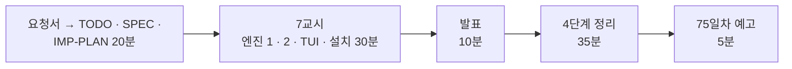

# 7·8교시 · 바이브 코딩 (`tver`)

- 교시: 7교시 16:00~16:50 (각자 만들기), 8교시 17:00~17:50 (발표 10분 · [4단계 정리](04-STAGE4-WRAPUP.md) 35분 · 예고 5분)
- 과제: [VIBE-REQ-TVER](../../Last3Mon/74/VIBE-REQ-TVER.md)(요청서, 요청의 말 ①~⑫) → [VIBE-Q-TVER](../../Last3Mon/74/VIBE-Q-TVER.md)의 8단계: `Doc/TODO.md` → `Doc/SPEC.md` → `Doc/IMP-PLAN.md`(엔진 · TUI 단계) → 단계별 구현 → 확인 → `uv tool install` → 다른 폴더에서 사용 → 수업 뒤 `VIBE-A-TVER.md` 공개
- 요구 14개(R1~R14). 50분 안에는 **엔진 1단계(R1 · R2 · R3 · R4) + 엔진 2단계(R5 · R6) + TUI 1단계(R8) + 설치(R14)**, 나머지는 IMP-PLAN의 다음 단계로 집에서.
- 72일차 `tbench` · 73일차 `tscan`과 같은 흐름입니다: 사람의 말(요청서)을 **확인할 수 있는 요구**로 바꾸는 일을 학생이 먼저 하고, VIBE-Q는 그 다음 단계(비교 대상)로 씁니다.
- 오늘은 `tver`: n8n 워크플로우 JSON을 git에 버전으로 저장하고, 두 버전을 노드 단위로 비교해 바뀐 것을 **모델 · 지시문 · 흐름**으로 나눠 보여 주는 TUI. 오늘 `flow.py diff`로 한 일을 내 도구로.

## 1. 7교시 · 각자 만들기 (50분)

| 시간 | 단계 | 확인 |
| --- | --- | --- |
| 16:00~16:09 | 0 준비 · 1 요청서 → `Doc/TODO.md` (에이전트 없이) | 할 일 ①~⑫ · 꼭 / 나중 |
| 16:09~16:15 | 2 `Doc/SPEC.md` → VIBE-Q 요구 표(R1~R14)와 비교 · commit | 요구마다 확인 방법 (바뀌었다고 나와야 할 것 · 나오면 안 되는 것) |
| 16:15~16:20 | 3 `Doc/IMP-PLAN.md` (엔진 1~4단계 · TUI 1단계 · 설치) · commit | 단계마다 체크리스트 |
| 16:20~16:44 | 4 구현: 엔진 1단계 → 엔진 2단계 → TUI 1단계, 막히면 5 문제 해결 팁 | 단계마다 `pytest` · 직접 실행 · commit |
| 16:44~16:50 | 6 확인 · 7 `uv tool install --editable .` · 8 다른 폴더에서 `tver` | `cd ~/aio-01d4-stu/Last3Mon/74 && tver diff reference/helpdesk-v1.json reference/helpdesk-v2.json` |

| 볼 것 | 막혔을 때 한마디 |
| --- | --- |
| TODO · SPEC 없이 VIBE-Q를 통째로 붙여 넣었나 | "요청서로 Doc/TODO.md부터. 나오면 안 되는 차이가 SPEC에 없으면 시끄러운 diff를 모릅니다" |
| IMP-PLAN이 한 덩어리 · 첫 요청에 14개 | "엔진 1단계만. 단계마다 확인 · 체크 · commit" |
| 모든 노드가 "바뀜" | "id · position을 빼고 비교, 저장할 때도" |
| 노드 짝이 안 맞음 | "name으로 짝짓기" |
| 지시문 diff가 한 줄로 뭉개짐 | "80자 넘는 값은 difflib 줄 단위" |
| 같은 파일인데 커밋이 계속 | "정리 · 키 정렬 후 저장, 바뀐 게 없으면 커밋 안 함" |
| 웹훅 경로를 "모델"로 셈 | "분류 규칙을 SPEC 4절에 글로 정하고 테스트로 고정" |
| 테스트가 `~/.tver/store`를 씀 | "테스트 저장소는 tmp_path (`--repo`)" |
| `tver`를 다른 폴더에서 못 찾음 | "`uv tool list`, `uv tool update-shell` 뒤 새 터미널" |
| 실행해 보지 않고 다음 요청 | "에이전트가 됐다고 해도 직접 `uv run tver`" |

정답 예(R1~R14를 모두 넣은 `tver`와 정답본 `VIBE-A-TVER.md`)는 수업 뒤 공개됩니다. 강사 바이브 코딩(4절)은 시간이 남으면 · 수업 뒤 하고, 걸린 시간을 정답본(`VIBE-A-TVER.md`) 6절에 남깁니다.

## 2. 8교시 · 발표 (10분)

- 1~2명. **오늘 Lab의 helpdesk.json을 단계마다 저장해 비교한 사람**, 위치만 바꾼 파일이 "no change"가 되는 것을 보여 줄 수 있는 사람을 먼저 고릅니다.
- 3분 발표 · 2분 질문: **내 SPEC과 VIBE-Q가 달랐던 곳** / IMP-PLAN을 어떻게 나눴나 / 잘 먹힌 요청문 / 안 먹힌 요청문 / 에이전트가 틀린 곳 / 시연.

## 3. 강사 정리 (8교시 4단계 정리 안에서, 1절 표와 함께)

| | n8n 헬프데스크 (오늘 Lab) | tver |
| --- | --- | --- |
| 바뀐 것 읽기 | `flow.py diff` (Lab 01 예제 1) | 노드 단위 diff + 지시문 줄 diff |
| 바뀌는 것 셋 | 모델 · 지시문 · 흐름 (1단계 강의) | R4 한 줄 요약 |
| 뜻 없는 차이 | — | id · position · 순서 빼기 (R2) |
| 버전 저장 | 데이터 API 릴리스 · 지시문 저장소 (불변) | git (정리해서, 같으면 저장 안 함) |
| 되돌리기 | `release helpdesk 1.0.0` (값 하나) | `tver restore <rev>` → 사람이 push |
| 비밀 | Credential (지시문 · JSON에 키 없음) | 키 모양이면 저장 거부 (R7, 73일차 `tscan`) |

## 4. 강사 바이브 코딩 (시간이 남으면 · 수업 뒤, 15분)

| 주제 | 요청문 요지 | 보여 줄 것 |
| --- | --- | --- |
| 게이트 붙이기 | "tver save 전에 지정한 테스트 파일로 flow.py gate 를 돌려 FAIL 이면 저장 안 함" | 버전 저장 = 게이트 통과 (오늘 3단계 정책과 같은 생각) |
| 지시문만 따로 | "systemMessage 를 꺼내 prompts/<노드>.md 로 저장, 지시문 diff 만 보기" | 오늘 지시문 저장소와 같은 생각 |
| 코드 분류 | "jsCode 는 prompt 가 아니라 code 로 따로 세기" | 분류 규칙은 팀이 정한다 |

걸린 시간과 결과를 `Last3Mon/74/VIBE-A-TVER.md` 6절에 적어 둡니다.

## 5. 보충 · 팁 (읽을거리, 4단계 정리 7절과 함께)

| 팁 | 설명 |
| --- | --- |
| 요청서 → 요구가 먼저 | 확인 방법(바뀐 수 · 버전 수 · 종료 코드)이 있는 요구가 있어야 에이전트의 "완료"를 판단할 수 있음 |
| 비교 전에 정리 | 의미 없는 차이(id · position · 키 순서)를 먼저 없애기 — 비교에도 저장에도 |
| 무엇으로 짝짓나 | 바뀌지 않는 이름 · 키로 (오늘 카나리의 bucket과 같은 생각) |
| 바뀐 것을 분류 | 모델 · 지시문 · 흐름 — 원인 찾기가 빨라짐 |
| 바뀐 게 없으면 커밋하지 않기 | 기록이 깨끗해야 읽힌다 |
| 꺼내기는 사람이 올리게 | 도구가 n8n에 직접 쓰면 실수가 바로 운영으로 |
| 단계마다 `git commit` | 에이전트가 망가뜨려도 돌아갈 곳 |

## 6. 75일차 예고 (5분)

- 오늘: 무엇이 바뀌었나 · 게이트 · 배포 · 되돌리기. 내일: **컴퓨팅 자원 · API 사용량 관리, 비용 최적화** — 오늘 2.0.0(작은 모델)을 품질 · 속도로만 봤습니다. 내일은 토큰과 단가로 비용을 재고, 하루 사용량에 한도를 둡니다.
- 바이브 코딩: `tcost`. 오늘 `tver`는 지우지 마세요. 79일차 `tops`에서 씁니다.

## 확인 (강사)

- [ ] 16:00 요청서 → TODO(에이전트 없이) → SPEC → IMP-PLAN 20분을 지켰다, 16:20부터 엔진 1단계.
- [ ] 7교시 시작 전 `reference/helpdesk-v1.json` · `v2.json`을 시험 자료로 쓰라고 화면에 띄웠다 (`flow.py diff`와 같은 7개가 기준).
- [ ] 수업 뒤: `VIBE-A-TVER.md`의 강사 바이브 코딩 시간을 채우고, 요청이 있을 때 학생 저장소에 정답(LAB-A · `answers/` · VIBE-A · `tver/`)을 올린다.
- [ ] 발표자 1~2명, 강사 정리 표, 팁, 예고.
- [ ] 수업이 끝날 때 학생들의 릴리스가 `--reset` 상태인지, `fault prompts ok`인지 (`doctor`).
