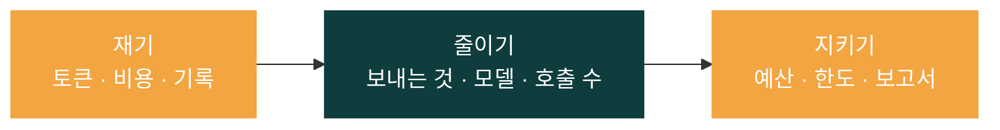
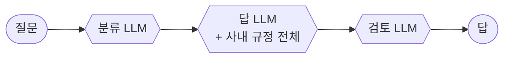
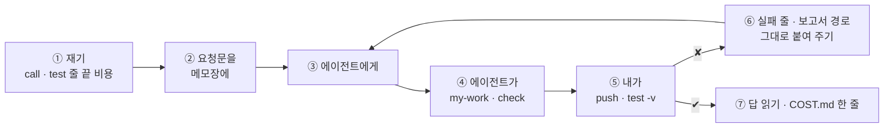
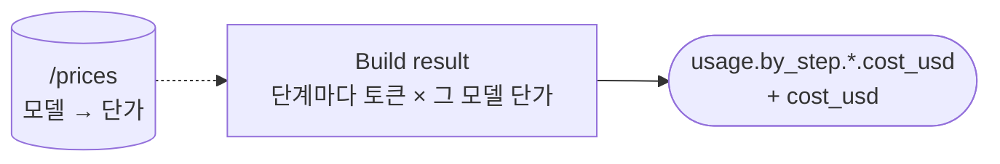
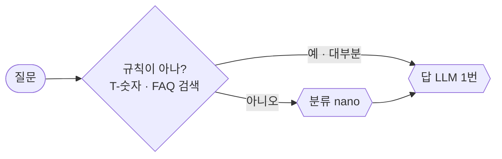
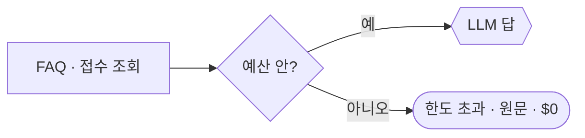
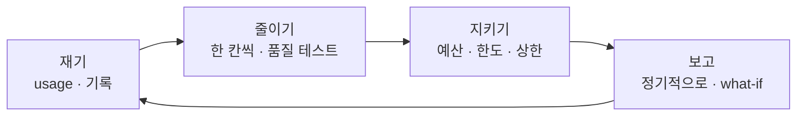
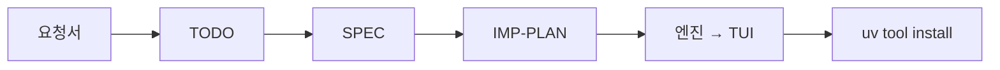

# 75일차 개요 · 컴퓨팅 자원·API 사용량 관리와 비용 최적화

> 노코드 멀티 에이전트 워크플로우 설계 및 운영 · 2026-10-29
> 30장 · 각 장은 가로줄(`---`)로 나뉩니다. 1교시에는 1~6장을 보고, 나머지 장은 각 단계 강의(1 · 3 · 5교시) 때 함께 띄웁니다.
> 숫자는 모두 강사 노트북 실측입니다 (65일차 n8n 2.42.6, OpenAI `gpt-4.1-mini` · `gpt-5.4-nano`, 10/28 정답 워크플로우를 학생 순서대로 1회). 단가는 OpenAI 모델 문서에서 2026-10-28에 확인한 값입니다.

| 장 | 범위 | 띄우는 때 |
| --- | --- | --- |
| 1~6 | 표지 · 목표 · 시간표 · 비싼 헬프데스크 · 일하는 순서 · 실습 15개 | 1교시 시작 |
| 7~14 | 1단계 · 사용량 재기 | 1교시 강의 |
| 15~21 | 2단계 · 비용 줄이기 | 3교시 강의 |
| 22~28 | 3단계 · 예산과 한도 | 5교시 강의 |
| 29~30 | 바이브 코딩 · 정리와 예고 (8교시 35분 정리는 [04-STAGE4-WRAPUP](04-STAGE4-WRAPUP.md)) | 7교시 · 8교시 |

---

## 1 / 30 · 표지



**75일차**

# 컴퓨팅 자원·API 사용량 관리와 비용 최적화

질문 하나에 얼마인지 재고, 품질은 그대로 두고 줄이고, 넘치지 않게 지킨다

<sub>노코드 멀티 에이전트 워크플로우 설계 및 운영 · 2026-10-29</sub>

---

## 2 / 30 · 오늘 할 수 있게 될 세 가지

| | 목표 | 내용 |
| --- | --- | --- |
| 1 | **잰다** | 자원 · 토큰 · 돈을 구분하고, 단계마다 비용을 결과에 남기고, 종류별로 한 달을 어림하고, 요청마다 기록한다 (멈춰도 답은 나감) |
| 2 | **줄인다** | 보내는 것 · 단가 · 호출 수를 한 칸씩, 품질 테스트와 답 읽기로 확인하고, 긴 입력에도 상한을 둔다 |
| 3 | **지킨다** | 하루 예산을 넘으면 원문으로, 몰아 부르면 429, 예산이 언제 멈추는지 재고, 보고서 · what-if는 코드로 |

---

## 3 / 30 · 오늘의 시간표

| 교시 | 시간 | 내용 |
| --- | --- | --- |
| 1 | 09:00~09:50 | 개요 · **1단계 강의** · 사용량 재기 |
| 2 | 10:00~10:50 | **Lab 01 실습 5개** · 자원 · 비용 · 종류별 비용 · 기록 · 기록이 멈추면 |
| 3 | 11:00~11:50 | **2단계 강의** · 비용 줄이기 |
| 4 | 12:00~12:50 | **Lab 02 실습 5개** · 보내는 것 · 모델 · 답까지 nano? · LLM 한 번 · 긴 질문 |
| - | 13:00~14:00 | 점심 |
| 5 | 14:00~14:50 | **3단계 강의** · 예산과 한도 |
| 6 | 15:00~15:50 | **Lab 03 실습 5개** · 하루 예산 · 1분 한도 · 예산 바꿔 보기 · 보고서 · what-if |
| 7 | 16:00~16:50 | 바이브 코딩 `tcost`: 요청서 → TODO → SPEC → IMP-PLAN → 만들기 → 설치 |
| 8 | 17:00~17:50 | 발표 · **4단계 정리** (의미 · 효과 · 회사에서 쓰는 법) · 76일차 예고 |

---

## 4 / 30 · 오늘 고치는 것: 비싼 헬프데스크



| 수업 준비 때 | VPN 질문 하나 | LLM 호출 |
| --- | --- | --- |
| 시작 (`base-cost`) | **$0.001040** (입력 1,999 · 출력 150) | 3 |
| 하루 뒤 (Lab 02 과제 1) | **$0.000156** | 1 |

- 72~74일차와 같은 IT 문의 헬프데스크 (FAQ · 접수 건). 오늘은 **같은 답을 더 싸게**, 그리고 **넘치지 않게**.

---

## 5 / 30 · 일하는 순서 (오늘은 "재기 → 줄이기 → 품질 확인")



- 예산 · 한도 · 글자 수 상한은 **내가** `flow.py budget`으로. 끝나면 `budget --reset`.
- 오늘은 호출마다 실제로 돈이 듭니다 (질문 하나에 약 $0.0001~$0.0012). 같은 테스트를 수십 번 반복하지 않습니다.

---

## 6 / 30 · 오늘의 실습 15개

| | 예제 1 | 예제 2 | 예제 3 | 과제 1 | 과제 2 |
| --- | --- | --- | --- | --- | --- |
| Lab 01 | 자원 · 단계별 토큰 (에이전트 없이) | 결과에 `cost_usd` | 종류별 비용 · 한 달 (에이전트 없이) | 요청마다 기록 | 기록이 멈춰도 답 |
| Lab 02 | 보내는 것 줄이기 | 단계마다 맞는 모델 | 답까지 nano면? (에이전트 없이) | LLM 한 번 · $0.0002 | 긴 질문의 상한 |
| Lab 03 | 하루 예산 → 원문 | 1분 한도 → 429 | 예산을 바꿔 가며 (에이전트 없이) | 비용 보고서 | 바꾸면 얼마 (what-if) |

- 실습 문서에 복사해 붙일 요청문은 없습니다. 막히면 `▶`, 요청문은 **빈칸 4개**를 채워서.

---

## 7 / 30 · 1단계 · 왜 비용인가

| | 일반 웹 서비스 | LLM API |
| --- | --- | --- |
| 무엇에 돈을 내나 | 서버 시간 · 저장 · 전송 | **보낸 · 받은 토큰** |
| 요청 하나의 비용 | 작고 거의 같음 | 요청마다 크게 다름 |
| 실수 하나의 크기 | 작음 | 지시문에 긴 자료 → **모든 요청**이 비쌈 |

- FinOps 세 단계: **알기**(1단계) → **줄이기**(2단계) → **운영하기**(3단계). 재지 않고 줄이면 무엇을 잃었는지 모릅니다.
- 쓸모 있는 숫자는 **요청 하나의 비용** (단위 경제).

---

## 8 / 30 · 1단계 · 자원: 내 컴퓨터와 공급자 (Lab 01 예제 1)

| 컨테이너 (`docker stats`) | CPU | 메모리 |
| --- | --- | --- |
| n8n | 0.27% | 642.6MiB |
| runners | 0.21% | 100.5MiB |
| data-api | 0.02% | 20.3MiB |

- API로 부르면 LLM 계산은 공급자 서버에서 → 내 CPU는 거의 쓰지 않음. 돈은 **토큰**에서.
- 내 쪽에서 늘어나는 것: 동시 실행 · 실행 기록 · 로그 (3단계 7절, 76 · 77일차).

---

## 9 / 30 · 1단계 · 토큰과 단가

```text
비용 = (입력 토큰 × 입력 단가 + 출력 토큰 × 출력 단가) ÷ 1,000,000
```

| 모델 (1M 토큰당 $) | 입력 | 캐시된 입력 | 출력 |
| --- | --- | --- | --- |
| `gpt-4.1-mini` | 0.40 | 0.10 | 1.60 |
| `gpt-5.4-nano` | 0.20 | 0.02 | 1.25 |

- VPN 질문: (1,999 × 0.40 + 150 × 1.60) ÷ 10⁶ = **$0.00104**. 하루 1,000번 · 22일 ≈ $22.9.
- **출력이 더 비싸고, 가격은 바뀝니다** (단가표에 확인한 날짜).

---

## 10 / 30 · 1단계 · 토큰이 보이는 호출 (Lab 01 예제 1 · 2)

| `base-cost` VPN | 입력 | 출력 |
| --- | --- | --- |
| classify | 78 | 6 |
| answer | **1,781** | 78 |
| review | 140 | 66 |

- 응답의 `usage`가 청구의 기준. AI Agent 노드는 답만 주고 토큰을 버림 → 오늘은 **HTTP로 OpenAI를 직접**.
- 입력의 89%가 `answer` 하나. 접수 질문도 1,791 → **매번 같이 보내는 것**이 있다.

---

## 11 / 30 · 1단계 · 단계별 비용, 단가는 밖에 (Lab 01 예제 2)



- 단가를 코드에 숫자로 → 가격 · 모델이 바뀌면 **조용히 틀림**. 70일차 설정 표 · 74일차 저장소와 같은 생각.
- 모르는 모델은 0원이 아니라 **오류**. 소수 8자리.
- 결과: VPN **$0.001040** (손 계산과 같음), `lab01` 3/3.

---

## 12 / 30 · 1단계 · 종류별 비용과 한 달 (Lab 01 예제 3)

| 종류 | 평균 (`lab01-mix`) | 비중 (가정) |
| --- | --- | --- |
| FAQ 넷 | $0.000980 | 60% |
| 접수 둘 | $0.000918 | 30% |
| 그 밖 | $0.000830 | 10% |

- 가중 평균 $0.000946 × 1,000건 × 22일 ≈ **한 달 $20.8**.
- 일곱 질문이 **$0.00083 ~ 0.00104로 비슷** → 고정비(규정 전체)가 대부분. 고정비부터 줄인다.

---

## 13 / 30 · 1단계 · 기록: 요청 · 호출 · 사람 (Lab 01 과제 1)

| 요약 (`/usage/summary`) | 질문 3개 뒤 |
| --- | --- |
| requests (요청) | 3 |
| calls (호출) | 9 |
| 합계 | $0.002951 |
| 사람별 | 이준호 $0.001040 · 박서연 $0.000959 · 한지훈 $0.000953 |

- 호출마다 한 줄, 같은 요청은 같은 `request_id` (`$execution.id`). 기록이 없으면 **예산 · 한도도 없다**.
- 기록에는 숫자와 분류 칸만 (질문 원문 · 개인정보 · 키는 남기지 않음).

---

## 14 / 30 · 1단계 · 기록이 멈추면 (Lab 01 과제 2)

| 기록 API | 고치기 전 | 고친 뒤 (`timeout` 3초 · 실패해도 계속) |
| --- | --- | --- |
| 고장 (500) | 답 · `recorded` 없음 | 답 · `recorded: false` |
| 느림 (8초) | **11.2초** | **6.1초** · `recorded: false` |

- 부가 기능(기록)이 본 기능(답)을 막지 않게. 값: 빠진 기록은 **예산에서도 빠짐** → 표시를 남김.
- 수업 준비 때: 3초에 포기했는데 서버가 8초 뒤 **결국 저장** → 다음 테스트의 요청 수가 하나 많았음. **포기해도 상대의 일은 끝나지 않을 수 있다.**

---

## 15 / 30 · 2단계 · 비용의 세 칸

```text
요청 하나의 비용 ≈ 호출 수 × 호출당 토큰 × 토큰 단가
```

| 칸 | 줄이는 방법 | 오늘 |
| --- | --- | --- |
| 호출당 토큰 | 필요한 것만 보내기 · RAG · 출력 상한 · 긴 입력 자르기 | 예제 1 · 과제 2 |
| 토큰 단가 | 단계에 맞는 작은 모델 · 캐시 · 배치 | 예제 2 · 3 |
| 호출 수 | 규칙으로 먼저 · 중복 단계 빼기 · 캐시 | 과제 1 |

- **품질 테스트를 먼저 고정**하고, 한 번에 한 칸, 가장 큰 몫부터.

---

## 16 / 30 · 2단계 · 보내는 것 줄이기 (Lab 02 예제 1)

| | 전 | 후 |
| --- | --- | --- |
| `answer` 입력 (VPN) | 1,781 | **165** (91% 줄임) |
| VPN 비용 | $0.001007 | **$0.000346** |
| 품질 테스트 | ✔ | ✔ |

- 규정 전체 빼기, FAQ 3칸 · 접수 5칸 (연락처 · 담당자 빼기 = **데이터 최소화**), `max_completion_tokens` 200.
- 규정이 필요하면 통째로가 아니라 **검색해서 관련 부분만** (71일차 RAG).

---

## 17 / 30 · 2단계 · 단계마다 맞는 모델 (Lab 02 예제 2)

| 모델 | 입력 | 출력 |
| --- | --- | --- |
| `gpt-4.1-mini` | 0.40 | 1.60 |
| `gpt-5.4-nano` | 0.20 (절반) | 1.25 (약 0.78배) |

- 분류 · 검토(쉬운 일)만 nano, 답은 mini → VPN $0.000346 → **$0.000278**.
- "작은 모델이면 몇 배 싸다"는 늘 맞지 않음 → **단가표로 계산**. 노드와 함께 **계산의 모델 이름도**.

---

## 18 / 30 · 2단계 · 싸졌는데 나빠졌다면 (Lab 02 예제 3)

| 답 단계 | 낱말 검사 | 일곱 질문 평균 |
| --- | --- | --- |
| mini (내 것) | 5/5 | $0.000233 |
| nano (비교본) | **5/5** | $0.000198 (약 15% 덜) |

- nano 답을 읽으면: `**처리 중**` 마크다운, "ticket_id가 없어…" 안쪽 말, "접수 건은 찾지 못했습니다" 군더더기.
- **통과 ≠ 같은 품질.** 사람이 읽고, 찾은 것은 테스트로. 오늘은 답을 mini로 둔다.

---

## 19 / 30 · 2단계 · 가장 싼 호출은 하지 않은 호출 (Lab 02 과제 1)



| | 전 | 후 |
| --- | --- | --- |
| FAQ · 접수 | 3 calls · 다섯이 $0.0002 넘음 | **1 call · $0.000108 ~ 0.000166** |
| `lab02-challenge` | 0/7 | **7/7** |
| 시간 | 3초대 | 1초대 |

---

## 20 / 30 · 2단계 · 긴 입력의 상한 (Lab 02 과제 2)

| 6,000자 넘는 로그 질문 | 전 | 후 (앞 200 + 뒤 300자) |
| --- | --- | --- |
| 프린터 (끝에 질문) | **$0.001196** (짧은 질문의 7배 넘게) | **$0.000237** · "대기열" |
| VPN (앞에 질문) | $0.001099 | $0.000260 · "인증서" |

- 입력 상한이 없으면 **요청 하나의 비용에도 상한이 없다** (Denial of Wallet).
- 입력 상한 + 출력 상한 → 요청 하나의 **최대 비용** → 예산을 지킬 수 있다.

---

## 21 / 30 · 2단계 · 한 번에 한 칸씩

| 단계 | 바꾼 칸 | VPN 비용 | 호출 |
| --- | --- | --- | --- |
| 기준 | | $0.001007 | 3 |
| 예제 1 | 호출당 토큰 | $0.000346 | 3 |
| 예제 2 | 단가 | $0.000278 | 3 |
| 과제 1 | 호출 수 | **$0.000156** | 1 |

- 바꿀 때마다 `COST.md`에 한 줄: 바꾼 것 · 전 → 후 · 품질 테스트 · **잃은 것**.

---

## 22 / 30 · 3단계 · 넘치지 않게

| 장치 | 막는 것 | 오늘 |
| --- | --- | --- |
| 예산 | 전체가 너무 많이 | 하루 `daily_usd` $1.0 |
| 속도 제한 | 한 사람이 짧은 시간에 몰아서 | 1분 `user_limit_per_min` 20 |
| 요청 상한 | 요청 하나가 너무 큼 | `max_question_chars` 500 · `max_completion_tokens` 200 |

- 공급자 한도는 **계정 전체**에 걸림 → 한 사람 때문에 모두 막힘. 그래서 내 쪽에 사람별 한도.
- 값은 **사람이** 정하고(`/budget`), 워크플로우는 읽기만.

---

## 23 / 30 · 3단계 · 하루 예산, 넘으면 원문 (Lab 03 예제 1)



- 멈추는 대신 **낮춰서 답하기** (graceful degradation). 확인은 LLM 앞 · 데이터 뒤.
- 72일차 LLM 장애의 `간단 답변`과 `route`를 구분 → 장애인지 예산인지 가른다.
- 결과: `한도 초과 · 0 calls · $0`, "인증서" · "처리 중" (3/3).

---

## 24 / 30 · 3단계 · 사용자별 한도와 429 (Lab 03 예제 2)

| 세는 방법 | 특징 |
| --- | --- |
| 고정 창 | 쉬움, 경계에서 두 배 |
| 이동 창 (오늘) | 고르게 막음 |
| 토큰 버킷 · 새는 통 | 짧은 몰림 허용 · 속도를 고르게 |

- **가장 앞**에서 429 + `retry_after` → 이준호 세 번째: **0.0초 · $0**, 다른 사람은 그대로.
- 세는 곳은 하나 (서버가 여러 대여도). 사람은 로그인 정보로 가린다.

---

## 25 / 30 · 3단계 · 예산은 넘은 뒤 멈춘다 (Lab 03 예제 3)

| 예산 $0.0003 | 결과 | 누적 |
| --- | --- | --- |
| 1 · 2번째 | 자동 답변 | $0.000293 (아래) |
| 3번째 | 자동 답변 | **$0.000430 (43% 넘음)** |
| 4 · 5 · 6번째 | 한도 초과 · $0 | 그대로 |

- 넘지 않으려면 "남은 돈 < 한 건 최대 비용이면 멈춤" → **상한이 있어야 예산도 지킨다**.
- 경고는 멈추기 **전에** (80%). 한도 초과 답도 기록해야 몇 명이 원문을 받았는지 센다.

---

## 26 / 30 · 3단계 · 비용 보고서 (Lab 03 과제 1)

| 넣은 네 줄 | 손 계산 = 보고서 |
| --- | --- |
| 요청 · 호출 · 합계 | 3 · 4 · $0.001989 |
| 평균 (요청 수로) · 100건 × 22일 | $0.000663 · **$1.4586** |
| 가장 많이 쓴 사람 · 남은 예산 | 박서연 · $0.998011 |

- 숫자는 **코드가** 계산 (틀리지 않고 · 공짜 · 늘 같게), LLM은 설명만 (79일차).
- 실제 사용량 일곱 건 · 하루 1,000건 → **한 달 $2.80** (아침 어림 $20.8의 약 7분의 1).

---

## 27 / 30 · 3단계 · 바꾸면 얼마: what-if (Lab 03 과제 2)

| what-if (넣은 네 줄) | 비용 | 아끼는 돈 |
| --- | --- | --- |
| 모두 nano | $0.00117 | $0.000819 |
| 모두 mini | $0.002016 | **−$0.000027** |

- 실제 사용량: $0.000929 → nano였다면 $0.00061 (34% 덜). **같은 토큰 · 같은 품질을 가정한 숫자.**
- 계산은 "해 볼 만한가", 결정은 "재고 · 읽고 · 게이트로" (74일차). 모르는 모델은 400.

---

## 28 / 30 · 3단계 · 운영: 재기 → 줄이기 → 지키기



- 누가 값을 정하나(사람) · 언제 보나(매주 · 매달) · 넘으면 무엇을 주나(원문 · 429) · 무엇을 남기나(`COST.md`).
- 내 쪽 자원(동시 실행 · 실행 기록)도 같은 보고서에.

---

## 29 / 30 · 7교시 · 바이브 코딩 `tcost`

- LLM을 부르기 **전에** 글 · 워크플로우의 토큰과 비용을 계산하고, 테스트 보고서(`runs/*.json`)의 **실제 사용량을 모아** 한 달을 예상하는 TUI. **OpenAI를 부르지 않습니다.**
- 순서: [요청서](../../Last3Mon/75/VIBE-REQ-TCOST.md) → `Doc/TODO.md` → `Doc/SPEC.md` → `Doc/IMP-PLAN.md` → 단계별 구현 → `uv tool install` → 다른 폴더에서.
- 요구 14개 (R1~R14). 50분 안에 엔진 1 · 2단계 · TUI 1단계 · 설치.



---

## 30 / 30 · 오늘의 정리 · 76일차 예고

| 오늘 | 한 줄 |
| --- | --- |
| 1단계 | 응답의 `usage`로 단계마다 비용, 단가는 밖에, 종류별로 한 달, 호출마다 기록 (멈춰도 답) |
| 2단계 | 보내는 것 · 단가 · 호출 수를 한 칸씩, 통과해도 답을 읽고, 입력 · 출력 상한 |
| 3단계 | 예산을 넘으면 원문, 몰아 부르면 429, 예산은 넘은 뒤 멈춘다, 보고서 · what-if는 코드로 |

**76일차 · 에러 처리와 예외 대응**: 오늘 기록 API가 멈췄을 때 답은 보냈지만, 빠진 기록은 `recorded: false`로 남기기만 했습니다. 내일은 실패한 일을 **모아 두고 다시 처리하고, 사람에게 알리는** 운영 체계를 만듭니다.
