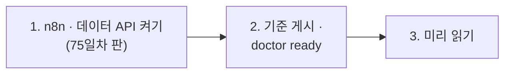

# 75일차 실습 준비 · 수업 전에 미리 해 두면 좋은 것

- 수업일: 2026-10-29 (75일차) · 컴퓨팅 자원·API 사용량 관리와 비용 최적화
- 준비 시간: 약 10분
- 먼저 WSL에서 `cd ~/aio-01d4-stu && git pull`로 오늘 자료를 받습니다 (수강생 저장소: https://gl.isitsoft.kr/publicproj/aio-01d4-stu).
- **수업 전날까지** 1~2절을 끝내 주세요.



---

## 1. n8n과 데이터 API 켜기 (전날 필수, 3분)

오늘은 **75일차 판 데이터 API**(74일차 + 단가 · 사용량 기록 · 예산 · 한도)를 씁니다. 같은 이름이라 이 폴더에서 다시 만들면 바뀝니다.

```bash
sudo systemctl disable --now ollama 2>/dev/null   # WSL에 설치한 Ollama가 있으면 끄고 자동 시작도 끔
cd ~/aio-01d4-stu/Last3Mon/65/n8n
docker compose rm -sf ollama                      # Ollama 컨테이너가 있으면 지움 (없으면 그냥 지나감)
docker compose start
cd ~/aio-01d4-stu/Last3Mon/75/data-api
docker compose up -d --force-recreate
sleep 3                                           # 데이터 API가 뜰 때까지
curl -s localhost:8800/prices                     # {"currency": "USD", "unit": "per 1M tokens", ... "gpt-5.4-nano" ...
```

- **66일차부터 LLM은 OpenAI API 키(`Last3Mon/.env`, Credential `OpenAI (.env)`)만 씁니다.** 오늘은 이 키로 쓴 토큰과 돈을 직접 잽니다. 작은 모델은 `gpt-5.4-nano`입니다 (`gpt-4.1-nano`는 OpenAI가 더 이상 받지 않음).
- `network day65-n8n_default not found` → n8n이 켜져 있지 않음. 위 n8n 부분부터 다시.

## 2. 기준 게시와 준비 확인 (전날 필수, 3분)

오늘 비용을 잴 **비싼 헬프데스크**를 게시해 둡니다 (만들지 않고 게시만).

```bash
cd ~/aio-01d4-stu/Last3Mon/75
uv run tools/flow.py push reference/baseline-cost.json
uv run tools/flow.py call base-cost requests/faq-vpn.json     # usage.by_step 에 단계별 토큰 (한 번에 약 $0.001)
uv run tools/flow.py doctor
```

```text
✔ n8n container day65-n8n-n8n-1
✔ n8n http://localhost:5678
✔ data API http://localhost:8800
✔ prices /prices · budget /budget (day 75 data API)
✔ n8n → http://data-api:8800
✔ credential 'OpenAI (.env)' (openAiCourse0001)
✔ node catalog (for check)
✔ CLI coding agent: codex, claude, agy
ready
```

| ✘ 항목 | 할 일 |
| --- | --- |
| n8n container · data API | 1절 |
| prices · budget | 데이터 API가 예전 판 → 1절 `--force-recreate` · `sleep 3` |
| `! budget is not the start state` | `uv run tools/flow.py budget --reset` |
| `! fault switch is on` | `uv run tools/flow.py fault all ok` |
| credential | `cd ~/aio-01d4-stu/Last3Mon/65/n8n && bash register-credentials.sh` |
| CLI coding agent | [67일차 준비](../67/00-DAY67-PREP.md) 2절 |

---

## 3. 미리 읽어 오면 좋은 내용 (선택, 약 5분)

### 3.1 질문 하나에 얼마일까

LLM API는 **토큰**(글자 조각) 수만큼 돈을 받습니다. 보낸 것(입력)과 받은 것(출력)의 단가가 다르고, 모델마다 다릅니다. 지시문에 사내 규정을 통째로 붙여 매번 보내면 어떻게 될까요? 2절의 `call base-cost`에서 `usage.by_step`의 입력 토큰이 가장 많은 단계를 찾아 와도 좋습니다.

### 3.2 용어

| 용어 | 한 줄 설명 |
| --- | --- |
| 토큰 | LLM이 글을 세는 단위 (한국어는 대략 글자 1~2개에 1토큰) |
| 입력 · 출력 토큰 | 보낸 지시문 · 질문 · 자료 / 받은 답 (출력이 더 비쌈) |
| 단가 | 1M(백만) 토큰당 달러, 입력 · 출력 · 모델마다 다름 |
| 계량 (metering) | 요청마다 쓴 양을 재서 남기기 |
| 예산 · 한도 | 하루에 쓸 돈의 상한 · 한 사람이 짧은 시간에 부를 수 있는 횟수 |
| 429 | "요청이 너무 많다"는 HTTP 상태 코드 |

### 3.3 7교시 요청서

[VIBE-REQ-TCOST](../../Last3Mon/75/VIBE-REQ-TCOST.md)를 한 번 읽어 옵니다. 재무 · 운영 담당이 원하는 것 열두 가지 중 "꼭"은 무엇일까요?

## 4. 당일 준비물

- 충전된 노트북과 충전기, WSL의 Docker, Windows Terminal(WSL) 창 **두 개**, 웹 브라우저

## 확인

- [ ] `curl -s localhost:8800/prices`에 `gpt-4.1-mini` · `gpt-5.4-nano` 단가
- [ ] `call base-cost`가 `usage.by_step`을 돌려줌
- [ ] `uv run tools/flow.py doctor` → 마지막 줄 `ready`
