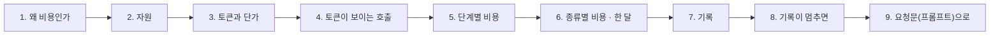
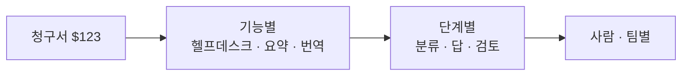

# 1단계 · 사용량 재기

- 교시: 1교시 강의 (09:00~09:50) · 2교시 [Lab 01](../../Last3Mon/75/LAB-01-Q-MEASURE-USAGE.md) 실습 5개 (10:00~10:50)
- 이 단계가 끝나면: AI 워크플로우가 쓰는 것 세 가지(컴퓨팅 자원 · API 토큰 · 돈)를 구분하고, 토큰과 단가로 질문 하나의 비용을 계산하고, 단계마다 비용을 결과에 남기고, 질문 종류별 비용으로 한 달을 어림하고, 요청마다 사용량을 기록하고, 기록이 멈춰도 답은 나가게 할 수 있다.
- 숫자: 모두 강사 노트북 실측입니다 (65일차 n8n 2.42.6, OpenAI `gpt-4.1-mini` · `gpt-5.4-nano`, 10/28 실습을 5개로 늘린 뒤 정답 워크플로우를 학생 순서대로 1회). 단가는 OpenAI 모델 문서에서 2026-10-28에 확인한 값입니다. 출력 전부는 수업 뒤 공개되는 `Last3Mon/75/answers/LAB-TEST-RESULT.md`에 있습니다.
- 실습 가리키기: 이 문서에서 "Lab 01 예제 1"은 2교시 [Lab 01 문서](../../Last3Mon/75/LAB-01-Q-MEASURE-USAGE.md)의 그 절입니다. 파일 경로(`cases/` · `requests/` · `my-work/` · `reference/`)는 실습 폴더 `~/aio-01d4-stu/Last3Mon/75` 기준입니다.



## 0. 이 시간 (50분)

| 시간 | 절 · 개요 | 하는 일 |
| --- | --- | --- |
| 09:00~09:06 | 개요 1~6장 | 오늘 하루, 비싼 헬프데스크, 실습 15개 |
| 09:06~09:12 | 1 · 개요 7장 | 쓴 만큼 내는 비용, FinOps, 요청 하나의 비용 |
| 09:12~09:17 | 2 · 개요 8장 | 내 컴퓨터의 자원과 공급자의 자원 |
| 09:17~09:24 | 3 · 개요 9장 | 토큰, 입력 · 출력 단가, 계산 |
| 09:24~09:29 | 4 · 개요 10장 | 응답의 `usage`, 숨기는 노드, 관측 도구 |
| 09:29~09:34 | 5 · 개요 11장 | 단계별 비용, 단가는 밖에 |
| 09:34~09:39 | 6 · 개요 12장 | 고정비 · 변동비, 가중 평균, 한 달 어림 |
| 09:39~09:45 | 7 · 8 · 개요 13~14장 | 기록(요청 · 호출 · 사람), 기록이 멈추면 |
| 09:45~09:50 | 9 · 10 · 확인 질문 | 요청문, 자주 하는 실수 |

### 2교시 Lab 01에서 이어서 하는 것

| 2교시 실습 (시각) | 이 강의의 절 | 실습에서 하는 일 | 쓰는 파일 · 명령 |
| --- | --- | --- | --- |
| 시작 (10:00) | — | 비용 계획 복사 | `cp templates/COST-PLAN-TEMPLATE.md my-work/COST.md` (오늘 잰 숫자를 모두 여기에) |
| Lab 01 예제 1 (10:00~10:10, 에이전트 없이) | 2 · 3 | 자원 · 단계별 토큰 · 단가 보기, 손 계산 | `docker stats --no-stream`, `call base-cost requests/faq-vpn.json` → `COST.md` 1 · 2절 |
| Lab 01 예제 2 (10:10~10:22) | 4 · 5 | 에이전트에게 단계마다 `cost_usd`를 넣게 하기 | `my-work/cost.json` (기준을 복사), 테스트 `cases/lab01.json` |
| Lab 01 예제 3 (10:22~10:30, 에이전트 없이) | 6 | 일곱 질문의 비용, 한 달 어림 | `test cases/lab01-mix.json` → `COST.md` 3절 |
| Lab 01 과제 1 (10:30~10:40) | 7 | 요청마다 `/usage`에 기록 | 테스트 `cases/lab01-challenge.json`, `flow.py usage` |
| Lab 01 과제 2 (10:40~10:50) | 8 | 기록이 멈춰도 답은 나감 | 테스트 `cases/lab01-challenge2.json` (`fault usage error` · `slow`) |

## 1. 왜 비용인가: "청구서를 보고 놀라는 날"

### 일반 설명

예전에는 서버를 사면 한 달 비용이 정해져 있었습니다. 클라우드와 API는 다릅니다. **쓴 만큼 냅니다 (pay as you go).** 처음에는 싸고 편하지만, 쓰는 사람이 늘거나 한 번에 쓰는 양이 늘면 비용도 그만큼 늘어납니다. 그리고 그 사실을 **청구서가 오고 나서야** 아는 일이 흔합니다.

LLM API는 이 성질이 더 강합니다.

| | 일반 웹 서비스 | LLM API |
| --- | --- | --- |
| 무엇에 돈을 내나 | 서버 시간 · 저장 공간 · 전송량 | **보낸 · 받은 토큰** |
| 요청 하나의 비용 | 아주 작고 거의 같음 | 요청마다 크게 다름 (보낸 글의 길이, 답의 길이, 모델) |
| 누가 비용을 정하나 | 주로 개발자 | 개발자 + **사용자**(질문 길이) + 지시문 · 자료를 붙이는 방식 |
| 실수 하나의 크기 | 작음 | 지시문에 긴 자료를 붙이면 **모든 요청**이 비싸짐 |

**FinOps.** 클라우드 비용을 엔지니어 · 재무 · 사업이 함께 관리하는 방법을 FinOps라고 부릅니다. FinOps Foundation은 이것을 세 단계로 설명합니다.

| 단계 | 하는 일 | 오늘 |
| --- | --- | --- |
| 알기 (Inform) | 누가 · 무엇에 · 얼마를 쓰는지 보이게 | 1단계 · 재기 · 기록 |
| 줄이기 (Optimize) | 같은 결과를 더 싸게 | 2단계 · 줄이기 |
| 운영하기 (Operate) | 예산 · 한도 · 보고를 습관으로 | 3단계 · 예산 · 한도 · 보고서 |

순서가 중요합니다. **재지 않고 줄이면** 무엇이 줄었는지도, 무엇을 잃었는지도 모릅니다. 72일차 성능 튜닝에서 "먼저 재고, 하나씩 바꾸고, 다시 잰다"를 했습니다. 비용도 같습니다.

**요청 하나의 비용 (unit cost).** 전체 청구액만 보면 "많이 썼다"만 압니다. 운영에서 쓸모 있는 숫자는 **요청 하나에 얼마**입니다. 이 숫자가 있으면 사용자가 두 배가 될 때 비용이 얼마가 될지, 새 기능이 요청당 얼마를 더하는지, 가격을 얼마로 매겨야 남는지를 말할 수 있습니다. 이것을 단위 경제(unit economics)라고 부릅니다.

| 숫자 | 뜻 | 어디에 쓰나 |
| --- | --- | --- |
| 요청 하나의 비용 | 질문 하나에 드는 돈 | 한 달 예상, 기능 비교 |
| 사용자 한 명의 하루 비용 | 한 사람이 하루에 쓰는 돈 | 한도 정하기 (3단계) |
| 기능별 비용 | 분류 · 답 · 검토 각각 | 줄일 곳 찾기 (2단계) |
| 하루 · 한 달 합계 | 청구액 | 예산과 비교 (3단계) |

**청구액이 갑자기 느는 흔한 까닭.** 운영 중인 LLM 앱의 비용이 갑자기 늘었을 때 원인을 찾아보면 대개 아래 중 하나입니다. 어느 것이든 **요청 하나의 비용**이나 **요청 수** 중 하나가 바뀐 것이고, 기록이 있으면 어느 쪽인지 바로 보입니다.

| 원인 | 무엇이 늘었나 | 알아채는 법 |
| --- | --- | --- |
| 지시문에 자료를 더 붙임 | 요청 하나의 입력 토큰 | 단계별 입력 토큰이 갑자기 큼 |
| 대화 기록을 통째로 다시 보냄 | 대화가 길수록 입력 토큰 | 같은 사람의 요청마다 입력이 커짐 |
| 재시도 · 반복 호출 | 호출 수 | 요청 수는 같은데 호출 수가 늘어남 |
| 더 비싼 모델로 바꿈 | 단가 | 모델별 합계의 비중이 바뀜 |
| 누가 자동으로 많이 부름 (스크립트 · 고장 난 루프) | 요청 수 | 한 사람 · 한 시간대에 몰림 |
| 아주 긴 입력 (로그 · 문서 붙여 넣기) | 몇몇 요청의 입력 토큰 | 평균은 조금, 최대값이 크게 |

**비용은 품질 · 속도와 함께 봅니다.** 비용만 보면 가장 싼 답은 "답하지 않기"입니다. 그래서 비용을 줄일 때는 **품질 테스트**(오늘 Lab의 `contains`)와 **시간**(72일차 p95)을 같이 봅니다. 셋 중 하나만 좋아지고 다른 것이 나빠지면, 그것은 개선이 아니라 맞바꿈입니다. 맞바꿈이 괜찮은지는 사람이 정합니다.

### 오늘 실습에서

오늘의 헬프데스크는 72~74일차와 같은 IT 문의 창구입니다 (FAQ 검색 + 접수 건 조회 + 답). 다만 오늘 시작하는 `base-cost`는 **일부러 비싸게** 만든 것입니다. 질문마다 LLM을 세 번(분류 · 답 · 검토) 부르고, 답 단계에 사내 규정 문서 여덟 개를 통째로 붙여 보냅니다.

| 시간 | 할 일 | 실습 |
| --- | --- | --- |
| 1~2교시 | 자원 · 토큰 · 비용 재기, 결과에 비용, 종류별 비용 · 한 달, 기록, 기록이 멈추면 | Lab 01 |
| 3~4교시 | 보내는 것 줄이기, 단계마다 모델, 답까지 작은 모델이면?, LLM 한 번, 긴 질문의 상한 | Lab 02 |
| 5~6교시 | 하루 예산, 사용자별 한도, 예산을 바꿔 보기, 비용 보고서, 바꾸면 얼마 | Lab 03 |

하루 동안 VPN 질문 하나의 비용은 이렇게 바뀝니다 (수업 준비 때 실측).

| 때 | VPN 질문 하나 | LLM 호출 |
| --- | --- | --- |
| 시작 (`base-cost`) | **$0.001040** | 3 |
| Lab 02 예제 1 뒤 (보내는 것 줄이기) | $0.000346 | 3 |
| Lab 02 예제 2 뒤 (분류 · 검토 nano) | $0.000278 | 3 |
| Lab 02 과제 1 뒤 (LLM 한 번) | **$0.000156** | 1 |

## 2. 자원: 내 컴퓨터가 쓰는 것과 공급자가 쓰는 것 (2교시 Lab 01 예제 1)

### 일반 설명

**컴퓨팅 자원**은 프로그램이 돌아가는 데 쓰는 것입니다.

| 자원 | 무엇 | 모자라면 |
| --- | --- | --- |
| CPU | 계산 | 느려짐, 응답 시간이 늘어남 |
| 메모리 | 지금 쓰는 데이터를 올려 두는 곳 | 프로그램이 강제로 꺼짐 (OOM) |
| 디스크 | 저장 (실행 기록 · 로그 · 데이터베이스) | 저장 실패, 서비스 멈춤 |
| 네트워크 | 다른 서버와 주고받기 | 느림, 시간 초과 |

**LLM을 어디서 돌리느냐에 따라 자원과 비용이 갈립니다.**

| | 직접 돌리기 (self-host, 66일차 전의 Ollama) | API로 부르기 (오늘) |
| --- | --- | --- |
| LLM 계산 | 내 컴퓨터의 CPU · GPU · 메모리 | 공급자의 서버 |
| 내 컴퓨터가 쓰는 것 | 많음 (모델 크기만큼 메모리) | 거의 없음 (요청을 보내고 기다림) |
| 돈 | 장비 · 전기 (쓰지 않아도 듦) | 토큰 (쓴 만큼) |
| 늘어날 때 | 장비를 더 사야 | 그냥 더 부름 (비용도 그만큼) |

API로 부르면 LLM 계산은 내 쪽 자원을 거의 쓰지 않습니다. 그래도 내 쪽에서 자원을 쓰는 것이 있습니다.

| 내 쪽에서 자원을 쓰는 것 | 늘어나는 까닭 | 다루는 법 |
| --- | --- | --- |
| 워크플로우 엔진 (n8n) 메모리 | 동시에 도는 실행, 큰 데이터(긴 글 · 파일) | 동시 실행 수 한도, 큰 데이터는 나눠서 |
| 실행 기록 (execution data) | 실행마다 입력 · 출력을 저장 | 보관 기간 · 개수 정하기 (오래된 것 지우기) |
| 로그 · 기록 | 요청마다 한 줄씩 | 보관 기간, 필요한 칸만 |
| 대기 | 느린 API를 기다리는 동안 연결 · 메모리를 잡고 있음 | timeout (72일차) |

**컨테이너는 자원에 한도를 둘 수 있습니다.** Docker는 컨테이너마다 쓸 수 있는 메모리 · CPU의 상한을 정할 수 있습니다. 상한이 없으면 한 컨테이너가 컴퓨터 전체를 써서 다른 서비스까지 멈추게 할 수 있습니다. 운영 서버에서는 상한을 두고, `docker stats` 같은 도구로 지금 얼마나 쓰는지 봅니다.

**동시 실행도 자원입니다.** 워크플로우 엔진은 요청 하나를 처리하는 동안 실행 하나를 잡고 있습니다. LLM 답을 기다리는 몇 초 동안에도 그 실행은 메모리를 씁니다. 동시에 들어오는 요청이 많으면 기다리는 실행이 쌓여 메모리가 늘고, 엔진이 받을 수 있는 수를 넘으면 뒤의 요청은 줄을 서거나 실패합니다. 그래서 운영에서는 **동시 실행 수의 상한**을 정하고, 넘치는 요청은 큐에 넣거나 "잠시 후"로 돌려보냅니다 (3단계의 429와 같은 생각).

**자원 비용과 API 비용은 성질이 다릅니다.** 서버 자원은 대개 **쓰지 않아도** 시간만큼 냅니다 (켜 둔 서버). API 비용은 **부르지 않으면 0**입니다. 그래서 자원은 "얼마나 큰 서버가 필요한가"(용량 계획)로, API는 "요청 하나에 얼마 · 하루에 몇 번"(사용량 관리)으로 관리합니다. 오늘은 주로 뒤쪽입니다.

### 오늘 실습에서

Lab 01 예제 1의 `docker stats --no-stream` (수업 준비 때):

| 컨테이너 | CPU | 메모리 |
| --- | --- | --- |
| n8n | 0.27% | 642.6MiB |
| runners (Code 노드를 돌리는 곳) | 0.21% | 100.5MiB |
| data-api | 0.02% | 20.3MiB |

질문을 보내는 동안에도 CPU는 1%를 넘지 않았습니다. LLM은 OpenAI 서버에서 계산하기 때문입니다. 오늘 돈이 드는 곳은 내 노트북이 아니라 **토큰**입니다. n8n의 메모리는 실행 기록이 쌓이면 늘어나므로, 76 · 77일차에 실행 기록을 다룰 때 다시 봅니다.

## 3. 토큰과 단가 (2교시 Lab 01 예제 1)

### 일반 설명

**토큰은 LLM이 글을 세는 단위입니다.** 모델은 글을 글자나 낱말이 아니라 **토큰**이라는 조각으로 나눠 읽고 씁니다. 자주 나오는 글자 묶음은 한 토큰이 되고, 드문 것은 여러 토큰으로 나뉩니다. 그래서 같은 뜻이라도 언어 · 글의 종류에 따라 토큰 수가 다릅니다.

| 글 | 토큰이 되는 모양 (대략) |
| --- | --- |
| 영어 문장 | 낱말 하나가 토큰 1~2개 |
| 한국어 문장 | 글자 1~2개가 토큰 하나쯤 (모델의 토큰 나누는 법에 따라 다름) |
| 숫자 · 기호 · 로그 | 잘게 나뉘어 생각보다 많음 |
| JSON | 따옴표 · 괄호 · 칸 이름도 모두 토큰 |

토큰을 나누는 규칙(토크나이저)은 모델 계열마다 다릅니다. 같은 글을 다른 모델로 보내면 토큰 수가 조금 다를 수 있습니다. 정확한 수는 **공급자가 응답에 알려 주는 값**이 기준이고, 부르기 전에 미리 셀 때는 그 모델 계열의 토크나이저(예: OpenAI는 `tiktoken`)로 어림합니다 (7교시 `tcost`).

**입력과 출력은 따로 셉니다.**

| | 무엇 | 예 |
| --- | --- | --- |
| 입력 토큰 (`prompt_tokens`) | 보낸 것 전부: 지시문(system) + 질문 + 붙인 자료 + 앞 대화 | FAQ · 접수 건 · 규정 |
| 출력 토큰 (`completion_tokens`) | 모델이 만든 답 | 답 문장 |

**단가는 1M(백만) 토큰당 달러입니다.** 그리고 대개 **출력이 입력보다 비쌉니다.** 출력은 모델이 토큰을 하나씩 만들어 내야 하므로 계산이 더 들기 때문입니다.

```text
비용 = (입력 토큰 × 입력 단가 + 출력 토큰 × 출력 단가) ÷ 1,000,000
```

오늘 쓰는 두 모델의 단가 (OpenAI 모델 문서, 2026-10-28 확인, 1M 토큰당 달러):

| 모델 | 입력 | 캐시된 입력 | 출력 | 출력 ÷ 입력 |
| --- | --- | --- | --- | --- |
| `gpt-4.1-mini` | 0.40 | 0.10 | 1.60 | 4배 |
| `gpt-5.4-nano` | 0.20 | 0.02 | 1.25 | 약 6배 |

- **캐시된 입력**: 공급자가 같은 앞부분(긴 지시문)을 최근에 본 적이 있으면 그 부분을 싸게 받는 것입니다. 지시문을 앞에, 바뀌는 질문을 뒤에 두면 캐시가 잘 맞습니다. 오늘 계산은 캐시를 빼고 합니다 (보수적으로).
- **배치(Batch)**: 바로 답이 필요 없는 일(밤새 문서 요약 등)은 모아서 보내면 더 싸게 받는 방식도 있습니다. 실시간 헬프데스크에는 맞지 않습니다.
- **가격은 바뀝니다.** 공급자는 단가를 내리기도 하고, 새 모델을 내고 옛 모델을 지원 종료하기도 합니다 (74일차 `gpt-4.1-nano`). 그래서 단가표에는 **언제 확인했는지**를 같이 적습니다.

**계산을 손으로 한 번 해 봅니다.** 입력 2,000 · 출력 150토큰, `gpt-4.1-mini`라면:

```text
(2,000 × 0.40 + 150 × 1.60) ÷ 1,000,000 = (800 + 240) ÷ 1,000,000 = $0.00104
```

아주 작은 숫자입니다. 하지만 하루 1,000번 · 한 달 22일이면 $0.00104 × 22,000 ≈ $22.9입니다. 직원 수 · 질문 수가 늘거나, 같은 일을 하는 워크플로우가 여러 개면 곱해집니다. **작은 숫자에 큰 숫자를 곱하는 것**이 API 비용의 성질입니다.

**부르기 전에 세 보는 방법.** 지시문 · 자료를 바꾸기 전에 비용을 알고 싶으면, 그 글을 토크나이저로 세어 단가를 곱합니다. 공급자의 토큰 세기 도구(OpenAI `tiktoken`, 다른 공급자의 token count API)를 쓰면 API를 실제로 부르지 않고도 어림할 수 있습니다. 다만 실제 요청에는 실행 때 붙는 질문 · 검색 결과 · 대화 기록이 더해지므로, 미리 센 값은 **하한**에 가깝습니다. 7교시 `tcost`가 이것을 만듭니다.

**토큰을 쓰는 것은 돈만이 아닙니다.** 모델마다 한 번에 받을 수 있는 토큰 수(컨텍스트 창)의 상한이 있고, 입력이 길수록 응답이 늦어집니다. 긴 입력은 비용 · 속도 · 한도를 모두 씁니다.

### 오늘 실습에서

Lab 01 예제 1의 `call base-cost requests/faq-vpn.json` (수업 준비 때):

| 단계 | 입력 | 출력 |
| --- | --- | --- |
| classify | 78 | 6 |
| answer | **1,781** | 78 |
| review | 140 | 66 |
| 합 | 1,999 | 150 |

입력의 89%가 `answer` 단계 하나에서 나옵니다. 접수 질문(T-1002)도 입력 1,973 · `answer` 1,791로 거의 같습니다. 질문이 VPN이든 접수 상태든 **매번 같이 보내는 것**이 있다는 뜻입니다. 위 손 계산이 바로 이 VPN 질문입니다 ($0.00104).

## 4. 토큰이 보이는 호출 (2교시 Lab 01 예제 2)

### 일반 설명

LLM API는 답과 함께 **얼마나 썼는지**를 돌려줍니다. OpenAI Chat Completions 응답의 `usage`가 그것입니다.

```json
{
  "choices": [{"message": {"content": "VPN 클라이언트를 최신 버전으로 …"}}],
  "usage": {"prompt_tokens": 1781, "completion_tokens": 78, "total_tokens": 1859}
}
```

Anthropic · Google 등 다른 공급자도 이름은 조금 달라도(`input_tokens` · `output_tokens` 등) 같은 정보를 줍니다. **이 숫자가 청구의 기준**이므로, 비용을 재려면 이것을 받아 두어야 합니다.

**편한 도구가 숫자를 숨기기도 합니다.** 프레임워크 · 노코드 도구의 "AI Agent" 같은 상자는 답 글자만 다음 단계로 넘기고 `usage`를 버리는 경우가 있습니다. 편하지만, 그러면 비용을 잴 수 없습니다. 방법은 두 가지입니다.

| 방법 | 장점 | 단점 |
| --- | --- | --- |
| 공급자 API를 직접 부름 (HTTP) | `usage`를 그대로 받음, 무엇을 보내는지 다 보임 | 대화 · 도구 호출을 직접 다뤄야 함 |
| 관측(observability) 도구를 붙임 | 기존 흐름을 크게 안 바꿈, 화면이 좋음 | 도구를 하나 더 운영 |

**LLM 관측 도구.** LLM 호출마다 입력 · 출력 · 토큰 · 비용 · 시간을 모아 보여 주는 도구들이 있습니다 (예: Langfuse, Helicone, LangSmith, 클라우드의 모니터링 서비스). OpenTelemetry에도 생성형 AI 호출을 기록하는 공통 규칙(GenAI semantic conventions)이 정해지고 있습니다. 이름은 달라도 모으는 것은 같습니다: **어느 요청의 · 어느 단계가 · 어느 모델로 · 몇 토큰 · 얼마 · 몇 초.** 오늘은 이것을 n8n과 데이터 API로 직접 만들어 봅니다 (과제 1).

**토큰 수와 함께 남길 것.**

| 칸 | 왜 |
| --- | --- |
| 모델 이름 (실제로 불린 것) | 단가가 모델마다 다름. 74일차처럼 모델이 바뀐 날을 찾음 |
| 단계 (분류 · 답 · 검토) | 어디서 많이 쓰는지 (2단계) |
| 요청 번호 | 한 요청의 여러 호출을 묶음 (7절) |
| 누가 · 어떤 경로 | 사람별 · 경로별 합 (3단계) |

**내 기록과 공급자 청구는 맞춰 봅니다.** 내가 남긴 토큰 · 비용의 합과 공급자 사용량 화면(대시보드)의 숫자가 조금 다를 수 있습니다. 기록이 빠진 요청(8절), 테스트 · 실험으로 부른 것, 단가표가 오래된 것, 캐시 · 배치 할인이 그 까닭입니다. 운영하는 쪽은 정기적으로(예: 매주) 두 숫자를 나란히 놓고, 차이가 크면 어디서 새는지 찾습니다. 내 기록은 **나눠 보기**(누가 · 어디서)에, 공급자 청구는 **실제로 낼 돈**에 씁니다.

### 오늘 실습에서

오늘 워크플로우는 OpenAI를 **HTTP Request 노드로 직접** 부릅니다 (AGENTS.md 5절). 그래서 노드의 출력에 `usage`가 그대로 있고, 마지막 `Build result`(Code)가 단계마다 모아 `usage.by_step`으로 결과에 넣습니다. 66~74일차의 AI Agent 노드는 답만 주고 토큰 수를 주지 않아서 오늘은 쓰지 않습니다.

## 5. 단계별 비용, 단가는 밖에 (2교시 Lab 01 예제 2)

### 일반 설명

**비용을 어디에 붙이나 (cost attribution).** 청구서는 "OpenAI $123"처럼 한 줄로 옵니다. 줄일 곳을 찾으려면 그 돈이 **어느 기능 · 어느 단계 · 누구**에게서 나왔는지 나눠야 합니다. 그래서 요청마다, 단계마다 비용을 계산해 붙입니다.



**단가는 코드 밖에 둡니다.** 단가를 코드에 숫자로 박으면 두 가지 사고가 납니다. 가격이 바뀌었는데 코드를 안 고쳐 비용 숫자가 **조용히 틀리고**, 모델을 바꿨는데 단가를 그대로 둬 **다른 모델의 값**으로 계산합니다. 그래서 단가표를 한 곳(설정 · 데이터)에 두고, 계산하는 쪽은 **모델 이름으로 찾아** 씁니다. 70일차 설정 표, 74일차 릴리스 · 지시문 저장소와 같은 생각입니다: **바뀌는 값은 한 곳에 두고, 모두 그것을 읽는다.**

| 단가를 | 가격이 바뀌면 | 모델을 바꾸면 |
| --- | --- | --- |
| 코드에 숫자로 | 코드를 모두 찾아 고침 (빠뜨리기 쉬움) | 단가도 같이 고쳐야 함 |
| 단가표에 (모델 이름 → 단가) | 단가표 한 곳만 | 계산은 저절로 그 모델 값 |

**모르는 모델은 0원이 아닙니다.** 단가표에 없는 모델 이름이 오면 "없으니 0"으로 계산하기 쉽습니다. 그러면 그 모델은 공짜로 보이고, 비용 보고서는 거짓말을 합니다. 없는 이름은 오류로 알려야 합니다 (Lab 03 과제 2, 7교시 `tcost`).

**반올림을 정해 둡니다.** 요청 하나의 비용은 $0.000156처럼 아주 작아서, 계산할 때 소수점 아래가 길게 나옵니다 (0.00015560000000001). 자리를 정하지 않으면 합계 · 테스트가 흔들립니다. 오늘 계약은 **소수 8자리**입니다.

### 오늘 실습에서

Lab 01 예제 2는 `Get prices`(HTTP `GET /prices`)를 앞에 두고, `Build result`가 단계마다 그 단계 모델의 단가로 `cost_usd`를 계산해 `usage.by_step.<단계>.cost_usd`와 합계 `cost_usd`를 결과에 넣습니다. 수업 준비 때 VPN 질문의 결과가 **$0.001040** — 3절의 손 계산과 같았습니다. 테스트는 `range`로 비용이 0보다 크고 $0.01 이하인지 봅니다. 줄 끝에 `· 자동 답변 · 3 calls · $0.001040`처럼 호출 수와 비용이 나옵니다.

## 6. 질문 종류별 비용과 한 달 어림 (2교시 Lab 01 예제 3)

### 일반 설명

**한 달 비용 = 요청 하나의 비용 × 하루 요청 수 × 일하는 날.** 식은 간단하지만, "요청 하나의 비용"을 무엇으로 잡느냐가 어렵습니다. 요청마다 비용이 다르기 때문입니다.

**고정비와 변동비로 나눠 봅니다.**

| | 무엇 | 예 |
| --- | --- | --- |
| 고정비 | 질문과 관계없이 매번 드는 몫 | 늘 보내는 긴 지시문, 늘 부르는 단계 |
| 변동비 | 질문마다 달라지는 몫 | 질문 길이, 검색된 FAQ 개수, 답의 길이 |

고정비가 크면 어떤 질문이든 비용이 비슷하고, 줄일 때는 **고정비부터** 줄이는 것이 효과가 큽니다. 고정비가 작아지면 그다음에 변동비(긴 질문, 긴 답)가 눈에 띕니다 (Lab 02).

**종류마다 재고, 비중으로 섞습니다 (가중 평균).**

```text
한 달 ≈ Σ(종류별 평균 비용 × 그 종류의 비중) × 하루 요청 수 × 일하는 날
```

비중은 지난 기록에서 셉니다 (과제 1의 기록, 77일차 로그 분석). 기록이 없으면 가정한 값을 쓰고, **가정이라고 적어 둡니다.**

**평균만 보면 안 되는 때.** 대부분의 질문은 싸지만 가끔 아주 비싼 질문(긴 로그를 붙인 질문)이 온다면, 평균은 그 몇 개에 끌려 올라갑니다. 72일차에 시간을 p50 · p95로 본 것처럼, 비용도 **분포**를 봅니다. "질문 하나의 최대 비용"이 정해져 있지 않으면 한 달 예상도 믿기 어렵습니다 (Lab 02 과제 2의 상한).

**어림은 범위로 말합니다.** LLM 답의 길이는 실행마다 조금씩 달라서, 같은 질문도 비용이 약간 다릅니다. 그래서 한 달 예상은 "$20.8"보다 "약 $21, 사용량이 두 배면 $42"처럼 **가정과 함께** 말합니다. 실제 숫자는 기록을 쌓은 뒤 보고서로 다시 봅니다 (3단계).

### 오늘 실습에서

Lab 01 예제 3의 `test cases/lab01-mix.json` (수업 준비 때, 예제 2 정답):

| 종류 | 질문 | 비용 | 종류 평균 |
| --- | --- | --- | --- |
| FAQ | VPN · 프린터 · 비밀번호 · 메일 | $0.001040 · 0.000960 · 0.000953 · 0.000965 | $0.000980 |
| 접수 | T-1002 · T-1001 | $0.000946 · 0.000890 | $0.000918 |
| 그 밖 | 회의실 화면 공유 | $0.000830 | $0.000830 |

일곱 질문 모두 3 calls, 비용이 **$0.00083 ~ $0.00104로 비슷합니다.** 규정 전체를 매번 보내는 고정비가 비용의 대부분이기 때문입니다. 비중 60 · 30 · 10%(연습용 가정)로 섞으면 $0.000946 × 1,000건 × 22일 ≈ **한 달 $20.8**, 일곱 개 단순 평균이면 ≈ $20.7. 고정비가 커서 두 어림이 거의 같습니다. Lab 02로 고정비를 없애면 질문마다 $0.000097 ~ $0.000166으로 벌어집니다 (변동비가 보임).

## 7. 기록: 요청 · 호출 · 사람 (2교시 Lab 01 과제 1)

### 일반 설명

답에 비용을 남기면 **질문한 사람만** 그 숫자를 봅니다. 오늘 전체로 얼마를 썼는지, 누가 많이 쓰는지, 예산을 넘었는지는 **어딘가에 쌓인 기록**이 있어야 압니다. 쓴 양을 재서 남기는 것을 **계량(metering)**이라고 부릅니다. 전기 계량기처럼, 재지 않으면 나눌 수도 막을 수도 없습니다.

**요청과 호출은 다릅니다.**

| | 뜻 | 질문 3개 · 각 3단계 |
| --- | --- | --- |
| 요청 (request) | 사용자가 한 번 물은 것 | 3 |
| 호출 (call) | LLM을 한 번 부른 것 | 9 |

기록은 **호출마다 한 줄**이 정확합니다 (단계 · 모델마다 토큰 · 단가가 다르므로). 그 줄들이 같은 요청이라는 것을 알리려고 **같은 요청 번호**를 붙입니다. 분산 시스템에서 한 요청이 여러 서비스를 지나갈 때 같은 추적 번호(trace id)를 붙이는 것과 같습니다 (77일차).

**태그를 붙입니다.** 기록 한 줄에 사람 · 팀 · 기능 · 경로를 같이 남기면 나중에 어떤 칸으로든 나눠 합칠 수 있습니다.

| 나눠 보기 | 쓰는 곳 |
| --- | --- |
| 사람 · 팀별 | 사용자별 한도 (3단계), 부서에 비용을 알려 주기 (showback) · 나눠 청구하기 (chargeback) |
| 모델별 | 모델을 바꾸면 얼마 (3단계 과제 2) |
| 경로별 (`자동 답변` · `한도 초과` · `잠시 후`) | 예산 · 한도가 얼마나 자주 걸리나 |
| 단계별 | 줄일 곳 (2단계) |

**기록에 남기지 않을 것.** 비용 기록은 여러 사람이 오래 봅니다. 그래서 **질문 · 답의 원문**이나 연락처 같은 개인정보는 넣지 않고, 숫자와 분류 칸(누가 · 어느 단계 · 어느 모델 · 몇 토큰 · 얼마 · 어느 경로)만 남깁니다. 원문이 필요한 분석은 따로 권한을 둔 곳에서 합니다 (73일차 감사 로그). "누가"도 이름 대신 사번 · 익명 번호로 남기는 회사가 많습니다.

| 칸 | 비용 기록에 | 까닭 |
| --- | --- | --- |
| 요청 번호 · 단계 · 모델 · 토큰 · 비용 · 경로 · 시각 | 남김 | 합치고 나누는 데 필요 |
| 사람 | 남김 (가능하면 번호로) | 사람별 한도 · 합계 |
| 질문 · 답 원문 | 남기지 않음 | 개인정보 · 사내 정보가 섞임 |
| API 키 · 비밀번호 | 절대 남기지 않음 | 기록은 많은 사람이 읽음 (73일차) |

**기록은 예산 · 한도의 바탕입니다.** "오늘 $1 넘으면 LLM을 쓰지 않는다"(예산), "한 사람이 1분에 20번 넘으면 잠시 막는다"(한도)는 모두 기록을 세어야 할 수 있습니다. 기록이 빠지면 예산 · 한도도 그만큼 덜 셉니다 (8절).

### 오늘 실습에서

Lab 01 과제 1은 `Build result` 뒤에 `Record usage`(HTTP `POST /usage`)를 넣어 `usage.by_step`의 단계마다 한 줄 `{request_id, user, step, model, prompt_tokens, completion_tokens, cost_usd, route}`를 남깁니다. `request_id`는 n8n의 실행 번호(`$execution.id`)입니다. 수업 준비 때 질문 3개 뒤 `/usage/summary`가 **requests 3 · calls 9 · $0.002951**, 사람별 이준호 $0.001040 · 박서연 $0.000959 · 한지훈 $0.000953이었습니다. 기록 노드를 지나면 다음 노드의 입력이 기록 API의 응답(`{"stored": 3}`)이 되므로, 응답하기 전에 `Build result`의 결과를 다시 꺼냅니다.

## 8. 기록이 멈추면 (2교시 Lab 01 과제 2)

### 일반 설명

**부가 기능이 본 기능을 막으면 안 됩니다.** 사용자에게 중요한 것은 답이고, 기록은 운영하는 쪽의 일입니다. 그런데 기록이 끝나야 답을 보내게 만들면, 기록 서버가 느릴 때 사용자가 기다리고, 멈추면 답도 못 받습니다. 부가 기능(기록 · 알림 · 통계)은 **실패해도 본 기능이 계속되게** 만듭니다.

| 방법 | 어떻게 | 오늘 |
| --- | --- | --- |
| 시간 제한 | 기록을 N초까지만 기다림 | `timeout` 3초 |
| 실패해도 계속 | 기록이 실패하면 그 사실만 남기고 답을 보냄 | `onError: continueRegularOutput` |
| 나중에 보내기 | 기록을 큐에 넣고 따로 보냄 (비동기) | (오늘은 하지 않음) |
| 표시 남기기 | 기록이 빠졌다는 표시 | `recorded: false` |

**계속 가는 쪽의 값.** 74일차 지시문 저장소처럼 여기도 **계속 가는 쪽(fail-open)**입니다. 그런데 값이 있습니다. 기록이 빠진 요청은 예산 · 한도에 세어지지 않아, 실제보다 덜 쓴 것처럼 보입니다. 그래서 빠졌다는 표시(`recorded: false`)를 남겨 나중에 몇 건이 빠졌는지 셀 수 있게 합니다.

| | 73일차 판별 LLM | 74일차 지시문 저장소 | 오늘 사용량 기록 |
| --- | --- | --- | --- |
| 멈추면 | 막는다 (fail-closed) | 기본 지시문으로 답 | 답은 그대로, 기록만 빠짐 |
| 남기는 표시 | `guard_down` | `prompt_source: fallback` | `recorded: false` |
| 치르는 값 | 사용자가 기다림 | 지시문이 최신이 아닐 수 있음 | 예산 · 한도가 덜 셈 |

**시간 초과로 포기해도 상대의 일은 끝나지 않을 수 있습니다.** 내 쪽에서 3초에 포기해도, 상대 서버는 그 요청을 계속 처리해 **결국 저장할 수** 있습니다. 그러면 나는 "기록 안 됨"이라고 남겼는데 실제로는 기록된 상태가 됩니다. 분산 시스템에서는 이런 일이 흔해서, 같은 기록이 두 번 들어가도 한 번으로 세게 하는 장치(같은 요청 번호면 한 번만 세기, 멱등성 idempotency)를 둡니다. 오늘 요약이 `request_id`로 요청 수를 세는 것도 그 하나입니다.

### 오늘 실습에서

Lab 01 과제 2 (수업 준비 때):

| `cases/lab01-challenge2.json` | 고치기 전 (과제 1 정답) | 고친 뒤 |
| --- | --- | --- |
| 기록 API 고장 (`usage error`, 500) | 답은 나감 · `recorded` 없음 | `recorded: false` |
| 기록 API 느림 (`usage slow`, 8초) | **11.2초** 걸려 답 · `recorded` 없음 | **6.1초** · `recorded: false` |
| 고친 뒤 · 기록됨 | `recorded` 없음 | `recorded: true` |
| 요약 · 기록된 요청 | 1건 | 1건 |

**수업 준비 중에 실제로 일어난 일.** 처음 데이터 API는 느림 모드에서 8초를 기다린 뒤 **결국 저장**했습니다. 워크플로우는 3초에 포기하고 `recorded: false`로 답했는데, 늦게 저장된 한 줄이 다음 테스트를 시작한 뒤에 들어와 그 테스트의 요청 수가 하나 많았습니다. 위 "포기해도 상대의 일은 끝나지 않는다"가 실제로 일어난 것입니다. 실습용 데이터 API는 "늦게 답하고 저장하지 않음"(멈춘 기록 서버)으로 바꿨습니다.

## 9. 요청문(프롬프트)으로

**요청문(프롬프트)이란.** 실습에서 CLI 코딩 에이전트(codex · claude · agy)에게 보내는 글입니다. 에이전트는 이 글만 보고 n8n 워크플로우 JSON을 만들거나 고칩니다. 이 절은 이 단계에서 배운 것을 **요청문(프롬프트)에 어떤 칸으로 적을지** 실습 전에 정리하는 자리입니다. 실습 문서의 `▶ 빈칸 채우기 · 요청문(프롬프트) 뼈대`가 이 칸을 실제 문장으로 만든 것이고, 빈칸 ①~④는 그 문장 속 정확한 값입니다.

| 칸 | 에이전트에게 알려 주는 것 | 빠지면 생기는 일 |
| --- | --- | --- |
| 무엇을 | 만들거나 바꿀 기능 | 에이전트가 짐작해서 다른 것을 만듦 |
| 어디에 | 고칠 파일 · 노드 · 자리 | 엉뚱한 노드를 고치거나 새 파일을 만듦 |
| 어떤 모양으로 | 결과 JSON의 칸 이름 · 값 · 응답 코드 | 테스트가 보는 칸 이름과 달라 실패 |
| 그대로 · 하지 말 것 | 건드리면 안 되는 것 | 다른 곳까지 바뀌어 무엇 때문인지 모르게 됨 |
| 확인 | 통과해야 할 테스트 파일 | "다 됐다"를 판단할 기준이 없음 |

67~71일차의 다섯 가지(① 파일 ② 입력 ③ 처리 ④ 결과 모양 ⑤ 기대 결과)와 같은 뜻입니다. 파일 · 입력이 "어디에", 처리가 "무엇을", 결과 모양이 "어떤 모양으로", 기대 결과가 "확인"입니다. 72일차부터는 **이미 있는 워크플로우를 고치는** 요청이 많아 "그대로"가 따로 한 칸이 됐습니다.

오늘도 요청문의 뼈대는 같습니다: **무엇을 · 어디에 · 어떤 모양으로 · 무엇은 그대로 · 무엇으로 확인**. 비용 요청에서는 하나가 더 붙습니다: **LLM을 몇 번 · 어느 모델로 · 무엇을 보내는가, 그리고 숫자는 어디서 읽는가(단가 · 예산)**.

아래 표의 열은 이 단계에서 에이전트를 쓰는 실습, 줄은 위 다섯 칸입니다. 각 칸에 그 실습에서 채울 것을 적었습니다.

| 요청문에 | Lab 01 예제 2 | Lab 01 과제 1 | Lab 01 과제 2 |
| --- | --- | --- | --- |
| 무엇을 | 단계마다 비용 | 요청마다 기록 | 기록이 멈춰도 답 |
| 어디에 | `Has question?` 뒤 `Get prices`, `Build result` | `Build result` 뒤 `Record usage` · `Result again` | `Record usage`의 설정, `Result again` |
| 어떤 모양으로 | `usage.by_step.<단계>.cost_usd`, `cost_usd` (8자리) | 단계마다 한 줄, 같은 `request_id` | `recorded: true \| false` |
| 그대로 | 단가를 숫자로 쓰지 않음 (`/prices`에서) | 응답은 `Build result` 그대로 | `answer` · `cost_usd` |
| 확인 | `cases/lab01.json` | `cases/lab01-challenge.json` | `cases/lab01-challenge2.json` |

예를 들어 Lab 01 예제 2 열을 위에서부터 이어 읽으면 요청문(프롬프트)이 됩니다 (화살표 오른쪽은 다섯 칸 중 어디인지):

```text
단계마다 비용을 계산해 결과에 넣어 줘.                                          ← 무엇을
Has question? 뒤에 Get prices(GET /prices), 계산은 Build result 에서.              ← 어디에
usage.by_step.<단계>.cost_usd 와 합 cost_usd, 소수 8자리.                         ← 어떤 모양으로
단가는 숫자로 쓰지 말고 /prices 에서 그 단계 모델 이름으로 찾아.                  ← 그대로
cases/lab01.json 이 통과해야 해.                                                   ← 확인
```

## 10. 자주 하는 실수

| 실수 | 왜 문제인가 | 이렇게 |
| --- | --- | --- |
| 재지 않고 "아마 여기가 비쌀 것" | 엉뚱한 곳을 줄임 | 단계별 토큰부터 (`usage.by_step`) |
| 1,000,000으로 나누지 않음 | 비용이 백만 배 | 단가 단위(1M 토큰당)를 식에 |
| 단가를 코드에 숫자로 | 가격 · 모델이 바뀌면 조용히 틀림 | 단가표에서 모델 이름으로 |
| 모르는 모델을 0원으로 | 공짜로 보이는 거짓 보고서 | 오류로 알림 |
| 출력 토큰을 빼고 계산 | 출력이 더 비싸서 크게 틀림 | 입력 · 출력 따로 |
| VPN 하나만 재서 곱함 | 종류마다 비용이 다르면 틀림 | 종류별로 재고 비중으로 |
| 기록을 호출마다 다른 번호로 | 요청 수가 호출 수로 보임 | 같은 요청은 같은 `request_id` |
| 기록이 끝나야 답을 보냄 | 기록 서버가 느리면 사용자가 기다림 | timeout + 실패해도 계속 + `recorded` |

## 확인 질문

1. LLM API 비용이 일반 웹 서비스의 서버 비용과 다른 점 두 가지는?
2. 입력 2,000 · 출력 150토큰, 입력 $0.40 · 출력 $1.60(1M당)이면 한 번에 얼마인가요? 하루 1,000번 · 22일이면?
3. 질문 종류가 달라도 비용이 거의 같았습니다. 무엇을 알려 주나요? 무엇부터 줄이면 효과가 클까요?
4. 단가를 워크플로우 Code 안에 숫자로 적어 두면 어떤 사고가 날 수 있나요?
5. 질문 하나에 LLM을 세 번 부르면 기록은 몇 줄이고, "요청 수"는 어떻게 세나요?
6. 기록 API가 멈췄을 때 답은 보내고 `recorded: false`를 남깁니다. 이렇게 하면 무엇을 잃나요? 수업 준비 때 "포기했는데 늦게 저장된" 일은 왜 일어났나요?

## 정리

- [ ] 쓰는 것 셋: 컴퓨팅 자원 · API 토큰 · 돈 — API로 부르면 돈은 거의 토큰에서
- [ ] 비용 = (입력 × 입력 단가 + 출력 × 출력 단가) ÷ 1,000,000, 출력이 더 비싸다
- [ ] 응답의 `usage`를 받고, 단계마다 그 모델의 단가(단가표에서)로 계산한다
- [ ] 고정비 · 변동비로 나눠 보고, 종류별 · 비중으로 한 달을 어림한다
- [ ] 호출마다 기록하되 같은 요청은 같은 번호, 기록이 멈춰도 답은 나가고 `recorded`를 남긴다
