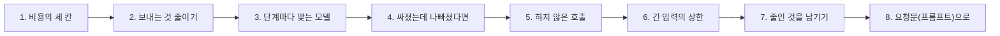
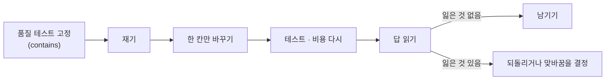
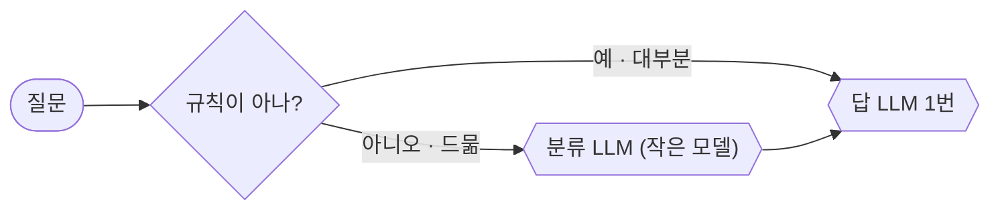

# 2단계 · 비용 줄이기

- 교시: 3교시 강의 (11:00~11:50) · 4교시 [Lab 02](../../Last3Mon/75/LAB-02-Q-REDUCE-COST.md) 실습 5개 (12:00~12:50)
- 이 단계가 끝나면: 비용을 정하는 세 칸(호출 수 · 호출당 토큰 · 단가)을 구분하고, 한 번에 한 칸씩 줄이고, 바꿀 때마다 품질 테스트와 답 읽기로 잃은 것이 없는지 확인하고, 아주 긴 입력에도 요청 하나의 비용에 상한을 둘 수 있다.
- 숫자: 모두 강사 노트북 실측입니다 (65일차 n8n 2.42.6, OpenAI `gpt-4.1-mini` · `gpt-5.4-nano`, 10/28 정답 워크플로우를 학생 순서대로 1회). 출력 전부는 수업 뒤 공개되는 `Last3Mon/75/answers/LAB-TEST-RESULT.md`에 있습니다.
- 실습 가리키기: 이 문서에서 "Lab 02 예제 1"은 4교시 [Lab 02 문서](../../Last3Mon/75/LAB-02-Q-REDUCE-COST.md)의 그 절입니다. 파일 경로는 실습 폴더 `~/aio-01d4-stu/Last3Mon/75` 기준입니다.



## 0. 이 시간 (50분)

| 시간 | 절 · 개요 | 하는 일 |
| --- | --- | --- |
| 11:00~11:07 | 1 · 개요 15장 | 호출 수 × 토큰 × 단가, 줄이는 방법 지도, 품질 테스트를 먼저 |
| 11:07~11:15 | 2 · 개요 16장 | 필요한 것만 보내기, 필드 줄이기, 출력 상한, 캐시 |
| 11:15~11:22 | 3 · 개요 17장 | 모델 라우팅, 단가표를 다시 보기 |
| 11:22~11:29 | 4 · 개요 18장 | 통과했는데 나빠진 답, 사람이 읽기, 맞바꿈 |
| 11:29~11:36 | 5 · 개요 19장 | 규칙으로 먼저, 중복 단계 빼기 |
| 11:36~11:43 | 6 · 개요 20~21장 | 입력 · 출력 상한 = 요청 하나의 최대 비용, Denial of Wallet |
| 11:43~11:50 | 7 · 8 · 9 · 확인 질문 | 줄인 것을 남기기, 요청문, 자주 하는 실수 |

### 4교시 Lab 02에서 이어서 하는 것

| 4교시 실습 (시각) | 이 강의의 절 | 실습에서 하는 일 | 쓰는 파일 · 명령 |
| --- | --- | --- | --- |
| Lab 02 예제 1 (12:00~12:10) | 2 | 규정 전체를 빼고 필요한 칸만, 출력 상한 | `my-work/cost.json`, 테스트 `cases/lab02.json` (앞 세 케이스), `diff` |
| Lab 02 예제 2 (12:10~12:18) | 3 | 분류 · 검토를 `gpt-5.4-nano` | 테스트 `cases/lab02.json` 5개, `cases/lab01.json` |
| Lab 02 예제 3 (12:18~12:25, 에이전트 없이) | 4 | 답까지 nano인 비교본을 재고 **읽기** | `push reference/lab02-example3-nano-answer.json`, `test cases/lab02.json --webhook nano-answer -v`, `lab01-mix` 둘 |
| Lab 02 과제 1 (12:25~12:38) | 5 | 규칙 분류 · 검토 빼기 → LLM 한 번 | 테스트 `cases/lab02-challenge.json` 7개 |
| Lab 02 과제 2 (12:38~12:50) | 6 | 긴 질문은 앞 40% + 뒤 60%만 | `requests/long-printer.json`, 테스트 `cases/lab02-challenge2.json` |

## 1. 비용의 세 칸: 호출 수 × 호출당 토큰 × 단가

### 일반 설명

1단계의 식을 요청 하나로 묶으면 이렇습니다.

```text
요청 하나의 비용 = Σ (그 요청의 호출마다) 입력 토큰 × 입력 단가 + 출력 토큰 × 출력 단가
                ≈ 호출 수 × 호출당 토큰 × 토큰 단가
```

비용을 줄이는 방법은 모두 이 세 칸 중 하나를 줄이는 것입니다.

| 칸 | 줄이는 방법 (업계에서 쓰는 이름) | 오늘 |
| --- | --- | --- |
| 호출당 토큰 | 보내는 자료 줄이기 · 필요한 부분만 찾아 보내기(RAG) · 지시문 다듬기 · 출력 상한 · 긴 입력 자르기 | 예제 1 · 과제 2 |
| 토큰 단가 | 단계에 맞는 작은 모델(모델 라우팅) · 캐시된 입력 할인 · 배치 할인 | 예제 2 · 3 |
| 호출 수 | 규칙으로 먼저 정하기 · 중복 단계 빼기 · 같은 질문의 답 다시 쓰기(캐시, 72일차) | 과제 1 |

**한 번에 한 칸씩.** 세 칸을 한꺼번에 바꾸면 비용이 줄어도 무엇 덕분인지, 답이 나빠져도 무엇 때문인지 모릅니다. 72일차 성능 튜닝 · 74일차 버전 관리의 "한 번에 하나만 바꾸고 다시 잰다"가 여기서도 같습니다.

**품질 테스트를 먼저 고정합니다.** 비용을 줄이는 일은 늘 품질을 깎을 위험이 있습니다. 그래서 줄이기 전에 **"이것은 지켜야 한다"를 테스트로 적어 두고**, 바꿀 때마다 그 테스트를 다시 돌립니다. 테스트를 통과시키려고 기대 결과를 바꾸면 안 됩니다 (AGENTS.md 9절: 답의 내용 검사를 없애지 않는다).



**숨은 비용도 셉니다.** 청구서에는 사용자가 받은 답만이 아니라 **부른 것 전부**가 들어갑니다.

| 숨은 비용 | 어디서 | 줄이는 법 |
| --- | --- | --- |
| 재시도 | 실패 · 시간 초과 뒤 다시 부름 (72일차) | 재시도 횟수 상한, 실패 원인부터 |
| 실패한 호출 | 형식이 틀려 버린 답, 중간에 끊긴 답 | 출력 형식을 단순하게, 짧게 |
| 버려지는 호출 | 결과를 쓰지 않는 단계 (오늘 `base-cost`의 분류는 결과를 쓰지 않음) | 쓰지 않는 단계 빼기 |
| 테스트 · 실험 | 개발 · 수업 준비 때 돌린 것 | 같은 테스트를 수십 번 돌리지 않기, 작은 표본 |

**어디부터 줄이나.** 1단계에서 잰 단계별 토큰을 봅니다. **가장 큰 몫**부터입니다. 전체의 89%가 한 단계의 입력이라면, 다른 곳을 아무리 줄여도 11% 안에서 움직입니다. 이것은 72일차에 가장 오래 걸리는 단계부터 줄인 것과 같습니다 (병목부터).

### 오늘 실습에서

하루 동안 VPN 질문 하나의 비용 (수업 준비 때, 같은 질문):

| 단계 | 바꾼 칸 | `answer` 입력 | 호출 | 비용 | 품질 테스트 |
| --- | --- | --- | --- | --- | --- |
| 기준 (Lab 01 과제 2 정답) | | 1,781 | 3 | $0.001007 | ✔ |
| 예제 1 · 보내는 것 줄이기 | 호출당 토큰 | **165** | 3 | $0.000346 | ✔ |
| 예제 2 · 분류 · 검토 nano | 단가 | 165 | 3 | $0.000278 | ✔ |
| 과제 1 · LLM 한 번 | 호출 수 | 약 165 | **1** | **$0.000156** | ✔ |

## 2. 보내는 것 줄이기 (4교시 Lab 02 예제 1)

### 일반 설명

**"혹시 필요할지 몰라서" 붙인 글이 비용의 대부분이 되기 쉽습니다.** 지시문에 사내 규정 · 매뉴얼 · 예시를 통째로 붙이면 답이 좋아질 것 같지만, 모델은 그 글을 **요청마다** 다시 읽고 공급자는 **요청마다** 돈을 받습니다. 그리고 관련 없는 긴 글은 모델을 헷갈리게 해 답이 오히려 나빠지기도 합니다.

**무엇을 보낼지 고르는 것도 설계입니다.** 요즘은 이것을 컨텍스트 엔지니어링(context engineering)이라고 부릅니다. 지시문 · 자료 · 대화 기록 중 **이번 답에 필요한 것만** 골라 보내는 일입니다.

| 보내는 것 | 줄이는 방법 |
| --- | --- |
| 참고 자료 (규정 · 매뉴얼) | 통째로 대신 질문과 관련된 부분만 검색해서 (RAG, 71일차) |
| 데이터 (FAQ · 접수 건) | 답에 쓰는 칸만 (`id` · `title` · `answer` / `status` · `note`) |
| 지시문 | 같은 말을 두 번 하지 않기, 예시는 꼭 필요한 만큼 |
| 대화 기록 | 최근 몇 개만, 또는 요약해서 |
| 출력 | 상한(`max_completion_tokens`), "3문장 이내" 같은 지시 |

**RAG에도 비용이 있습니다.** 필요한 부분만 찾아 보내면 답 단계의 입력은 줄지만, 찾는 데에도 돈이 듭니다. 문서를 벡터로 바꾸는 임베딩(71일차 `text-embedding-3-large`)은 색인을 만들 때 문서 전체에 한 번, 질문마다 질문에 한 번 듭니다. 대개 답 LLM에 긴 자료를 매번 보내는 것보다 훨씬 싸지만, 문서가 자주 바뀌어 색인을 자주 다시 만들면 그 비용도 셉니다. **줄인 곳 옆에 새로 생긴 비용**까지 합쳐야 진짜 절약입니다.

**예시(few-shot)도 비용입니다.** 지시문에 "이런 질문엔 이렇게 답하라"는 예시를 여러 개 붙이면 답의 모양이 고르게 되지만, 예시의 토큰도 **요청마다** 냅니다. 예시가 정말 효과가 있는지 예시 없이 같은 테스트를 돌려 비교하고, 효과가 있는 만큼만 남깁니다. 긴 지시문을 짧게 줄여 주는 압축 기법들(prompt compression)도 있지만, 압축하면 뜻이 바뀔 수 있어 역시 테스트로 확인합니다.

**칸을 빼면 안전해지기도 합니다.** 접수 건에는 연락처 · 담당자 같은 칸이 있습니다. 답에 쓰지 않는 칸을 LLM에 보내지 않으면 토큰도 줄고, 73일차처럼 개인정보가 답으로 새어 나갈 길도 하나 줄어듭니다. 개인정보 보호에서 말하는 **데이터 최소화**(필요한 것만 다룬다)와 같은 원칙입니다.

**출력 상한.** 출력은 입력보다 비쌉니다 (`gpt-4.1-mini`는 4배). `max_completion_tokens`는 답의 최대 길이입니다. 너무 작으면 답이 잘리고, 너무 크면 상한의 뜻이 없습니다. 지시문의 "3문장 이내"와 맞는 값을 둡니다. 그리고 공급자 · 모델마다 이름이 다를 수 있습니다 (`gpt-5.4-nano`는 예전 이름 `max_tokens`를 받지 않음).

**고정된 앞부분은 캐시가 받아 줍니다.** 공급자는 같은 앞부분을 최근에 받은 적이 있으면 그 입력을 싸게 받기도 합니다 (캐시된 입력, 1단계 3절). 그래서 바뀌지 않는 지시문은 **앞에**, 질문처럼 바뀌는 것은 **뒤에** 둡니다. 다만 캐시는 할인일 뿐이고, 필요 없는 글을 빼는 것이 먼저입니다.

### 오늘 실습에서

Lab 02 예제 1 (수업 준비 때):

| | 전 (`answers/08`) | 후 (`answers/09`) |
| --- | --- | --- |
| `answer` 입력 · VPN | 1,781 | **165** (91% 줄임) |
| `answer` 입력 · 접수 | 1,791 | 152 |
| VPN 비용 | $0.001007 | **$0.000346** |
| 품질 (인증서 · 처리 중 · 비밀번호 찾기) | ✔ | ✔ |
| `diff` | | `Answer` 본문 3,491 → 822자, 한 곳만 |

규정 전체는 답을 더 좋게 만들지 않았습니다. 지시문이 "FAQ와 접수 건으로만 답하라"고 했기 때문입니다. 규정이 필요한 질문이 있다면 통째로가 아니라 71일차처럼 **검색해서 관련 부분만** 보내는 것이 답입니다.

## 3. 단계마다 맞는 모델 (4교시 Lab 02 예제 2)

### 일반 설명

**모든 일에 같은 모델을 쓸 까닭은 없습니다.** 세 낱말 중 하나를 고르는 분류와, 사실을 틀리면 안 되는 답은 어려움이 다릅니다. 일의 어려움에 맞춰 모델을 고르는 것을 **모델 라우팅(model routing)**이라고 부릅니다. 쉬운 모델로 먼저 해 보고 자신이 없을 때만 큰 모델로 넘기는 방식은 **계단식(cascade)**이라고 부릅니다.

| 일 | 어려움 | 맞는 모델 |
| --- | --- | --- |
| 분류 · 낱말 뽑기 · 형식 바꾸기 | 쉬움 | 작은 모델 |
| 말투 다듬기 | 쉬움~보통 | 작은 모델, 또는 코드 검사 |
| 사실에 맞는 답 · 판단 | 어려움 | 검증된 모델 |
| 긴 추론 · 계획 | 어려움 | 큰 모델 |

**라우팅을 맡는 도구도 있습니다.** 여러 공급자 · 모델을 한 주소로 부르고, 규칙(작업 종류 · 길이 · 비용 한도)에 따라 모델을 골라 주는 게이트웨이 · 라우터 도구들이 있습니다 (예: LiteLLM, OpenRouter, 클라우드 공급자의 모델 게이트웨이). 이런 도구를 써도 **어느 일에 어느 모델이 충분한지**는 내 테스트로 정해야 합니다. 도구는 고른 결과를 실행해 줄 뿐입니다.

**단가표를 다시 봅니다.** "작은 모델이면 몇 배 싸다"는 늘 맞지 않습니다. 오늘 두 모델은 입력이 절반, 출력은 약 0.78배입니다. 그래서 **입력이 많은 단계**를 바꿀수록 효과가 크고, 출력이 많은 단계는 덜합니다. 공급자 · 시기마다 단가가 달라서 바꾸기 전에 직접 계산해야 합니다.

| 모델 | 입력 ($/1M) | 출력 ($/1M) |
| --- | --- | --- |
| `gpt-4.1-mini` | 0.40 | 1.60 |
| `gpt-5.4-nano` | 0.20 (절반) | 1.25 (약 0.78배) |

**추론하는 모델은 생각에도 토큰을 씁니다.** 요즘 모델 중에는 답하기 전에 속으로 추론하는 모델(reasoning model)이 있고, 그 추론에 쓴 토큰은 화면에 보이지 않아도 **출력 토큰으로 청구됩니다** (OpenAI 응답의 `usage.completion_tokens_details.reasoning_tokens`). 추론 정도를 고르는 옵션(`reasoning_effort` 등)이 있으면 쉬운 일에는 낮게 둡니다. 오늘 `gpt-5.4-nano`는 기본값이 추론을 하지 않는 쪽이라 수업 준비 때 `reasoning_tokens`가 0이었습니다. 모델을 바꿀 때는 단가만이 아니라 **같은 일에 토큰을 얼마나 쓰는지**도 재야 합니다.

**바꾼 단계는 평가로 확인합니다.** 작은 모델이 그 일을 정말 잘하는지는 **그 단계만의 테스트**로 봅니다. 74일차처럼 모델만 바꾼 릴리스를 만들어 golden 게이트를 지나게 하는 것이 정석입니다. 그리고 모델 이름을 바꿀 때 **비용 계산의 모델 이름도 같이** 바꿔야 합니다. 노드만 바꾸면 실제로는 nano를 부르는데 기록은 mini라고 하고, 비용도 mini 단가로 계산됩니다 (74일차 "한 곳에서 정하고 모두 그것을 읽는다").

### 오늘 실습에서

Lab 02 예제 2 (수업 준비 때): 분류 · 검토를 `gpt-5.4-nano`로 바꾸자 VPN 질문이 $0.000346 → **$0.000278**. 분류 · 검토는 입력이 많은 단계가 아니라 줄어든 폭이 작았습니다. `lab02` 5/5 · `lab01` 3/3, 답은 mini 그대로라 품질 테스트도 그대로 통과했습니다.

## 4. 싸졌는데 나빠졌다면 (4교시 Lab 02 예제 3)

### 일반 설명

**통과했다고 같은 품질은 아닙니다.** 오늘 테스트는 답에 **꼭 있어야 할 낱말**이 있는지만 봅니다. 낱말이 있어도 형식 · 말투 · 군더더기 · 안쪽 말이 새는지는 잡지 못합니다. 비용을 줄이다 품질이 조금씩 나빠지는 것을 **품질 회귀(quality regression)**라고 부르고, 테스트가 약하면 아무도 모르는 사이에 쌓입니다.

| 테스트가 잡는 것 | 테스트가 놓치기 쉬운 것 |
| --- | --- |
| 꼭 있어야 할 낱말 | 형식 (마크다운 기호가 메신저에 그대로 나감) |
| 응답 코드 · 칸 | 군더더기 (묻지 않은 말) |
| 비용 · 시간 범위 | 안쪽 말 (데이터 API의 오류 글자 · 칸 이름) |
| | 말투 · 친절함 |

**사람이 읽습니다.** 그래서 모델 · 지시문을 바꾸면 테스트와 함께 **답 몇 개를 사람이 직접 읽습니다.** 읽고 찾은 것은 다음부터 테스트로 만듭니다 (`not_contains: ["**"]`). 답이 많으면 다른 LLM에게 기준표를 주고 채점하게 하는 방법(LLM-as-a-judge)도 쓰지만, 그 채점도 사람이 표본을 확인합니다.

**평가 세트를 키웁니다.** 사람이 읽다가 찾은 나쁜 답은 그냥 고치고 끝내지 않고, **테스트 케이스로 남깁니다.** 그러면 다음에 누가 모델 · 지시문을 바꿔도 같은 실수를 다시 잡습니다. 74일차의 강한 golden이 이렇게 자랐습니다. 비용 작업은 "더 싼 쪽으로 바꿔 볼까?"가 자주 되풀이되므로, 평가 세트가 탄탄할수록 다음 절약을 빠르고 안전하게 할 수 있습니다.

**아끼는 돈과 잃는 것을 나란히 놓습니다.** 결정은 사람이 합니다.

| 놓고 볼 것 | 예 |
| --- | --- |
| 아끼는 돈 | 요청 하나 · 한 달 몇 % |
| 잃는 것 | 형식 · 말투 · 정확도 · 시간 |
| 되돌리는 값 | 나빠진 답을 받은 사용자, 고치는 시간 |

아끼는 돈이 작고 잃는 것이 보이면 **바꾸지 않는 것**이 맞는 결정입니다. 이것도 개선 작업의 정상적인 결론입니다.

### 오늘 실습에서

Lab 02 예제 3 (수업 준비 때, 비교본 `nano-answer` = 예제 2 정답에서 답 단계만 nano):

| | 답 mini (내 것) | 답 nano |
| --- | --- | --- |
| `lab02` 낱말 검사 | 5/5 | **5/5** |
| 일곱 질문 평균 비용 (`lab01-mix`) | $0.000233 | $0.000198 (약 15% 덜) |

답을 읽으면 nano 쪽에 접수 답의 `**처리 중**` 같은 마크다운, "접수 건은 ticket_id가 없어 상태를 확인할 수 없으며…" 같은 묻지 않은 안쪽 말, "접수 건은 찾지 못했습니다" 같은 군더더기가 있었습니다. 15%를 아끼려고 이것을 받을지는 사람이 정합니다. 오늘은 **답은 mini로 둡니다.** 74일차 2.0.0(답까지 nano)이 golden을 통과하고도 "비용을 본 뒤"로 미룬 것을 오늘 숫자로 본 셈입니다.

## 5. 가장 싼 호출은 하지 않은 호출 (4교시 Lab 02 과제 1)

### 일반 설명

토큰과 단가를 줄인 뒤에 남는 것은 **호출 수**입니다. 호출을 없애면 그 호출의 비용 · 시간 · 실패 가능성이 한꺼번에 사라집니다.

| 방법 | 언제 | 예 |
| --- | --- | --- |
| 규칙으로 먼저 | 판단이 분명한 경우가 대부분일 때 | 질문에 `T-1002`가 있으면 접수, FAQ 검색에 걸리면 FAQ |
| 중복 단계 빼기 | 두 단계가 같은 일을 할 때 | 답의 지시문이 이미 말투를 정하는데 검토가 또 함 |
| 코드로 검사 | 검사할 것이 길이 · 금지어 · 형식일 때 | 69일차 검토자 Code |
| 답 다시 쓰기 (캐시) | 같은 질문이 자주 올 때 | 72일차 FAQ 답 캐시 (사람별 데이터는 캐시하지 않음) |

**규칙이 모르는 것만 LLM에게.** 규칙은 공짜이고 빠르고 늘 같습니다. 대신 모든 경우를 알지 못합니다. 그래서 **규칙이 분명히 아는 것은 규칙으로**, 모르는 것만 LLM에게 넘깁니다. 대부분의 요청이 규칙으로 처리되면 평균 비용이 크게 줄고, 드문 질문만 비용이 조금 더 듭니다.



**캐시는 같은 질문이 반복될 때만.** 같은 질문의 답을 저장해 두고 다시 쓰면 호출이 0이 됩니다 (72일차). 다만 답이 **사람마다 다른** 질문(내 접수 건, 내 휴가 일수)은 캐시하면 남의 답이 나갑니다. 그리고 원본(FAQ)이 바뀌면 저장해 둔 답도 낡습니다. 캐시는 "같은 질문 · 같은 답 · 자주"가 모두 맞을 때 씁니다.

**뺀 단계가 하던 일을 확인합니다.** 단계를 빼기 전에 그 단계가 실제로 무엇을 했는지 봅니다. 검토 단계가 말투만 다듬었다면 빼도 되지만, 사실을 고치고 있었다면 빼면 안 됩니다. 빼고 나서 **품질 테스트가 그대로인지**로 확인합니다.

### 오늘 실습에서

Lab 02 과제 1 (수업 준비 때):

| | 고치기 전 (예제 2 정답) | 고친 뒤 |
| --- | --- | --- |
| FAQ 넷 · 접수 둘 | 3 calls · $0.000164 ~ 0.000297 (다섯이 $0.0002 넘음) | **1 call · $0.000108 ~ 0.000166** |
| 규칙으로 모르는 질문 (회의실) | 3 calls | 2 calls · $0.000097 |
| `lab02-challenge` | 0/7 | **7/7** |
| 시간 | 3초대 | 1초대 |

품질 테스트(`lab02` 5/5 · `lab01` 3/3 · `lab01-challenge` 4/4)도 그대로였습니다. 질문 3개를 기록한 합계가 Lab 01 때 $0.002951에서 **$0.000409**로, 약 7분의 1이 됐습니다.

## 6. 긴 입력의 상한 (4교시 Lab 02 과제 2)

### 일반 설명

**입력 길이에 상한이 없으면 요청 하나의 비용에도 상한이 없습니다.** 비용은 보낸 토큰에 비례합니다. 사용자가 로그 · 문서를 통째로 붙여 넣으면 그 한 번이 평소의 몇 배가 됩니다. 실수일 수도 있고, 일부러일 수도 있습니다. 공격자가 아주 긴 입력을 계속 보내 **상대의 돈을 바닥내는** 공격을 Denial of Wallet이라고 부릅니다 (73일차 "아주 긴 입력으로 괴롭히기"의 비용 쪽 얼굴).

**두 상한이 있어야 최대 비용을 말할 수 있습니다.**

```text
요청 하나의 최대 비용 ≈ (최대 입력 토큰 × 입력 단가 + 최대 출력 토큰 × 출력 단가) ÷ 1,000,000
                         ↑ 입력 상한 (오늘 과제 2)       ↑ 출력 상한 (예제 1의 max_completion_tokens)
```

최대 비용을 알면 예산을 지킬 수 있습니다 (3단계: "남은 예산이 한 건의 최대 비용보다 적으면 멈춘다").

**긴 입력을 다루는 방법.**

| 방법 | 비용 | 사용자 | 언제 |
| --- | --- | --- | --- |
| 거절 (HTTP 413 "너무 김") | 0 | 다시 써야 함 | 길면 안 되는 입력 (검색어 등) |
| 앞뒤만 남기기 | 상한 안 | 대개 답을 받음 | 질문이 앞이나 끝에 있는 붙여 넣기 |
| 나눠서 요약한 뒤 답 | 요약 호출이 또 듦 | 답을 받음 | 문서 전체가 필요할 때 |
| 검색해서 관련 부분만 | 상한 안 | 답을 받음 | 긴 자료에서 찾을 때 (RAG) |

**출력 상한에 걸린 답은 표시가 남습니다.** 답이 출력 상한에 닿아 중간에 끊기면 공급자 응답의 끝난 까닭이 `length`로 옵니다 (OpenAI `finish_reason`). 정상으로 끝나면 `stop`입니다. 끊긴 답이 자주 나오면 상한이 너무 작거나 지시문이 너무 긴 답을 부르고 있는 것이므로, 기록에 이 값도 남겨 셉니다.

**상한 값은 사람이 정하고 밖에 둡니다.** 너무 작으면 정상 질문도 잘리고, 너무 크면 상한의 뜻이 없습니다. 값은 단가처럼 **코드 밖**(설정 · 데이터)에 두고, 바꾸면 테스트로 확인합니다. 그리고 잘랐다는 사실(`trimmed`)을 결과에 남겨, 얼마나 자주 잘리는지 나중에 셀 수 있게 합니다.

### 오늘 실습에서

Lab 02 과제 2 (수업 준비 때, 상한 500자 = 앞 200 + 뒤 300):

| 질문 | 고치기 전 (과제 1 정답) | 고친 뒤 |
| --- | --- | --- |
| 프린터 로그 + 끝에 질문 (6,298자) | **$0.001196** (짧은 질문의 7배 넘게) | **$0.000237** · "대기열" |
| 앞에 질문 + VPN 로그 (6,103자) | $0.001099 | $0.000260 · "인증서" |
| 짧은 질문 (24자) | | `trimmed: false` · `question_chars: 24` |
| 사람이 상한을 10000으로 | | 자르지 않음 · $0.001196 |

수업 준비 때 처음에는 긴 질문도 $0.0002 이하를 기대했는데, 500자로 줄여도 $0.00024 ~ 0.00026, 300자로 줄여도 $0.00021 ~ 0.00022였습니다. 답(출력)과 FAQ만으로 약 $0.0001이 들기 때문입니다. 그래서 기대를 **$0.0003 이하**(줄이기 전의 약 4분의 1)로 정했습니다. 입력을 아무리 줄여도 **출력 · 고정 자료의 몫은 남는다**는 것이 이 숫자에서 보입니다.

## 7. 줄인 것을 남기기

### 일반 설명

비용을 줄인 작업은 **무엇을 바꿔 · 얼마를 아끼고 · 무엇을 잃었는지**를 한 줄씩 남깁니다. 나중에 품질 문제가 생기면 이 기록에서 "어느 절약 때문인지"를 찾고, 단가가 바뀌면 다시 계산합니다. 74일차 변경 기록(CHANGELOG)의 비용판입니다.

| 칸 | 예 |
| --- | --- |
| 바꾼 것 (한 칸만) | `Answer`에서 규정 전체를 뺌 |
| 비용 전 → 후 | VPN $0.001007 → $0.000346 |
| 품질 테스트 | `lab02` 앞 세 케이스 ✔ |
| 잃은 것 | 규정에만 있는 질문은 "찾지 못했습니다" |
| 되돌리는 법 | 이전 워크플로우 (74일차 릴리스) |

### 오늘 실습에서

`my-work/COST.md` 5절에 Lab 02의 다섯 실습을 한 줄씩 적습니다. 특히 예제 3의 "바꾸지 않기로 한 결정"과 그 까닭도 한 줄입니다.

## 8. 요청문(프롬프트)으로

**요청문(프롬프트)이란.** 실습에서 CLI 코딩 에이전트(codex · claude · agy)에게 보내는 글입니다. 에이전트는 이 글만 보고 n8n 워크플로우 JSON을 만들거나 고칩니다. 이 절은 이 단계에서 배운 것을 **요청문(프롬프트)에 어떤 칸으로 적을지** 실습 전에 정리하는 자리입니다. 실습 문서의 `▶ 빈칸 채우기 · 요청문(프롬프트) 뼈대`가 이 칸을 실제 문장으로 만든 것이고, 빈칸 ①~④는 그 문장 속 정확한 값입니다.

| 칸 | 에이전트에게 알려 주는 것 | 빠지면 생기는 일 |
| --- | --- | --- |
| 무엇을 | 만들거나 바꿀 기능 | 에이전트가 짐작해서 다른 것을 만듦 |
| 어디에 | 고칠 파일 · 노드 · 자리 | 엉뚱한 노드를 고치거나 새 파일을 만듦 |
| 어떤 모양으로 | 결과 JSON의 칸 이름 · 값 · 응답 코드 | 테스트가 보는 칸 이름과 달라 실패 |
| 그대로 · 하지 말 것 | 건드리면 안 되는 것 | 다른 곳까지 바뀌어 무엇 때문인지 모르게 됨 |
| 확인 | 통과해야 할 테스트 파일 | "다 됐다"를 판단할 기준이 없음 |

67~71일차의 다섯 가지(① 파일 ② 입력 ③ 처리 ④ 결과 모양 ⑤ 기대 결과)와 같은 뜻입니다. 파일 · 입력이 "어디에", 처리가 "무엇을", 결과 모양이 "어떤 모양으로", 기대 결과가 "확인"입니다. 72일차부터는 **이미 있는 워크플로우를 고치는** 요청이 많아 "그대로"가 따로 한 칸이 됐습니다.

비용을 줄이는 요청에서는 **"그대로"가 가장 중요한 칸**입니다. 한 번에 한 칸만 바꾸려면 나머지를 그대로 두라고 적어야 하고, 품질 테스트(답의 낱말)를 지키라고 적어야 합니다.

아래 표의 열은 이 단계에서 에이전트를 쓰는 실습, 줄은 위 다섯 칸입니다.

| 요청문에 | Lab 02 예제 1 | Lab 02 예제 2 | Lab 02 과제 1 | Lab 02 과제 2 |
| --- | --- | --- | --- | --- |
| 무엇을 | 보내는 것 줄이기 | 쉬운 단계를 작은 모델로 | LLM 한 번 | 긴 질문 줄이기 |
| 어디에 | `Answer` 본문 | `Classify` · `Review`, `Build result`의 단계 목록 | `Get ticket` 뒤 `Rule classify` · `Known?`, `Review` 빼기 | `Get budget` · `Prepare question`, FAQ 검색 · 규칙 · 답이 읽는 질문 |
| 어떤 모양으로 | FAQ 3칸 · 접수 5칸, `max_completion_tokens` 200 | `usage.by_step.classify.model` = `gpt-5.4-nano` | `llm_calls` 1 (모를 때 2) | `trimmed` · `question_chars` |
| 그대로 | 분류 · 검토 단계 | 답은 `gpt-4.1-mini` | 답의 내용 (품질 테스트) | 과제 1의 결과 · 상한 값은 `/budget`에서 |
| 확인 | `cases/lab02.json` 앞 셋 | `cases/lab02.json` · `lab01` | `cases/lab02-challenge.json` · `lab02` · `lab01` · `lab01-challenge` | `cases/lab02-challenge2.json` · `lab02-challenge` |

예를 들어 Lab 02 예제 1 열을 위에서부터 이어 읽으면 요청문(프롬프트)이 됩니다 (화살표 오른쪽은 다섯 칸 중 어디인지):

```text
답 단계에 보내는 것을 줄여 줘.                                                    ← 무엇을
my-work/cost.json 의 Answer 본문에서.                                              ← 어디에
규정 전체는 빼고, FAQ 는 id · title · answer, 접수 건은 다섯 칸만, max_completion_tokens 200.   ← 어떤 모양으로
Classify · Review 는 그대로.                                                       ← 그대로
cases/lab02.json 앞 세 케이스가 통과해야 해.                                       ← 확인
```

## 9. 자주 하는 실수

| 실수 | 왜 문제인가 | 이렇게 |
| --- | --- | --- |
| 세 칸을 한꺼번에 바꿈 | 무엇 덕분 · 무엇 때문인지 모름 | 한 번에 한 칸, `COST.md`에 한 줄 |
| 작은 곳부터 줄임 | 전체가 거의 안 줄어듦 | 가장 큰 몫(단계별 토큰)부터 |
| 테스트를 통과시키려고 기대를 바꿈 | 품질이 몰래 나빠짐 | 워크플로우를 고친다 |
| 통과했으니 같은 품질이라고 봄 | 형식 · 군더더기 · 안쪽 말을 놓침 | 답을 읽고, 찾은 것은 테스트로 |
| 노드의 모델만 바꿈 | 기록 · 비용이 다른 모델로 계산됨 | 계산의 모델 이름도 함께 |
| 출력 상한을 너무 작게 | 답이 잘림 | 지시문의 길이와 맞게 |
| 긴 입력을 그대로 둠 | 한 사람이 예산을 다 씀 | 입력 상한 · 출력 상한 → 최대 비용 |
| 상한 값을 코드에 | 바꿀 때마다 워크플로우 수정 | `/budget`처럼 밖에 |

## 확인 질문

1. 비용을 정하는 세 칸은? 오늘 Lab 02의 다섯 실습은 각각 어느 칸을 줄였나요?
2. 답 단계 입력이 1,781에서 165토큰으로 줄었는데 품질 테스트는 그대로였습니다. 무엇을 알려 주나요?
3. 작은 모델의 단가가 입력은 절반, 출력은 0.78배입니다. 어느 단계를 바꾸면 효과가 큰가요?
4. 답까지 nano로 바꾼 비교본이 테스트를 다 통과했는데도 바꾸지 않았습니다. 왜인가요?
5. 규칙으로 분류하고 검토를 뺐습니다. 검토를 빼도 되는지 무엇으로 확인했나요?
6. 긴 질문을 500자로 줄여도 $0.0002 아래로 내려가지 않았습니다. 무엇이 남았나요?

## 정리

- [ ] 비용 = 호출 수 × 호출당 토큰 × 단가, 한 번에 한 칸씩, 가장 큰 몫부터
- [ ] 품질 테스트를 먼저 고정하고, 바꿀 때마다 다시 돌리고 답을 읽는다
- [ ] 필요한 것만 보내고(데이터 최소화), 출력에 상한을 둔다
- [ ] 쉬운 단계만 작은 모델, 단가표로 효과를 계산하고 계산의 모델 이름도 함께
- [ ] 가장 싼 호출은 하지 않은 호출 — 규칙으로 먼저, 중복 단계 빼기
- [ ] 입력 · 출력 상한으로 요청 하나의 최대 비용을 정한다
