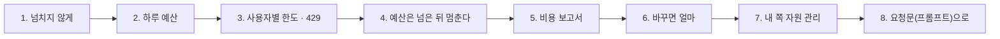
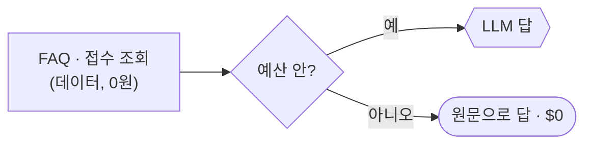

# 3단계 · 예산과 한도

- 교시: 5교시 강의 (14:00~14:50) · 6교시 [Lab 03](../../Last3Mon/75/LAB-03-Q-BUDGET-AND-LIMITS.md) 실습 5개 (15:00~15:50)
- 이 단계가 끝나면: 비용이 넘치지 않게 하는 장치(하루 예산 · 사용자별 한도 · 요청 하나의 상한)를 구분하고, 예산을 넘으면 LLM 없이 낮춰서 답하고, 한 사람이 몰아 부르면 429로 잠시 막고, 예산이 언제 멈추는지 재고, 지금까지의 기록으로 한 달 비용과 "모델을 바꾸면 얼마"를 코드로 계산할 수 있다.
- 숫자: 모두 강사 노트북 실측입니다 (65일차 n8n 2.42.6, OpenAI `gpt-4.1-mini` · `gpt-5.4-nano`, 10/28 정답 워크플로우를 학생 순서대로 1회). 출력 전부는 수업 뒤 공개되는 `Last3Mon/75/answers/LAB-TEST-RESULT.md`에 있습니다.
- 실습 가리키기: 이 문서에서 "Lab 03 예제 1"은 6교시 [Lab 03 문서](../../Last3Mon/75/LAB-03-Q-BUDGET-AND-LIMITS.md)의 그 절입니다. 파일 경로는 실습 폴더 `~/aio-01d4-stu/Last3Mon/75` 기준입니다.



## 0. 이 시간 (50분)

| 시간 | 절 · 개요 | 하는 일 |
| --- | --- | --- |
| 14:00~14:07 | 1 · 개요 22장 | 예산 · 한도 · 상한, 공급자 한도와 내 한도 |
| 14:07~14:14 | 2 · 개요 23장 | 넘으면 낮춰서 답하기, 어디에 두나 |
| 14:14~14:22 | 3 · 개요 24장 | 속도 제한 방식, 429와 다시 시도 |
| 14:22~14:28 | 4 · 개요 25장 | 넘은 뒤 멈춤, 경고 단계, 하루가 바뀔 때 |
| 14:28~14:36 | 5 · 개요 26장 | 보고서는 코드가 계산, 정확한 테스트 |
| 14:36~14:42 | 6 · 개요 27장 | what-if, 가정의 한계 |
| 14:42~14:46 | 7 · 개요 28장 | 동시 실행 · 실행 기록 |
| 14:46~14:50 | 8 · 9 · 확인 질문 | 요청문, 자주 하는 실수 |

### 6교시 Lab 03에서 이어서 하는 것

| 6교시 실습 (시각) | 이 강의의 절 | 실습에서 하는 일 | 쓰는 파일 · 명령 |
| --- | --- | --- | --- |
| Lab 03 예제 1 (15:00~15:10) | 2 | 예산을 넘으면 LLM 없이 원문 | `budget`, 테스트 `cases/lab03.json` |
| Lab 03 예제 2 (15:10~15:20) | 3 | 사람마다 1분 한도 → 429 | 테스트 `cases/lab03-limit.json`, `lab03` · `lab02-challenge` |
| Lab 03 예제 3 (15:20~15:27, 에이전트 없이) | 4 | 예산 $0.0003으로 여섯 질문 | `budget --daily 0.0003` → `test cases/lab03-drill.json` → `usage` → `budget --reset` |
| Lab 03 과제 1 (15:27~15:40) | 5 | 비용 보고서 `my-cost-report` | `my-work/cost-report.json`, 테스트 `cases/lab03-challenge.json` |
| Lab 03 과제 2 (15:40~15:50) | 6 | `what_if_model` | 테스트 `cases/lab03-challenge2.json` |

## 1. 넘치지 않게: 예산 · 한도 · 상한

### 일반 설명

1 · 2단계로 **얼마인지 알고, 줄였습니다.** 그래도 쓰는 사람이 늘거나, 누가 몰아서 부르거나, 아주 긴 질문이 오면 비용은 넘칠 수 있습니다. 운영에서는 넘치기 **전에** 멈추는 장치를 둡니다.

| 장치 | 무엇을 막나 | 단위 | 오늘 |
| --- | --- | --- | --- |
| 예산 (budget) | 전체가 너무 많이 씀 | 하루 · 한 달 금액 | Lab 03 예제 1 |
| 속도 제한 (rate limit) | 한 사람 · 한 프로그램이 짧은 시간에 몰아 부름 | 분당 · 초당 요청 수 | Lab 03 예제 2 |
| 할당량 (quota) | 한 사람 · 한 팀이 오래 많이 씀 | 하루 · 한 달 요청 수 · 금액 | (사람별 하루 한도로 넓힐 수 있음) |
| 요청 상한 | 요청 하나가 너무 큼 | 입력 글자 수 · 출력 토큰 | Lab 02 과제 2 · 예제 1 |

**공급자 쪽 한도와 내 쪽 한도.** 공급자도 한도를 둡니다. API 계정마다 분당 요청 수 · 분당 토큰 수(rate limit)가 정해져 있고, 넘으면 429를 받습니다. 계정 전체의 월 사용 한도를 정해 둘 수도 있습니다. 그런데 공급자 한도는 **계정 전체**에 걸리므로, 한 사람이 몰아 부르면 **모든 직원**이 막힙니다. 그래서 내 서비스 안에서 사람마다 · 기능마다 더 작은 한도를 둡니다.

| | 공급자 한도 | 내 한도 |
| --- | --- | --- |
| 단위 | 계정 · 모델 | 사람 · 팀 · 기능 |
| 넘으면 | 모든 요청이 429 | 그 사람 · 그 기능만 |
| 누가 정하나 | 공급자 (요금제) | 우리 |
| 목적 | 공급자 서버 보호 | 예산 · 공정성 |

**넘었을 때 무엇을 주나도 설계입니다.** "오류"로 끝내면 사용자는 아무것도 못 받습니다. 낮춰서 답하기(2절), 잠시 뒤 다시 하라는 안내(3절), 담당자 연결 중 무엇을 줄지 정합니다. 그리고 **넘었다는 사실을 기록**해서 한도가 적절했는지 나중에 판단합니다.

**팀마다 몫을 나누기도 합니다.** 여러 부서가 같은 AI 서비스를 쓰면, 회사는 부서마다 한 달 몫(할당량)을 정하고 쓴 만큼을 알려 주거나(showback) 부서 예산에서 떼어 가기도(chargeback) 합니다. 그러려면 1단계의 기록에 **팀 · 기능 칸**이 있어야 합니다. 몫이 정해지면 각 팀은 자기 기능의 비용을 스스로 줄일 까닭이 생깁니다.

**값은 사람이 정합니다.** 예산 · 한도는 기술이 아니라 **결정**입니다. 한 달 예산을 일하는 날로 나눈 값, 지난달 기록의 평균에 여유를 둔 값, 사용자 수 × 한 사람 몫 등 근거를 정해 적습니다. 그래서 값은 코드 밖(`/budget`)에 두고, 사람이 `flow.py budget`으로 바꿉니다. 워크플로우는 **읽기만** 합니다 (AGENTS.md 9절).

### 오늘 실습에서

오늘 데이터 API의 `/budget`이 사람이 정한 값 셋을 줍니다 (`data/budget.json`, 처음 상태).

| 값 | 처음 | 쓰는 곳 |
| --- | --- | --- |
| `daily_usd` | $1.0 | 예제 1 (넘으면 `한도 초과`) |
| `user_limit_per_min` | 20 | 예제 2 (넘으면 429) |
| `max_question_chars` | 500 | Lab 02 과제 2 (넘으면 앞뒤만) |

`used_usd`는 기록된 `cost_usd`의 합이고 `over`는 `used_usd ≥ daily_usd`입니다. 그래서 Lab 01 과제의 기록이 없으면 예산도 없습니다.

## 2. 하루 예산, 넘으면 낮춰서 답하기 (6교시 Lab 03 예제 1)

### 일반 설명

**예산을 넘으면 멈추는 대신 낮춰서 답합니다.** 예산을 넘었다고 "오늘은 끝"이라고 하면 직원은 오후 내내 도움을 못 받습니다. 그런데 헬프데스크가 답하는 재료(FAQ 원문 · 접수 상태)는 **이미 데이터에 있습니다.** LLM이 문장을 다듬지 않을 뿐, 내용은 줄 수 있습니다. 이것을 **우아한 저하(graceful degradation)**라고 합니다.

| 수준 | 무엇을 주나 | 비용 |
| --- | --- | --- |
| 평소 | LLM이 다듬은 답 | 요청마다 |
| 낮춤 | 데이터 원문 + "오늘 자동 답변 한도를 넘어 원문으로 안내합니다" | 0 |
| 더 낮춤 | "담당자에게 연결합니다" | 0 |

**어디에 두나.** 예산 확인은 LLM보다 **앞**, 데이터 조회보다는 **뒤**에 둡니다. 낮춰서 답하려면 데이터가 먼저 있어야 하고, LLM을 부른 뒤에 확인하면 이미 돈을 쓴 뒤이기 때문입니다.



**무엇을 먼저 지킬지 정해 둡니다.** 예산이 바닥났을 때 모든 기능을 똑같이 낮출 필요는 없습니다. 보안 사고 신고처럼 **꼭 LLM이 있어야 하는 일**은 따로 남은 몫을 두고, 덜 급한 일(요약 · 말투 다듬기)부터 낮춥니다. 이것을 미리 정해 두지 않으면, 예산이 바닥난 날 가장 중요한 문의도 원문만 받습니다.

**사용자에게 솔직하게 알립니다.** 낮춘 답에는 "오늘 자동 답변 한도를 넘어 원문으로 안내합니다"처럼 **왜 평소와 다른지**를 한 줄 붙입니다. 아무 말 없이 답의 질만 떨어지면 사용자는 서비스가 고장 났다고 생각하고 문의가 늘어납니다. 언제 다시 평소대로 되는지(내일 · 담당자 연결)도 알려 주면 더 좋습니다.

**장애로 낮춘 것과 예산으로 낮춘 것은 구분합니다.** 72일차에는 LLM이 **멈췄을 때** 데이터 그대로 답했습니다 (`간단 답변`). 오늘은 LLM이 멀쩡한데 **쓰지 않기로** 한 것입니다. 답의 모양은 비슷해도 `route`를 다르게 두면, 나중에 로그를 보는 사람이 "장애였나, 예산이었나"를 가를 수 있습니다. 원인이 다르면 대응도 다릅니다 (장애는 고치고, 예산은 값을 다시 정함).

### 오늘 실습에서

Lab 03 예제 1 (수업 준비 때): 예산 $0.001에 이미 $0.002를 쓴 상태로 시험했습니다. 고치기 전에는 그래도 `자동 답변`으로 LLM을 불렀고 ($0.000154), 고친 뒤에는 **`한도 초과` · 0 calls · $0**에 FAQ 원문("인증서")과 접수 상태("처리 중")가 나갔습니다. 한도 안이면 평소대로 $0.000156.

## 3. 사용자별 한도와 429 (6교시 Lab 03 예제 2)

### 일반 설명

**하루 예산은 모두의 것입니다.** 한 사람이 스크립트로 1분에 수백 번 부르면 예산이 오전에 바닥나고, 나머지 직원은 원문만 받습니다. 그래서 **사람마다** 짧은 시간의 한도를 둡니다. 이것을 **속도 제한(rate limiting)**이라고 합니다. 공정성 · 비용 · 서버 보호를 함께 얻습니다.

**세는 방법 넷.**

| 방법 | 어떻게 | 특징 |
| --- | --- | --- |
| 고정 창 (fixed window) | 매 분 0초부터 몇 번 | 쉬움. 59초와 61초에 몰면 짧은 사이에 두 배 |
| 이동 창 (sliding window) | 지금부터 거꾸로 60초 동안 몇 번 | 고르게 막음. 기록을 시각과 함께 남겨야 함 (오늘) |
| 토큰 버킷 (token bucket) | 일정한 속도로 채워지는 통에서 하나씩 꺼냄 | 짧은 몰림은 허용, 오래 몰리면 막음. 공급자들이 많이 씀 |
| 새는 통 (leaky bucket) | 들어온 것을 일정한 속도로만 내보냄 | 내보내는 속도가 고름 |

**429는 "잠시 뒤 다시"라는 약속입니다.** HTTP 429 `Too Many Requests`는 표준 응답이고, `Retry-After`(헤더 · 또는 본문의 `retry_after`)로 몇 초 뒤에 다시 부르면 되는지 알려 줍니다. 부르는 프로그램은 이것을 보고 기다렸다가 다시 시도합니다. 바로바로 다시 부르면 한도에 또 걸리므로, 72일차처럼 **기다리는 시간을 늘려 가며**(exponential backoff) 다시 시도합니다.

**가장 앞에 둡니다.** 한도를 넘은 요청에는 데이터 조회도 LLM도 할 까닭이 없습니다. 맨 앞에서 돌려보내면 **0원 · 거의 0초**입니다. 예산 확인(2절)과 자리가 다른 까닭은 원문 답이 필요 없기 때문입니다.

**횟수 대신 토큰 · 금액으로 셀 수도 있습니다.** 요청 수로만 세면 짧은 질문 20번과 긴 로그 질문 20번이 같은 한도를 씁니다. 그런데 비용은 몇 배 차이가 납니다. 그래서 공급자들은 분당 요청 수와 함께 **분당 토큰 수**에도 한도를 두고, 서비스 안에서도 "한 사람이 하루 $0.05까지"처럼 금액으로 셀 수 있습니다. 오늘은 요청 수로 세고, 긴 질문은 Lab 02 과제 2의 상한이 따로 막습니다.

**세는 곳은 하나여야 합니다.** 워크플로우 엔진을 여러 대로 늘리면, 각자 자기 메모리에 횟수를 세면 한 사람이 서버마다 한도만큼 부를 수 있습니다. 그래서 횟수는 **모두가 같이 보는 곳**(데이터베이스, Redis 같은 저장소, 오늘은 데이터 API)에서 셉니다. 공급자 · API 게이트웨이 · 클라우드의 한도 기능도 같은 이유로 한곳에서 셉니다.

**한도 값을 정할 때 생각할 것.**

| 생각할 것 | 예 |
| --- | --- |
| 정상 사용자의 최대 | 사람이 1분에 몇 번 묻나 (고쳐 묻기 포함) |
| 공용 계정 · 자동화 | 여러 사람이 한 이름으로, 다른 시스템이 부를 때 |
| 무엇으로 사람을 가르나 | 로그인 정보 (사용자가 보낸 이름은 바꿀 수 있음 — 67일차) |
| 넘었을 때 알림 | 몇 번 넘으면 담당자에게 (76일차) |

### 오늘 실습에서

Lab 03 예제 2 (수업 준비 때, 한도 2): 이준호의 세 번째 요청이 고치기 전에는 200 · 1.3초 · $0.000156이었고, 고친 뒤에는 **429 · 잠시 후 · 0.0초 · $0**. 다른 사람(한지훈)은 그대로 200. 데이터 API의 `/usage/user/<이름>?window=60`은 기록된 요청을 이동 창으로 셉니다. 오늘 실습의 "사람"은 요청 본문의 `user`라서 바꿔 보낼 수 있습니다. 실제 서비스에서는 로그인 정보로 가릅니다.

## 4. 예산은 넘은 뒤 멈춘다 (6교시 Lab 03 예제 3)

### 일반 설명

**"쓴 돈 ≥ 예산이면 멈춘다"는 넘은 뒤에 멈춥니다.** 예산이 조금이라도 남아 있으면 다음 요청은 평소대로 답하고, 그 요청의 비용만큼 예산을 넘습니다. 그래서 실제로 쓴 돈은 "예산 + 마지막 한 건"까지 갑니다. 동시에 여러 요청이 들어오면 여러 건만큼 넘을 수도 있습니다.

| 방식 | 어떻게 | 넘을 수 있나 |
| --- | --- | --- |
| 넘은 뒤 멈춤 (오늘) | 쓴 돈 ≥ 예산이면 멈춤 | 마지막 몇 건만큼 |
| 미리 잡기 (reserve) | 부르기 전에 "최대 비용"만큼 예산에서 떼어 두고, 끝나면 실제 비용으로 정산 | 넘지 않음 |
| 여유 두기 | 남은 돈 < 한 건의 최대 비용이면 멈춤 | 거의 넘지 않음 |

미리 잡기 · 여유 두기를 하려면 **한 건의 최대 비용**을 알아야 합니다. 그것을 정해 주는 것이 2단계의 입력 상한 · 출력 상한입니다. **상한이 있어야 예산도 지킬 수 있습니다.**

**경고는 멈추기 전에.** 예산의 80% · 90%에 닿으면 담당자에게 먼저 알립니다 (76일차 알림). 멈춘 뒤에 알게 되면 직원들이 이미 원문만 받고 있습니다. 클라우드 공급자의 예산 기능도 대개 "몇 % 넘으면 알림"을 함께 둡니다.

| 단계 | 행동 |
| --- | --- |
| 80% | 담당자에게 알림 |
| 100% | 낮춰서 답하기 (원문) |
| 그 뒤 | 다음 날 0시에 다시 0부터, 또는 사람이 예산을 늘림 |

**하루가 바뀌면 누가 0으로 돌리나.** "하루 예산"은 "오늘 0시부터 쓴 돈"을 세야 합니다. 기록에 시각이 있으면 세는 쪽이 오늘 것만 더합니다. 사람이 매일 손으로 지우는 방식은 빠뜨리기 쉽습니다. 그리고 "오늘"이 어느 시간대 기준인지도 정해 둡니다 (서버 시각과 사무실 시각이 다를 수 있음).

**갑자기 늘면 먼저 알아챕니다.** 예산 안이라도 평소의 몇 배로 갑자기 늘면 무언가 잘못된 신호입니다 (고장 난 루프, 누가 자동으로 부름, 긴 입력 공격). 시간대별 · 사람별 사용량을 평소와 비교해 크게 벗어나면 알리는 것을 **이상 탐지(anomaly detection)**라고 합니다. 단순하게는 "지난 7일 같은 시간대 평균의 3배를 넘으면 알림" 같은 규칙으로 시작합니다 (76 · 77일차).

**넘어서 낮춘 답도 셉니다.** 낮춰서 답한 요청은 LLM을 부르지 않아 **비용 기록에 남지 않습니다.** 그러면 "오늘 몇 명이 원문만 받았나"를 셀 수 없고, 예산이 적절했는지도 판단할 수 없습니다. 비용이 0인 요청도 한 줄 남기는 것이 좋습니다.

### 오늘 실습에서

Lab 03 예제 3 (수업 준비 때, 예산 $0.0003):

| 질문 | 결과 | 쓴 돈 (누적) |
| --- | --- | --- |
| 1 · VPN | `자동 답변` $0.000141 | $0.000141 |
| 2 · 프린터 | `자동 답변` $0.000152 | $0.000293 (예산 아래) |
| 3 · 비밀번호 | `자동 답변` $0.000136 | **$0.000430 (넘음)** |
| 4 · 5 · 6 | **`한도 초과` · $0** | 그대로 |

예산을 $0.00013, **43%** 넘었습니다. `usage`의 route별 합계에는 `자동 답변` 세 줄만 있고, 한도 초과 세 건은 기록에 없었습니다. `--reset`($1.0) 뒤에는 여섯 모두 `자동 답변`.

## 5. 비용 보고서 (6교시 Lab 03 과제 1)

### 일반 설명

**보고서의 숫자는 코드가 계산합니다.** 합계 · 평균 · 곱셈은 코드가 **틀리지 않고 · 공짜로 · 늘 같게** 합니다. LLM에게 숫자 계산을 맡기면 틀릴 수도, 돈도 들고, 같은 입력에 다른 숫자가 나올 수도 있습니다. LLM은 숫자를 **설명하는** 데 씁니다 (79일차: "이번 달은 지난달보다 왜 늘었나"를 글로).

| 일 | 맡길 곳 |
| --- | --- |
| 합 · 평균 · 예측 · 순위 | 코드 |
| 숫자를 읽기 쉬운 글로 설명 | LLM (숫자는 코드가 준 것만 쓰게) |
| 무엇을 할지 결정 | 사람 |

**비용 보고서에 들어갈 것.**

| 칸 | 질문 | 오늘 |
| --- | --- | --- |
| 합계 · 요청 수 · 호출 수 | 얼마를 · 몇 번 | `cost_usd` · `requests` · `calls` |
| 요청 하나의 평균 | 단위 비용 | `avg_usd` (요청 수로 나눔) |
| 모델별 · 사람별 | 어디서 · 누가 | `by_model` · `top_user` |
| 한 달 예상 | 이대로면 얼마 | `projected_month_usd` |
| 예산 대비 | 남았나 · 넘었나 | `remaining_usd` · `over_budget` |

**예측은 단순한 것부터.** 오늘의 한 달 예상은 "평균 × 하루 요청 × 일하는 날"입니다. 실제로는 요일 · 월말 · 신입 입사 같은 패턴이 있어서, 기록이 쌓이면 지난 몇 주의 추세로 예측합니다. 하지만 처음에는 **가정을 밝힌 단순한 식**이 낫습니다. 복잡한 예측은 맞았는지 틀렸는지 설명하기 어렵습니다.

**보고서는 정해진 때에 봅니다.** 비용 보고서는 만들어 두는 것보다 **정기적으로 보는 것**이 중요합니다. 매주 · 매달 초에 같은 칸(합계 · 평균 · 모델별 · 사람별 · 예산 대비)을 보고, 지난번과 다르면 까닭을 적습니다. FinOps의 "운영하기" 단계가 이것입니다. 숫자가 자동으로 나오면 사람은 **판단**에 시간을 씁니다.

**정확한 숫자를 테스트합니다.** LLM 답은 `contains` · `range`로 시험했지만, 보고서는 입력이 정해지면 결과가 **정확히 하나**입니다. 그래서 알려진 기록 몇 줄을 넣고 `equals`로 소수점까지 봅니다. 반올림 자리와 순서(반올림은 마지막에)를 계약으로 정해 두지 않으면 0.0019890000001 같은 값에서 실패합니다.

### 오늘 실습에서

Lab 03 과제 1 (수업 준비 때): 테스트가 넣은 네 줄로 요청 3 · 호출 4 · $0.001989 · 평균 $0.000663 · 100건 × 22일 **$1.4586** · 가장 많이 쓴 사람 박서연 · 남은 예산 $0.998011 — 손 계산과 정확히 같았습니다 (5/5). 그다음 실제 사용량(과제 1 정답의 일곱 질문)으로 하루 1,000건을 넣으면 평균 $0.000127, **한 달 $2.80**. 1단계 예제 3의 어림 $20.8에서 약 7분의 1입니다.

## 6. 바꾸면 얼마: what-if (6교시 Lab 03 과제 2)

### 일반 설명

**바꾸기 전에 계산합니다.** 모델을 바꾸는 것은 74일차처럼 릴리스 · 게이트 · 카나리를 거치는 일입니다. 그 전에 "바꾸면 얼마 아끼나"를 알면 **해 볼 만한지** 먼저 정할 수 있습니다. 기록에는 모델마다 입력 · 출력 토큰이 있으니, 단가만 바꿔 다시 곱하면 됩니다. 이렇게 "만약 ~라면"을 계산하는 것을 **what-if 분석** · 시나리오 분석이라고 합니다.

```text
what-if 비용 = (기록된 입력 토큰 합 × 새 모델 입력 단가 + 기록된 출력 토큰 합 × 새 모델 출력 단가) ÷ 1,000,000
아끼는 돈    = 지금 비용 − what-if 비용   (음수면 더 비쌈)
```

**가정을 밝힙니다.** what-if는 **같은 토큰 수 · 같은 품질**을 가정합니다. 실제로는 다릅니다.

| 가정 | 실제 |
| --- | --- |
| 토큰 수가 같다 | 모델마다 답 길이 · 토큰 나누는 법 · 추론 토큰이 다름 |
| 품질이 같다 | 형식 · 군더더기 · 정확도가 달라질 수 있음 (2단계 4절) |
| 요청 수가 같다 | 싸지면 더 많이 쓰기도 함 |

그래서 what-if는 "**아끼는 돈의 대략**"이고, 바꿀지는 품질 게이트로 정합니다. 반대로 아끼는 돈이 **음수**(더 비싼 모델)거나 아주 작으면, 게이트를 돌릴 것도 없이 바꿀 까닭이 없다는 것이 바로 보입니다.

**여러 값을 넣어 봅니다 (민감도).** what-if는 한 숫자보다 **여러 가정**을 나란히 볼 때 쓸모가 큽니다. 하루 요청이 500 · 1,000 · 2,000일 때, 모델이 mini · nano일 때 한 달이 얼마인지 표로 놓으면, 어떤 가정이 결과를 가장 크게 흔드는지 보입니다. 대개 **요청 수**가 모델보다 크게 흔듭니다. 그래서 모델을 바꾸기 전에 "요청 수가 늘면 어떻게 할지"(한도 · 예산)를 먼저 정해 두는 것이 순서입니다.

**모르는 이름은 막습니다.** 단가표에 없는 모델 이름을 0원으로 계산하면 "100% 아낀다"는 거짓 숫자가 나옵니다. 74일차 "없는 릴리스는 400"처럼, 모르는 이름은 오류와 알려진 목록으로 돌려보냅니다.

### 오늘 실습에서

Lab 03 과제 2 (수업 준비 때): 테스트가 넣은 네 줄이 모두 nano였다면 $0.00117 (아끼는 돈 $0.000819, 한 달 $1.4586 → $0.858), 모두 mini였다면 $0.002016로 아끼는 돈 **−$0.000027**. 없는 모델 `gpt-9`는 400. 실제 사용량 일곱 건으로는 $0.000929 → nano였다면 $0.00061 (34% 덜). 2단계 예제 3에서 **실제로** 답 단계만 nano로 바꿔 잰 것은 15% 덜이었고 답의 형식이 나빠졌습니다 (구성이 달라 바로 비교할 수는 없음). 계산은 "해 볼 만한가", 결정은 "재고 읽고 게이트로".

## 7. 내 쪽 자원 관리: 동시 실행 · 실행 기록

### 일반 설명

오늘 비용의 대부분은 API 토큰이지만, 워크플로우 엔진을 운영하는 쪽에서는 **내 서버의 자원**도 관리합니다 (1단계 2절).

| 자원 | 무엇이 늘리나 | 관리 |
| --- | --- | --- |
| 동시 실행 | 몰리는 요청, 느린 API를 기다리는 실행 | 동시 실행 수 상한, 넘치면 큐 · 429 |
| 실행 기록 (입력 · 출력 저장) | 실행마다, 큰 데이터일수록 | 보관 기간 · 개수 정하기, 실패한 것만 남기기 |
| 로그 · 사용량 기록 | 요청마다 | 보관 기간, 원문 대신 숫자 |
| 컨테이너 메모리 · CPU | 위 모두 | 컨테이너 상한, `docker stats`로 보기 |

n8n도 이것을 설정으로 둡니다. 예를 들어 동시에 도는 운영 실행 수의 상한(`N8N_CONCURRENCY_PRODUCTION_LIMIT`), 오래된 실행 기록을 지우는 설정(`EXECUTIONS_DATA_PRUNE` · `EXECUTIONS_DATA_MAX_AGE`), 성공한 실행은 저장하지 않는 설정 등입니다. 값은 서버 크기 · 요청 수 · 얼마나 오래 되짚어 봐야 하는지(77일차 로그 분석)를 보고 정합니다.

**자원 비용도 같은 보고서에.** 서버 · 저장 공간처럼 켜 둔 만큼 드는 비용은 API 비용과 성질이 다르지만(1단계 2절), 한 서비스의 비용으로 함께 봐야 합니다. "요청 하나에 API $0.00016 + 서버 몫 얼마"처럼 합치면 직접 돌리기(self-host)와 API를 비교할 때도, 사용자가 늘 때 무엇이 먼저 늘어나는지 볼 때도 쓸모가 있습니다.

**자원 한도도 "넘치면 무엇을 주나"를 정합니다.** 동시 실행이 꽉 찼을 때 새 요청을 무한히 기다리게 하면 사용자도 서버도 지칩니다. 3절의 429처럼 "잠시 뒤 다시"를 빨리 주는 것이 낫습니다.

### 오늘 실습에서

오늘 실습은 강사 노트북 · 학생 노트북 한 대에서 한 사람이 부르므로 동시 실행 · 실행 기록의 상한은 바꾸지 않습니다. 1단계 예제 1의 `docker stats`(n8n 642.6MiB)를 기억해 두고, 76일차(실패한 실행 모으기) · 77일차(실행 기록 · 로그 분석)에서 다시 봅니다.

## 8. 요청문(프롬프트)으로

**요청문(프롬프트)이란.** 실습에서 CLI 코딩 에이전트(codex · claude · agy)에게 보내는 글입니다. 에이전트는 이 글만 보고 n8n 워크플로우 JSON을 만들거나 고칩니다. 이 절은 이 단계에서 배운 것을 **요청문(프롬프트)에 어떤 칸으로 적을지** 실습 전에 정리하는 자리입니다. 실습 문서의 `▶ 빈칸 채우기 · 요청문(프롬프트) 뼈대`가 이 칸을 실제 문장으로 만든 것이고, 빈칸 ①~④는 그 문장 속 정확한 값입니다.

| 칸 | 에이전트에게 알려 주는 것 | 빠지면 생기는 일 |
| --- | --- | --- |
| 무엇을 | 만들거나 바꿀 기능 | 에이전트가 짐작해서 다른 것을 만듦 |
| 어디에 | 고칠 파일 · 노드 · 자리 | 엉뚱한 노드를 고치거나 새 파일을 만듦 |
| 어떤 모양으로 | 결과 JSON의 칸 이름 · 값 · 응답 코드 | 테스트가 보는 칸 이름과 달라 실패 |
| 그대로 · 하지 말 것 | 건드리면 안 되는 것 | 다른 곳까지 바뀌어 무엇 때문인지 모르게 됨 |
| 확인 | 통과해야 할 테스트 파일 | "다 됐다"를 판단할 기준이 없음 |

67~71일차의 다섯 가지(① 파일 ② 입력 ③ 처리 ④ 결과 모양 ⑤ 기대 결과)와 같은 뜻입니다. 파일 · 입력이 "어디에", 처리가 "무엇을", 결과 모양이 "어떤 모양으로", 기대 결과가 "확인"입니다. 72일차부터는 **이미 있는 워크플로우를 고치는** 요청이 많아 "그대로"가 따로 한 칸이 됐습니다.

예산 · 한도 요청에서는 **"어디에"(순서)**가 특히 중요합니다. 같은 확인이라도 LLM 앞이냐 뒤냐, 데이터 조회 앞이냐 뒤냐에 따라 비용과 답이 달라집니다. 그리고 "값은 `/budget`에서 읽고 워크플로우가 바꾸지 않는다"를 "그대로"에 적습니다.

| 요청문에 | Lab 03 예제 1 | Lab 03 예제 2 | Lab 03 과제 1 | Lab 03 과제 2 |
| --- | --- | --- | --- | --- |
| 무엇을 | 예산을 넘으면 원문 | 사람마다 1분 한도 | 비용 보고서 | 바꾸면 얼마 |
| 어디에 | `Get ticket` 뒤 (LLM 앞) `Within budget?` · `Over budget` | `Get budget` 바로 뒤 (가장 앞) `Recent requests` · `Under user limit?` | 새 파일 `my-work/cost-report.json` | `Get prices`, `Make report`, `Known model?` |
| 어떤 모양으로 | `한도 초과` · `llm_calls` 0 · `cost_usd` 0 | 429 `{route: 잠시 후, retry_after: 60, …}` | AGENTS.md 3절 보고서 (6자리) | `what_if: {model, cost_usd, saving_usd, projected_month_usd}`, 없는 모델 400 |
| 그대로 | 평소 갈래 · 예산 값은 읽기만 | 평소 갈래 | LLM 없이 | 과제 1의 결과 |
| 확인 | `cases/lab03.json` | `cases/lab03-limit.json` · `lab03` · `lab02-challenge` | `cases/lab03-challenge.json` | `cases/lab03-challenge2.json` · `lab03-challenge` |

예를 들어 Lab 03 예제 2 열을 위에서부터 이어 읽으면 요청문(프롬프트)이 됩니다 (화살표 오른쪽은 다섯 칸 중 어디인지):

```text
같은 사람이 1분에 한도를 넘게 부르면 잠시 막아 줘.                              ← 무엇을
my-work/cost.json 의 Get budget 바로 뒤, 가장 앞에 Recent requests 와 Under user limit?.   ← 어디에
넘으면 HTTP 429 {route: '잠시 후', answer, retry_after: 60, llm_calls: 0, cost_usd: 0}.   ← 어떤 모양으로
한도 안이면 지금 갈래 그대로, 한도 값은 /budget 의 user_limit_per_min 을 읽기만.  ← 그대로
cases/lab03-limit.json, cases/lab03.json, cases/lab02-challenge.json 이 통과해야 해.  ← 확인
```

## 9. 자주 하는 실수

| 실수 | 왜 문제인가 | 이렇게 |
| --- | --- | --- |
| 예산을 넘으면 "오류" | 직원이 아무 도움도 못 받음 | 데이터 원문으로 낮춰서 답 |
| 예산 확인을 LLM 뒤에 | 이미 돈을 쓴 뒤 | LLM 앞, 데이터 조회 뒤 |
| 한도 확인을 맨 뒤에 | 막을 요청도 조회 · LLM을 함 | 가장 앞 |
| 장애와 예산을 같은 `route`로 | 원인을 가를 수 없음 | `간단 답변` · `한도 초과` · `잠시 후` |
| 예산 · 한도를 워크플로우가 바꿈 | 누가 정했는지 모름, 사고 | 사람이 `/budget`에, 워크플로우는 읽기만 |
| 상한 없이 예산만 | 마지막 한 건이 얼마나 넘을지 모름 | 입력 · 출력 상한으로 최대 비용 |
| 보고서 숫자를 LLM이 | 틀림 · 돈 · 흔들림 | 코드가 계산, LLM은 설명만 |
| 평균을 호출 수로 나눔 | 한 달이 작게 나옴 | 요청 수로 |
| what-if를 그대로 믿고 바꿈 | 토큰 · 품질이 다를 수 있음 | 재고 · 읽고 · 게이트로 |

## 확인 질문

1. 공급자의 rate limit이 있는데 내 서비스 안에 사람별 한도를 또 두는 까닭은?
2. 예산을 넘었을 때 FAQ 원문으로 답하는 것과 72일차 LLM 장애 때의 간단 답변은 무엇이 같고 무엇이 다른가요?
3. 예산 확인과 사람별 한도 확인은 워크플로우의 다른 자리에 둡니다. 각각 어디이고 왜인가요?
4. 예산 $0.0003에서 실제로는 $0.000430까지 썼습니다. 왜 넘었고, 넘지 않게 하려면 무엇이 필요한가요?
5. 비용 보고서의 숫자를 LLM에게 계산하게 하면 안 되는 까닭 셋은?
6. what-if가 "모두 nano면 34% 덜"이라고 했습니다. 이 숫자만 보고 바꾸면 안 되는 까닭은?

## 정리

- [ ] 넘치지 않게: 예산(전체) · 속도 제한(사람 · 짧은 시간) · 요청 상한(요청 하나)
- [ ] 예산을 넘으면 LLM 없이 데이터 원문으로, 확인은 LLM 앞 · 데이터 뒤, `route`는 원인별로
- [ ] 사람별 한도는 가장 앞, 429와 `retry_after`, 값은 사람이 정하고 워크플로우는 읽기만
- [ ] 예산은 넘은 뒤 멈춘다 — 경고는 먼저, 넘지 않으려면 상한으로 최대 비용
- [ ] 보고서 · what-if는 코드가 계산하고, 가정을 밝히고, 바꿀지는 품질 게이트로
