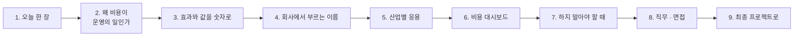

# 4단계 · 정리: 오늘 한 일의 의미 · 효과 · 실전 응용

- 교시: 8교시 17:10~17:45 (35분, 바이브 코딩 발표 10분 뒤) · 자료: 이 문서 + [개요](00-DAY75-OVERVIEW.md) 30장
- 이 시간이 끝나면: 오늘 1~3단계에서 한 일이 **무엇을 지키기 위한 것이었는지**, 숫자로 **무엇을 줄였고 무엇을 치렀는지**, 회사에서는 같은 생각을 **어떤 이름과 도구로** 쓰는지 말할 수 있고, 최종 프로젝트에 무엇을 가져갈지 정할 수 있다.
- 숫자: 오늘 교안의 실측(강사 노트북, 10/28 정답 워크플로우 1회, 단가는 2026-10-28 OpenAI 모델 문서)입니다. "예시"라고 적은 계산은 가정을 둔 어림입니다.

## 0. 이 시간 (35분)

| 시간 | 절 | 하는 일 |
| --- | --- | --- |
| 17:10~17:15 | 1 · 2 | 오늘 한 장, 왜 비용이 운영의 일인가 |
| 17:15~17:20 | 3 | 오늘 숫자로 본 효과와 값, 한 달로 보면 (예시) |
| 17:20~17:28 | 4 · 5 | 같은 생각의 업계 이름 · 도구, 산업별 응용 예 |
| 17:28~17:33 | 6 · 7 | 비용 지표 여섯 개, 하지 말아야 할 때 |
| 17:33~17:40 | 8 · 9 | 직무와 면접 질문, 최종 프로젝트 체크리스트 |
| 17:40~17:45 | 10 · 토론 | 다음 일차와의 연결, 질문 둘 |

## 1. 오늘 한 장

| 단계 | 한 일 | 오늘 숫자 |
| --- | --- | --- |
| 1단계 · 재기 | 자원 · 토큰 · 비용, 단계별 `cost_usd`, 종류별 한 달 어림, 요청마다 기록, 기록이 멈춰도 답 | VPN 하나 **$0.00104** (입력의 **89%**가 답 단계), 한 달 어림 **$20.8**, 기록 느림 11.2초 → **6.1초** |
| 2단계 · 줄이기 | 보내는 것 · 단계마다 모델 · 답까지 nano? · LLM 한 번 · 긴 질문 상한 | 답 단계 입력 1,781 → **165**, VPN $0.001007 → **$0.000156**, 답 nano는 **15%** 덜 들지만 형식이 나빠짐, 긴 질문 $0.001196 → **$0.000237** |
| 3단계 · 지키기 | 하루 예산 → 원문, 1분 한도 → 429, 예산 바꿔 보기, 보고서, what-if | 한도 초과 **$0**, 429 **0.0초**, 예산 $0.0003을 **43%** 넘음, 실제 사용량 한 달 **$2.80**, what-if nano **34%** 덜 |
| 바이브 코딩 | 부르기 전에 토큰 · 비용을 계산하는 `tcost` (TODO → SPEC → IMP-PLAN → 설치) | 요구 14개 |

한 문장으로: **질문 하나에 얼마인지 재고, 품질 테스트를 지키며 한 칸씩 줄이고, 넘치지 않게 예산 · 한도 · 상한을 둔다.**

## 2. 왜 비용이 운영의 일인가

72일차는 "빠르게, 멈춰도 답하게", 73일차는 "속지 않게, 새지 않게", 74일차는 "바꿔도 망가지지 않게"였습니다. 오늘은 "**써도 감당할 수 있게**"입니다. LLM 서비스는 쓰는 사람이 늘수록 비용이 **그대로 따라 늘고**, 한 사람 · 한 지시문의 실수가 모든 요청의 비용을 바꿉니다.

| | 만들기 | 운영하기 (비용 관리) |
| --- | --- | --- |
| 질문 | "답이 맞나?" | "질문 하나에 얼마? 한 달에 얼마? 넘치면?" |
| 기준 | 테스트 통과 | 같은 테스트를 지키면서 **비용 전 · 후** |
| 실패 | 오류 | **청구서** (오류처럼 보이지 않음) |
| 정하는 사람 | 개발자 | 개발자 + 재무 · 사업 (예산) + 사용자 (질문 길이) |

- 비용 사고는 대개 **조용합니다.** `base-cost`는 모든 테스트를 통과하면서 질문마다 필요 없는 규정 약 1,600토큰을 보냈고, 긴 로그 질문은 아무 오류 없이 평소의 7배 넘게 썼습니다. 재지 않으면 청구서가 올 때까지 모릅니다.
- 비용을 줄이는 일은 **품질과의 맞바꿈**이 되기 쉽습니다. 답까지 nano로 바꾼 비교본은 테스트를 다 통과했지만 답의 형식이 나빠졌습니다. 그래서 숫자와 함께 **답을 읽고**, 결정은 사람이 합니다.

## 3. 효과와 값을 숫자로

### 3.1 오늘 실측 전 · 후

| 무엇 | 전 | 후 | 바꾼 것 |
| --- | --- | --- | --- |
| VPN 질문 하나의 비용 | $0.001040 (3 calls) | **$0.000156** (1 call) | 보내는 것 · 단계마다 모델 · 규칙 분류 · 검토 빼기 |
| 답 단계 입력 토큰 | 1,781 | **165** | 규정 전체 빼기, 필요한 칸만 |
| 질문 3개의 기록 합계 | $0.002951 (calls 9) | **$0.000409** | 위와 같음 |
| 긴 로그 질문 (6,298자) | $0.001196 | **$0.000237** | 입력 상한 (앞 200 + 뒤 300자) |
| 기록 API가 느릴 때 | 11.2초 | **6.1초** | timeout 3초 + 실패해도 계속 |
| 예산을 넘은 질문 | LLM을 부름 | **$0 · 원문** | 예산 확인 (LLM 앞) |
| 1분 한도를 넘은 요청 | 200 · $0.000156 | **429 · 0.0초 · $0** | 한도 확인 (가장 앞) |

**치른 값**:

- **규정에만 있는 질문**은 이제 "찾지 못했습니다"입니다 (규정 전체를 뺐으므로). 필요하면 검색해서 관련 부분만 보내는 일(71일차)을 따로 해야 합니다.
- **검토 단계**를 뺐으므로 말투 · 형식은 답 단계의 지시문에만 달렸습니다.
- **기록이 빠진 요청**은 예산 · 한도에서도 빠집니다 (`recorded: false`로 셀 수 있게만 함).
- **예산은 넘은 뒤 멈춥니다** (오늘 43% 넘음). 넘지 않으려면 최대 비용으로 미리 잡는 방식이 필요합니다.

### 3.2 한 달로 보면 (예시)

가정: 하루 질문 1,000건 · 한 달 22일 (오늘 실습의 가정, 질문 종류의 비중은 실습에서 쓴 FAQ 60 · 접수 30 · 그 밖 10%).

| | 아침 (`base-cost`) | 저녁 (Lab 02 과제 1 정답) |
| --- | --- | --- |
| 요청 하나의 평균 | $0.000946 (가중 평균, Lab 01 예제 3) | $0.000127 (실제 일곱 질문, Lab 03 과제 1) |
| 한 달 | **약 $20.8** | **약 $2.80** |
| 하루 예산 $1.0이면 | 하루 약 1,050건에서 멈춤 | 하루 약 7,900건까지 |

- 두 평균은 재는 방법이 조금 다릅니다 (아침은 가정한 비중, 저녁은 실제 일곱 질문). 그래도 **약 7분의 1**이라는 크기는 같은 질문 하나($0.00104 → $0.000156)에서도 보입니다.
- 사용자가 10배가 되면 아침 기준은 한 달 $208, 저녁 기준은 $28입니다. **요청 하나의 비용**을 줄이는 것이 규모가 커질수록 중요한 까닭입니다.

## 4. 회사에서는 같은 생각을 이렇게 부른다

| 오늘 한 것 | 업계 이름 | 쓰는 도구 · 표준 (예) |
| --- | --- | --- |
| 재기 → 줄이기 → 지키기 | FinOps (Inform · Optimize · Operate) | FinOps Foundation 프레임워크, 클라우드 비용 관리 화면 |
| 응답의 `usage`, 단계별 비용 | LLM 관측 (observability), 비용 할당 | Langfuse, Helicone, LangSmith, OpenTelemetry GenAI 규칙 |
| 요청마다 기록 · 사람별 합 | 계량 (metering), showback · chargeback | 사용량 기록 테이블, 태그 · 레이블 |
| 단가표를 밖에 · 모르는 모델은 오류 | 가격 카탈로그, 설정 외부화 | 공급자 가격 페이지, 사내 설정 저장소 |
| 필요한 것만 보내기 | 컨텍스트 엔지니어링, 데이터 최소화, RAG | 검색 색인, 프롬프트 템플릿 |
| 단계마다 맞는 모델 | 모델 라우팅 · 계단식(cascade) | LiteLLM, OpenRouter, 클라우드 모델 게이트웨이 |
| 같은 앞부분 할인 · 모아서 보내기 | 프롬프트 캐싱, 배치 처리 | 공급자의 캐시된 입력 단가, Batch API |
| 규칙으로 먼저 · 검토 빼기 | 호출 줄이기, 규칙 기반 라우팅 | Code 노드, 의도 분류 규칙 |
| 입력 · 출력 상한 | 요청 크기 제한, 무제한 소비 방지 | `max_completion_tokens`, OWASP LLM Top 10의 Unbounded Consumption (Denial of Wallet) |
| 하루 예산 · 원문으로 낮추기 | 예산 · 알림, 우아한 저하 | 클라우드 예산 알림(AWS Budgets 등), 공급자 사용 한도 |
| 1분 한도 · 429 | 속도 제한, 할당량 | API 게이트웨이(Kong · AWS API Gateway usage plan), nginx `limit_req`, Redis 카운터 |
| 비용 보고서 · what-if | 비용 보고 · 예측, 시나리오 분석 | 스프레드시트 · BI 대시보드, 월간 비용 리뷰 |
| `tcost` | 부르기 전 토큰 계산 | `tiktoken`, 공급자 token count API |

- 오늘은 n8n 노드 · 작은 데이터 API · `flow.py`로 직접 만들었습니다. 회사에서는 게이트웨이 · 관측 도구가 대신해 주는 경우가 많습니다. 그래도 **무엇을 재고, 어느 칸부터 줄이고, 예산 · 한도를 얼마로 둘지**는 오늘처럼 사람이 정합니다.

## 5. 산업별 응용 (예)

아래는 오늘 한 일을 다른 업무에 옮긴 예입니다 (실제 특정 회사의 사례가 아니라 흔한 모양).

| 업무 | 오늘의 무엇을 | 이렇게 |
| --- | --- | --- |
| 쇼핑몰 상담 챗봇 | 규칙으로 먼저 · 단계마다 모델 | 주문 번호가 있으면 조회만, 일반 문의만 LLM, 분류는 작은 모델 |
| 콜센터 통화 요약 | 입력 상한 · 배치 | 긴 통화는 나눠 요약, 실시간이 아닌 요약은 모아서 밤에 (배치 할인) |
| 사내 문서 검색 (71일차) | 보내는 것 줄이기 · 비용 보고서 | 문서 전체 대신 검색 결과 상위 몇 개만, 부서별 사용량을 매달 보고 |
| SaaS의 AI 기능 (고객사별) | 사람별 한도 · 할당량 · showback | 요금제마다 월 몫, 넘으면 429 · 업그레이드 안내, 고객사별 비용으로 가격을 정함 |
| 사내 IT 헬프데스크 (오늘) | 전부 | 예산을 넘으면 FAQ 원문, 몰아 부르면 429, 매달 보고서 |
| 개발팀 코드 리뷰 봇 | what-if · 모델 라우팅 | 작은 변경은 작은 모델, 큰 변경만 큰 모델, 바꾸기 전에 지난달 기록으로 what-if |

**토론 거리**: 내 회사(또는 가고 싶은 회사)의 AI 기능 하나를 골라, "요청 하나에 얼마일까 · 가장 큰 몫은 어디일까"를 어림해 봅니다.

## 6. 비용 대시보드에 올릴 숫자 여섯

오늘 기록(`/usage`)에 남긴 칸만으로 비용 지표가 됩니다 (77일차 로그 분석 · 79일차 운영 대시보드에서 실제로 모읍니다).

| 지표 | 어느 칸에서 | 무엇을 알 수 있나 |
| --- | --- | --- |
| 요청 하나의 평균 비용 | `cost_usd` ÷ 요청 수 | 단위 비용이 늘었나 (지시문 · 모델 변경 뒤) |
| 요청당 호출 수 | `calls` ÷ `requests` | 재시도 · 단계가 늘었나 |
| 모델별 비용 비중 | `by_model` | 비싼 모델이 어디서 쓰이나 |
| 사람 · 팀별 상위 | `by_user` | 몰아 쓰는 사람 · 자동화가 있나 |
| 경로별 수 | `by_route` (`자동 답변` · `한도 초과` · `잠시 후`) | 예산 · 한도가 너무 빡빡하거나 느슨한가 |
| 예산 대비 · 한 달 예상 | `/budget`, 보고서 | 이번 달 안에 넘을까 |

- 오늘 기록 한 줄에 `request_id` · `user` · `step` · `model` · `route`를 넣게 한 까닭이 이것입니다. **나눠 볼 칸이 없으면 줄일 곳도 찾지 못합니다.**

## 7. 하지 말아야 할 때 (흔한 실수)

| 하기 쉬운 일 | 왜 위험한가 | 대신 |
| --- | --- | --- |
| 재지 않고 줄임 | 엉뚱한 곳을 줄이고 무엇을 잃었는지 모름 | 단계별 토큰부터 |
| 세 칸을 한꺼번에 | 무엇 덕분 · 무엇 때문인지 모름 | 한 칸씩, `COST.md`에 한 줄 |
| 싸지면 무조건 좋다 | 품질이 몰래 나빠짐 (답 nano의 형식) | 테스트 + 답 읽기, 맞바꿈은 사람이 |
| 단가를 코드에 숫자로 | 가격 · 모델이 바뀌면 조용히 틀림 | 단가표, 확인한 날짜 |
| 모르는 모델을 0원으로 | "100% 아낀다"는 거짓 | 오류 · 알려진 목록 |
| 입력 길이를 그대로 받음 | 한 사람이 예산을 다 씀 | 입력 · 출력 상한 |
| 예산을 넘으면 오류 | 직원이 아무 도움도 못 받음 | 데이터 원문으로 낮춰서 |
| 보고서 숫자를 LLM이 | 틀림 · 돈 · 흔들림 | 코드가 계산, LLM은 설명 |
| what-if를 그대로 믿음 | 토큰 · 품질이 다를 수 있음 | 재고 · 읽고 · 게이트로 (74일차) |

## 8. 직무와 면접

오늘 한 일은 다음 직무들이 날마다 하는 일입니다: **AI · LLM 애플리케이션 엔지니어, LLMOps · 플랫폼 엔지니어, FinOps · 클라우드 비용 담당, 백엔드 엔지니어, AI 서비스 기획 · 운영.** 채용 공고의 "LLM 비용 최적화", "토큰 사용량 관리", "프롬프트 최적화", "모델 선택 · 라우팅", "rate limiting", "FinOps"가 오늘 내용입니다.

면접에서 흔히 받는 질문과 오늘 숫자로 답하는 법:

1. "LLM 비용이 너무 많이 나옵니다. 어디부터 보나요?"

먼저 요청 하나의 비용을 단계별로 나눠 봅니다. 오늘 헬프데스크는 VPN 질문 하나가 $0.00104였고, 응답의 `usage`를 단계별로 모아 보니 입력의 89%가 답 단계 하나(1,781토큰)에서 나왔습니다. 지시문에 사내 규정 전체를 붙여 보내고 있었기 때문입니다. 질문 종류가 달라도 비용이 비슷했던 것도 그 고정비 때문이었습니다. 가장 큰 몫부터 줄였습니다.

2. "비용을 줄이면서 품질은 어떻게 지키나요?"

줄이기 전에 품질 테스트를 고정하고, 한 번에 한 가지만 바꾸고, 바꿀 때마다 테스트와 함께 답을 직접 읽었습니다. 보내는 것을 줄이자 답 단계 입력이 1,781에서 165토큰, 비용이 $0.001007에서 $0.000346이 됐고 테스트는 그대로였습니다. 반대로 답 단계까지 작은 모델로 바꾼 비교본은 테스트를 다 통과했지만 마크다운 · 군더더기가 섞여서, 15%를 아끼는 대신 바꾸지 않기로 했습니다.

3. "작은 모델로 바꾸면 얼마나 싸지나요?"

단가표로 계산해 봐야 합니다. 오늘 두 모델은 입력이 절반, 출력은 0.78배라서 "몇 배"가 아니었습니다. 입력이 많은 단계일수록 효과가 큽니다. 쉬운 단계(분류 · 검토)만 바꾸고 답은 그대로 두었고, 바꾸기 전에는 기록된 토큰으로 what-if를 계산했습니다 (모두 작은 모델이면 34% 덜). what-if는 같은 토큰 · 품질을 가정하므로 결정은 품질 게이트로 합니다.

4. "한 사용자가 API를 몰아 쓰거나 아주 긴 입력을 보내면?"

세 겹으로 막습니다. 사람마다 1분 한도를 두고 넘으면 가장 앞에서 429와 `retry_after`를 줍니다 (0.0초 · $0). 입력에 글자 수 상한을 두어 6,000자 넘는 로그 질문이 $0.001196에서 $0.000237이 되게 했고, 출력에도 `max_completion_tokens` 상한을 둡니다. 그리고 하루 예산을 넘으면 LLM 없이 데이터 원문으로 답합니다. 두 상한이 있어야 요청 하나의 최대 비용을 말할 수 있고, 그래야 예산도 지킬 수 있습니다.

5. "예산을 넘지 않게 하려면?"

"쓴 돈이 예산 이상이면 멈춘다"는 넘은 뒤에 멈춥니다. 오늘 예산 $0.0003에서 세 번째 질문까지 답해 $0.000430, 43%를 넘었습니다. 넘지 않으려면 부르기 전에 한 건의 최대 비용만큼 예산에서 미리 떼어 두거나, 남은 돈이 그보다 적으면 멈춰야 합니다. 그 최대 비용은 입력 · 출력 상한으로 정해집니다. 그리고 80%에서 먼저 알림을 줍니다.

## 9. 최종 프로젝트로 가져갈 것

최종 프로젝트(85일차~)의 워크플로우에 아래를 넣으면 "운영을 생각한 프로젝트"가 됩니다.

- [ ] LLM 호출마다 `usage`를 받아 단계 · 모델별 `cost_usd`, 단가는 밖에 (확인한 날짜와 함께)
- [ ] 요청마다 사용량 기록 (`request_id` · 사람 · 단계 · 모델 · 경로, 원문은 남기지 않음), 기록이 멈춰도 답은 나감
- [ ] 질문 종류별 비용과 한 달 예상 (가정을 적어서)
- [ ] 보내는 것은 필요한 것만, 출력 상한
- [ ] 단계마다 맞는 모델 (바꾸기 전에 단가표 · what-if, 바꾼 뒤 품질 테스트 · 답 읽기)
- [ ] 규칙으로 먼저, 쓰지 않는 단계는 빼기
- [ ] 입력 상한 · 출력 상한 → 요청 하나의 최대 비용
- [ ] 하루 예산(넘으면 낮춰서 답) · 사람별 한도(429), 값은 사람이 정하고 밖에
- [ ] 비용 보고서 (코드가 계산), `COST.md`에 바꾼 것 · 아낀 것 · 잃은 것

## 10. 다음 일차와의 연결

| 일차 | 오늘의 무엇을 잇나 |
| --- | --- |
| 76 | 에러 처리 · 예외 대응 — 오늘 `recorded: false`로 남긴 빠진 기록 같은 실패를 모아 두고 다시 처리 · 알림 |
| 77 | 로그 분석 — 오늘의 사용량 기록을 사람별 · 경로별 · 시간대별로 분석, 비용이 갑자기 느는 때 찾기 |
| 78 | 성능 기준(SLO) — 비용 · 시간 · 품질을 함께 목표로 |
| 79 | 운영 대시보드 · `tops` — 6절의 비용 지표 여섯, `tcost`로 부르기 전 계산 |

## 토론 (5분)

1. 오늘 줄인 것 중 **품질과 맞바꾼 것**은 무엇이었나요? 그 맞바꿈은 누가 정해야 할까요?
2. 내 업무의 AI 기능에 하루 예산을 둔다면, 넘었을 때 사용자에게 무엇을 주는 것이 맞을까요 (원문 · 담당자 연결 · 잠시 후)?

## 정리

- [ ] 비용도 **운영**: 써도 감당할 수 있게, 그리고 요청 하나의 비용을 안다
- [ ] 효과는 같은 날 전 · 후 숫자로 ($0.00104 → $0.000156, 1,781 → 165토큰, 긴 질문 $0.0012 → $0.00024, 한도 초과 · 429는 $0)
- [ ] 같은 생각을 업계에서는 FinOps · LLM 관측 · 모델 라우팅 · 프롬프트 캐싱 · 속도 제한 · 예산 알림이라고 부른다
- [ ] 기록의 칸이 곧 비용 지표가 된다
- [ ] 최종 프로젝트에 체크리스트 9개를 가져간다
