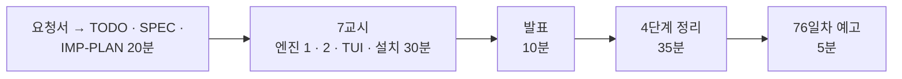

# 7·8교시 · 바이브 코딩 (`tcost`)

- 교시: 7교시 16:00~16:50 (각자 만들기), 8교시 17:00~17:50 (발표 10분 · [4단계 정리](04-STAGE4-WRAPUP.md) 35분 · 예고 5분)
- 과제: [VIBE-REQ-TCOST](../../Last3Mon/75/VIBE-REQ-TCOST.md)(요청서, 요청의 말 ①~⑫) → [VIBE-Q-TCOST](../../Last3Mon/75/VIBE-Q-TCOST.md)의 8단계: `Doc/TODO.md` → `Doc/SPEC.md` → `Doc/IMP-PLAN.md`(엔진 · TUI 단계) → 단계별 구현 → 확인 → `uv tool install` → 다른 폴더에서 사용 → 수업 뒤 `VIBE-A-TCOST.md` 공개
- 요구 14개(R1~R14). 50분 안에는 **엔진 1단계(R1 · R2 · R3 · R13) + 엔진 2단계(R5 · R6) + TUI 1단계(R8) + 설치(R14)**, 나머지는 IMP-PLAN의 다음 단계로 집에서.
- 72일차 `tbench` · 73일차 `tscan` · 74일차 `tver`와 같은 흐름입니다: 사람의 말(요청서)을 **확인할 수 있는 요구**로 바꾸는 일을 학생이 먼저 하고, VIBE-Q는 그 다음 단계(비교 대상)로 씁니다.
- 오늘은 `tcost`: LLM을 부르기 **전에** 글 파일 · 워크플로우의 토큰과 비용을 계산하고, 테스트 보고서(`runs/*.json`)의 실제 사용량을 모아 한 달을 예상하는 TUI. OpenAI를 부르지 않습니다. 오늘 n8n을 돌려서 잰 것을 돌리기 전에 내 도구로.

> 이 문서는 7 · 8교시 진행 문서입니다. 8교시의 정리 35분은 [04-STAGE4-WRAPUP](04-STAGE4-WRAPUP.md)으로 합니다 (74일차부터 4단계 정리를 따로 두었습니다).

## 1. 7교시 · 각자 만들기 (50분)

| 시간 | 단계 | 확인 |
| --- | --- | --- |
| 16:00~16:09 | 0 준비 · 1 요청서 → `Doc/TODO.md` (에이전트 없이) | 할 일 ①~⑫ · 꼭 / 나중 |
| 16:09~16:15 | 2 `Doc/SPEC.md` → VIBE-Q 요구 표(R1~R14)와 비교 · commit | 요구마다 확인 방법 (손으로 계산한 금액 · 건너뛴 수) |
| 16:15~16:20 | 3 `Doc/IMP-PLAN.md` (엔진 1~4단계 · TUI 1단계 · 설치) · commit | 단계마다 체크리스트 |
| 16:20~16:44 | 4 구현: 엔진 1단계 → 엔진 2단계 → TUI 1단계, 막히면 5 문제 해결 팁 | 단계마다 `pytest` · 직접 실행 · commit |
| 16:44~16:50 | 6 확인 · 7 `uv tool install --editable .` · 8 다른 폴더에서 `tcost` | `cd ~/aio-01d4-stu/Last3Mon/75 && tcost usage runs --per-day 1000` |

| 볼 것 | 막혔을 때 한마디 |
| --- | --- |
| TODO · SPEC 없이 VIBE-Q를 통째로 붙여 넣었나 | "요청서로 Doc/TODO.md부터. 손으로 계산한 금액이 SPEC에 없으면 맞았는지 모릅니다" |
| IMP-PLAN이 한 덩어리 · 첫 요청에 14개 | "엔진 1단계만. 단계마다 확인 · 체크 · commit" |
| 금액이 백만 배 | "단가는 1M 토큰당. ÷ 1,000,000" |
| 0.00056000000001 | "비용은 소수 8자리에서 반올림" |
| 모르는 모델이 $0 | "단가표에 없으면 오류, 목록을 보여 줘" |
| 테스트가 OpenAI를 부름 | "테스트는 네트워크 없이, 토큰은 tiktoken" |
| 보고서의 400 · 요약 케이스에서 오류 | "`usage.by_step`이 없는 결과는 skipped로 세고 넘어가기" |
| 평균이 이상하게 작음 | "호출 수가 아니라 요청 수로 나누기" |
| 설치한 `tcost`가 단가 파일을 못 찾음 | "prices.json을 wheel에 넣어 줘" |
| 실행해 보지 않고 다음 요청 | "에이전트가 됐다고 해도 직접 `uv run tcost`" |

정답 예(R1~R14를 모두 넣은 `tcost`와 정답본 `VIBE-A-TCOST.md`)는 수업 뒤 공개됩니다. 강사 바이브 코딩(4절)은 시간이 남으면 · 수업 뒤 하고, 걸린 시간을 정답본(`VIBE-A-TCOST.md`) 6절에 남깁니다.

## 2. 8교시 · 발표 (10분)

- 1~2명. **자기 `runs`의 실제 비용과 한 달 예상을 보여 줄 수 있는 사람**, 기준 · 내 워크플로우의 고정 지시문 토큰을 비교한 사람을 먼저 고릅니다.
- 3분 발표 · 2분 질문: **내 SPEC과 VIBE-Q가 달랐던 곳** / IMP-PLAN을 어떻게 나눴나 / 잘 먹힌 요청문 / 안 먹힌 요청문 / 에이전트가 틀린 곳 / 시연.

## 3. 강사 정리 (8교시 4단계 정리 안에서, 1절 표와 함께)

| | n8n 헬프데스크 (오늘 Lab) | tcost |
| --- | --- | --- |
| 토큰 세기 | 응답의 `usage` (부른 뒤) | `tiktoken` (부르기 전) |
| 단가 | 데이터 API `/prices` | 단가 파일 (`checked` 날짜 · 출처) |
| 비용 식 | 단계마다 × 그 모델 단가, 8자리 (Lab 01 예제 2) | 같은 식 (R1 · R2) |
| 모으기 | `/usage/summary` (Lab 01 과제 1) | `runs/*.json` (R5) |
| 한 달 | 보고서 `projected_month_usd` (Lab 03 과제 1) | `--per-day --days` (R6) |
| 바꾸면 얼마 | what-if (Lab 03 과제 2) | `compare` (R7) |
| 모르는 모델 | 400 `unknown model` | 종료 코드 2 (R12) |

- 풀이 거리: 긴 프린터 질문을 `tcost count --out 60`으로 미리 세면 2,613토큰 · $0.001141, n8n에서 실제로 돌리면 $0.001196이었습니다 (강사 본). 미리 센 값은 질문 글만이라 **하한**에 가깝습니다 (지시문 · FAQ가 더해짐).

## 4. 강사 바이브 코딩 (시간이 남으면 · 수업 뒤, 15분)

| 주제 | 요청문 요지 | 보여 줄 것 |
| --- | --- | --- |
| 실제와 맞춰 보기 | "보고서의 질문 글을 세어 prompt_tokens 와 차이를 % 로" | 내 셈과 공급자 셈의 차이 |
| 캐시 입력 단가 | "cached_tokens 가 있으면 cached input 단가로" | 같은 앞부분이 싸지는 것 |
| 비용 관문 붙이기 | "tcost workflow --max-usd 를 tver save 앞에" | 저장 = 비용 관문 통과 (74일차 정책과 같은 생각) |

걸린 시간과 결과를 `Last3Mon/75/VIBE-A-TCOST.md` 6절에 적어 둡니다.

## 5. 보충 · 팁 (읽을거리, 4단계 정리 7절과 함께)

| 팁 | 설명 |
| --- | --- |
| 요청서 → 요구가 먼저 | 확인 방법(정확한 금액 · 건너뛴 수 · 종료 코드)이 있는 요구가 있어야 에이전트의 "완료"를 판단할 수 있음 |
| 숫자 검사는 쉬운 숫자로 | 1,000토큰 × $0.40 = $0.0004 같은 손 계산으로 먼저 테스트 |
| 날짜는 넘겨받게 | "오늘"을 함수 인자로 받으면 테스트가 날마다 같음 |
| 없는 것은 0이 아니라 skipped · 오류 | 0으로 세면 평균 · 비용이 거짓말을 함 |
| 단가는 파일로 | 코드에 박지 않고, 확인한 날짜와 함께 |
| 미리 센 값은 하한 | 실제 요청에는 실행 때 붙는 것이 더해짐 |
| 단계마다 `git commit` | 에이전트가 망가뜨려도 돌아갈 곳 |

## 6. 76일차 예고 (5분)

- 오늘: 재기 · 줄이기 · 예산과 한도. 내일: **에러 처리와 예외 대응, 안정적 운영 체계** — 오늘 기록 API가 멈췄을 때 답은 보냈지만 빠진 기록은 `recorded: false`로 남기기만 했습니다. 내일은 실패한 일을 모아 두고(DLQ) 알리고 다시 처리합니다.
- 바이브 코딩: `tretry`. 오늘 `tcost`는 지우지 마세요. 79일차 `tops`에서 씁니다.

## 확인 (강사)

- [ ] 16:00 요청서 → TODO(에이전트 없이) → SPEC → IMP-PLAN 20분을 지켰다, 16:20부터 엔진 1단계.
- [ ] 7교시 시작 전 시험 자료(`reference/baseline-cost.json` · `lab02-example1-lean.json`, 오늘 `runs/`)를 화면에 띄웠다.
- [ ] 수업 뒤: `VIBE-A-TCOST.md`의 강사 바이브 코딩 시간을 채우고, 요청이 있을 때 학생 저장소에 정답(LAB-A · `answers/` · VIBE-A · `tcost/`)을 올린다.
- [ ] 발표자 1~2명, 강사 정리 표, 팁, 예고.
- [ ] 수업이 끝날 때 학생들의 예산 · 기록 · 고장 스위치가 처음 상태인지 (`budget --reset`, `usage --clear`, `fault usage ok`, `doctor`).
