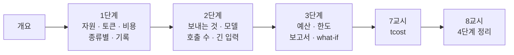

# 75일차 · 컴퓨팅 자원·API 사용량 관리와 비용 최적화 (바이브 코딩)

- 일자: 2026-10-29 (75일차)
- 교과목: 노코드 멀티 에이전트 워크플로우 설계 및 운영
- 단원: AI 워크플로우 운영 및 관리 역량 강화
- 학습 내용: 컴퓨팅 자원 및 API 사용량 관리, 비용 최적화 전략 적용
- 실습 폴더: [Last3Mon/75](../../Last3Mon/75/README.md)
- 실습 환경: 65일차 n8n 2.42.6 + OpenAI API(`gpt-4.1-mini`, `gpt-5.4-nano`) + 75일차 데이터 API(단가 · 사용량 기록 · 예산 · 한도) + **CLI 코딩 에이전트**
- **실습 준비: [00-DAY75-PREP.md](00-DAY75-PREP.md) (수업 전날까지 1~2절 완료)**
- 수업 형식: 1 · 3 · 5교시 강의, 2 · 4 · 6교시 실습 5개씩 (예제 3 · 과제 2), 7교시 바이브 코딩, 8교시 발표 · 4단계 정리

## 오늘의 시간표

| 교시 | 시간 | 내용 | 자료 |
| --- | --- | --- | --- |
| 1 | 09:00~09:50 | 개요 · 1단계 강의 · 사용량 재기 | [개요](00-DAY75-OVERVIEW.md) 1~14장, [1단계](01-STAGE1-MEASURE-USAGE.md) |
| 2 | 10:00~10:50 | Lab 01 실습 5개 (자원 · 토큰 · 비용 · 종류별 비용 · 기록 · 기록이 멈추면) | [Lab 01](../../Last3Mon/75/LAB-01-Q-MEASURE-USAGE.md) |
| 3 | 11:00~11:50 | 2단계 강의 · 비용 줄이기 | 개요 15~21장, [2단계](02-STAGE2-REDUCE-COST.md) |
| 4 | 12:00~12:50 | Lab 02 실습 5개 (보내는 것 · 모델 · 답까지 nano? · LLM 한 번 · 긴 질문) | [Lab 02](../../Last3Mon/75/LAB-02-Q-REDUCE-COST.md) |
| - | 13:00~14:00 | 점심 |  |
| 5 | 14:00~14:50 | 3단계 강의 · 예산과 한도 | 개요 22~28장, [3단계](03-STAGE3-BUDGET-AND-LIMITS.md) |
| 6 | 15:00~15:50 | Lab 03 실습 5개 (하루 예산 · 1분 한도 · 예산 바꿔 보기 · 보고서 · what-if) | [Lab 03](../../Last3Mon/75/LAB-03-Q-BUDGET-AND-LIMITS.md) |
| 7 | 16:00~16:50 | 바이브 코딩 `tcost`: 요청서 → TODO → SPEC → IMP-PLAN → 만들기 → 설치 | [VIBE-REQ-TCOST](../../Last3Mon/75/VIBE-REQ-TCOST.md), [진행](05-VIBE-CODING.md) |
| 8 | 17:00~17:50 | 발표 · **4단계 정리** (의미 · 효과 · 회사에서 쓰는 법) · 76일차 예고 | [4단계 정리](04-STAGE4-WRAPUP.md), [진행](05-VIBE-CODING.md) |

## 자료 목록

| 파일 | 내용 |
| --- | --- |
| `00-DAY75-PREP.md` | 실습 준비: n8n · 75일차 판 데이터 API 켜기, 기준(`base-cost`) 게시, `flow.py doctor` (수업 전) |
| `00-DAY75-OVERVIEW.md` | 개요 30장 (PPT 대신 Markdown, 가로줄로 장 구분) |
| `01-STAGE1-MEASURE-USAGE.md` | 왜 비용인가 · FinOps, 자원, 토큰과 단가, 토큰이 보이는 호출, 단계별 비용 · 단가는 밖에, 종류별 비용 · 한 달, 기록, 기록이 멈추면 (실제 사례) |
| `02-STAGE2-REDUCE-COST.md` | 비용의 세 칸, 보내는 것 줄이기, 단계마다 맞는 모델, 싸졌는데 나빠졌다면, 하지 않은 호출, 긴 입력의 상한, 줄인 것을 남기기 |
| `03-STAGE3-BUDGET-AND-LIMITS.md` | 넘치지 않게, 하루 예산 · 낮춰서 답하기, 사용자별 한도 · 429, 예산은 넘은 뒤 멈춘다, 비용 보고서, what-if, 내 쪽 자원 관리 |
| `04-STAGE4-WRAPUP.md` | 8교시 35분: 오늘의 의미 · 효과 숫자 · 업계 이름 · 산업별 응용 · 비용 지표 · 면접 · 최종 프로젝트 체크리스트 |
| `05-VIBE-CODING.md` | 7 · 8교시 바이브 코딩 진행 (tcost), 발표, 강사 정리, 강사 바이브 코딩, 팁, 예고 |
