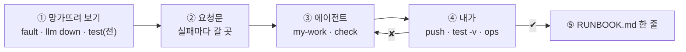
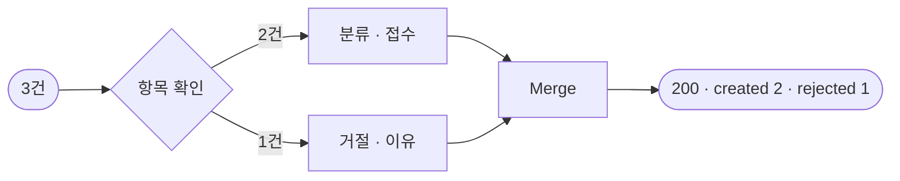
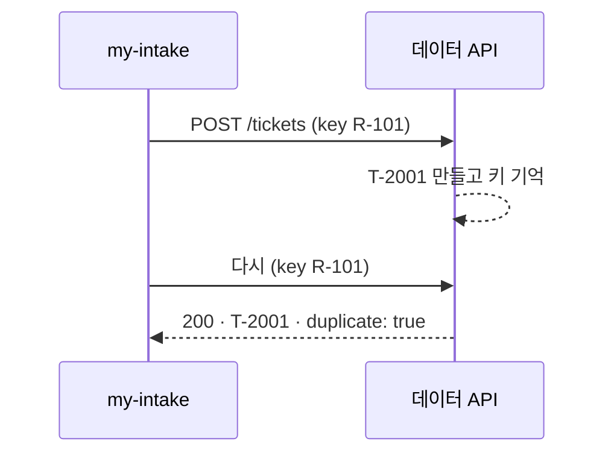
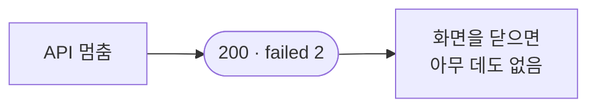
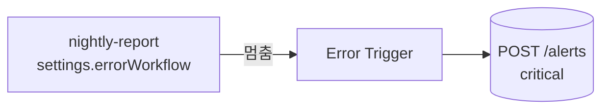
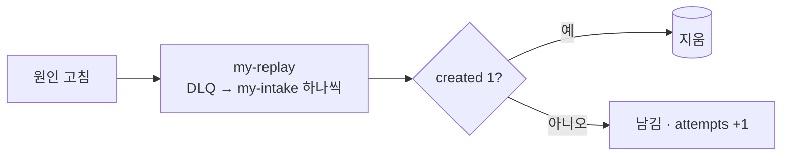
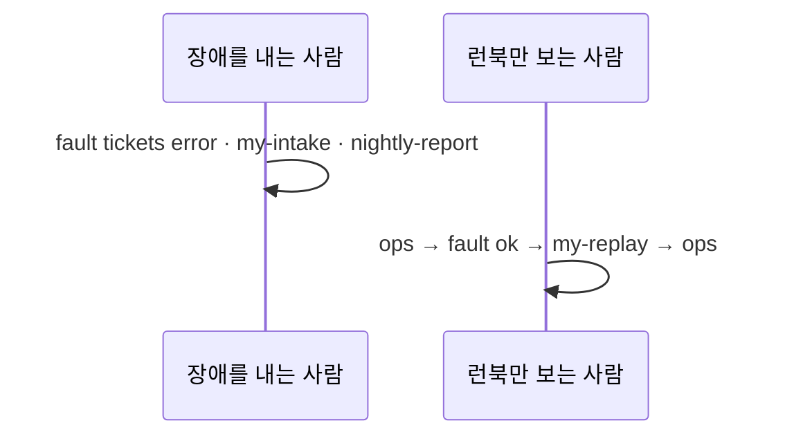

# 76일차 개요 · 에러 처리와 예외 대응, 안정적 운영 체계

> 노코드 멀티 에이전트 워크플로우 설계 및 운영 · 2026-10-30
> 30장 · 각 장은 가로줄(`---`)로 나뉩니다. 1교시에는 1~6장을 보고, 나머지 장은 각 단계 강의(1 · 3 · 5교시) 때 함께 띄웁니다.
> 숫자는 모두 강사 노트북 실측입니다 (65일차 n8n 2.42.6, OpenAI `gpt-4.1-mini`(분류), 76일차 판 데이터 API, 10/29 정답 워크플로우를 학생 순서대로 1회).

| 장 | 범위 | 띄우는 때 |
| --- | --- | --- |
| 1~6 | 표지 · 목표 · 시간표 · 잃고 겹치는 접수 · 일하는 순서 · 실습 15개 | 1교시 시작 |
| 7~14 | 1단계 · 실패의 종류 | 1교시 강의 |
| 15~21 | 2단계 · 모으고 알리기 | 3교시 강의 |
| 22~28 | 3단계 · 재처리와 운영 체계 | 5교시 강의 |
| 29~30 | 바이브 코딩 · 정리와 예고 (8교시 35분 정리는 [04-STAGE4-WRAPUP](04-STAGE4-WRAPUP.md)) | 7교시 · 8교시 |

---

## 1 / 30 · 표지


**76일차**

# 에러 처리와 예외 대응, 안정적 운영 체계

실패해도 잃지 않고 · 다시 해도 겹치지 않고 · 사람이 알게

<sub>노코드 멀티 에이전트 워크플로우 설계 및 운영 · 2026-10-30</sub>

---

## 2 / 30 · 오늘 할 수 있게 될 세 가지

| | 목표 | 내용 |
| --- | --- | --- |
| 1 | **나눈다** | 실패를 다시 할 것 · 거절할 것으로 나누고, 항목마다 상태로 답하고, 재시도에 멱등 키를 붙이고, LLM이 멈춰도 접수하고, 입구에서 막는다 |
| 2 | **모으고 알린다** | 다시 할 실패는 원래 그대로 DLQ에, 예상 못 한 오류는 Error Workflow로, 그물 사이의 구멍을 막고, 등급을 나눠 같은 문제는 한 번만 알린다 |
| 3 | **되돌린다** | 고친 뒤 같은 입구로 재처리하고, 런북으로 짝 연습을 하고, 세 번 실패하면 사람에게 넘기고, 지금 괜찮은지 신호 하나로 |

---

## 3 / 30 · 오늘의 시간표

| 교시 | 시간 | 내용 |
| --- | --- | --- |
| 1 | 09:00~09:50 | 개요 · **1단계 강의** · 실패의 종류 |
| 2 | 10:00~10:50 | **Lab 01 실습 5개** · 망가뜨려 보기 · 항목 확인 · 재시도 · 멱등 키 · 고장 종류 · LLM 멈춤 · 요청 규칙 |
| 3 | 11:00~11:50 | **2단계 강의** · 모으고 알리기 |
| 4 | 12:00~12:50 | **Lab 02 실습 5개** · DLQ · Error Workflow · 그물 지도 · 처리한 실패 알림 · 알림 폭주 |
| - | 13:00~14:00 | 점심 |
| 5 | 14:00~14:50 | **3단계 강의** · 재처리와 운영 체계 |
| 6 | 15:00~15:50 | **Lab 03 실습 5개** · 재처리 · 런북 · 장애 연습 · 반쯤 처리된 요청 · parked · 운영 상태 |
| 7 | 16:00~16:50 | 바이브 코딩 `tretry`: 요청서 → TODO → SPEC → IMP-PLAN → 만들기 → 설치 |
| 8 | 17:00~17:50 | 발표 · **4단계 정리** (의미 · 효과 · 회사에서 쓰는 법) · 77일차 예고 |

---

## 4 / 30 · 오늘 고칠 것: 실패하면 잃고, 다시 보내면 겹치는 접수

`base-intake`: 문의 여러 건(`requests[]`) → 하나씩 LLM 분류 → 접수 건 만들기.

| 수업 준비 때 한 일 | 사용자가 받은 것 | 실제로 |
| --- | --- | --- |
| 빈 글이 섞인 3건 | **HTTP 500** | **2건은 이미 접수됨** |
| 잠깐 끊김 (`flaky`) | 500 | 0건 (재시도 없음) |
| 같은 3건을 다시 | 200 · 새 번호 3개 | VPN 문의의 접수 건이 **둘** |
| API가 멈춘 동안 (고친 뒤에도 DLQ가 없으면) | `failed: 2` | 화면을 닫으면 **사라짐** |
| 보고서 작업의 버그 | 500 | **아무도 모름** |

---

## 5 / 30 · 일하는 순서 (오늘은 "망가뜨려 보기 → 고치기 → 다시 망가뜨려 확인")



| 누가 | 무엇을 |
| --- | --- |
| 나 | 고장 스위치 · LLM 멈춤으로 실패를 일으키기, 요청문, 런북, 짝 연습 |
| CLI 에이전트 | `AGENTS.md`대로 워크플로우 JSON, `check` |
| `flow.py` | `ops`(접수 건 · DLQ · 알림 · 스위치), `fault tickets\|dlq flaky\|slow\|error\|ok`, `test`(`{"sleep": 3}`) |

---

## 6 / 30 · 실습 15개 (Lab마다 예제 3 · 과제 2)

| | 예제 1 | 예제 2 | 예제 3 | 과제 1 | 과제 2 |
| --- | --- | --- | --- | --- | --- |
| Lab 01 | 망가뜨려 보기 (에이전트 없이) | 항목 확인 · 재시도 · 멱등 키 | 고장 종류마다 (에이전트 없이) | LLM이 멈춰도 미분류 | 같은 id · 10건 상한 |
| Lab 02 | DLQ | Error Workflow | 어느 실패가 어느 그물에 (에이전트 없이) | 처리한 실패 알림 · DLQ가 멈추면 | 알림 폭주 막기 |
| Lab 03 | 재처리 | 런북 · 장애 연습 (에이전트 없이) | 반쯤 처리된 요청 (에이전트 없이) | 세 번 실패하면 parked | 운영 상태 |

---

## 7 / 30 · 1단계 · 부분 실패: 500이 숨기는 것

> 생활 속 예: 마트 계산대에서 "결제 실패"라고만 들었는데, 영수증을 보니 앞의 8개는 이미 결제됨.

| | 한 건 | 여러 건 (일괄) |
| --- | --- | --- |
| 결과 | 성공 / 실패 | 성공 / 실패 / **일부만** |
| 실패했을 때 서버에 | 대개 없음 | **이미 끝난 일** |
| 다시 보내면 | 대개 안전 | 끝난 일을 **또** |

- 500을 받은 사용자는 다시 보냅니다 → **중복** (접수 · 결제 · 메일 두 통).
- 수업 준비 때: 빈 글이 섞인 3건 → 500, 접수 건 2개는 이미 생김.

---

## 8 / 30 · 실패의 종류

> 생활 속 예: 전화가 안 될 때: 통화 중(조금 뒤 다시) · 없는 번호(다시 걸어도 안 됨) · 전원 꺼짐(나중에).

| 종류 | 예 | 다시 하면? | 할 일 |
| --- | --- | --- | --- |
| 고칠 수 없음 | 빈 글 · 400 · 401 · 404 | 같음 | 그 항목만 **거절** + 이유 |
| 잠깐 | 끊김 · 503 · 429 | 대부분 성공 | **재시도** |
| 오래감 | API가 한 시간 멈춤 | 나중에 성공 | **모아 두기** → 재처리 |
| 예상 못 함 | 버그 · 모르는 응답 | ? | **알림** |

- HTTP: 4xx = 내 요청 문제 (408 · 425 · 429 빼고), 5xx = 서버 문제, 응답 없음 = **모름**.

---

## 9 / 30 · 부분 성공: 항목마다 상태

> 생활 속 예: 택배 배송 조회: "1~4번 배달 완료, 5번 주소 불명 반송" — 상자마다 상태.



- 고친 뒤: 빈 글만 `rejected`(`text is required`), **1.7초** (빈 글을 LLM에 보내지 않음).
- 업계: HTTP 207 Multi-Status, SQS batch item failures.

---

## 10 / 30 · 재시도: 몇 번 · 얼마나 기다리나

> 생활 속 예: 자판기 지폐는 펴서 몇 번 다시 넣지만, 콘서트 예매 새로고침을 모두가 연타하면 더 막힘 (재시도 폭풍).

```text
기다림(i) = min(처음 간격 × 2^(i-1), 상한) × (1 - jitter × 무작위)
```

| 원칙 | 까닭 |
| --- | --- |
| 다시 할 실패만 | 400을 다시 보내면 부하만 |
| 지수 backoff · 상한 | 힘든 서버를 더 힘들게 하지 않게 |
| jitter | 모두 같은 순간에 다시 보내지 않게 |
| 한 곳에서 · 예산 안에서 | 층마다 3번이면 27배 (재시도 폭풍) |

- n8n: `retryOnFail` · `maxTries` · `waitBetweenTries` (노드 바로 아래, 고정 간격, 노드의 항목을 **모두** 다시 보냄).

---

## 11 / 30 · 고장 종류마다 재시도가 하는 일 (Lab 01 예제 3)

> 생활 속 예: 통화 중이면 다시 걸면 되지만, 전화국이 고장이면 백 번 걸어도 시간만 감.

| 고장 | 시간 | 결과 | 재시도는 |
| --- | --- | --- | --- |
| `flaky` | 2.4초 | `created: 2` | 도움이 됨 |
| `error` | 3.4초 | `failed: 3` | 시간만 더함 |
| `slow` | **12.4초** | `failed: 3` | 사용자를 기다리게 함 |

- 그리고 8초 뒤: 실패라던 3건이 **접수 건 목록에 있음**. 시간 초과는 "안 됨"이 아니라 **"모름"**.

---

## 12 / 30 · 멱등 키: 몇 번 보내도 한 번

> 생활 속 예: 엘리베이터 버튼을 열 번 눌러도 한 대만 옴 · 택배 송장 번호로 같은 상자를 두 번 배달하지 않음.



| 키 | 다시 보내면 |
| --- | --- |
| `$execution.id` · 시각 | 매번 새 키 → 중복 |
| **요청 id** `R-101` | 같은 키 → 처음 번호 |

- 같은 3건을 두 번: `created: 3, duplicates: 3`. 업계: Stripe `Idempotency-Key`.

---

## 13 / 30 · 핵심 일과 덧붙인 일: 우아한 저하 (Lab 01 과제 1)

> 생활 속 예: 카드 단말기가 고장 난 편의점: 문을 닫지 않고 "오늘은 현금만".

| | 핵심 일 (접수) | 덧붙인 일 (LLM 분류) |
| --- | --- | --- |
| 실패하면 | 일을 못 함 | 줄여서라도 핵심 일은 |

| LLM 멈춤 (`llm down`) | 고치기 전 | 고친 뒤 |
| --- | --- | --- |
| 결과 | 0.8초에 500 · 접수 0 | 0.9초 · `created: 3, unclassified: 3` |

- 72일차 "간단 답변", 75일차 "예산을 넘으면 원문"과 같은 생각. **줄인 수를 숨기지 않기** (`unclassified`).

---

## 14 / 30 · 입구에서 막기 (Lab 01 과제 2)

> 생활 속 예: 접수 창구 직원이 "방금 접수하셨는데요" 하고 같은 서류를 그 자리에서 돌려줌.

| 규칙 | 어기면 | 고치기 전 → 후 |
| --- | --- | --- |
| 같은 요청 안의 같은 id | 두 번째만 거절 | `created: 3, duplicates: 1` → `created: 2, rejected: 1` |
| 한 번에 10건까지 | 전체 400 | **11.0초** · 13건 접수 → **0.2초** · 400 |

- 키는 **피해를** 막고, 입구 규칙은 **일을** 막습니다 (분류 세 번 · 11초 붙잡기).

---

## 15 / 30 · 2단계 · 결과에만 남은 실패는 사라진다

> 생활 속 예: 콜센터가 "장애라 접수가 안 돼요" 하고 끊으면, 고객 이름도 내용도 어디에도 안 남음.



- 수업 준비 때 `fault tickets error`: `failed: 2`, `ops`의 DLQ 0 · 알림 0.
- 실패한 일을 **서버 쪽에** 남겨야 고친 뒤 다시 할 수 있습니다.

---

## 16 / 30 · DLQ: 배달하지 못한 편지 보관함 (Lab 02 예제 1)

> 생활 속 예: 부재 시 택배는 버리지 않고 보관소에 — 상자 그대로 · 못 전한 까닭 · 시도 횟수와 함께.

| 넣는 것 | 까닭 |
| --- | --- |
| **원래 요청 그대로** | 재처리 때 같은 입구로 |
| 이유 · 어디서 · `attempts` | 원인 · 계속 실패하는 것 가려내기 |

| 넣지 않는 것 | 까닭 |
| --- | --- |
| 거절 (빈 글) | 다시 해도 같음 |

- 고친 뒤 DLQ: `D-1 R-301` · `D-2 R-302` · `attempts 1` · `500 - tickets service is failing`.
- 업계: Amazon SQS · RabbitMQ · Kafka · Azure Service Bus의 DLQ.

---

## 17 / 30 · 처리한 실패와 처리하지 못한 실패

> 생활 속 예: 떨어진 우유는 장보기 목록에 (예상한 일), 터진 수도관은 바로 관리실에 (예상 못 한 일).

| | 처리한 | 처리하지 못한 |
| --- | --- | --- |
| 예 | API 멈춤 → DLQ | `nightly-report`의 버그 |
| 워크플로우 | 계속 · 200 | **멈춤** · 500 |
| 받는 곳 | 내가 만든 알림 | **Error Workflow** |

- 코드의 `try/catch`(노드 `onError`)와 전역 오류 처리기(Error Workflow · Sentry)와 같은 구조.

---

## 18 / 30 · Error Workflow (Lab 02 예제 2)

> 생활 속 예: 자동차 경고등: 고장을 고치지는 않지만 "엔진 · 온도 높음"을 알려 정비소로 보냄.



```text
[critical] 76 Nightly report (provided, has a bug) · unexpected · Count by category · rows is not iterable [line 4]
```

- 처리기 id 고정(`errHandler76001`) · **게시**해야 불림 (게시를 내리면 알림 0, 수업 준비 때 확인) · 응답 뒤 1~3초.

---

## 19 / 30 · 그물 지도와 구멍 (Lab 02 예제 3)

> 생활 속 예: 건전지가 다 된 화재경보기는 불이 나도 조용함 → 그래서 "건전지 부족" 삑 소리가 따로 있음.

| 실패 | 그물 | 수업 준비 때 |
| --- | --- | --- |
| 빈 글 | `rejected` | ✔ |
| API 오류 | DLQ | ✔ DLQ 2 |
| 버그 | Error Workflow | ✔ critical |
| **API 오류 + DLQ 오류** | **없음** | ✘ `failed: 3`, DLQ 그대로 2, 알림 없음 → **3건 사라짐** |

- `neverError` 덕분에 멈추지 않았고, 그래서 Error Workflow도 안 불렸습니다. **감시자를 누가 감시하나.**

---

## 20 / 30 · 알림 등급 · 구멍 막기 (Lab 02 과제 1)

> 생활 속 예: 응급실 환자 분류: 심정지는 바로, 골절은 30분 안에, 감기는 몇 시간 뒤.

| 등급 | 오늘 | 받으면 |
| --- | --- | --- |
| `critical` | 버그, **DLQ가 멈춤** | 바로 |
| `high` | DLQ에 쌓임, parked | 원인 확인 · 재처리 |
| 없음 | 거절, 미분류 | 보고서 |

```text
[high] intake · dlq · count 2 · 2 request(s) could not be created and wait in the DLQ
[critical] intake · dlq_down · count 2 · DLQ save failed: … · lost ids R-201, R-203
```

- 요청 하나에 하나 · `count`. 결과에 `dlq_saved` · `alert`.

---

## 21 / 30 · 알림 피로: 같은 문제는 한 번 (Lab 02 과제 2)

> 생활 속 예: 양치기 소년 · 매일 울리는 차 경보 · 알림을 꺼 버린 단톡방.

| | 고치기 전 | 고친 뒤 |
| --- | --- | --- |
| 10분 안 두 번째 실패 | `sent`, dlq 알림 2 | **`suppressed`**, dlq 알림 1 |
| DLQ | 5건 | **5건 모두** |
| critical | 보냄 | 늘 보냄 |

- 줄이는 것은 **알림**이지 기록이 아닙니다. 업계: Alertmanager · PagerDuty의 중복 없애기 · 묶기 · 반복 간격.

---

## 22 / 30 · 3단계 · 재처리: 같은 입구로 다시 (Lab 03 예제 1)

> 생활 속 예: 보관소의 택배를 다음 날 재배송하고, 전하면 목록에서 지움 — 같은 배송 절차로.



- 고친 뒤 `replayed: 2, ok: 2` (1.1초), DLQ 0, 접수 건 2 (중복 없음).
- 직접 만들지 않고 **같은 입구로** → 규칙이 하나. 업계: SQS DLQ redrive.

---

## 23 / 30 · 런북: 그때 할 일을 미리 (Lab 03 예제 2)

> 생활 속 예: 비행기 비상 체크리스트 · 엘리베이터 안의 "갇혔을 때" 안내문.

| 갖출 것 | 예 |
| --- | --- |
| 어느 알림 | "`high · dlq`를 받으면" |
| 명령 그대로 | `uv run tools/flow.py ops` |
| 볼 숫자 | "DLQ 0, 같은 key가 둘이 아닌지" |
| 갈림길 | "critical unexpected는 코드 담당에게" |
| **하지 말 것** | "DLQ를 비우지 말 것" |
| 누가 · 언제까지 | "parked는 데이터 담당이 다음 업무일까지" |

- 구글 SRE: 미리 쓴 플레이북은 회복 시간을 약 세 배 줄인다.

---

## 24 / 30 · 장애 연습: 써 둔 런북이 맞는지

> 생활 속 예: 소방 훈련: 불이 나기 전에 비상구 앞 상자를 발견.



- 수업 준비 때: 알림 둘(high dlq · critical unexpected) — 재처리 뒤에도 **critical은 남음** (버그는 재처리로 안 고쳐짐).
- `lab03-drill` 7/7, 접수 건 5 (중복 없음). 업계: game day · chaos engineering · blameless postmortem.

---

## 25 / 30 · 최소 한 번 + 멱등 = 결과는 한 번 (Lab 03 예제 3)

> 생활 속 예: 엘리베이터 버튼: 여러 번 눌려도(최소 한 번) 한 대만 옴(멱등).

| 순서 | 수업 준비 때 |
| --- | --- |
| `slow` · 2건 | 11.6초 · `failed: 2` → DLQ 2 |
| 8초 뒤 | 접수 건 **이미 2개** |
| 재처리 | `ok: 2, duplicates: 2`, 접수 건 그대로 2 |

- DLQ의 요청은 **반쯤 처리됐을** 수 있습니다. 재처리가 안전한 것은 1단계의 키 덕분.

---

## 26 / 30 · 끝없이 돌리지 않기: parked (Lab 03 과제 1)

> 생활 속 예: 택배 재배송은 몇 번에서 멈추고 보낸 사람에게 연락 · 비밀번호 5번 틀리면 창구로.

| | 고치기 전 | 고친 뒤 |
| --- | --- | --- |
| 재처리 3 (`attempts` 3) | 또 보냄 (2.0초) | **0.1초 · parked 2** · high 알림 |
| 고친 뒤 재처리 | 자동으로 보냄 | `replayed: 0` (사람이 정함) |

- 간격 × 횟수 = 포기하기까지. 업계: SQS `maxReceiveCount`, 독 메시지, human in the loop.

---

## 27 / 30 · 운영 상태: 신호 하나와 까닭 (Lab 03 과제 2)

> 생활 속 예: 미세먼지 앱의 "좋음 · 보통 · 나쁨"과 "마스크를 쓰세요".

| 신호 | 기준 |
| --- | --- |
| `critical` | parked · 10분 안 critical 알림 |
| `warn` | DLQ · 10분 안 high 알림 |
| `ok` | 둘 다 아님 |

```json
{"status": "critical", "dlq": 5, "parked": 0, "alerts": {"critical": 1, "high": 1},
 "reasons": ["critical 알림 1건 (10분)", "DLQ 5건: 원인을 고친 뒤 재처리", "high 알림 1건 (10분)"]}
```

- **읽기만** (확인이 상태를 바꾸지 않게). 업계: health check · status page.

---

## 28 / 30 · 운영 체계 한 장

> 생활 속 예: 택배 회사에 오늘 만든 것이 모두 있음: 송장 번호 · 보관소 · 재배송 · 상황실 화면 (3단계 8절 표).

| 질문 | 답하는 것 |
| --- | --- |
| 잘못된 요청은? | 입구 규칙 · 거절 + 이유 |
| 잠깐 끊기면? | 재시도 + 멱등 키 |
| 오래 멈추면? | DLQ → 알림 → 재처리 |
| 예상 못 한 오류는? | Error Workflow → critical |
| 처리 장치가 멈추면? | critical `dlq_down` · 잃을 뻔한 id |
| 계속 실패하면? | parked → 사람 |
| 지금 괜찮은가? | 운영 상태 |
| 그때 누가 무엇을? | 런북 · 연습 |

---

## 29 / 30 · 7교시 바이브 코딩 · `tretry`

요청서(운영 담당의 말 ①~⑫) → `Doc/TODO.md` → `SPEC.md` → `IMP-PLAN.md` → 단계별로 → `uv tool install`.

| 오늘 n8n에서 | `tretry`로 n8n 밖 어떤 명령에든 |
| --- | --- |
| `retryOnFail` · 고정 간격 | 지수 backoff · 상한 · jitter |
| 노드 timeout | 시도마다 `--timeout`, 전체 `--deadline` |
| 항목 거절 | 4xx는 1번 · 종료 코드 3 · 대체 안 함 |
| `key` = 요청 id | `--idem-key` · `--body-key` |
| 미분류 | `--fallback` |
| parked | 회로 차단 `--breaker` |

- 강사 본: `slow`에서 `--timeout 3 --deadline 5` → 5.00초에 포기 (Lab 01 예제 3은 12.4초).

---

## 30 / 30 · 오늘의 정리 · 77일차 예고

| 단계 | 오늘 숫자 |
| --- | --- |
| 나누기 | 500 · 중복 → 부분 성공 · `duplicates: 3`, 11건 11.0초 → 0.2초 400 |
| 모으고 알리기 | 사라지던 2건 → DLQ · high 1, 버그 → critical, DLQ 멈춤 → lost ids |
| 되돌리기 | 재처리 `ok: 2` · 중복 0, 반쯤 처리 `duplicates: 2`, parked 0.1초, 상태 ok → warn → critical → ok |

- 8교시 [4단계 정리](04-STAGE4-WRAPUP.md): 의미 · 효과 · 업계 이름 · 면접 · 최종 프로젝트 체크리스트.
- 77일차 (11/2): **실행 로그 분석과 운영 데이터 기반 Workflow 개선** — 오늘 남긴 실패 · 알림 · 실행 기록을 모아 어디가 자주 · 오래 실패하는지 찾고 고친 뒤 다시 잰다. 바이브 코딩 `tlog`.
