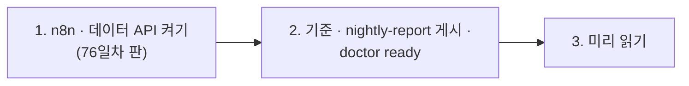

# 76일차 실습 준비 · 수업 전에 미리 해 두면 좋은 것

- 수업일: 2026-10-30 (76일차) · 에러 처리와 예외 대응, 안정적 운영 체계
- 준비 시간: 약 10분
- 먼저 WSL에서 `cd ~/aio-01d4-stu && git pull`로 오늘 자료를 받습니다 (수강생 저장소: https://gl.isitsoft.kr/publicproj/aio-01d4-stu).
- **수업 전날까지** 1~2절을 끝내 주세요.



---

## 1. n8n과 데이터 API 켜기 (전날 필수, 3분)

오늘은 **76일차 판 데이터 API**(75일차 + 접수 건 만들기 · DLQ · 알림 · 고장 스위치 `dlq`)를 씁니다. 같은 이름이라 이 폴더에서 다시 만들면 바뀝니다.

```bash
sudo systemctl disable --now ollama 2>/dev/null   # WSL에 설치한 Ollama가 있으면 끄고 자동 시작도 끔
cd ~/aio-01d4-stu/Last3Mon/65/n8n
docker compose rm -sf ollama                      # Ollama 컨테이너가 있으면 지움 (없으면 그냥 지나감)
docker compose start
cd ~/aio-01d4-stu/Last3Mon/76/data-api
docker compose up -d --force-recreate
sleep 3                                           # 데이터 API가 뜰 때까지
curl -s localhost:8800/dlq                        # {"size": 0, "parked": 0, "items": []}
```

- **66일차부터 LLM은 OpenAI API 키(`Last3Mon/.env`, Credential `OpenAI (.env)`)만 씁니다.** 오늘 LLM은 문의 분류에만 씁니다 (`gpt-4.1-mini`). Ollama는 쓰지 않습니다.
- 75일차의 예산 · 사용량 기록 · 고장 스위치는 데이터 API를 새로 띄우면 처음으로 돌아갑니다.
- `network day65-n8n_default not found` → n8n이 켜져 있지 않음. 위 n8n 부분부터 다시.

## 2. 기준 · nightly-report 게시와 준비 확인 (전날 필수, 3분)

오늘 망가뜨려 볼 **기준 일괄 접수**와 일부러 버그가 있는 **nightly-report**를 게시해 둡니다 (만들지 않고 게시만).

```bash
cd ~/aio-01d4-stu/Last3Mon/76
uv run tools/flow.py push reference/baseline-intake.json reference/nightly-report.json
uv run tools/flow.py call base-intake requests/batch-ok.json      # processed 3
uv run tools/flow.py ops --reset
uv run tools/flow.py doctor
```

```text
✔ n8n container day65-n8n-n8n-1
✔ n8n http://localhost:5678
✔ data API http://localhost:8800
✔ dead letter queue /dlq · alerts · fault switch dlq (day 76 data API)
✔ n8n → http://data-api:8800
✔ credential 'OpenAI (.env)' (openAiCourse0001)
✔ node catalog (for check)
✔ CLI coding agent: codex, claude, agy
ready
```

| ✘ 항목 | 할 일 |
| --- | --- |
| n8n container · data API | 1절 |
| dead letter queue | 데이터 API가 예전 판 → 1절 `--force-recreate` · `sleep 3` |
| `! fault switch is on` · `! DLQ is not empty` | `uv run tools/flow.py ops --reset` |
| credential | `cd ~/aio-01d4-stu/Last3Mon/65/n8n && bash register-credentials.sh` |
| CLI coding agent | [67일차 준비](../67/00-DAY67-PREP.md) 2절 |

---

## 3. 미리 읽어 오면 좋은 내용 (선택, 약 5분)

### 3.1 500을 받았다면 아무것도 안 된 걸까

문의 세 건을 한꺼번에 보냈는데 "오류"가 났습니다. 다시 보내야 할까요? 그런데 사실은 두 건이 이미 접수돼 있었다면? 다시 보내면 어떻게 될까요? 오늘 첫 실습에서 직접 겪어 봅니다.

### 3.2 용어

| 용어 | 한 줄 설명 |
| --- | --- |
| 부분 성공 | 여러 건 중 일부만 성공. 무엇이 성공하고 실패했는지 알려 주기 |
| 멱등 (idempotent) | 같은 요청을 여러 번 보내도 결과가 한 번 보낸 것과 같음 (키로 알아봄) |
| DLQ | Dead Letter Queue — 처리하지 못한 요청을 버리지 않고 모아 두는 곳 |
| Error Workflow | n8n에서 다른 워크플로우가 오류로 멈추면 대신 실행되는 워크플로우 |
| 런북 (runbook) | 장애가 났을 때 무엇을 어떤 순서로 할지 적은 대응 절차 |
| 재시도 · backoff | 실패하면 다시 해 보기 · 다시 할 때마다 기다리는 시간을 늘리기 |
| 알림 피로 | 알림이 너무 많아 아무도 보지 않게 되는 것 |

### 3.3 7교시 요청서

[VIBE-REQ-TRETRY](../../Last3Mon/76/VIBE-REQ-TRETRY.md)를 한 번 읽어 옵니다. 운영 담당이 원하는 것 열두 가지 중 "꼭"은 무엇일까요? 그리고 "고칠 수 없는 실패"는 무엇일까요?

## 4. 당일 준비물

- 충전된 노트북과 충전기, WSL의 Docker, Windows Terminal(WSL) 창 **두 개**, 웹 브라우저
- 오후 장애 연습(Lab 03 예제 2)은 **옆 사람과 짝**으로 합니다

## 확인

- [ ] `curl -s localhost:8800/dlq`가 `size 0` · `parked 0`
- [ ] `call base-intake`가 `processed 3`
- [ ] `uv run tools/flow.py doctor` → 마지막 줄 `ready`
