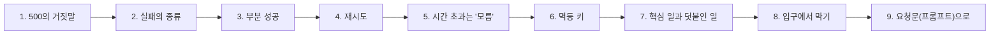
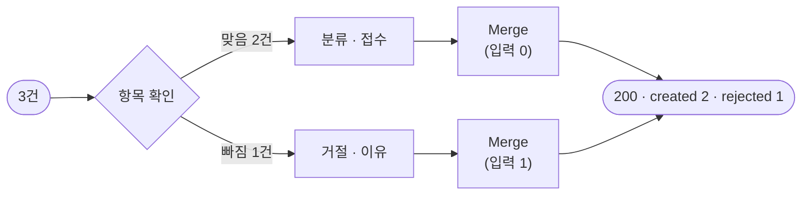
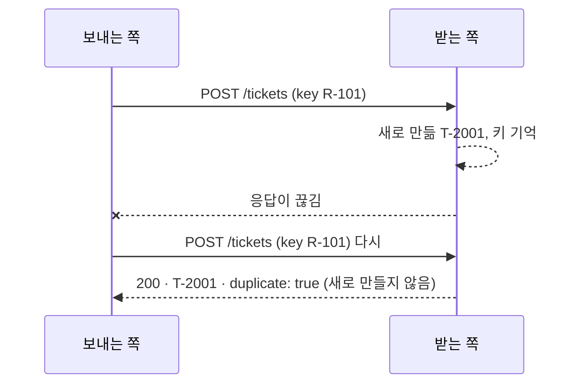

# 1단계 · 실패의 종류

- 교시: 1교시 강의 (09:00~09:50) · 2교시 [Lab 01](../../Last3Mon/76/LAB-01-Q-FAILURE-TYPES.md) 실습 5개 (10:00~10:50)
- 이 단계가 끝나면: 여러 건을 처리하는 워크플로우에서 실패를 종류별로 나누고, 항목 하나의 실패가 전체를 망치지 않게 부분 성공으로 답하고, 재시도의 효과와 한계를 고장 종류별로 말하고, 재시도 · 시간 초과에도 중복이 생기지 않게 멱등 키를 쓰고, 덧붙인 일(LLM 분류)이 실패해도 핵심 일(접수)을 끝내고, 요청 전체의 규칙을 입구에서 지킬 수 있다.
- 숫자: 모두 강사 노트북 실측입니다 (65일차 n8n 2.42.6, OpenAI `gpt-4.1-mini`(분류), 76일차 판 데이터 API, 10/29 실습을 5개로 늘린 뒤 정답 워크플로우를 학생 순서대로 1회). 출력 전부는 수업 뒤 공개되는 `Last3Mon/76/answers/LAB-TEST-RESULT.md`에 있습니다.
- 실습 가리키기: 이 문서에서 "Lab 01 예제 1"은 2교시 [Lab 01 문서](../../Last3Mon/76/LAB-01-Q-FAILURE-TYPES.md)의 그 절입니다. 파일 경로(`cases/` · `requests/` · `my-work/` · `reference/`)는 실습 폴더 `~/aio-01d4-stu/Last3Mon/76` 기준입니다.



## 0. 이 시간 (50분)

| 시간 | 절 · 개요 | 하는 일 |
| --- | --- | --- |
| 09:00~09:06 | 개요 1~6장 | 오늘 하루, 실패하면 잃고 다시 보내면 겹치는 접수, 실습 15개 |
| 09:06~09:12 | 1 · 개요 7장 | 부분 실패, 500이 숨기는 것 |
| 09:12~09:18 | 2 · 개요 8장 | 실패의 종류, 4xx · 5xx · 시간 초과 |
| 09:18~09:23 | 3 · 개요 9장 | 부분 성공, 항목마다 상태 |
| 09:23~09:31 | 4 · 5 · 개요 10~11장 | 재시도 · backoff · jitter · 재시도 폭풍, 시간 초과 |
| 09:31~09:37 | 6 · 개요 12장 | 멱등 키 |
| 09:37~09:44 | 7 · 8 · 개요 13~14장 | 우아한 저하, 입구에서 막기 |
| 09:44~09:50 | 9 · 10 · 확인 질문 | 요청문, 자주 하는 실수 |

### 2교시 Lab 01에서 이어서 하는 것

| 2교시 실습 (시각) | 이 강의의 절 | 실습에서 하는 일 | 쓰는 파일 · 명령 |
| --- | --- | --- | --- |
| 시작 (10:00) | — | 런북 복사 | `cp templates/RUNBOOK-TEMPLATE.md my-work/RUNBOOK.md` (오늘 본 실패를 모두 여기에) |
| Lab 01 예제 1 (10:00~10:10, 에이전트 없이) | 1 · 2 | 기준을 망가뜨려 보기: 빈 글 · `flaky` · 다시 보내기 | `call base-intake requests/batch-*.json`, `ops` → `RUNBOOK.md` 1.1 |
| Lab 01 예제 2 (10:10~10:25) | 3 · 4 · 6 | 항목 확인 · 재시도 · 멱등 키 · 부분 성공 | `my-work/intake.json` (기준을 복사), 테스트 `cases/lab01.json` |
| Lab 01 예제 3 (10:25~10:32, 에이전트 없이) | 4 · 5 | 고장 종류마다 재시도가 하는 일, 늦게 생긴 접수 건 | `test cases/lab01-faults.json -v` → `RUNBOOK.md` 1.2 |
| Lab 01 과제 1 (10:32~10:40) | 7 | LLM이 멈춰도 미분류로 접수 | 테스트 `cases/lab01-challenge.json` (`llm down` · `up`) |
| Lab 01 과제 2 (10:40~10:50) | 8 | 같은 id · 10건 상한 | 테스트 `cases/lab01-challenge2.json` |

## 1. 500의 거짓말: 여러 건을 처리할 때의 부분 실패 (2교시 Lab 01 예제 1)

### 일반 설명

> **생활 속 예 · 마트 계산대.** 물건 10개를 계산하다 9번째 우유의 바코드가 안 찍혀 계산원이 "결제 실패입니다"라고만 말했다고 합시다. 손님은 아무것도 안 샀다고 생각하고 다시 줄을 섭니다. 그런데 영수증을 보면 앞의 8개는 **이미 카드로 결제됐습니다.** 다시 계산하면 8개 값을 두 번 냅니다. "실패" 한마디가 "8개는 됐고, 우유 하나가 안 됐다"를 숨긴 것입니다. 여러 건을 한 번에 처리하는 워크플로우의 500이 바로 이 "결제 실패"입니다.

**한 건과 여러 건은 실패의 모양이 다릅니다.** 요청 하나가 일 하나만 하면, 결과는 "됐다" 아니면 "안 됐다"입니다. 요청 하나가 일 여러 개를 하면(일괄 처리, batch) 세 번째 모양이 생깁니다: **일부만 됐다.** 이것을 부분 실패(partial failure)라고 부릅니다.

| | 한 건 | 여러 건 (일괄) |
| --- | --- | --- |
| 결과 | 성공 / 실패 | 성공 / 실패 / **일부만 성공** |
| 실패했을 때 서버에 남은 것 | 대개 없음 | **이미 끝난 일**이 남아 있음 |
| 다시 보내면 | 대개 안전 | 끝난 일을 **또** 함 (중복) |

**분산 시스템의 기본 성질입니다.** 워크플로우는 여러 서비스(LLM · 데이터 API · 메일 · DB)를 부릅니다. 이 서비스들은 서로 다른 곳에서 돌고, 그 사이의 네트워크는 언제든 끊기거나 느려집니다. 분산 컴퓨팅 분야에서는 오래전부터 "네트워크는 믿을 수 있다", "지연은 0이다"를 대표적인 **잘못된 가정**(fallacies of distributed computing)으로 꼽습니다. 그래서 "부르면 된다"가 아니라 "부르다 실패할 수 있다, 그것도 **중간에**"를 전제로 설계합니다.

**500이 숨기는 것.** 서버가 일부를 처리하다 멈추면 많은 시스템은 그냥 500(서버 오류)을 돌려줍니다. 받는 쪽은 500을 보고 "아무것도 안 됐다"고 생각하고 다시 보냅니다. 그러면:

| 사용자가 아는 것 | 실제 |
| --- | --- |
| "실패했다" | 일부는 이미 처리됨 |
| "다시 보내면 된다" | 처리된 일부가 **두 번** 됨 (중복 접수 · 중복 결제 · 메일 두 통) |
| "어디가 실패했는지 모른다" | 서버의 실행 기록에만 있음 |

**은행 이체로 생각해 보기.** 열 사람에게 급여를 보내는 일괄 이체에서 다섯 번째에 오류가 나 "실패"가 떴습니다. 담당자가 다시 누르면 앞의 네 사람은 급여를 두 번 받습니다. 그래서 금융 · 결제 시스템은 일괄 처리의 결과를 **건마다** 돌려주고, 같은 요청을 다시 받으면 이미 한 것은 하지 않게 만듭니다 (3 · 6절).

### 오늘 실습에서

기준 `base-intake`(문의 여러 건 → 하나씩 LLM 분류 → 접수 건 만들기)를 수업 준비 때 망가뜨려 본 결과입니다 (Lab 01 예제 1).

| 한 일 | 사용자가 받은 것 | 실제로 |
| --- | --- | --- |
| 가운데 항목의 글이 빈 3건 | **HTTP 500** · `Error in workflow` | 1번째 · 3번째 **2건은 이미 접수됨** |
| `flaky`(키마다 첫 시도만 실패)에서 2건 | 500 | 0건 (재시도 없음) |
| 정상 3건을 다시 보냄 | 200 · 새 번호 3개 | 같은 VPN 문의의 접수 건이 **둘** (T-2001 · T-2006) |

- 2번째의 빈 제목에 데이터 API가 400을 주자 접수 노드가 오류로 멈췄고, 그 앞뒤 항목은 이미 만들어져 있었습니다.
- 같은 3건을 다시 보내 중복이 생긴 것은 키가 `$execution.id + 순서`(실행마다 바뀜)여서입니다 (6절).

## 2. 실패의 종류: 다시 하면 되는 것과 안 되는 것

### 일반 설명

> **생활 속 예 · 전화 걸기.** 전화가 안 될 때도 까닭이 여럿입니다. **통화 중**이면 조금 뒤 다시 걸면 됩니다 (잠깐의 실패). **없는 번호**면 백 번 걸어도 안 됩니다 (잘못된 입력 → 다시 하지 말고 번호를 고침). **전원이 꺼져 있음**이면 지금은 안 되지만 몇 시간 뒤엔 될 수 있습니다 (오래 멈춤 → 나중에). 셋을 똑같이 "안 됨"으로 처리하면, 없는 번호에 계속 걸거나 통화 중인 사람을 포기하게 됩니다.

실패를 하나로 다루면 대응도 하나뿐입니다 ("500, 끝"). 실패를 **다시 하면 되는지**로 나누면 대응이 달라집니다.

| 종류 | 예 | 다시 하면? | 할 일 | 오늘 |
| --- | --- | --- | --- | --- |
| **고칠 수 없는 실패** (permanent) | 빈 글, 없는 사용자, 형식 오류, 권한 없음 | 몇 번을 해도 같음 | **그 항목만 거절**, 이유를 알려 고쳐서 보내게 | 1단계 |
| **잠깐의 실패** (transient) | 네트워크 끊김, 서버 순간 오류, 잠깐의 과부하 | 대부분 성공 | **재시도** (간격을 두고 몇 번) | 1단계 |
| **오래가는 실패** | API가 한 시간 멈춤, 공급자 장애 | 지금은 실패, 나중엔 성공 | **모아 두었다가** 고친 뒤 다시 | 2 · 3단계 (DLQ · 재처리) |
| **예상 못 한 실패** | 버그, 모르는 응답 모양 | ? | **알림**, 사람이 봄 | 2단계 (Error Workflow) |

**HTTP 상태 코드로 나누기.** HTTP를 쓰는 API는 상태 코드가 실패의 종류를 알려 줍니다.

| 코드 | 뜻 | 다시 하면? |
| --- | --- | --- |
| 2xx | 성공 | — |
| 400 · 401 · 403 · 404 · 422 | **내 요청이 잘못됨** (형식 · 인증 · 권한 · 없는 것) | 아니오 — 요청을 고쳐야 함 |
| 408 · 425 · 429 | 시간 초과 · 너무 이름 · **너무 많이 보냄** | 예 — 기다린 뒤 (`Retry-After`) |
| 500 · 502 · 503 · 504 | **서버 쪽 문제** | 대개 예 |
| (응답 없음) 시간 초과 · 연결 실패 | 모름 (5절) | 예 — 단, 멱등이어야 안전 (6절) |

Microsoft와 AWS의 클라우드 설계 지침은 모두 이 구분을 "**일시적 오류 처리**(transient fault handling)"라는 이름으로 첫머리에 둡니다: 잠깐의 실패만 다시 하고, 고칠 수 없는 실패는 다시 하지 않는다.

**LLM API도 같습니다.** 틀린 키(401)나 잘못된 매개변수(400, 75일차의 `max_tokens`)는 다시 해도 같고, 429(속도 제한)와 5xx(공급자 장애)는 기다리면 됩니다. LLM에는 하나가 더 있습니다: **답은 왔는데 모양이 틀린 것**(JSON을 달라 했는데 글이 옴). 이것은 다시 하면 될 수도 있고, 대체 값으로 넘어갈 수도 있습니다 (7절).

### 오늘 실습에서

| 오늘의 실패 | 종류 | 오늘의 대응 | 실습 |
| --- | --- | --- | --- |
| 빈 글 · 빠진 id · user | 고칠 수 없음 | 그 항목만 `rejected` + 이유 | Lab 01 예제 2 |
| 같은 요청 안의 같은 id · 10건 넘음 | 고칠 수 없음 (요청 규칙) | 두 번째만 거절 · 전체 400 | Lab 01 과제 2 |
| 데이터 API `flaky` | 잠깐 | 재시도 3번 | Lab 01 예제 2 · 3 |
| 데이터 API `error` · `slow` | 오래감 | `failed` → DLQ → 재처리 | Lab 01 예제 3 → Lab 02 · 03 |
| LLM 멈춤 (틀린 키) | 오래감 (덧붙인 일) | 미분류로 접수 | Lab 01 과제 1 |
| `nightly-report`의 버그 | 예상 못 함 | Error Workflow → critical 알림 | Lab 02 예제 2 |

## 3. 부분 성공: 항목마다 상태를 돌려주기 (2교시 Lab 01 예제 2)

### 일반 설명

> **생활 속 예 · 택배 배송 조회.** 택배 다섯 상자를 보냈을 때 배송 조회 화면은 "배송 실패" 한 줄을 보여 주지 않습니다. "1~4번 **배달 완료**, 5번 **주소 불명으로 반송**"처럼 상자마다 상태를 보여 줍니다. 보낸 사람은 5번의 주소만 고쳐 다시 보내면 됩니다. 오늘의 부분 성공(HTTP 200 + 항목마다 `created` · `failed` · `rejected`)이 이 배송 조회 화면입니다.

**"모두 성공 아니면 500" 대신 "무엇이 되고 무엇이 안 됐는지".** 여러 건을 받는 API는 결과를 **항목마다** 돌려줍니다. 전체 응답은 200(요청 자체는 받았다)이고, 항목마다 성공 · 실패 · 거절과 이유를 담습니다.

| 방식 | 예 |
| --- | --- |
| 항목마다 상태 | 오늘 `results: [{id, status: created \| failed \| rejected, reason}]` |
| HTTP 207 Multi-Status | 여러 자원의 결과를 한 응답에 (WebDAV에서 정의) |
| 실패한 것만 따로 | AWS Lambda가 SQS 묶음을 처리할 때 실패한 메시지 id만 돌려주는 방식 (batch item failures) |
| 성공 · 실패 개수 + 목록 | 많은 일괄 처리 API (예: 이메일 대량 발송 결과) |

**받는 쪽이 할 일이 분명해집니다.** `rejected`는 고쳐서, `failed`는 나중에 다시(혹은 서버가 모아 두었다가), `created`는 끝. 500 하나로는 이 셋을 나눌 수 없습니다.

**n8n에서 항목마다 처리하기.** n8n의 노드는 들어온 **항목(item)마다** 일합니다. 그래서 일괄 처리는 자연스럽게 "항목 → 확인(If) → 처리 / 거절 → 다시 모으기(Merge)"가 됩니다.



- Merge는 두 갈래 중 한쪽이 **비어도** 모읍니다. 그래야 "모두 맞음" · "모두 거절"에서도 결과가 나갑니다.
- 결과의 순서를 지킵니다. Code 노드에서 앞 노드의 `.all()`과 **같은 순서**로 맞춰야 이유가 엉뚱한 항목에 붙지 않습니다.

### 오늘 실습에서

- 고친 뒤 빈 글이 섞인 3건 → 200 · `created: 2, rejected: 1`, 이유 `text is required`. 빈 글을 LLM에 보내지 않아 **1.7초** (Lab 01 예제 2).
- 계약은 `AGENTS.md` 3절: `{total, created, failed, rejected, duplicates, unclassified, results: [...]}`.

## 4. 재시도: 언제 · 몇 번 · 얼마나 기다리나 (2교시 Lab 01 예제 2 · 3)

### 일반 설명

> **생활 속 예 · 자판기와 맛집 줄.** 자판기가 지폐를 뱉으면 한 번 펴서 다시 넣어 봅니다 (재시도). 세 번 뱉으면 다른 지폐를 꺼냅니다 (횟수 상한). 그런데 인기 콘서트 예매에서 모두가 1초마다 새로고침을 누르면 서버가 더 막힙니다 (**재시도 폭풍**). 다시 시도할 때는 기다리는 시간을 점점 늘리고 (1초 → 2초 → 4초, **backoff**), 사람마다 조금씩 다른 순간에 다시 오게 해야 (**jitter**) 한꺼번에 몰리지 않습니다. 맛집이 "30분 뒤에 오세요"라고 할 때 모두가 정확히 30분 뒤에 오면 또 줄이 막히는 것과 같습니다.

**재시도 정책의 네 가지.**

| 정하는 것 | 뜻 | 흔한 값 |
| --- | --- | --- |
| 무엇을 | 다시 할 실패만 (2절) | 5xx · 429 · 시간 초과 · 연결 실패 |
| 몇 번 | 첫 시도를 포함한 최대 수 | 3~5 |
| 얼마나 기다리나 | 시도 사이 간격 | 고정 · **지수 증가(exponential backoff)** |
| 언제 그만 | 횟수 · **전체 마감 시간** | 사용자가 기다릴 수 있는 시간 안 |

**지수 backoff와 상한.** 0.5 → 1 → 2 → 4초처럼 기다림을 두 배씩 늘립니다. 이미 힘든 서버에 0.1초마다 다시 보내면 더 힘들어지기 때문입니다. 끝없이 늘지 않게 **상한**(예: 8초)을 둡니다.

```text
기다림(i) = min(처음 간격 × 2^(i-1), 상한)
```

**jitter (흔들기).** 서버가 잠깐 멈췄다 살아나는 순간, 그동안 실패한 모든 클라이언트가 **같은 간격**으로 기다렸다가 **같은 순간에** 다시 보냅니다. 서버는 살아나자마자 다시 쓰러집니다 (thundering herd). 기다림에 작은 무작위를 섞으면 다시 보내는 시각이 흩어집니다. AWS 설계 글 "Timeouts, retries and backoff with jitter"가 이것을 자세히 다룹니다.

**재시도 폭풍 (retry storm).** 재시도는 부하를 **곱합니다.** 세 단계를 거치는 요청에서 단계마다 3번씩 다시 하면 맨 아래 서비스는 최대 3 × 3 × 3 = 27배의 요청을 받습니다. 그래서:

| 원칙 | 까닭 |
| --- | --- |
| 한 곳에서만 다시 한다 (보통 가장 바깥 또는 가장 가까운 곳) | 층마다 다시 하면 곱해짐 |
| 재시도 예산을 둔다 | 예: 전체 요청의 10%까지만 재시도 (Google SRE 책) |
| 계속 실패하면 잠시 부르지 않는다 | 회로 차단기(circuit breaker) — 7교시 `tretry` R10 |
| 고칠 수 없는 실패는 다시 하지 않는다 | 400을 다시 보내는 것은 부하만 늘림 |

**재시도는 사용자를 기다리게 합니다.** 시도마다 시간 제한이 3초이고 3번 하면, 실패를 알기까지 9초 넘게 걸립니다. 사용자가 기다릴 수 있는 시간(예: 5초)을 먼저 정하고 그 안에서 횟수를 정합니다 (전체 마감, deadline).

**n8n의 재시도.** 노드 설정(Settings 탭)의 Retry On Fail · Max Tries · Wait Between Tries입니다. JSON으로는 노드 바로 아래 `retryOnFail` · `maxTries` · `waitBetweenTries`(밀리초)이고, `parameters` 안에 쓰면 무시됩니다. n8n의 기다림은 **고정 간격**이고(지수 증가 없음), 시도 수는 5번까지입니다. 그리고 **노드 단위**라서, 노드에 들어온 항목을 **모두** 다시 보냅니다. 이미 성공한 항목도요 (6절).

**재시도는 어디에 두나.** 같은 재시도라도 두는 자리에 따라 하는 일이 다릅니다.

| 자리 | 예 | 좋은 점 | 조심할 것 |
| --- | --- | --- | --- |
| 부르는 노드 (오늘) | n8n `retryOnFail` | 설정만으로, 노드마다 | 고정 간격, 항목 모두 다시 |
| 코드 · 라이브러리 | SDK의 기본 재시도, tenacity · Polly · resilience4j | 지수 backoff · jitter · 상태 코드별 | 층마다 두면 곱해짐 |
| 큐 · 나중에 | DLQ → 재처리 (2 · 3단계) | 사용자를 기다리게 하지 않음 | 결과를 나중에 알려야 함 |
| 부르는 사람 | 사용자가 다시 누름 | — | 키가 없으면 중복 |

- **짧은 실패는 가까이서, 긴 실패는 큐로**: 1초 안에 풀릴 끊김은 노드 재시도로, 몇 분 · 몇 시간 갈 장애는 DLQ에 모았다가 나중에. 오늘 하루가 이 순서입니다.
- LLM 공급자 SDK들도 429 · 5xx에 몇 번 다시 하는 기본값을 가진 경우가 많습니다. 그 위에 n8n 재시도를 또 두면 층이 둘입니다. 어느 층에서 다시 하는지 알고 씁니다.

### 오늘 실습에서

같은 `my-intake`(재시도 3번 · 간격 0.3초 · 시간 제한 3초)를 고장 셋에서 잰 결과입니다 (Lab 01 예제 3).

| 고장 | 시간 | 결과 | 재시도는 |
| --- | --- | --- | --- |
| `flaky` (키마다 첫 시도만 500) | 2.4초 | `created: 2` | **도움이 됨** |
| `error` (늘 500) | 3.4초 | `failed: 3` | 시간만 더함 |
| `slow` (8초 뒤 답) | **12.4초** | `failed: 3` (`timeout of 3000ms exceeded` × 3) | 사용자를 12초 기다리게 함 |

## 5. 시간 초과는 "실패"가 아니라 "모름" (2교시 Lab 01 예제 3)

### 일반 설명

> **생활 속 예 · 식당 주문.** 식당에서 주문한 지 40분째 음식이 안 나옵니다. 주방에 주문이 **안 들어간** 걸까요, 들어갔는데 **늦는** 걸까요? 손님은 알 수 없습니다. 지나가는 다른 직원에게 같은 음식을 또 주문하면, 잠시 뒤 두 접시가 나올 수 있습니다. 안전한 방법은 "주문 번호 12번, 들어갔나요?"라고 **같은 번호로 묻는 것**입니다. 시간 초과는 "실패"가 아니라 이 "모름"이고, 주문 번호가 6절의 멱등 키입니다.

**응답이 오지 않은 요청은 세 가지 중 하나입니다.**

| 무슨 일이 있었나 | 서버에 |
| --- | --- |
| 요청이 서버에 닿지 않음 | 아무것도 없음 |
| 서버가 처리하는 중 (느림) | **곧 생김** |
| 서버가 처리했는데 응답이 돌아오다 끊김 | **이미 있음** |

보낸 쪽에서는 셋을 **구분할 수 없습니다.** 그래서 시간 초과 뒤 다시 보내면 두 번째 · 세 번째 경우에 같은 일이 두 번 됩니다. 이것이 분산 시스템에서 "정확히 한 번(exactly-once)"이 어려운 까닭입니다. 실무의 답은 "**최소 한 번(at-least-once)** 보내고, **받는 쪽이 멱등**하게"입니다 (6절).

**시간 제한은 꼭 둡니다.** 시간 제한이 없으면 느린 서버 하나가 워크플로우 전체를 붙잡습니다. 그 사이 다른 요청도 줄을 섭니다. 시간 제한은 "포기하고 다음으로 간다"는 결정이지, "서버가 안 했다"는 사실이 아닙니다.

### 오늘 실습에서

- `slow`에서 워크플로우는 세 번 포기하고 `failed: 3`이라고 답했습니다. 그런데 8초 뒤 접수 건 목록에 R-101~103이 **있었습니다** (데이터 API가 늦게 처리). 시도는 9번 갔지만 키가 같아 3건만 생겼습니다 (Lab 01 예제 3).
- 같은 현상을 Lab 03 예제 3에서 재처리로 다시 봅니다: DLQ에 들어간 요청이 사실은 이미 처리된 것 → 재처리는 `duplicates: 2`.

## 6. 멱등 키: 몇 번 보내도 한 번 한 것처럼 (2교시 Lab 01 예제 2)

### 일반 설명

**멱등(idempotent)**은 수학에서 온 말로, 여러 번 해도 한 번 한 것과 결과가 같은 성질입니다. 쉽게 말해 "**한 번 보내든 세 번 보내든 마지막 상태가 같다**"입니다. 재시도가 안전한지가 여기서 갈립니다.

**GET · PUT · DELETE는 원래 멱등.** 쇼핑몰의 내 주소로 보면:

| 요청 | 하는 일 | 세 번 보내면 |
| --- | --- | --- |
| GET 내 주소 | 읽기 | 같은 주소를 세 번 읽음, 바뀌는 것 없음 |
| PUT 내 주소 = "서울시 강남구" | 이 값으로 **덮어쓰기** | 세 번 덮어써도 주소는 "서울시 강남구" 하나 |
| DELETE 장바구니 3번 상품 | 지우기 | 첫 번에 지워지고 그다음은 지울 것이 없음, "3번 없음" 그대로 |

**POST(새로 만들기)는 멱등이 아님.** 보낼 때마다 새 것이 하나씩 생깁니다.

| 요청 | 세 번 보내면 |
| --- | --- |
| POST 주문 | 주문 3건 |
| POST 결제 | 카드에서 3번 빠짐 |
| POST 메일 보내기 | 같은 메일 3통 |
| POST 문의 접수 (오늘) | 같은 문의가 접수 건 3개 |

**문제는 "다시 보내기"에서.** 결제 버튼을 눌렀는데 30초째 돌기만 한다면, 보내는 쪽은 둘을 구별할 수 없습니다 (5절: 시간 초과는 "모름").

- (가) 요청이 서버에 닿지도 않았다 → 다시 보내야 함
- (나) 서버는 결제를 끝냈는데 **응답만** 오다가 끊겼다 → 다시 보내면 두 번 결제

**멱등 키(idempotency key)로 POST를 멱등하게.** 택배 송장 번호처럼, 보내는 쪽이 요청마다 **고유한 번호표(키)**를 붙입니다. 받는 쪽은 처리하면서 "키 R-101 → 접수 T-2001"을 적어 두고, 같은 키가 다시 오면 **새로 만들지 않고 적어 둔 처음 결과를 돌려줍니다.** 그러면 POST를 열 번 보내도 접수는 하나, PUT처럼 몇 번 보내도 안전해집니다.

- 키는 **처음 보낼 때 한 번 정하고, 재시도에도 똑같이** 보냅니다. 재시도마다 새 키를 만들면 받는 쪽은 처음 보는 요청으로 알고 또 만듭니다 (아래 "무엇을 키로 쓰나").
- 키는 **받는 쪽이 기억해 줘야** 효과가 있습니다. 보내는 쪽만 키를 붙이고 받는 쪽이 무시하면 소용없습니다.
- 한 줄로: 재시도는 "다시 보내기", 멱등 키는 "다시 보내도 한 번만 처리되게 하는 번호표". 그래서 둘은 짝입니다.



| 어디서 쓰나 | 예 |
| --- | --- |
| 결제 API | Stripe는 `Idempotency-Key` 헤더를 받아 같은 키의 결제를 한 번만 처리 |
| 표준 | IETF에서 `Idempotency-Key` HTTP 헤더를 표준으로 만드는 중 (초안) |
| 메시지 처리 | 메시지 id로 이미 처리한 것을 건너뜀 (중복 제거) |
| 오늘 데이터 API | `POST /tickets`의 `key`가 같으면 `duplicate: true` |

**무엇을 키로 쓰나.** 키는 "**같은 요청이면 같고, 다른 요청이면 다른**" 값이어야 합니다.

| 키 | 같은 요청을 다시 보내면 | 판정 |
| --- | --- | --- |
| 실행 번호 (`$execution.id`) | 매번 새 키 | ✘ 중복 |
| 현재 시각 · 무작위 | 매번 새 키 | ✘ 중복 |
| **요청의 업무 id** (`R-101`, 주문 번호) | 같은 키 | ✔ |
| 요청 내용의 해시 | 같은 내용이면 같은 키 | 내용이 같은 **다른** 요청도 막힘 — 주의 |

**재시도와 멱등 키는 짝입니다.****키를 언제까지 기억하나.** 받는 쪽은 키를 영원히 기억할 수 없습니다. 결제 API들은 보통 키를 정해진 기간(예: 하루) 동안만 기억합니다. 그 기간 안의 재시도 · 재처리만 안전하다는 뜻이므로, 재처리를 며칠 뒤에 돌린다면 키를 기억하는 기간도 함께 정해야 합니다. 오늘 데이터 API는 다시 켜기 전까지 기억합니다 (`ops --reset`이 지움).

**같은 키에 다른 내용이 오면.** 키는 같은데 내용이 다르면(같은 `R-101`에 다른 글) 대개 보내는 쪽의 버그입니다. 잘 만든 API는 이때 처음 결과를 돌려주지 않고 오류(예: 409 · 422)를 줍니다. 오늘 데이터 API는 단순하게 처음 번호를 돌려줍니다.

 4절에서 본 것처럼 n8n의 재시도는 노드의 항목을 **모두** 다시 보냅니다. 키가 없으면 재시도가 곧 중복입니다. 5절의 시간 초과도 마찬가지입니다. 그래서 "재시도를 켠다"와 "멱등 키를 둔다"는 늘 함께 정합니다.

### 오늘 실습에서

- 키를 요청 `id`로 바꾼 뒤 같은 3건을 두 번 보내면 `created: 3, duplicates: 3`, 접수 건은 3개 그대로 (Lab 01 예제 2).
- `flaky`에서 재시도가 두 건을 **모두** 다시 보냈지만 `created: 2`, 중복 없음.

## 7. 핵심 일과 덧붙인 일: 우아한 저하 (2교시 Lab 01 과제 1)

### 일반 설명

> **생활 속 예 · 정전 난 편의점과 내비게이션.** 편의점의 카드 단말기가 고장 나도 가게 문을 닫지 않습니다. "오늘은 현금만 받아요"로 **줄여서라도 판매(핵심 일)를 계속**합니다. 내비게이션의 실시간 교통 정보가 끊겨도 길 안내는 멈추지 않고, "교통 정보 없음" 표시를 띄운 채 기본 경로로 안내합니다. 줄였다는 것을 **숨기지 않는** 것도 같습니다. 오늘 LLM 분류(덧붙인 일)가 멈추면 접수(핵심 일)는 "미분류"로 계속하고, `unclassified` 수로 줄인 양을 알려 줍니다.

**워크플로우의 일을 둘로 나눕니다.**

| | 핵심 일 | 덧붙인 일 |
| --- | --- | --- |
| 뜻 | 이 워크플로우가 있는 이유 | 핵심 일을 더 낫게 함 |
| 오늘 | 문의 **접수** | LLM **분류** (분야 · 우선순위) |
| 실패하면 | 일을 못 함 | 덜 좋게라도 핵심 일은 함 |

**우아한 저하(graceful degradation).** 덧붙인 일이 실패하면 **줄여서라도** 핵심 일을 끝냅니다. 쇼핑몰의 추천 기능이 멈추면 인기 상품을 보여 주고 주문은 받습니다. 지도 앱의 실시간 교통 정보가 멈추면 평소 소요 시간으로 길을 안내합니다. 72일차에는 LLM이 멈추면 FAQ 원문으로 "간단 답변"을, 75일차에는 예산을 넘으면 원문으로 답했습니다.

**줄였다는 것을 숨기지 않습니다.** 대체 값으로 넘어갔다면 결과에 그 수를 남깁니다 (오늘 `unclassified`). 그래야 나중에 사람이 몇 건을 다시 봐야 하는지 알고, 대체가 너무 자주 일어나면 알아챕니다.

**LLM 노드의 실패 셋.**

| 실패 | 예 | n8n에서 |
| --- | --- | --- |
| 호출 실패 | 틀린 키 · 공급자 장애 · 시간 초과 | 노드 `onError: continueRegularOutput` → 항목에 `error` |
| 답은 왔는데 모양이 틀림 | JSON 대신 글 · 없는 분야 이름 | 다음 Code에서 `JSON.parse` 실패를 잡음 |
| 답이 틀림 | 분야를 잘못 고름 | 테스트 · 사람 검토 (73일차 평가) |

### 오늘 실습에서

- 고치기 전 `llm down`(틀린 키): 분류 노드가 멈춰 **0.8초에 500, 접수 0건**.
- 고친 뒤: 분류는 실패했지만 `created: 3, unclassified: 3` (0.9초). 미분류 접수 건이 목록에 남고, `llm up` 뒤 평소 분류는 그대로 (Lab 01 과제 1).

## 8. 입구에서 막기: 요청 전체의 규칙 (2교시 Lab 01 과제 2)

### 일반 설명

**잘못된 요청은 비싼 일을 하기 전에 막는 것이 가장 쌉니다** (validate at the edge). LLM · 외부 API · DB를 부른 뒤에 실패하면 시간 · 돈 · 정리할 일이 남습니다.

| 규칙의 수준 | 예 | 어기면 |
| --- | --- | --- |
| 항목 | 빈 글 · 빠진 칸 | 그 항목만 거절 |
| 항목 사이 | 같은 요청 안의 같은 id | 두 번째부터 거절 |
| 요청 전체 | 목록이 아님 · **너무 많음** | 요청 전체를 400 |

**왜 묶음에 상한을 두나.** 상한이 없으면 한 요청이 몇 분씩 자원을 붙잡고, 그동안 다른 요청이 기다립니다. 실패했을 때 다시 보낼 양도 커집니다. 많은 API가 한 번에 받을 수를 정해 둡니다 (예: Amazon SQS의 묶음 보내기는 한 번에 10개). 상한을 넘으면 일부만 처리하지 않고 **전체를 거절**합니다. 어디까지 됐는지 사용자가 알기 어렵기 때문입니다.

**멱등 키가 있어도 입구 규칙이 필요한 까닭.** 같은 id 두 개는 키 덕분에 접수 건이 하나만 생깁니다. 하지만 결과는 두 건을 접수했다고 말하고, LLM 분류를 두 번 합니다. 키는 **피해를 막고**, 입구 규칙은 **일을 막습니다.**

예: 한 요청 안에 같은 문의가 실수로 두 번 들어옴 (`R-401` · `R-401` · `R-402`). 입구 규칙이 없으면 세 줄을 모두 정상 문의로 보고 하나씩 처리합니다.

| 줄 | 입구 규칙 없음 | 입구 규칙 있음 |
| --- | --- | --- |
| R-401 | 분류 → 접수 `T-2001` 새로 | 분류 → 접수 `T-2001` 새로 |
| R-401 (또) | 분류 **한 번 더** → 접수 → 키가 같아 `T-2001` 그대로 (`duplicate: true`) | **입구에서 바로 거절**, 분류 · 접수 안 함 |
| R-402 | 분류 → 접수 `T-2002` 새로 | 분류 → 접수 `T-2002` 새로 |
| 답 | `created: 3` (실제 접수 건은 2개) | `created: 2, rejected: 1` |

- **키가 막은 것 (피해)**: 접수 건이 정말로 둘 생기는 일. 담당자가 같은 문의를 두 번 처리하지 않습니다.
- **키가 못 막은 것 (일)**: 두 번째 R-401의 LLM 분류(돈 · 시간), 접수 API 한 번 더, 실제와 다른 숫자(`created: 3`). 키는 **받는 쪽 끝에서** 일하므로, 거기까지 가는 동안의 일은 그대로 다 일어납니다.
- 비유: 멱등 키는 물류 센터의 **송장 번호 확인**입니다. 같은 상자가 두 번 와도 배송은 한 번이지만, 상자는 이미 트럭에 실려 왔습니다. 입구 규칙은 **접수 창구 직원**입니다. "방금 접수하셨는데요" 하고 그 자리에서 돌려보내, 트럭에 싣지도 않습니다.
- 그래도 키는 필요합니다. 입구 규칙은 **같은 요청 안**의 중복만 봅니다. 다른 요청으로 따로 오는 중복(재시도 · 재처리)은 입구에서 알 수 없고, 키가 막습니다. 그래서 둘 다 둡니다.

### 오늘 실습에서

| | 고치기 전 | 고친 뒤 |
| --- | --- | --- |
| 같은 id 두 번 + 다른 하나 | `created: 3, duplicates: 1` (분류 세 번) | `created: 2, rejected: 1` (`duplicate id in this request`) |
| 11건 | **11.0초** · 200 · 접수 건 13 | **0.2초** · 400 `too many requests (max 10)` · 접수 건 그대로 |

## 9. 요청문(프롬프트)으로 에이전트에게 맡기기

에러 처리 요청문은 "에러 처리를 잘 해 줘"가 아니라 **실패마다 어디로 가는지**를 적습니다 (`AGENTS.md` 1절: 에이전트는 먼저 "어떤 실패가 어디로 가는지" 표를 보여 줌).

| 넣을 것 | 예 |
| --- | --- |
| 실패의 종류와 갈 곳 | "빈 글은 `rejected`와 이유, API 실패는 재시도 3번 뒤 `failed`" |
| 재시도 설정과 자리 | "`Create ticket`에 timeout 3000ms, `maxTries` 3, `waitBetweenTries` 300 (노드 바로 아래)" |
| 실패해도 계속 | "`onError: continueRegularOutput`, 다음 Code가 앞 노드와 같은 순서로" |
| 멱등 키 | "`key`는 요청의 `id` (실행 번호가 아님)" |
| 결과 모양 · 상태 코드 | "AGENTS.md 3절 모양으로 HTTP 200, 목록이 아니면 400" |
| 기대 결과 | "`cases/lab01.json`" |

## 10. 자주 하는 실수

| 실수 | 결과 | 바로잡기 |
| --- | --- | --- |
| 재시도 설정을 `parameters` 안에 | 재시도가 안 됨 (조용히) | 노드 바로 아래 (`flow.py check`가 알려 줌) |
| 재시도만 켜고 키는 그대로 | 재시도가 곧 중복 | 키 = 요청 id |
| 400도 다시 | 같은 실패 × 3, 부하만 늚 | 고칠 수 없는 실패는 거절 |
| 재시도 횟수만 늘림 | 사용자가 오래 기다림 (`slow` 12초) | 기다릴 수 있는 시간 안에서 |
| 실패한 항목을 결과에서 뺌 | "모두 성공"처럼 보임 | 항목마다 상태, 실패도 그대로 |
| LLM 실패로 접수까지 멈춤 | 장애 동안 들어온 문의를 모두 잃음 | 덧붙인 일은 대체 값으로 |
| 대체했다는 것을 남기지 않음 | 얼마나 줄였는지 모름 | `unclassified` 같은 수 |

## 확인 질문

<details><summary>1. 빈 글이 섞인 3건에 500이 났는데 접수 건 2개가 생겼습니다. 사용자는 무엇을 하고, 그러면 어떻게 되나요?</summary>

사용자는 실패로 알고 다시 보냅니다. 키가 실행 번호라서 데이터 API는 새 요청으로 보고, 앞서 만들어진 두 건이 또 생깁니다. 그래서 항목마다 결과를 돌려주고(부분 성공), 키를 요청 id로 바꿉니다.
</details>

<details><summary>2. 재시도를 3번에서 5번으로 늘리면 좋아지나요?</summary>

고장에 따라 다릅니다. 잠깐의 실패(`flaky`)는 이미 2번째에 됩니다. 늘 실패(`error`)는 결과가 같고 시간만 늘고, 느림(`slow`)은 사용자를 더 오래 기다리게 합니다 (3번에 12.4초). 그리고 여러 층이 다시 하면 부하가 곱해집니다. 기다릴 수 있는 시간 · 재시도 예산 안에서 정하고, 오래가는 실패는 DLQ로 보냅니다.
</details>

<details><summary>3. 시간 초과로 `failed`라고 답한 요청을 다시 보내도 안전한가요?</summary>

멱등 키가 있으면 안전합니다. 시간 초과는 "안 됐다"가 아니라 "모른다"입니다. 오늘 `slow`에서 실패라던 3건이 8초 뒤 만들어져 있었습니다. 같은 키로 다시 보내면 `duplicate: true`로 처음 번호를 받고, 키가 없으면 두 번째 접수 건이 생깁니다.
</details>

<details><summary>4. LLM 분류가 멈췄을 때 접수까지 멈추면 안 되는 까닭은? 대신 무엇을 남기나요?</summary>

접수는 핵심 일, 분류는 덧붙인 일입니다. 덧붙인 일의 실패로 핵심 일을 멈추면 장애 동안 들어온 문의를 모두 잃습니다. 미분류 · 보통으로 접수하고, 결과의 `unclassified`에 그 수를 남겨 나중에 사람이 몇 건을 분류해야 하는지 알게 합니다.
</details>
