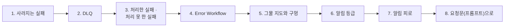
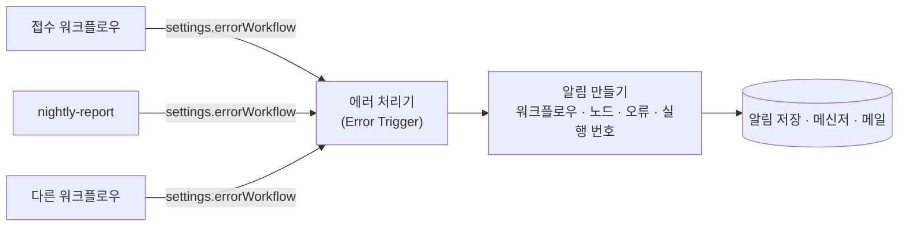

# 2단계 · 모으고 알리기

- 교시: 3교시 강의 (11:00~11:50) · 4교시 [Lab 02](../../Last3Mon/76/LAB-02-Q-COLLECT-AND-ALERT.md) 실습 5개 (12:00~12:50)
- 이 단계가 끝나면: 다시 하면 될 실패를 원래 요청 그대로 DLQ에 모으고, 예상하지 못한 오류를 Error Workflow로 알리고, 실패마다 어느 그물에 걸리는지 지도를 그려 구멍(DLQ가 멈출 때)을 찾아 막고, 알림의 등급과 양을 정해 알림 피로를 막을 수 있다.
- 숫자: 모두 강사 노트북 실측입니다 (10/29, 정답 워크플로우를 학생 순서대로 1회). 출력 전부는 수업 뒤 공개되는 `Last3Mon/76/answers/LAB-TEST-RESULT.md`에 있습니다.
- 실습 가리키기: "Lab 02 예제 1"은 4교시 [Lab 02 문서](../../Last3Mon/76/LAB-02-Q-COLLECT-AND-ALERT.md)의 그 절입니다.

## 0. 이 시간 (50분)

| 시간 | 절 · 개요 | 하는 일 |
| --- | --- | --- |
| 11:00~11:07 | 1 · 개요 15장 | 결과에만 남은 실패는 사라진다 |
| 11:07~11:15 | 2 · 개요 16장 | DLQ: 무엇을 · 왜 · 넣지 않을 것 |
| 11:15~11:25 | 3 · 4 · 개요 17~18장 | 처리한 · 처리하지 못한 실패, Error Workflow |
| 11:25~11:32 | 5 · 개요 19장 | 그물 지도, 감시자를 누가 감시하나 |
| 11:32~11:42 | 6 · 7 · 개요 20~21장 | 알림 등급, 알림 피로, 같은 알림은 한 번 |
| 11:42~11:50 | 8 · 9 · 확인 질문 | 요청문, 자주 하는 실수 |

### 4교시 Lab 02에서 이어서 하는 것

| 4교시 실습 (시각) | 이 강의의 절 | 실습에서 하는 일 | 쓰는 파일 · 명령 |
| --- | --- | --- | --- |
| Lab 02 예제 1 (12:00~12:12) | 1 · 2 | 실패한 요청은 원래 그대로 DLQ | `my-work/intake.json`, `fault tickets error`, 테스트 `cases/lab02.json` 앞 두 케이스, `ops` |
| Lab 02 예제 2 (12:12~12:24) | 3 · 4 | 에러 처리기 `errHandler76001`, `nightly-report`의 알림 | `my-work/error-handler.json`, 테스트 `cases/lab02.json` |
| Lab 02 예제 3 (12:24~12:30, 에이전트 없이) | 5 | 실패 넷이 어느 그물에, DLQ도 멈추면 | `test cases/lab02-nets.json -v` (5/7이 맞음) → `RUNBOOK.md` 1.3 |
| Lab 02 과제 1 (12:30~12:40) | 5 · 6 | 처리한 실패 high 알림, DLQ가 멈추면 critical | 테스트 `cases/lab02-challenge.json`, `lab02-nets` 7/7 |
| Lab 02 과제 2 (12:40~12:50) | 7 | 같은 이유의 high 알림은 10분에 한 번 | 테스트 `cases/lab02-challenge2.json` |

## 1. 결과에만 남은 실패는 사라진다 (4교시 Lab 02 예제 1)

### 일반 설명

> **생활 속 예 · 콜센터 전화.** 고객센터에 전화했더니 상담원이 "지금 시스템 장애라 접수가 안 됩니다. 나중에 다시 걸어 주세요"라고 하고 끊었습니다. 상담원은 정직하게 말했지만, 고객의 이름도 문의 내용도 **어디에도 적히지 않았습니다.** 고객이 다시 걸지 않으면 그 문의는 영영 사라집니다. 상담원이 메모지에 "김민지, 화면 공유 문제, 장애 끝나면 연락"이라고 적어 두기만 해도 달라집니다. 그 메모지가 DLQ입니다.

1단계에서 실패를 **결과에** 정직하게 남겼습니다 (`failed: 2`). 그런데 결과는 그 요청을 보낸 화면 · 프로그램에만 갑니다. 화면을 닫거나, 보낸 프로그램이 결과를 기록하지 않으면 실패도 함께 사라집니다. 오래가는 실패(API가 한 시간 멈춤)는 그 사이 들어온 요청을 **모두** 이렇게 잃습니다.

**실패한 일을 서버 쪽에 남겨야 합니다.** 그래야 원인을 고친 뒤 다시 할 수 있습니다. 이것이 DLQ이고, 3단계의 재처리가 그것을 꺼내 다시 돌립니다.

### 오늘 실습에서

- `fault tickets error` 동안 `my-intake`: 200 · `failed: 2`. `ops`의 DLQ 0 · 알림 0 — 두 문의(R-301 · R-302)는 응답 JSON 말고는 아무 데도 없습니다 (Lab 02 예제 1 고치기 전).

## 2. DLQ: 배달하지 못한 편지 보관함 (4교시 Lab 02 예제 1)

### 일반 설명

> **생활 속 예 · 택배 보관소.** 집에 아무도 없어 택배를 못 전하면 기사는 상자를 버리지 않고 **보관소**에 둡니다. 보관소에는 ① 상자 **그대로**(뜯거나 바꾸지 않음), ② **왜** 못 전했는지("수취인 부재"), ③ 몇 번째 배송 시도인지가 남습니다. 다음 날 **같은 상자를 다시** 배송하고, 전하면 보관소 목록에서 지웁니다. 하지만 "주소가 아예 없는 번지"인 상자는 보관해도 다시 배송할 수 없으니 보관소가 아니라 보낸 사람에게 돌려보냅니다 (오늘의 `rejected`).

**DLQ(dead letter queue)**는 처리하지 못한 메시지를 버리지 않고 옮겨 두는 곳입니다. 우체국이 주소가 틀린 편지를 따로 모아 두는 것(dead letter office)에서 온 이름입니다. 메시지 시스템마다 있습니다.

| 시스템 | DLQ |
| --- | --- |
| Amazon SQS | 큐마다 DLQ를 지정, 정해진 횟수(`maxReceiveCount`) 실패하면 옮김, 원래 큐로 되돌리기(redrive) |
| RabbitMQ | dead letter exchange: 거절 · 시간 초과 · 길이 초과 메시지를 다른 곳으로 |
| Apache Kafka (Kafka Connect 등) | 처리 실패 메시지를 따로 토픽(DLQ 토픽)에 |
| Azure Service Bus | 큐마다 dead-letter 하위 큐 |
| 오늘 데이터 API | `POST /dlq` · `GET /dlq` · `/dlq/update` |

**무엇을 넣나.**

| 넣는 것 | 까닭 |
| --- | --- |
| **원래 요청 그대로** | 재처리 때 같은 입구로 다시 보냄. 중간 결과(분류)는 그때 다시 만들어짐 |
| 실패 이유 | 사람이 원인을 앎 (`500 - tickets service is failing`, `timeout`) |
| 어디서 (워크플로우 · 단계) | DLQ 하나를 여러 워크플로우가 함께 쓸 때 |
| 몇 번째인지 (`attempts`) | 계속 실패하는 것을 가려냄 (3단계 parked) |
| 언제 | 오래된 것부터, 보관 기간 |

**넣지 않는 것.** 다시 해도 같은 실패(고칠 수 없는 실패: 빈 글 · 형식 오류)는 DLQ에 넣지 않고 그 자리에서 **거절**합니다. DLQ에 섞이면 재처리할 때마다 같은 실패가 되풀이되고, 정말 살려야 할 것이 묻힙니다. DLQ는 "**나중에 다시 하면 될 것**"만 모읍니다.

**개인정보 주의.** DLQ에는 원래 요청이 그대로 들어갑니다. 문의 글에 개인정보가 있으면 DLQ에도 있습니다 (73일차 가리기). 접근 권한과 보관 기간을 정하고, 재처리가 끝난 항목은 지웁니다.

**DLQ도 운영해야 합니다.** DLQ는 넣기만 하면 끝나는 곳이 아니라, 지켜보고 비워 가는 곳입니다.

| 운영할 것 | 까닭 | 흔한 방법 |
| --- | --- | --- |
| 크기 | 쌓이면 무언가 계속 실패 중 | 크기가 0보다 크면 알림 (오늘 high · 3단계 운영 상태) |
| 가장 오래된 것의 나이 | 재처리가 밀렸나 | "1시간 넘은 것이 있으면" 알림 |
| 보관 기간 | 개인정보 · 저장 공간 | SQS는 메시지 보관 기간을 정함 (최대 14일) |
| 재처리 도구 | 사람이 쉽게 되돌리게 | redrive 버튼 · 재처리 워크플로우 (3단계) |
| 이유별 수 | 같은 원인인가 | `reason`으로 묶어 세기 (77일차) |

- DLQ가 하나도 비지 않고 자라기만 한다면, 그것은 "잃지 않음"이 아니라 "**버리는 곳을 옮겼을 뿐**"입니다.

### 오늘 실습에서

- 고친 뒤 DLQ에 `D-1 R-301` · `D-2 R-302`가 원래 요청 · 이유 · `attempts 1`과 함께 (Lab 02 예제 1).
- 오늘 데이터 API는 같은 `item.id`가 다시 들어오면 새 줄 없이 `attempts`를 올립니다 (Lab 03에서 씀).

## 3. 처리한 실패와 처리하지 못한 실패

### 일반 설명

> **생활 속 예 · 집의 고장.** 우유가 떨어지는 것은 **예상한 일**입니다. 냉장고 앞 장보기 목록에 적어 두고 장 볼 때 삽니다 (처리한 실패 → 정해 둔 곳에 모음). 수도관이 갑자기 터지는 것은 **예상 못 한 일**입니다. 목록에 적을 일이 아니라 바로 관리실에 연락해야 합니다 (처리하지 못한 실패 → 마지막 그물이 사람을 부름). 둘을 같은 방법으로 다루면, 우유 때문에 관리실을 부르거나 터진 수도관을 장보기 목록에 적게 됩니다.

| | 처리한 실패 (handled) | 처리하지 못한 실패 (unhandled) |
| --- | --- | --- |
| 뜻 | 예상하고 갈 곳을 정해 둔 실패 | 예상하지 못해 워크플로우가 멈춘 실패 |
| 예 | API가 멈춤 → DLQ, 빈 글 → 거절 | 버그, 모르는 응답 모양, 누가 바꾼 설정 |
| 워크플로우 | 계속, 200 | **멈춤**, 500 |
| 알리는 곳 | 내가 만든 알림 (6절) | **Error Workflow** (n8n이 부름) |

**둘 다 있어야 합니다.** 처리한 실패만 있으면 예상하지 못한 버그는 아무도 모릅니다. 처리하지 못한 실패의 그물(Error Workflow)만 있으면 API가 멈출 때마다 워크플로우가 멈추고, 그 실행의 다른 항목도 함께 잃습니다. 예상한 것은 **그 자리에서**, 예상하지 못한 것은 **마지막 그물로**.

**프로그래밍 언어와 같은 구조입니다.** 코드에서 `try/catch`로 예상한 예외를 잡고, 잡지 못한 예외는 프로그램 전체의 처리기(웹 서버의 500 처리, 오류 추적 도구 Sentry 등)가 받아 기록 · 알림합니다. n8n에서는 노드의 `onError`가 `try/catch`, Error Workflow가 전체 처리기입니다.

## 4. Error Workflow: n8n이 부르는 마지막 그물 (4교시 Lab 02 예제 2)

### 일반 설명

> **생활 속 예 · 자동차 경고등.** 운전자는 차의 모든 고장을 미리 알 수 없습니다. 그래서 차는 엔진에 무슨 일이 생기든 **계기판에 경고등**을 켭니다. 경고등은 고장을 고치지 않습니다. 대신 "어디(엔진)가, 무엇이(온도 높음)" 문제인지 알려서 정비소에 가게 합니다. Error Workflow도 버그를 고치지 않습니다. 어느 워크플로우 · 어느 노드 · 무슨 오류인지 알림을 남겨 사람이 고치게 합니다. 서커스의 맨 아래 **안전망**처럼, 다른 장치가 모두 놓친 것을 받는 마지막 그물입니다.

**n8n의 Error Workflow.** 워크플로우 설정에 `errorWorkflow`(에러 처리기 워크플로우의 id)를 두면, 그 워크플로우가 처리하지 못한 오류로 멈출 때 n8n이 에러 처리기를 부릅니다. 에러 처리기는 **Error Trigger** 노드로 시작합니다.

| Error Trigger가 넘기는 것 | 알림에 | 쓰임 |
| --- | --- | --- |
| `workflow.name` · `workflow.id` | 어느 워크플로우 | 담당자 찾기 |
| `execution.lastNodeExecuted` | 어느 노드 | 고칠 곳 |
| `execution.error.message` | 무슨 오류 | 원인 짐작 |
| `execution.id` | 어느 실행 | n8n 화면 Executions에서 그 실행을 열어 노드마다 입력 · 출력을 봄 |

**처리기 하나를 여러 워크플로우가 함께 씁니다.** 그래서 처리기의 id를 고정하고(오늘 `errHandler76001`, 70일차 모듈처럼), 워크플로우마다 설정에 그 id를 적습니다. 처리기도 **게시**되어 있어야 합니다.

**알림은 응답 뒤에 갑니다.** Error Workflow는 실패한 실행이 끝난 **뒤에** 따로 돕니다. 부른 사람은 이미 500을 받았고, 알림은 1~3초 늦게 생깁니다.

**알림에 넣지 말 것.****에러 처리기가 할 수 있는 일.** 알림만이 아닙니다.

| 일 | 예 |
| --- | --- |
| 알림 | 메신저 · 메일 · 호출 (등급에 따라 다른 곳) |
| 기록 | 오류 기록 저장소 · 오류 추적 도구에 남김 (나중에 묶어 셈, 77일차) |
| 일감 만들기 | 같은 오류가 처음이면 이슈 · 티켓을 만듦 |
| 정리 | 반쯤 한 일을 되돌림 (보상 트랜잭션, saga) |

**에러 처리기도 실패합니다.** 처리기 안의 알림 HTTP가 실패하면 그 알림은 그냥 사라집니다. 그래서 처리기는 **아주 단순하게**(노드 몇 개, 외부 호출 하나) 두고, 처리기가 보낸 알림이 실제로 도착하는지는 따로 확인합니다 (가끔 일부러 오류를 내 보는 연습, 3단계).

 오류 문장에는 요청 내용 · 키 · 토큰이 섞일 수 있습니다 (73일차). 알림 채널(메신저)은 많은 사람이 봅니다. 길이를 자르고, 비밀은 지우고, 자세한 것은 실행 번호로 n8n에서 보게 합니다.

### 오늘 실습에서

- `nightly-report`(일부러 버그)는 고친 뒤에도 500입니다. 달라진 것은 3초 뒤 알림입니다:
  `[critical] 76 Nightly report (provided, has a bug) · unexpected · Count by category · rows is not iterable [line 4]` (Lab 02 예제 2).
- 수업 준비 때 확인: 에러 처리기를 **게시 해제**하면 n8n이 부르지 않아 알림이 0입니다.

## 5. 그물 지도와 구멍: 감시자를 누가 감시하나 (4교시 Lab 02 예제 3 · 과제 1)

### 일반 설명

> **생활 속 예 · 건전지가 다 된 화재경보기.** 화재경보기는 불을 알리는 장치입니다. 그런데 건전지가 다 되면 불이 나도 **조용합니다.** 그래서 경보기는 건전지가 떨어지면 따로 "삑" 소리를 냅니다. 감시하는 장치가 멈춘 것을 알리는 한 겹이 더 있는 것입니다. 오늘 DLQ가 멈추면 실패한 문의를 넣을 곳이 없는데 워크플로우는 조용히 끝났습니다. 택배 보관소 문이 잠겨 기사가 상자를 그냥 들고 돌아간 셈이니, 최소한 송장 번호(잃을 뻔한 id)를 메모로 남겨야 합니다.

**실패마다 어느 그물에 걸리는지 표로 그립니다.** 그물이 여럿이면 그물 **사이**에 구멍이 생기기 쉽습니다.

| 실패 | 그물 | 사람이 아는 방법 |
| --- | --- | --- |
| 잘못된 항목 | 결과의 `rejected` | 부른 쪽이 결과를 봄 |
| API 오류 | DLQ | 알림 (6절) |
| 버그 | Error Workflow | 알림 |
| **실패를 처리하는 장치의 실패** (DLQ 저장 실패, 알림 서버 장애) | ? | ? |

**처리하는 장치도 실패합니다.** DLQ에 넣는 HTTP 호출이 실패하면? 예제 1에서 "DLQ가 실패해도 응답은 나가게" `neverError`를 두었습니다. 그 결과 워크플로우는 멈추지 않고(→ Error Workflow도 안 불림), DLQ에도 없고, 결과는 `failed`만 말합니다. **조용히 잃습니다.** "감시자를 누가 감시하나(who watches the watchers)"라는 오래된 질문이 운영에서는 이렇게 나타납니다.

**구멍을 막는 방법.**

| 방법 | 오늘 |
| --- | --- |
| 처리 장치의 결과를 확인한다 (상태 코드가 아니라 본문의 `stored`) | 과제 1 |
| 실패하면 **다른 길**로 알린다 (더 높은 등급, 잃을 뻔한 id를 알림 안에) | 과제 1 `critical · dlq_down` |
| 결과에도 남긴다 | `dlq_saved: false` |
| 처리 장치 자체를 감시한다 (DLQ가 살아 있나, 알림이 오나) | 3단계 운영 상태 · 79일차 대시보드 |

### 오늘 실습에서

- 고치기 전 `fault tickets error` + `fault dlq error`에서 `batch-ok`: 200 · `failed: 3`, DLQ는 2건 그대로 — R-101~103이 **어디에도 남지 않음**, 알림 없음 (`lab02-nets` 5/7, Lab 02 예제 3).
- 고친 뒤: `dlq_saved: false` + `[critical] dlq_down` 알림 `DLQ save failed: dlq service is failing (fault switch) · lost ids R-201, R-203` (Lab 02 과제 1, `lab02-nets` 7/7).

## 6. 알림 등급: 무엇을 · 누구에게 · 얼마나 빨리 (4교시 Lab 02 과제 1)

### 일반 설명

> **생활 속 예 · 응급실의 환자 분류.** 응급실은 온 순서대로 보지 않습니다. 심장이 멈춘 환자는 **바로**, 팔이 부러진 환자는 **30분 안에**, 가벼운 감기는 **몇 시간 뒤**에 봅니다 (환자 분류, triage). 휴대폰도 급한 일은 전화로, 덜 급한 일은 문자로, 참고할 일은 앱 알림으로 옵니다. 알림 등급도 같습니다. `critical`(요청을 잃을 수 있음)은 지금 보고, `high`(DLQ에 쌓임)는 원인을 확인해 재처리하고, 거절 · 미분류는 알림 없이 보고서로 셉니다.

모든 알림이 같은 무게면 받는 사람은 무엇부터 볼지 모릅니다. 운영 조직은 알림에 **등급**(severity)을 두고, 등급마다 누가 · 몇 분 안에 · 무엇을 하는지 정합니다. 이름은 회사마다 다르지만(SEV1~4, P1~P5, critical · high · warning) 생각은 같습니다.

| 등급 | 오늘 | 받으면 | 예 (흔한 기준) |
| --- | --- | --- | --- |
| `critical` | 예상 못 한 오류, **요청을 잃을 수 있음** (DLQ 멈춤) | 바로 본다, 밤에도 깨운다 | 서비스 전체 장애, 데이터 손실 |
| `high` | DLQ에 쌓임, 계속 실패해 멈춤(parked) | 업무 시간 안에 원인 확인 · 재처리 | 일부 기능 실패, 자동 복구 실패 |
| (알림 없음) | 거절, 미분류 | 결과 · 보고서로 셈 | 사용자 실수, 대체로 처리됨 |

**알림은 "사람이 할 일이 있을 때만".** 자동으로 처리되었고 사람이 할 일이 없으면 알림이 아니라 **기록**(보고서 · 대시보드)입니다. 구글 SRE 책의 원칙도 같습니다: 알림(page)은 사람이 지금 무엇을 해야 하는 일에만.

**요청 하나에 알림 하나.****좋은 알림에 담을 것.**

| 담을 것 | 예 (오늘) | 없으면 |
| --- | --- | --- |
| 무엇이 · 어디서 | `workflow: intake` · `node: Send to DLQ` | 어느 시스템인지부터 찾음 |
| 얼마나 | `count: 2` | 한 건인지 천 건인지 모름 |
| 왜 (오류 문장, 짧게) | `500 - tickets service is failing` | 원인 짐작을 못 함 |
| 자세히 볼 곳 | `execution_id` | 처음부터 다시 찾음 |
| 사람이 할 일 | 런북 주소 · 절 (3단계) | 받은 사람이 할 일을 모름 |
| 잃을 수 있는 것 | `lost ids R-201, R-203` | 사람이 살릴 수 없음 |

 실패한 항목마다 알림을 보내면 50건 실패에 알림 50개입니다. 같은 원인이면 **하나로 묶고 개수**(`count`)를 담습니다.

### 오늘 실습에서

- 실패 2건 → high 알림 **하나** `count 2`. 실패가 없으면 `alert: none`, 알림 수 그대로 (Lab 02 과제 1).

## 7. 알림 피로: 같은 알림은 한 번, 대신 숨기지 않기 (4교시 Lab 02 과제 2)

### 일반 설명

> **생활 속 예 · 양치기 소년과 단톡방.** "늑대다!"를 매일 외친 소년의 말은, 정말 늑대가 왔을 때 아무도 믿지 않았습니다. 매일 밤 울리는 주차장 자동차 경보에는 아무도 창문을 열어 보지 않습니다. 하루 수백 개가 오는 단톡방은 결국 알림을 꺼 버립니다. 알림이 많으면 안전한 것이 아니라 **아무도 보지 않게 됩니다.** 그래서 같은 일은 한 번만 알리고 (10분에 한 번), 정말 급한 일(`critical`)은 늘 알립니다. 단톡방 알림을 꺼도 대화 기록은 남는 것처럼, 줄이는 것은 알림이지 기록(DLQ)이 아닙니다.

**알림 피로(alert fatigue).** 알림이 너무 많으면 사람은 알림을 보지 않게 됩니다. 병원의 의료 기기 경보가 너무 자주 울려 간호사가 무뎌지는 문제로 처음 널리 알려졌고, IT 운영에서도 같은 일이 일어납니다. 그러면 정말 급한 알림도 묻힙니다.

**같은 문제는 한 번.** 운영 도구(Prometheus Alertmanager · PagerDuty · Opsgenie 등)는 이렇게 줄입니다.

| 방법 | 뜻 | 오늘 |
| --- | --- | --- |
| 중복 없애기 (deduplication) | 같은 알림이 이미 열려 있으면 새로 만들지 않음 | 같은 `reason`이 10분 안에 있으면 보내지 않음 |
| 묶기 (grouping) | 같은 원인의 알림을 하나로 | 요청 하나에 하나 · `count` |
| 반복 간격 (repeat interval) | 해결될 때까지 정해진 간격으로만 다시 | 10분 |
| 억누르기 (inhibition) | 더 큰 알림이 있으면 작은 것은 숨김 | (오늘은 안 함) |

**줄이는 것은 알림이지 기록이 아닙니다.****알림 피로를 재는 법.** 알림이 너무 많은지는 느낌이 아니라 숫자로 봅니다.

| 볼 숫자 | 뜻 |
| --- | --- |
| 하루 · 한 주 알림 수 | 사람이 다 볼 수 있는 양인가 |
| 할 일이 없었던 알림의 비율 | 높으면 알림이 아니라 기록이어야 함 |
| 같은 원인의 반복 수 | 묶기 · 반복 간격이 필요함 |
| 알림 → 사람이 확인하기까지 | 늘어나면 이미 무뎌짐 |

구글 SRE 책은 당번(on-call) 한 번에 처리할 사건 수를 적게 유지하라고 권합니다. 사건이 너무 많으면 알림을 줄이거나 원인을 고치는 일이 먼저입니다.

 보내지 않은 알림도 결과에 `suppressed`로 남기고, 실패한 요청은 **DLQ에 모두** 남깁니다. 그리고 critical은 줄이지 않습니다: DLQ가 멈춘 알림을 10분에 한 번만 보내면, 그 10분 동안 잃을 뻔한 id가 알림에 남지 않습니다.

### 오늘 실습에서

| | 고치기 전 | 고친 뒤 |
| --- | --- | --- |
| 10분 안에 두 번째 실패 | `alert: sent`, dlq 알림 2 | `alert: suppressed`, dlq 알림 1 |
| DLQ | 5건 | **5건 모두** |
| DLQ 멈춤 (critical) | `sent` | `sent` (늘) |

## 8. 요청문(프롬프트)으로 에이전트에게 맡기기

| 넣을 것 | 예 |
| --- | --- |
| 언제 · 어디로 | "`failed`가 1 이상일 때만 `POST /dlq`, 본문 `{items: [{item: 원래 요청, reason, workflow}]}`" |
| 넣지 않을 것 | "`rejected`는 넣지 않는다" |
| 처리 장치가 실패하면 | "DLQ 응답에 `stored`가 없으면 critical `dlq_down`, 잃을 뻔한 id를 message에" |
| 처리기의 고정 id · 설정 | "파일 맨 위 `"id": "errHandler76001"`, 부르는 쪽 `settings.errorWorkflow`" |
| 알림 모양 · 등급 · 수 | "요청 하나에 하나, `{workflow, severity, reason, count, message}`" |
| 줄이는 규칙 | "같은 `reason`의 high가 10분 안에 있으면 보내지 않고 `suppressed`, critical은 늘" |
| 읽기는 읽기로 | "확인은 `/alerts/list` (POST `/alerts`는 알림을 만든다)" |

## 9. 자주 하는 실수

| 실수 | 결과 | 바로잡기 |
| --- | --- | --- |
| 거절도 DLQ에 | 재처리 때마다 같은 실패 | DLQ는 다시 하면 될 것만 |
| 분류 결과 등 중간 값을 DLQ에 | 재처리 때 원래 요청을 모름 | 원래 요청 그대로 |
| 처리기를 게시하지 않음 · id가 다름 | 알림 0 | `"id"` 고정 · push |
| `neverError`만 두고 끝 | DLQ가 멈추면 조용히 잃음 | 본문 확인 · critical |
| 항목마다 알림 | 50건에 50개 → 아무도 안 봄 | 요청 하나에 하나 · `count` |
| 알림을 줄이려고 DLQ에서도 뺌 | 실패를 숨김 | 알림만 줄이고 기록은 그대로 |
| 테스트가 `POST /alerts`로 확인 | 확인이 알림을 만듦 | 읽기 전용 `/alerts/list` |

## 확인 질문

1. DLQ에 무엇을 넣고, 무엇을 넣지 않나요? 왜요?

원래 요청 그대로와 실패 이유 · 워크플로우를 넣습니다. 재처리 때 같은 입구로 다시 보내기 위해서입니다. 다시 해도 같은 실패(빈 글 같은 거절)는 넣지 않습니다. 섞이면 재처리할 때마다 되풀이되고 살려야 할 것이 묻힙니다.

2. DLQ가 있는데 Error Workflow도 필요한 까닭은?

DLQ는 예상한 실패(API가 멈춤)를 그 자리에서 처리한 것입니다. 버그처럼 예상하지 못한 오류는 워크플로우를 멈추게 하고, 그때는 n8n이 부르는 Error Workflow만 알 수 있습니다. 오늘 `nightly-report`의 버그는 처리기 없이는 알림 0, 처리기를 게시한 뒤 3초 만에 critical 알림이 생겼습니다.

3. DLQ 저장이 실패하면 오늘 워크플로우는 어떻게 되었고, 어떻게 막았나요?

DLQ 노드에 `neverError`를 두었기 때문에 워크플로우는 멈추지 않았고(Error Workflow도 안 불림), 세 요청은 DLQ에도 없고 결과도 `failed`만 말했습니다. DLQ 응답의 `stored`를 확인해, 없으면 critical `dlq_down` 알림에 잃을 뻔한 id를 적고 결과에 `dlq_saved: false`를 남겨 막았습니다.

4. 알림을 줄이면 위험하지 않나요?

줄이는 것은 같은 문제의 반복 알림이지, 실패의 기록이 아닙니다. 오늘 두 번째 실패의 알림은 `suppressed`로 결과에 남고, DLQ에는 5건 모두 있습니다. 그리고 critical은 줄이지 않습니다. 알림이 너무 많으면 사람이 알림을 끄게 되고, 그것이 더 위험합니다.

