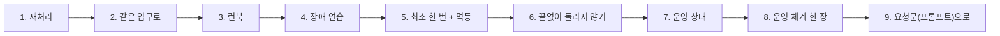
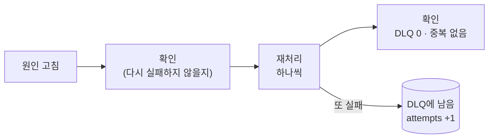
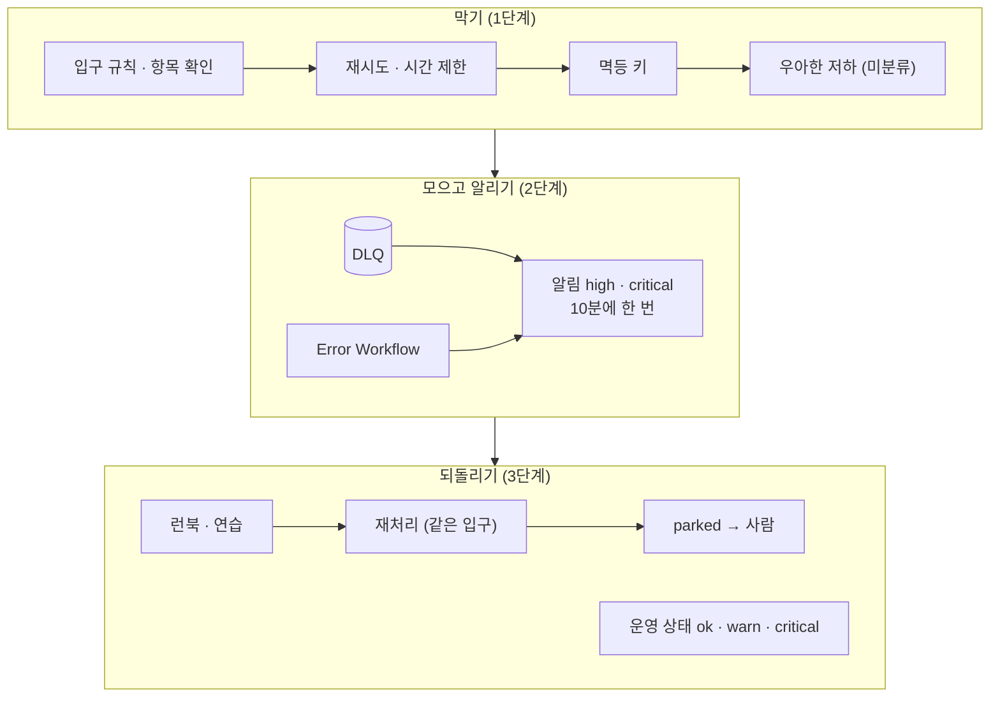

# 3단계 · 재처리와 운영 체계

- 교시: 5교시 강의 (14:00~14:50) · 6교시 [Lab 03](../../Last3Mon/76/LAB-03-Q-REPLAY-AND-RUNBOOK.md) 실습 5개 (15:00~15:50)
- 이 단계가 끝나면: 원인을 고친 뒤 DLQ의 요청을 같은 입구로 중복 없이 다시 돌리고, 알림을 받았을 때 할 일을 런북으로 써서 짝과 장애 연습을 하고, 반쯤 처리된 요청도 재처리가 안전한 까닭을 말하고, 계속 실패하는 요청은 정해진 횟수 뒤 사람에게 넘기고, "지금 괜찮은가"를 한 번에 알려 주는 상태 웹훅을 만들 수 있다.
- 숫자: 모두 강사 노트북 실측입니다 (10/29, 정답 워크플로우를 학생 순서대로 1회). 출력 전부는 수업 뒤 공개되는 `Last3Mon/76/answers/LAB-TEST-RESULT.md`에 있습니다.
- 실습 가리키기: "Lab 03 예제 1"은 6교시 [Lab 03 문서](../../Last3Mon/76/LAB-03-Q-REPLAY-AND-RUNBOOK.md)의 그 절입니다.



## 0. 이 시간 (50분)

| 시간 | 절 · 개요 | 하는 일 |
| --- | --- | --- |
| 14:00~14:08 | 1 · 2 · 개요 22장 | 재처리(redrive), 같은 입구로 다시 |
| 14:08~14:18 | 3 · 4 · 개요 23~24장 | 런북, 장애 연습 (game day) |
| 14:18~14:25 | 5 · 개요 25장 | 최소 한 번 + 멱등 = 결과는 한 번 |
| 14:25~14:33 | 6 · 개요 26장 | 최대 시도 수, parked, 사람에게 넘기기 |
| 14:33~14:40 | 7 · 개요 27장 | 운영 상태, health check · status page |
| 14:40~14:50 | 8 · 9 · 10 · 개요 28장 · 확인 질문 | 운영 체계 한 장, 요청문, 자주 하는 실수 |

### 6교시 Lab 03에서 이어서 하는 것

| 6교시 실습 (시각) | 이 강의의 절 | 실습에서 하는 일 | 쓰는 파일 · 명령 |
| --- | --- | --- | --- |
| Lab 03 예제 1 (15:00~15:12) | 1 · 2 | 재처리 `my-replay` | `my-work/replay.json`, 테스트 `cases/lab03.json` |
| Lab 03 예제 2 (15:12~15:24, 에이전트 없이) | 3 · 4 | 런북 쓰기 · 짝 연습 | `RUNBOOK.md` 2 · 3절, `test cases/lab03-drill.json -v` |
| Lab 03 예제 3 (15:24~15:30, 에이전트 없이) | 5 | 반쯤 처리된 요청을 재처리 | `test cases/lab03-half.json -v` |
| Lab 03 과제 1 (15:30~15:40) | 6 | 세 번 실패하면 parked | 테스트 `cases/lab03-challenge.json` |
| Lab 03 과제 2 (15:40~15:50) | 7 | 운영 상태 `my-ops-status` | `my-work/ops-status.json`, 테스트 `cases/lab03-challenge2.json` |

## 1. 재처리: 모은 것은 다시 돌려야 끝난다 (6교시 Lab 03 예제 1)

### 일반 설명

> **생활 속 예 · 택배 재배송.** 보관소에 둔 택배는 보관만 해서는 일이 끝나지 않습니다. 받는 사람이 집에 있는 날 **다시 배송**하고, 전하면 보관소 목록에서 **지워야** 끝납니다. 다시 배송하다 또 부재면 목록에 그대로 두고 다음에 또 시도합니다. 재처리는 DLQ(보관소)의 요청을 원인이 고쳐진 뒤 다시 돌리는 이 재배송입니다.

DLQ는 실패를 잃지 않게 해 줄 뿐, 일을 끝내 주지는 않습니다. 원인(API 장애)을 고친 뒤 모아 둔 요청을 **다시 돌려야** 문의가 접수됩니다. 이것을 재처리(replay, reprocess)라고 하고, 메시지 큐에서는 DLQ의 메시지를 원래 큐로 되돌린다는 뜻으로 redrive라고 부릅니다 (Amazon SQS의 DLQ redrive).

**재처리의 순서.**



| 원칙 | 까닭 |
| --- | --- |
| **원인을 고친 뒤에** | 고치기 전에 돌리면 또 실패하고 `attempts`만 오름 (6절) |
| **하나씩** (또는 작은 묶음으로) | 하나가 실패해도 다른 것은 됨, 어느 것이 실패했는지 보임 |
| **성공한 것만 지운다** | 실패한 것은 남아 다음 재처리 · 사람이 봄 |
| **천천히** | 쌓인 수천 건을 한꺼번에 보내면 막 살아난 서비스가 다시 쓰러짐 |
| 재처리 전후로 **센다** | DLQ 수 · 접수 건 수 · 중복 |

**언제 돌리나.** 사람이 원인을 확인하고 손으로(오늘), 정해진 시간마다 자동으로(Schedule Trigger), 또는 상태가 좋아지면 자동으로. 자동으로 돌릴수록 6절의 "끝없이 돌리지 않기"가 더 중요합니다.

| 언제 돌리나 | 좋은 점 | 조심할 것 |
| --- | --- | --- |
| 사람이 손으로 (오늘) | 원인을 확인한 뒤라 안전 | 사람이 잊으면 쌓임 |
| 정해진 시간마다 (Schedule Trigger) | 잊지 않음 | 원인이 안 고쳐졌으면 또 실패 → `attempts`만 |
| 상태가 좋아지면 자동으로 | 빠름 | "좋아졌다"를 무엇으로 판단하나 (health check · 시험 요청 하나) |

**순서가 중요한 일.** 접수는 순서가 바뀌어도 괜찮지만, "주소 바꾸기 → 배송"처럼 순서가 중요한 일은 재처리가 순서를 뒤집으면 안 됩니다 (예전 주소로 배송). 그런 일은 같은 대상(같은 사람 · 주문)의 요청을 묶어 차례대로 재처리하거나, 최신 상태를 다시 읽고 처리합니다.

### 오늘 실습에서

- 고치기 전: `my-replay`가 없어 404, DLQ 2 · 접수 건 0.
- 고친 뒤: `replayed: 2, ok: 2` (1.1초), DLQ 0, 접수 건 2 — 중복 없음. 한 번 더 돌리면 `replayed: 0` (Lab 03 예제 1).

## 2. 새로 만들지 말고 같은 입구로 다시 보내기

### 일반 설명

> **생활 속 예 · 은행 창구.** 은행 마감 뒤 맡겨 둔 서류를 다음 날 처리할 때, 직원이 "어제 거니까"라며 뒷문으로 신분 확인 · 서명 없이 처리하면 안 됩니다. **같은 창구, 같은 절차**(신분 확인 → 서명 → 처리)를 거쳐야 합니다. 뒷문 절차를 따로 만들면 언젠가 두 절차가 달라져, 어제 서류만 확인이 빠지는 구멍이 생깁니다. 재처리가 접수 건을 직접 만들지 않고 `my-intake`(같은 창구)로 다시 보내는 까닭입니다.

**재처리가 일을 직접 하면 규칙이 둘이 됩니다.** 재처리 워크플로우가 접수 건을 직접 만들면 항목 확인 · 분류 · 멱등 키 · DLQ · 알림을 또 만들어야 하고, 언젠가 두 곳의 규칙이 달라집니다 (원래 입구는 고쳤는데 재처리는 옛 규칙). 그래서 재처리는 원래 요청을 **원래 입구로** 다시 보냅니다. 70일차에 공통 모듈을 하나 두고 여러 곳에서 부른 것과 같은 생각입니다.

| 재처리가 | 장점 | 단점 |
| --- | --- | --- |
| 원래 입구(`my-intake`)를 다시 부름 | 규칙이 하나, 재처리도 같은 키 · 알림 · DLQ | 입구가 받을 수 있는 모양이어야 함 |
| 일을 직접 함 | 빠를 수 있음 | 규칙이 둘, 하나만 고치는 사고 |

**성공은 결과로 판단합니다.** `my-intake`는 부분 성공이라 늘 200입니다. HTTP 상태가 아니라 결과의 `created`로 판단합니다.

## 3. 런북: 그때 할 일을 미리 써 두기 (6교시 Lab 03 예제 2)

### 일반 설명

> **생활 속 예 · 비행기 비상 체크리스트와 엘리베이터 안내문.** 조종사는 엔진에 불이 나면 기억에 의존하지 않고 **비상 체크리스트**를 펴서 한 줄씩 따라 합니다. 아무리 숙련된 조종사도 급할 때는 단계를 빠뜨리기 때문입니다. 엘리베이터 안에는 "갇혔을 때: ① 비상벨을 누른다 ② 관리실 ○○○-○○○○ ③ 문을 억지로 열지 않는다"가 붙어 있습니다. 처음 탄 사람도 따라 할 수 있고, **하지 말 것**까지 적혀 있습니다. 런북은 알림 하나에 대한 이런 안내문입니다.

**런북(runbook)**은 특정 알림 · 장애가 났을 때 할 일을 순서대로 적은 문서입니다. 플레이북(playbook)이라고도 부릅니다. 장애는 대개 바쁠 때, 밤에, 그 시스템을 만든 사람이 없을 때 납니다. 그때 머릿속으로 떠올리면 단계를 빠뜨리고, 급한 마음에 하지 말아야 할 일(DLQ 비우기)을 합니다. 구글 SRE 책은 미리 써 둔 플레이북이 장애 회복 시간(MTTR)을 약 세 배 줄인다고 말합니다.

**좋은 런북의 모양.**

| 갖출 것 | 나쁜 예 | 좋은 예 |
| --- | --- | --- |
| 어느 알림에 대한 것인지 | "장애 대응" | "`high · dlq` 알림을 받으면" |
| 명령을 그대로 | "DLQ를 확인한다" | `uv run tools/flow.py ops` |
| 확인은 무엇을 보면 되는지 | "정상인지 확인" | "`ops`의 DLQ 0, 같은 key가 둘이 아닌지" |
| 갈림길 | (없음) | "`critical · unexpected`면 코드 담당에게, `high · dlq`면 3번으로" |
| **하지 말 것** | (없음) | "DLQ를 비우지 말 것 — 재처리할 요청이 사라짐", "parked를 자동으로 돌리지 말 것" |
| 누구 · 언제까지 | (없음) | "1차 대응 ○○, 30분 안에 / parked는 데이터 담당이 다음 업무일까지" |
| 마지막으로 고친 날 | (없음) | 시스템이 바뀌면 런북도 바뀜 |

**알림과 런북을 잇습니다.****런북의 뼈대 (오늘 `RUNBOOK.md`와 같음).**

```text
제목: high · dlq 알림을 받으면 (마지막으로 고친 날: 2026-10-30)
1. 확인   — 명령 · 볼 숫자
2. 나누기 — 알림의 reason · severity에 따라 갈림길
3. 원인   — 누구에게 묻나 · 무엇을 보나
4. 고침   — (오늘은 고장 스위치)
5. 되돌리기 — 재처리 명령
6. 확인   — DLQ 0 · 같은 key 없음 · 운영 상태 ok
하지 말 것 — DLQ 비우기 · parked 자동 재처리 · 급한 배포
누가 · 언제까지 — 1차 대응 · 데이터 담당 · parked 결정
```

 알림 메시지에 런북의 주소(또는 절 번호)를 넣으면, 알림을 받은 사람이 바로 할 일로 갑니다. 많은 회사가 알림 규칙마다 `runbook_url`을 붙입니다.

### 오늘 실습에서

- `ops` 한 번에 DLQ 2건과 알림 둘: `[high] intake · dlq · count 2`, `[critical] … unexpected · rows is not iterable`. **원인이 다른 두 알림**입니다 (Lab 03 예제 2).
- 고장 스위치를 되돌리고 재처리하자 DLQ 0 · 접수 건 2. 그런데 critical 알림은 남았습니다 — 버그는 재처리로 고쳐지지 않습니다. 런북에 갈림길이 있어야 하는 까닭입니다.

## 4. 장애 연습: 써 둔 런북이 맞는지 일부러 장애를 내 본다

### 일반 설명

> **생활 속 예 · 소방 훈련.** 학교와 회사는 불이 나지 않았는데도 일부러 경보를 울리고 모두 대피해 봅니다. 해 보면 "비상구 앞에 상자가 쌓여 있다", "3층 경보가 안 들린다", "모이는 곳을 모르는 사람이 있다" 같은 문제가 **불이 나기 전에** 드러납니다. 대피 안내문(런북)은 써 둔 것만으로는 맞는지 모릅니다. 오늘 짝 연습에서 한 사람이 일부러 장애를 내고 다른 사람이 런북만 보고 대응하는 것이 이 소방 훈련입니다.

런북은 써 두기만 하면 틀린 줄을 모릅니다. **일부러 장애를 내고, 다른 사람이 런북만 보고 대응**해 봐야 빠진 단계가 드러납니다.

| 이름 | 무엇 |
| --- | --- |
| 장애 연습 (game day, fire drill) | 정해진 날 정해진 장애를 내고 팀이 대응해 봄 |
| 카오스 엔지니어링 | 운영 환경에서 일부러 고장(서버 끄기 · 지연)을 내 약한 곳을 찾음. Netflix의 Chaos Monkey가 유명 |
| 사후 검토 (postmortem) | 장애가 끝난 뒤 무엇이 · 왜 · 다음엔 어떻게를 **탓하지 않고**(blameless) 적음 |

**사후 검토에서 묻는 것.** 장애나 연습이 끝나면 짧게라도 적습니다. "누가 잘못했나"가 아니라 "**시스템과 절차의 무엇이 이것을 가능하게 했나**"를 묻습니다 (탓하지 않는 사후 검토).

| 질문 | 오늘 연습이라면 |
| --- | --- |
| 무슨 일이 언제 있었나 (시간 순서) | 장애 시작 · 알림 · 알아챔 · 고침 · 재처리 |
| 영향은 | 문의 몇 건이 몇 분 늦었나, 잃은 것은 없나 |
| 왜 알아채는 데 그만큼 걸렸나 | 알림은 있었나, 누가 봤나 |
| 무엇이 잘 됐나 | DLQ · 키 덕분에 잃지 않고 중복 없음 |
| 다음에 바꿀 것 (담당 · 기한) | 런북에 갈림길 더하기 |

**연습에서 재는 것.**

| 잴 것 | 뜻 |
| --- | --- |
| 알아채기까지 (MTTD) | 장애 시작 → 사람이 앎 |
| 회복까지 (MTTR) | 장애 시작 → 다시 정상 |
| 런북에 없던 단계 | 다음 판 런북에 더할 것 |

### 오늘 실습에서

- 짝 연습: 한 사람이 `fault tickets error` · `call my-intake` · `call nightly-report`, 다른 사람이 런북만 보고 `ops → fault ok → my-replay → ops`. `RUNBOOK.md` 3절에 시간과 빠진 단계를 적습니다.
- 같은 연습을 테스트로: `lab03-drill` 7/7, 접수 건 5 (평소 3 + 재처리 2), 중복 없음 (Lab 03 예제 2).

## 5. 최소 한 번 + 멱등 = 결과는 한 번 (6교시 Lab 03 예제 3)

### 일반 설명

> **생활 속 예 · 엘리베이터 버튼.** 급한 사람은 엘리베이터 버튼을 여러 번 누릅니다. 그래도 엘리베이터는 한 대만 옵니다. 버튼이 "이미 불렀음"을 기억하기 때문입니다 (멱등). 누르는 쪽이 "한 번만 눌러야지"를 지키게 하는 것보다, **받는 쪽이 여러 번 눌러도 한 번만 처리**하게 만드는 편이 훨씬 쉽고 확실합니다. 재시도 · 재처리가 있으면 같은 요청이 여러 번 갈 수 있으니 (최소 한 번), 받는 쪽을 이 버튼처럼 만듭니다 (멱등 키).

**전달 보장의 세 가지.** 메시지 · 요청을 보내는 시스템은 보통 셋 중 하나를 약속합니다.

| 보장 | 뜻 | 대가 |
| --- | --- | --- |
| 최대 한 번 (at-most-once) | 다시 보내지 않음 | 실패하면 **잃음** |
| 최소 한 번 (at-least-once) | 될 때까지 다시 보냄 | 같은 것이 **두 번 이상** 갈 수 있음 |
| 정확히 한 번 (exactly-once) | 꼭 한 번 | 네트워크 너머에서는 매우 어려움 (특별한 저장 · 조정 필요) |

오늘 재시도 · DLQ · 재처리는 **최소 한 번**입니다. 잃지 않는 대신 같은 요청이 두 번 이상 갈 수 있습니다. 1단계 5절의 시간 초과처럼, DLQ에 들어간 요청이 **사실은 이미 처리된 것**일 수도 있습니다. 그래서 받는 쪽을 **멱등**하게 만들어 "여러 번 가도 결과는 한 번"을 만듭니다. 실무에서 "effectively once"라고 부르는 방식입니다.


### 오늘 실습에서

- `slow`에서 11.6초 뒤 `failed: 2`, DLQ 2건. 8초 뒤 접수 건 **이미 2개** (데이터 API가 늦게 처리) — 같은 문의가 DLQ에도, 접수 건에도.
- 재처리: `replayed: 2, ok: 2, duplicates: 2`, 접수 건 2개 그대로 (Lab 03 예제 3). 1단계의 멱등 키가 재처리까지 지켜 줬습니다.

## 6. 끝없이 돌리지 않기: 최대 시도 수와 사람에게 넘기기 (6교시 Lab 03 과제 1)

### 일반 설명

> **생활 속 예 · 택배 반송과 비밀번호 잠금.** 택배는 재배송을 무한히 하지 않습니다. 몇 번 시도해도 못 전하면 멈추고 **보낸 사람에게 연락**합니다. 은행 앱은 비밀번호를 5번 틀리면 잠기고, 그다음은 **창구에서 사람이** 확인합니다. 자동으로 다시 하는 데에는 끝이 있어야 하고, 그 끝은 "포기"가 아니라 "사람에게 넘기기"입니다. 오늘의 `parked`가 이것입니다.

**원인이 고쳐지지 않은 요청을 계속 돌리면 독이 됩니다.** 매번 API를 두드리고, 알림이 쌓이고, 새로 들어온 실패가 묻힙니다. 어떤 요청은 영영 성공하지 못합니다 (데이터 API가 받지 않는 내용, 지워진 사용자). 그런 메시지를 "독 메시지(poison message)"라고 부릅니다.

**정해진 횟수 뒤 따로 빼기.**

| 시스템 | 방법 |
| --- | --- |
| Amazon SQS | `maxReceiveCount`를 넘으면 DLQ로 |
| 많은 작업 큐 (Sidekiq · Celery 등) | 최대 재시도 뒤 "죽은 작업" 목록으로 |
| 오늘 | `attempts ≥ 3`이면 다시 보내지 않고 `parked: true` + high 알림 |

**사람에게 넘기기 (human in the loop).****parked를 받은 사람이 하는 결정.**

| 보이는 것 | 결정 |
| --- | --- |
| 요청 자체가 이상함 (영영 받지 않을 글) | 요청한 사람에게 돌려보내고 DLQ에서 지움 (거절로 바꿈) |
| 데이터 API의 다른 문제 (권한 · 설정) | 그쪽을 고친 뒤 parked를 풀어 재처리 |
| 이미 다른 길로 처리됨 (전화로 접수) | 기록을 남기고 지움 |
| 모르겠음 | 담당에게 넘기고 기한을 정함 (런북 4절) |

 parked는 "포기"가 아니라 "**자동으로는 여기까지, 이제 사람이**"입니다. 사람이 보고 요청을 고치거나, 데이터 API의 다른 문제를 고치거나, 정말 버릴지 정합니다. 그래서 parked는 지우지 않고, 런북에 **누가 · 언제까지**를 적습니다.

**몇 번이 좋은가.** 숫자 자체보다 **간격 × 횟수 = 포기하기까지 걸리는 시간**으로 정합니다.

| 재처리 간격 | 3번이면 | 맞는 경우 |
| --- | --- | --- |
| 1분마다 (자동) | 3분 | 잠깐의 장애가 대부분일 때 |
| 1시간마다 (자동) | 3시간 | 공급자 장애가 몇 시간 갈 수 있을 때 |
| 하루 한 번 (사람) | 3일 | 담당자가 확인하고 돌릴 때 |

### 오늘 실습에서

| | 고치기 전 | 고친 뒤 |
| --- | --- | --- |
| 재처리 3 (`attempts` 3) | 또 보냄 `replayed: 2` (2.0초) | **0.1초** `parked: 2`, `[high] parked` |
| 고친 뒤 재처리 | 자동으로 다시 보냄 | `replayed: 0` (사람이 보기 전에는 안 돌림) |

## 7. 운영 상태: "지금 괜찮은가"를 한 번에 (6교시 Lab 03 과제 2)

### 일반 설명

> **생활 속 예 · 미세먼지 예보와 자동차 계기판.** 미세먼지 앱은 측정값 여럿(PM10 · PM2.5 · 오존)을 늘어놓지 않고 **좋음 · 보통 · 나쁨**과 "마스크를 쓰세요"를 먼저 보여 줍니다. 자동차 계기판도 숫자 대신 초록 · 노랑 · 빨강 등을 켭니다. 처음 보는 사람도 "지금 괜찮은가, 무엇을 해야 하나"를 바로 압니다. 운영 상태 웹훅은 DLQ · parked · 알림 숫자를 이 신호등(`ok` · `warn` · `critical`)과 까닭으로 줄입니다.

**상태 확인(health check).** 운영 중인 서비스는 대개 "살아 있나 · 일할 수 있나"를 알려 주는 주소를 둡니다. 쿠버네티스는 그 주소(liveness · readiness probe)로 컨테이너를 다시 띄울지, 요청을 보낼지 정합니다. 많은 회사가 고객이 보는 **상태 페이지(status page)**도 둡니다 (정상 · 일부 장애 · 장애).

**숫자 여럿을 신호 하나로.** 사람에게는 DLQ 수 · parked 수 · 알림 수를 각각 주는 것보다 **신호등 하나와 까닭**이 빠릅니다.

| 신호 | 기준 (오늘) | 사람이 할 일 |
| --- | --- | --- |
| `ok` | 아래 둘 다 아님 | — |
| `warn` | parked가 아닌 DLQ가 있음, 10분 안 high 알림 | 원인을 고친 뒤 재처리 |
| `critical` | parked가 있음, 10분 안 critical 알림 | 지금 봄 · 담당에게 |

- 더 나쁜 쪽을 먼저 봅니다 (둘 다 맞으면 `critical`). 까닭(`reasons`)은 맞는 것을 모두 적습니다.

**무엇을 묻는 상태인가.** 상태 확인에도 종류가 있습니다.

| 종류 | 묻는 것 | 예 |
| --- | --- | --- |
| 살아 있나 (liveness) | 프로그램이 멈추지 않았나 | 데이터 API `/health` → 다시 띄울지 |
| 받을 수 있나 (readiness) | 지금 요청을 받아도 되나 | DB 연결 · 의존 서비스 확인 → 요청을 보낼지 |
| 일이 잘 되나 (오늘) | 실패가 쌓였나 · 사람이 볼 일이 있나 | `my-ops-status` → 사람이 무엇을 할지 |

오늘 데이터 API의 `/health`는 고장 스위치가 켜져 있어도 `ok`입니다 (살아 있기는 하니까). 그래서 "살아 있다"만으로는 "일이 잘 된다"를 말할 수 없고, 오늘 만든 운영 상태가 따로 필요합니다.

**확인은 상태를 바꾸지 않습니다.** 상태를 묻는 것이 DLQ나 알림을 바꾸면, 묻는 횟수에 따라 결과가 달라집니다. 2단계에서 테스트가 `/alerts`에 POST해 빈 알림을 만든 일이 그 예입니다. 상태 웹훅은 **읽기만** 합니다.

### 오늘 실습에서

- `ok` → 실패 2건 뒤 `warn` (DLQ 2, "원인을 고친 뒤 재처리") → 버그 뒤 `critical` (critical 1) → 재처리 · 알림 확인 뒤 `ok` (Lab 03 과제 2, 7/7). 상태 웹훅은 0.1초 안팎 (읽기만, LLM 없음).
- Lab 02 과제 2 테스트가 남긴 상태를 읽으면 `critical` · DLQ 5 · 까닭 셋 (`critical 알림 1건 (10분)`, `DLQ 5건: 원인을 고친 뒤 재처리`, `high 알림 1건 (10분)`).

## 8. 운영 체계 한 장

오늘 하루 만든 것을 모으면 하나의 체계입니다.

> **생활 속 예 · 택배 회사로 본 오늘 하루.** 오늘 만든 것은 모두 택배 회사에 이미 있습니다.
>
> | 오늘 만든 것 | 택배 회사에서는 |
> | --- | --- |
> | 부분 성공 (항목마다 상태) | 상자마다 배송 조회 |
> | 입구 규칙 · 거절 | 접수 창구에서 주소 없는 상자를 바로 돌려줌 |
> | 재시도 | 벨을 한 번 더 누름 |
> | 멱등 키 | 송장 번호 (같은 상자를 두 번 배달하지 않음) |
> | 우아한 저하 | 분류기가 고장 나도 손으로 분류해 배송은 계속 |
> | DLQ | 부재 시 보관소 |
> | Error Workflow | 사고 나면 본사 상황실로 자동 보고 |
> | 알림 등급 · 폭주 막기 | 사고는 즉시 전화, 지연은 하루 한 번 요약 |
> | 재처리 | 다음 날 재배송 |
> | parked | 세 번 부재면 보낸 사람에게 연락 |
> | 런북 · 장애 연습 | 사고 대응 매뉴얼 · 정기 훈련 |
> | 운영 상태 | 상황실 화면의 초록 · 노랑 · 빨강 |



| 질문 | 답하는 것 |
| --- | --- |
| 잘못된 요청은? | 입구 규칙 · 거절 + 이유 |
| 잠깐 끊기면? | 재시도 (키와 함께) |
| 오래 멈추면? | DLQ → 알림 → 재처리 |
| 예상 못 한 오류는? | Error Workflow → critical |
| 처리 장치가 멈추면? | critical `dlq_down` · 잃을 뻔한 id |
| 계속 실패하면? | parked → 사람 |
| 지금 괜찮은가? | 운영 상태 |
| 그때 누가 무엇을? | 런북 · 연습 |

## 9. 요청문(프롬프트)으로 에이전트에게 맡기기

| 넣을 것 | 예 |
| --- | --- |
| 다시 보내는 곳 · 모양 | "항목마다 `POST /webhook/my-intake` `{requests: [item]}`" |
| 성공 판단 | "`my-intake` 결과의 `created`가 1이면 성공 (HTTP는 늘 200)" |
| 지우기 · 남기기 | "성공만 `dlq/update remove`, 실패는 그대로" |
| 비었을 때 | "`alwaysOutputData`, 할 일 없음 갈래" |
| 멈추는 기준 | "`attempts >= max_attempts`(기본 3)면 parked + high 알림, 지우지 않음" |
| 상태 규칙의 순서 | "critical 조건을 먼저, 까닭은 모두" |
| 읽기만 | "상태 웹훅은 DLQ · 알림을 바꾸지 않는다" |

## 10. 자주 하는 실수

| 실수 | 결과 | 바로잡기 |
| --- | --- | --- |
| 원인을 고치기 전에 재처리 | 또 실패, `attempts`만 오름 → 금방 parked | 런북: 확인 → 재처리 |
| 재처리가 접수 건을 직접 만듦 | 규칙이 둘 | 같은 입구로 |
| HTTP 상태로 성공 판단 | 늘 성공처럼 보임 | 결과의 `created` |
| 쌓인 것을 한꺼번에 | 막 살아난 서비스가 다시 쓰러짐 | 하나씩 · 천천히 |
| parked를 지움 | 사람이 볼 것이 사라짐 | 지우지 않기 |
| 급해서 DLQ를 비움 | 재처리할 요청이 사라짐 | 런북 "하지 말 것" |
| 런북에 "확인한다"만 | 무엇을 봐야 할지 모름 | 볼 숫자까지 |
| 상태 확인이 상태를 바꿈 | 볼 때마다 결과가 달라짐 | 읽기만 |

## 확인 질문

<details><summary>1. 재처리가 접수 건을 직접 만들지 않고 my-intake를 다시 부르는 까닭은?</summary>

규칙을 하나로 두기 위해서입니다. 직접 만들면 항목 확인 · 분류 · 키 · DLQ · 알림을 또 만들어야 하고, 한쪽만 고치는 사고가 납니다. 같은 입구로 보내면 재처리도 같은 키로 중복을 막고, 또 실패하면 같은 DLQ로 돌아가 `attempts`가 오릅니다.
</details>

<details><summary>2. DLQ의 요청을 재처리했더니 duplicates: 2가 나왔습니다. 무엇이 일어난 건가요?</summary>

그 요청들이 사실은 이미 처리되어 있었습니다. 데이터 API가 느려 워크플로우는 시간 초과로 포기하고 DLQ에 넣었지만, 데이터 API는 늦게라도 접수 건을 만들었습니다. 재처리가 같은 키로 보내자 처음 번호를 돌려받았습니다. 최소 한 번 보내고 받는 쪽이 멱등하면 결과는 한 번입니다.
</details>

<details><summary>3. 3번 실패한 요청을 parked로 두는 것과 지우는 것은 무엇이 다른가요?</summary>

parked는 자동 재처리에서만 빼고 DLQ에 남깁니다. 사람이 원인을 보고 고친 뒤 다시 돌리거나 버릴지 정합니다. 지우면 그 문의는 사라집니다. 런북에 parked를 누가 언제까지 보는지 적습니다.
</details>

<details><summary>4. 좋은 런북과 나쁜 런북의 차이를 오늘 연습으로 말해 보세요.</summary>

좋은 런북은 어느 알림에 대한 것인지, 그대로 복사해 쓸 명령, 무엇을 보면 확인인지(DLQ 0 · 같은 key 없음), 갈림길(critical unexpected는 코드 담당에게), 하지 말 것(DLQ 비우기), 누가 언제까지를 적습니다. 오늘 연습에서 재처리 뒤에도 critical 알림이 남은 것은 갈림길이 없는 런북으로는 당황하기 쉬운 장면이었습니다.
</details>
