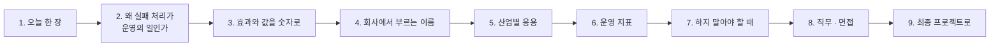

# 4단계 · 정리: 오늘 한 일의 의미 · 효과 · 실전 응용

- 교시: 8교시 17:10~17:45 (35분, 바이브 코딩 발표 10분 뒤) · 자료: 이 문서 + [개요](00-DAY76-OVERVIEW.md) 30장
- 이 시간이 끝나면: 오늘 1~3단계에서 한 일이 **무엇을 지키기 위한 것이었는지**, 숫자로 **무엇이 달라졌고 무엇을 치렀는지**, 회사에서는 같은 생각을 **어떤 이름과 도구로** 쓰는지 말할 수 있고, 최종 프로젝트에 무엇을 가져갈지 정할 수 있다.
- 숫자: 오늘 교안의 실측(강사 노트북, 10/29 정답 워크플로우 1회)입니다. "예시"라고 적은 계산은 가정을 둔 어림입니다.

## 0. 이 시간 (35분)

| 시간 | 절 | 하는 일 |
| --- | --- | --- |
| 17:10~17:15 | 1 · 2 | 오늘 한 장, 왜 실패 처리가 운영의 일인가 |
| 17:15~17:20 | 3 | 오늘 숫자로 본 효과와 값, 하루로 보면 (예시) |
| 17:20~17:28 | 4 · 5 | 같은 생각의 업계 이름 · 도구, 산업별 응용 예 |
| 17:28~17:33 | 6 · 7 | 운영 지표 여섯, 하지 말아야 할 때 |
| 17:33~17:40 | 8 · 9 | 직무와 면접 질문, 최종 프로젝트 체크리스트 |
| 17:40~17:45 | 10 · 토론 | 다음 일차와의 연결, 질문 둘 |

## 1. 오늘 한 장

| 단계 | 한 일 | 오늘 숫자 |
| --- | --- | --- |
| 1단계 · 실패의 종류 | 망가뜨려 보기, 항목 확인 · 재시도 · 멱등 키, 고장 종류마다, LLM 멈춤, 요청 규칙 | 500인데 **2건 접수** · 중복 → 부분 성공 · `duplicates: 3`, `slow` **12.4초** · 늦게 생긴 3건, LLM 멈춰도 `created: 3`, 11건 11.0초 → **0.2초 400** |
| 2단계 · 모으고 알리기 | DLQ, Error Workflow, 그물 지도, 처리한 실패 알림 · DLQ가 멈추면, 알림 폭주 | 사라지던 2건 → **DLQ**, 버그 → 3초 뒤 **critical**, DLQ 멈춤 → **잃을 뻔한 id**를 알림에, 두 번째 알림 → **suppressed** (DLQ 5건 그대로) |
| 3단계 · 재처리와 운영 체계 | 재처리, 런북 · 짝 연습, 반쯤 처리된 요청, parked, 운영 상태 | 재처리 `ok: 2` · 중복 0, 반쯤 처리 → `duplicates: 2`, 세 번째 재처리 **0.1초 parked**, 상태 `ok → warn → critical → ok` |
| 바이브 코딩 | 아무 명령 · HTTP에 재시도 · 마감 · 대체를 붙이는 `tretry` | 요구 14개, `slow`에서 마감 5초 |

한 문장으로: **실패를 종류별로 나눠 각자 갈 곳을 정하고, 잃지 않게 모으고, 사람이 알게 하되 지치지 않게, 고친 뒤 중복 없이 되돌린다.**

## 2. 왜 실패 처리가 운영의 일인가

> **생활 속 예 · 좋은 식당은 실수했을 때 알 수 있다.** 음식이 맛있는 식당은 많지만, 손님이 기억하는 것은 **일이 틀어졌을 때**입니다. 주문이 누락됐을 때 "죄송합니다, 주문서가 빠졌네요. 바로 해 드리고 음료는 서비스입니다"라고 하는 식당과, "주방에 물어보세요" 하는 식당. 앞의 식당에는 주문서 번호(멱등 키), 누락 주문 메모판(DLQ), 실장을 부르는 규칙(알림 등급), 직원 교육 매뉴얼(런북)이 있습니다. 실패 처리는 잘 될 때가 아니라 **안 될 때의 서비스 품질**입니다. 3단계 8절의 "택배 회사로 본 오늘 하루" 표도 함께 봅니다.

72일차는 "빠르게, 멈춰도 답하게", 73일차는 "속지 않게, 새지 않게", 74일차는 "바꿔도 망가지지 않게", 75일차는 "써도 감당할 수 있게"였습니다. 오늘은 "**실패해도 잃지 않게**"입니다.

| | 만들기 | 운영하기 (실패 처리) |
| --- | --- | --- |
| 질문 | "잘 될 때 맞나?" | "안 될 때 무엇이 남나? 누가 아나? 어떻게 되돌리나?" |
| 기준 | 정상 요청의 테스트 | **망가뜨린** 상태의 테스트 (고장 스위치 · `llm down`) |
| 실패 | 오류 메시지 | 잃은 문의 · 중복 접수 · 아무도 모르는 버그 |
| 정하는 사람 | 개발자 | 개발자 + 운영(알림 · 런북) + 업무 담당(parked를 어떻게) |

- 실패 처리의 사고는 대개 **두 번째 행동**에서 납니다. 500을 받은 사용자가 다시 보내 중복이 생기고, 급한 담당자가 DLQ를 비워 요청이 사라집니다. 그래서 결과를 정직하게(부분 성공), 다시 보내도 안전하게(멱등), 할 일을 미리(런북) 둡니다.
- 실패 처리 장치도 실패합니다. 오늘 DLQ가 멈추자 세 문의가 조용히 사라졌습니다. **처리 장치를 처리하는** 한 겹(critical `dlq_down`, 운영 상태)이 있어야 체계입니다.

## 3. 효과와 값을 숫자로

### 3.1 오늘 실측 전 · 후

| 무엇 | 전 | 후 | 바꾼 것 |
| --- | --- | --- | --- |
| 빈 글이 섞인 3건 | 500 · 사실은 2건 접수 | 200 · `created: 2, rejected: 1` (1.7초) | 항목 확인 · 부분 성공 |
| 같은 3건을 다시 | 새 접수 건 3개 (중복) | `duplicates: 3`, 접수 건 그대로 | 키 = 요청 id |
| 잠깐의 끊김 (`flaky`) | 500 | `created: 2` (2.4초) | 재시도 3 + 키 |
| LLM 멈춤 | 0.8초에 500 · 접수 0 | `created: 3, unclassified: 3` (0.9초) | 실패해도 계속 · 미분류 |
| 11건 | 11.0초 · 모두 처리 | **0.2초** · 400 | 입구 상한 |
| API가 멈춘 동안 2건 | 결과에만 → 사라짐 | DLQ 2 · high 알림 1 · 재처리 `ok: 2` | DLQ · 알림 · 재처리 |
| 버그 (`nightly-report`) | 500 · 아무도 모름 | 3초 뒤 critical (노드 · 오류 문장) | Error Workflow |
| DLQ도 멈춤 | 3건 조용히 사라짐 | `dlq_saved: false` · critical · lost ids | 처리 장치의 결과 확인 |
| 같은 문제의 두 번째 알림 | 또 보냄 | `suppressed` (DLQ에는 그대로) | 10분 안 같은 알림 확인 |
| 세 번 실패한 요청 | 재처리마다 또 보냄 | 0.1초 · parked · high 알림 | 최대 시도 수 |

**치른 값**:

- **시간**: 재시도는 실패를 늦게 알게 합니다. `slow`에서 사용자는 12초를 기다리고 실패를 받습니다. 사용자가 기다릴 수 있는 시간을 먼저 정해야 합니다 (`tretry --deadline`).
- **복잡도**: 기준 워크플로우는 노드 8개, 오늘 마지막 접수(Lab 02 과제 2 정답)는 22개입니다. 노드가 늘수록 실패 처리 자체가 버그가 될 수 있어(DLQ가 멈출 때의 구멍), 망가뜨린 상태의 테스트가 함께 늘어야 합니다.
- **미분류**: LLM이 멈춘 동안의 접수는 사람이 나중에 분류해야 합니다.
- **사람의 일**: parked · critical은 결국 사람이 봅니다. 런북의 "누가 · 언제까지"가 비어 있으면 parked는 영원히 parked입니다.
- **최소 한 번**: 잃지 않는 대신 같은 요청이 두 번 이상 갈 수 있고, 받는 쪽 모두가 멱등해야 합니다.

### 3.2 하루로 보면 (예시)

가정: 하루 문의 1,000건, 데이터 API가 하루 한 번 30분 멈춤 (문의가 고르게 온다면 약 21건이 그 사이), 잠깐의 끊김은 1% (10건).

| | 기준 (`base-intake`) | 오늘 저녁의 접수 |
| --- | --- | --- |
| 잠깐의 끊김 10건 | 10번의 500 → 사용자가 다시 보내면 일부는 중복 | 재시도로 거의 모두 접수, 중복 없음 |
| 30분 장애 동안 21건 | 21번의 500, 다시 보내지 않으면 잃음 | DLQ 21건 · high 알림 3번 (10분에 한 번) · 고친 뒤 재처리 |
| 같은 기간 알림 | 0 (아무도 모름) | high 3 · 필요하면 critical |
| 사람이 할 일 | 사용자 문의 · 중복 정리 | 런북대로 재처리, parked 확인 |

- 숫자는 가정입니다. 그래도 **잃는 건수와 알림 수를 같은 표에서 말할 수 있다**는 것이 오늘 만든 체계의 효과입니다.

## 4. 회사에서는 같은 생각을 이렇게 부른다

| 오늘 한 것 | 업계 이름 | 쓰는 도구 · 표준 (예) |
| --- | --- | --- |
| 실패를 다시 할 것과 아닌 것으로 | 일시적 오류 처리 (transient fault handling) | 클라우드 설계 지침 (Azure Architecture Center · AWS Builders' Library) |
| 항목마다 상태 · 200 | 부분 성공, batch item failures | HTTP 207, AWS Lambda의 SQS batch item failures |
| 재시도 · backoff · jitter | 재시도 정책, exponential backoff with jitter | 클라우드 SDK 기본 재시도, Polly(.NET) · resilience4j(Java) · tenacity(Python) |
| 멱등 키 | idempotency key, 중복 제거 | Stripe `Idempotency-Key`, IETF Idempotency-Key 헤더 초안 |
| 미분류로 접수 | 우아한 저하, 대체 경로 (fallback) | 기능 플래그, 기본값 |
| 입구 규칙 · 상한 | 입력 검증, 요청 크기 제한 | API 게이트웨이, JSON Schema |
| DLQ | dead letter queue | Amazon SQS · RabbitMQ · Kafka · Azure Service Bus |
| Error Workflow | 전역 오류 처리기, 오류 추적 | n8n Error Trigger, Sentry, 클라우드 로그 알림 |
| 알림 등급 · 줄이기 | 심각도(SEV), 중복 제거 · 묶기 · 반복 간격 | PagerDuty, Opsgenie, Prometheus Alertmanager |
| 재처리 | redrive, replay | SQS DLQ redrive, 작업 큐 재시도 화면 |
| parked | 독 메시지 · 최대 받기 횟수 | SQS `maxReceiveCount`, 작업 큐의 dead jobs |
| 런북 · 짝 연습 | runbook · playbook, game day, chaos engineering | 사내 위키, Chaos Monkey, 사후 검토(blameless postmortem) |
| 운영 상태 | health check, status page | 쿠버네티스 probe, 상태 페이지 서비스 |
| `tretry` | 재시도 래퍼, 회로 차단기 | 위 재시도 라이브러리, 서비스 메시(Istio 등)의 재시도 · circuit breaking |

- 오늘은 n8n 노드 · 작은 데이터 API · `flow.py`로 직접 만들었습니다. 회사에서는 큐 · 라이브러리 · 알림 도구가 대신하는 경우가 많습니다. 그래도 **무엇을 다시 할 실패로 볼지, 몇 번 · 얼마나 기다릴지, 어떤 알림을 누가 받을지, parked를 누가 볼지**는 오늘처럼 사람이 정합니다.

## 5. 산업별 응용 (예)

아래는 오늘 한 일을 다른 업무에 옮긴 예입니다 (실제 특정 회사의 사례가 아니라 흔한 모양).

| 업무 | 오늘의 무엇을 | 이렇게 |
| --- | --- | --- |
| 쇼핑몰 주문 · 결제 | 멱등 키 · 부분 성공 | 주문 번호를 키로 결제 요청, 시간 초과 뒤 다시 보내도 한 번만 결제 |
| 급여 · 대량 이체 | 항목마다 상태 · 입구 규칙 | 계좌 형식 오류는 그 건만 거절, 한 번에 보낼 건수 상한, 건마다 결과 파일 |
| 대량 메일 · 알림톡 발송 | DLQ · 재처리 · parked | 발송 실패는 모아 두었다 재시도, 세 번 실패한 수신자는 따로 (주소 확인) |
| 고객 문의 AI 분류 (오늘) | 우아한 저하 · 미분류 | LLM 장애 때도 접수, 미분류 수를 대시보드에 |
| 데이터 수집 · ETL | 그물 지도 · 운영 상태 | 원천이 잠깐 끊기면 재시도, 형식이 틀린 행은 따로, 저녁 작업 상태를 신호등으로 |
| 사내 자동화 (n8n · RPA) | Error Workflow · 런북 | 모든 워크플로우에 같은 에러 처리기, 알림에 실행 번호와 런북 주소 |

**토론 거리**: 내 회사(또는 가고 싶은 회사)의 업무 하나를 골라, "두 번 하면 안 되는 일은 무엇이고, 무엇을 키로 쓸까"를 정해 봅니다.

## 6. 운영 대시보드에 올릴 숫자 여섯

오늘 남긴 결과 · DLQ · 알림의 칸만으로 운영 지표가 됩니다 (77일차 로그 분석 · 79일차 운영 대시보드에서 실제로 모읍니다).

| 지표 | 어느 칸에서 | 무엇을 알 수 있나 |
| --- | --- | --- |
| 부분 성공 비율 | `failed` · `rejected` ÷ `total` | 실패가 늘었나, 사용자 입력이 나빠졌나 |
| 재시도로 살아난 수 | `flaky`처럼 재시도 뒤 `created` (실행 기록) | 잠깐의 끊김이 얼마나 잦나 |
| DLQ 크기와 가장 오래된 것 | `/dlq`의 `size` · `at` | 재처리가 밀렸나 |
| parked 수 | `/dlq`의 `parked` | 사람이 볼 일이 쌓였나 |
| 등급별 알림 수 · suppressed 수 | `/alerts`, 결과의 `alert` | 장애가 잦나, 알림이 너무 많나 |
| 미분류 비율 | `unclassified` ÷ `created` | LLM이 자주 멈추나 |

- 오늘 결과에 `reason` · `attempts` · `alert`를 남기게 한 까닭이 이것입니다. **센 수가 없으면 개선했는지도 말할 수 없습니다.**

## 7. 하지 말아야 할 때 (흔한 실수)

| 하기 쉬운 일 | 왜 위험한가 | 대신 |
| --- | --- | --- |
| 모든 실패를 재시도 | 400을 세 번, 부하만 늚 | 고칠 수 없는 것은 거절 |
| 재시도만 켜고 키는 없음 | 재시도가 곧 중복 | 키 = 업무 id |
| 층마다 재시도 | 부하가 곱해짐 (재시도 폭풍) | 한 곳에서, 예산 안에서 |
| 실패를 결과에서 뺌 | "모두 성공"이라는 거짓 | 항목마다 상태 |
| `neverError`만 두고 끝 | 처리 장치의 실패가 조용히 사라짐 | 본문 확인 · 다른 길로 알림 |
| 항목마다 알림 | 알림 피로 → 아무도 안 봄 | 요청 하나에 하나, 같은 문제는 한 번 |
| 급해서 DLQ를 비움 | 재처리할 요청이 사라짐 | 런북 "하지 말 것" |
| 원인을 고치기 전에 재처리 | 또 실패, 금방 parked | 확인 → 재처리 |
| 런북을 써 두기만 | 틀린 줄 모름 | 짝 연습 · game day |

## 8. 직무와 면접

오늘 한 일은 다음 직무들이 날마다 하는 일입니다: **백엔드 · 플랫폼 엔지니어, SRE · 운영 엔지니어, 데이터 엔지니어(파이프라인), AI · LLM 애플리케이션 엔지니어, 업무 자동화(RPA · n8n) 개발자.** 채용 공고의 "장애 대응", "on-call", "재시도 · 멱등성", "메시지 큐 · DLQ", "모니터링 · 알림", "런북 작성", "안정성(reliability)"이 오늘 내용입니다.

면접에서 흔히 받는 질문과 오늘 숫자로 답하는 법:

1. "일괄 처리 API에서 일부가 실패하면 어떻게 답하나요?"

전체를 500으로 끝내지 않고 200에 항목마다 상태와 이유를 담습니다. 오늘 기준 워크플로우는 빈 글 하나에 500을 줬지만 사실 두 건은 이미 접수되어 있었고, 사용자가 다시 보내면 중복이 생겼습니다. 고친 뒤에는 빈 글만 `rejected`, 나머지는 `created`로 1.7초에 답했습니다. 받는 쪽은 거절은 고쳐서, 실패는 나중에 다시 보내면 됩니다.

2. "재시도할 때 주의할 점은?"

세 가지입니다. 다시 하면 되는 실패(5xx · 429 · 시간 초과)만 다시 하고, 간격을 지수로 늘리고 흔들며(jitter) 상한과 전체 마감을 둡니다. 그리고 받는 쪽이 멱등해야 합니다. 오늘 `flaky`에서는 재시도로 2.4초에 성공했지만, 늘 실패하는 장애에서는 시간만 늘었고, 느린 장애에서는 사용자가 12초를 기다렸습니다. 게다가 시간 초과로 포기한 요청이 나중에 만들어져 있어서, 키가 없었다면 다시 보낼 때 중복이 생겼을 것입니다.

3. "멱등성이란 무엇이고 어떻게 구현하나요?"

같은 요청을 여러 번 보내도 결과가 한 번 보낸 것과 같은 성질입니다. 보내는 쪽이 업무 id 같은 고유한 키를 붙이고, 받는 쪽은 키를 기억했다가 같은 키가 오면 처음 결과를 돌려줍니다. 실행 번호나 시각은 매번 바뀌어서 키가 될 수 없습니다. 오늘 같은 세 건을 두 번 보내도 `duplicates: 3`, DLQ 재처리에서도 `duplicates: 2`로 접수 건이 늘지 않았습니다.

4. "DLQ에 쌓인 메시지는 어떻게 처리하나요?"

원인을 먼저 고치고, 원래 입구로 하나씩 다시 보내 성공한 것만 지웁니다. 정해진 횟수 넘게 실패한 것은 자동 재처리에서 빼서 사람에게 넘깁니다. 오늘 재처리는 `my-intake`를 다시 불러 같은 규칙과 키로 처리했고, 세 번 실패한 두 건은 parked로 남기고 high 알림을 보냈습니다. DLQ를 비우는 것은 런북의 "하지 말 것"에 적었습니다.

5. "알림이 너무 많아서 다들 무시합니다. 어떻게 하나요?"

등급을 나누고, 사람이 할 일이 있을 때만 알리고, 같은 문제는 묶습니다. 오늘은 요청 하나에 알림 하나(`count`)로, 같은 이유의 high 알림은 10분에 한 번으로 줄였습니다. 대신 보내지 않은 것도 `suppressed`로 남기고 DLQ에는 모두 남겼고, 요청을 잃을 수 있는 critical은 줄이지 않았습니다.

## 9. 최종 프로젝트로 가져갈 것

최종 프로젝트(85일차~)의 워크플로우에 아래를 넣으면 "운영을 생각한 프로젝트"가 됩니다.

- [ ] 여러 건을 받는 곳은 항목마다 상태로 답한다 (부분 성공), 입구 규칙 · 상한
- [ ] 외부 API 호출에 시간 제한 · 재시도 (다시 할 실패만), 두 번 하면 안 되는 일에는 멱등 키
- [ ] LLM 같은 덧붙인 일이 실패해도 핵심 일은 끝낸다, 대체한 수를 남긴다
- [ ] 오래가는 실패는 원래 요청 그대로 DLQ에 (개인정보 · 보관 기간 주의)
- [ ] 모든 워크플로우에 같은 에러 처리기 (고정 id, 실행 번호 · 노드 · 오류)
- [ ] 알림 등급 · 요청 하나에 하나 · 같은 문제는 한 번, 처리 장치가 실패할 때의 알림
- [ ] 재처리는 같은 입구로, 최대 시도 수 뒤 사람에게
- [ ] 운영 상태 웹훅 (읽기만)
- [ ] 런북 (명령 · 확인 · 갈림길 · 하지 말 것 · 누가) + 한 번은 짝 연습, `RUNBOOK.md`

## 10. 다음 일차와의 연결

| 일차 | 오늘의 무엇을 잇나 |
| --- | --- |
| 77 | 실행 로그 분석 — 오늘 남긴 실패 · 알림 · n8n 실행 기록을 모아 어디가 자주 · 오래 실패하는지 찾고 고친 뒤 다시 잼 |
| 78 | 데이터 품질 검증 — 오늘의 입구 규칙을 넓혀 들어오는 데이터의 품질을 자동으로 검사 |
| 79 | 운영 대시보드 · `tops` — 6절의 운영 지표 여섯, `tretry`의 기록 · 운영 상태 |
| 80~82 | 단위 프로젝트 — 팀 워크플로우에 9절 체크리스트 |

## 토론 (5분)

1. 오늘 바꾼 것 중 **사용자에게 보이는 것**과 **운영자에게만 보이는 것**은 각각 무엇인가요? 어느 쪽이 더 중요할까요?
2. 내 업무의 자동화 하나에서 "parked가 되면 누가, 언제까지, 무엇을 보고 정하나"를 정해 보세요.

## 정리

- [ ] 실패 처리도 **운영**: 실패해도 잃지 않게, 다시 해도 겹치지 않게, 사람이 알게
- [ ] 효과는 망가뜨린 상태의 전 · 후 숫자로 (500 · 중복 → 부분 성공 · `duplicates`, 사라짐 → DLQ · 알림 · 재처리, 11.0초 → 0.2초)
- [ ] 같은 생각을 업계에서는 transient fault handling · idempotency key · DLQ · redrive · alert fatigue · runbook · game day라고 부른다
- [ ] 결과 · DLQ · 알림의 칸이 곧 운영 지표가 된다
- [ ] 최종 프로젝트에 체크리스트 9개를 가져간다
