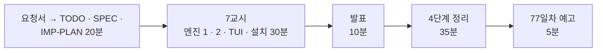

# 7·8교시 · 바이브 코딩 (`tretry`)

- 교시: 7교시 16:00~16:50 (각자 만들기), 8교시 17:00~17:50 (발표 10분 · [4단계 정리](04-STAGE4-WRAPUP.md) 35분 · 예고 5분)
- 과제: [VIBE-REQ-TRETRY](../../Last3Mon/76/VIBE-REQ-TRETRY.md)(요청서, 요청의 말 ①~⑫) → [VIBE-Q-TRETRY](../../Last3Mon/76/VIBE-Q-TRETRY.md)의 8단계: `Doc/TODO.md` → `Doc/SPEC.md` → `Doc/IMP-PLAN.md`(엔진 · TUI 단계) → 단계별 구현 → 확인 → `uv tool install` → 다른 폴더에서 사용 → 수업 뒤 `VIBE-A-TRETRY.md` 공개
- 요구 14개(R1~R14). 50분 안에는 **엔진 1단계(R1 · R2 · R3 · R4 · R12 · R13) + 엔진 2단계(R5 · R6 · R8) + TUI 1단계(R11) + 설치(R14)**, 나머지(R7 마감 · R9 순위 · R10 회로 차단)는 IMP-PLAN의 다음 단계로 집에서.
- 72일차 `tbench` · 73일차 `tscan` · 74일차 `tver` · 75일차 `tcost`와 같은 흐름입니다: 사람의 말(요청서)을 **확인할 수 있는 요구**로 바꾸는 일을 학생이 먼저 하고, VIBE-Q는 그 다음 단계(비교 대상)로 씁니다.
- 오늘은 `tretry`: 아무 명령이나 HTTP 호출을 감싸 다시 하기(지수 backoff · 상한 · 흔들기) · 시도마다 시간 제한 · 전체 마감 · 대체 명령을 붙이고, 고칠 수 없는 실패(4xx)는 다시 하지 않고, 같은 멱등 키를 붙이고, 기록 · 순위 · 회로 차단을 TUI로. 오늘 n8n 노드 설정으로 한 일을 **n8n 밖 어떤 명령에든.**

> **생활 속 예 · 자동 재다이얼 전화기.** 옛날 전화기의 "재다이얼" 버튼은 통화 중이면 몇 초 뒤 알아서 다시 겁니다. 잘 만든 재다이얼은 ① 간격을 점점 늘리고 ② 몇 번에서 멈추고 ③ "없는 번호" 안내가 나오면 다시 걸지 않고 ④ 정해 둔 시간이 지나면 "나중에 다시 거세요"로 끝냅니다. `tretry`는 아무 명령이나 HTTP 호출에 이런 재다이얼을 붙이는 도구입니다.

> 이 문서는 7 · 8교시 진행 문서입니다. 8교시의 정리 35분은 [04-STAGE4-WRAPUP](04-STAGE4-WRAPUP.md)으로 합니다 (74일차부터 4단계 정리를 따로 두었습니다).

## 1. 7교시 · 각자 만들기 (50분)

| 시간 | 단계 | 확인 |
| --- | --- | --- |
| 16:00~16:09 | 0 준비 · 1 요청서 → `Doc/TODO.md` (에이전트 없이) | 할 일 ①~⑫ · 꼭 / 나중 |
| 16:09~16:15 | 2 `Doc/SPEC.md` → VIBE-Q 요구 표(R1~R14)와 비교 · commit | 요구마다 확인 방법 (시도 수 · 기다린 시간 · 종료 코드) |
| 16:15~16:20 | 3 `Doc/IMP-PLAN.md` (엔진 1~3단계 · TUI 1단계 · 설치) · commit | 단계마다 체크리스트 |
| 16:20~16:44 | 4 구현: 엔진 1단계 → 엔진 2단계 → TUI 1단계, 막히면 5 문제 해결 팁 | 단계마다 `pytest` · 직접 실행 · commit |
| 16:44~16:50 | 6 확인 · 7 `uv tool install --editable .` · 8 다른 폴더에서 `tretry` | 데이터 API `flaky`에서 `tretry http POST localhost:8800/tickets ... --idem-key x --body-key key` |

| 볼 것 | 막혔을 때 한마디 |
| --- | --- |
| TODO · SPEC 없이 VIBE-Q를 통째로 붙여 넣었나 | "요청서로 Doc/TODO.md부터. 기다린 시간 [0.5, 1.0]이 SPEC에 없으면 맞았는지 모릅니다" |
| IMP-PLAN이 한 덩어리 · 첫 요청에 14개 | "엔진 1단계만. 단계마다 확인 · 체크 · commit" |
| 테스트가 몇 초씩 | "엔진이 sleep · clock을 인자로, 테스트에서는 가짜로" |
| 400도 다시 함 | "고칠 수 없는 실패는 1번, 종료 코드 3, 대체도 하지 않기 (오늘 Lab 01)" |
| 간격이 늘 같음 · 끝없이 늚 | "지수 backoff와 상한" |
| 다시 보낸 POST로 접수 건이 둘 | "멱등 키는 실행에 한 번 만들고 모든 시도에, 본문 key에도" |
| `--timeout`이 안 먹음 | "subprocess와 urlopen 둘 다 timeout, 시간 초과도 다시 할 실패" |
| `--` 뒤 옵션을 tretry가 먹음 | "`--` 앞만 tretry 옵션" |
| 기록에 토큰 | "헤더 값은 남기지 않기, URL · 오류의 키도 `***`" |
| 실행해 보지 않고 다음 요청 | "에이전트가 됐다고 해도 직접 `uv run tretry ...; echo $?`" |

정답 예(R1~R14를 모두 넣은 `tretry`와 정답본 `VIBE-A-TRETRY.md`)는 수업 뒤 공개됩니다.

## 2. 8교시 · 발표 (10분)

- 1~2명. **데이터 API의 `flaky` · `slow` · `error`에서 다시 하기 · 마감 · 대체를 보여 줄 수 있는 사람**, 400에서 멈추는 것(종료 코드 3)을 보여 줄 수 있는 사람을 먼저 고릅니다.
- 3분 발표 · 2분 질문: **내 SPEC과 VIBE-Q가 달랐던 곳** / IMP-PLAN을 어떻게 나눴나 / 잘 먹힌 요청문 / 안 먹힌 요청문 / 에이전트가 틀린 곳 / 시연.

## 3. 강사 정리 (8교시 4단계 정리 안에서)

| | n8n 일괄 접수 (오늘 Lab) | tretry |
| --- | --- | --- |
| 다시 하기 | 노드 `retryOnFail` · `maxTries` 3 · 고정 300ms | `--tries` · 지수 backoff · 상한 · jitter (R1 · R2) |
| 시간 제한 | 노드 `options.timeout` 3000 | `--timeout`, 전체 `--deadline` (R3 · R7) |
| 고칠 수 없는 실패 | 항목 확인 → `rejected` (Lab 01 예제 2) | 4xx는 1번 · 종료 코드 3 (R5) |
| 멱등 키 | `key` = 요청 id | `--idem-key` · `--body-key` (R6) |
| 대체 | 미분류로 접수 (Lab 01 과제 1) | `--fallback` (R4) |
| 실패 기록 | DLQ · 알림 | JSON Lines 기록 · `stats` (R8 · R9) |
| 끝없이 하지 않기 | `attempts` 3이면 parked (Lab 03 과제 1) | 회로 차단 `--breaker` (R10) |

- 풀이 거리: Lab 01 예제 3의 `slow`는 내 접수가 **12.4초** 뒤 실패했습니다. 강사 본 `tretry`에 `--timeout 3 --deadline 5`를 주면 두 번째 시도의 시간 제한을 남은 1.5초로 줄여 **5.00초**에 포기합니다. "몇 번 할까" 대신 "얼마나 기다릴 수 있나"로 정하는 것.

## 4. 강사 바이브 코딩 (시간이 남으면 · 수업 뒤, 15분)

| 주제 | 요청문 요지 | 보여 줄 것 |
| --- | --- | --- |
| 회로 차단의 대상 | "breaker 대상을 METHOD URL 이 아니라 METHOD + 경로 + 상태 코드 종류로, 4xx 는 세지 않기" | 400 실수 때문에 차단이 열리지 않는 것 |
| 재시도 예산 | "기록에서 최근 1분 시도 중 재시도 비율이 10% 넘으면 재시도하지 않기" | 재시도 폭풍 막기 |
| n8n 웹훅 감싸기 | "tretry http POST localhost:5678/webhook/my-intake --body @requests/batch-two.json" | 부분 성공(200)은 성공 — 결과를 보고 판단해야 함 |

걸린 시간과 결과를 `Last3Mon/76/VIBE-A-TRETRY.md`에 적어 둡니다.

## 5. 보충 · 팁 (읽을거리, 4단계 정리 7절과 함께)

| 팁 | 설명 |
| --- | --- |
| 요청서 → 요구가 먼저 | 확인 방법(시도 수 · 기다린 시간 · 종료 코드)이 있는 요구가 있어야 에이전트의 "완료"를 판단할 수 있음 |
| 시간은 바꿔 끼우게 | `sleep` · `clock` · 무작위를 인자로 받으면 3초짜리 시도도 0초에 시험 |
| 엔진은 "한 번 해 보기"만 안다 | 명령 · HTTP의 차이는 실행기에, 엔진은 하나 |
| 고칠 수 없는 실패를 가리지 않기 | 대체가 400을 덮으면 실수를 영영 모름 |
| 키는 실행에 한 번 | 시도마다 새 키면 멱등이 아님 |
| 기록은 한 줄에 하나 | 중간에 죽어도 앞 줄은 남음, 비밀은 지움 |
| 단계마다 `git commit` | 에이전트가 망가뜨려도 돌아갈 곳 |

## 6. 77일차 예고 (5분)

- 오늘: 실패를 나누고 · 모으고 · 알리고 · 다시 돌렸습니다. 다음 수업(77일차, 11/2): **실행 로그 분석과 운영 데이터 기반 Workflow 개선** — 오늘 남긴 알림 · DLQ · n8n 실행 기록을 모아 어디가 자주 · 오래 실패하는지 찾고 고친 뒤 다시 잽니다.
- 바이브 코딩: `tlog`. 오늘 `tretry`는 지우지 마세요. 79일차 `tops`에서 씁니다.

## 확인 (강사)

- [ ] 16:00 요청서 → TODO(에이전트 없이) → SPEC → IMP-PLAN 20분을 지켰다, 16:20부터 엔진 1단계.
- [ ] 7교시 시작 전 데이터 API가 `ops --reset` 상태이고, 고장 스위치를 바꿀 명령을 화면에 띄웠다.
- [ ] 수업 뒤: 요청이 있을 때 학생 저장소에 정답(LAB-A · `answers/` · VIBE-A · `tretry/`)을 올린다.
- [ ] 발표자 1~2명, 강사 정리 표, 팁, 예고.
- [ ] 수업이 끝날 때 학생들의 데이터 API가 처음 상태인지 (`ops --reset`, `llm up`, `doctor`).
