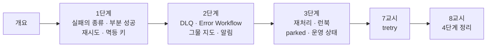

# 76일차 · 에러 처리와 예외 대응, 안정적 운영 체계 (바이브 코딩)

- 일자: 2026-10-30 (76일차)
- 교과목: 노코드 멀티 에이전트 워크플로우 설계 및 운영
- 단원: AI 워크플로우 운영 및 관리 역량 강화
- 학습 내용: 에러 처리 및 예외 대응 Workflow 구성, 안정적 운영 체계 적용
- 실습 폴더: [Last3Mon/76](../../Last3Mon/76/README.md)
- 실습 환경: 65일차 n8n 2.42.6 + OpenAI API(`gpt-4.1-mini`, 분류) + 76일차 데이터 API(75일차 + 접수 건 만들기 · DLQ · 알림 · 고장 스위치) + **CLI 코딩 에이전트**
- **실습 준비: [00-DAY76-PREP.md](00-DAY76-PREP.md) (수업 전날까지 1~2절 완료)**
- 수업 형식: 1 · 3 · 5교시 강의, 2 · 4 · 6교시 실습 5개씩 (예제 3 · 과제 2), 7교시 바이브 코딩, 8교시 발표 · 4단계 정리

## 오늘의 시간표

| 교시 | 시간 | 내용 | 자료 |
| --- | --- | --- | --- |
| 1 | 09:00~09:50 | 개요 · 1단계 강의 · 실패의 종류 | [개요](00-DAY76-OVERVIEW.md) 1~14장, [1단계](01-STAGE1-FAILURE-TYPES.md) |
| 2 | 10:00~10:50 | Lab 01 실습 5개 (망가뜨려 보기 · 항목 확인 · 재시도 · 멱등 키 · 고장 종류 · LLM 멈춤 · 요청 규칙) | [Lab 01](../../Last3Mon/76/LAB-01-Q-FAILURE-TYPES.md) |
| 3 | 11:00~11:50 | 2단계 강의 · 모으고 알리기 | 개요 15~21장, [2단계](02-STAGE2-COLLECT-AND-ALERT.md) |
| 4 | 12:00~12:50 | Lab 02 실습 5개 (DLQ · Error Workflow · 그물 지도 · 처리한 실패 알림 · 알림 폭주) | [Lab 02](../../Last3Mon/76/LAB-02-Q-COLLECT-AND-ALERT.md) |
| - | 13:00~14:00 | 점심 |  |
| 5 | 14:00~14:50 | 3단계 강의 · 재처리와 운영 체계 | 개요 22~28장, [3단계](03-STAGE3-REPLAY-AND-RUNBOOK.md) |
| 6 | 15:00~15:50 | Lab 03 실습 5개 (재처리 · 런북 · 장애 연습 · 반쯤 처리된 요청 · parked · 운영 상태) | [Lab 03](../../Last3Mon/76/LAB-03-Q-REPLAY-AND-RUNBOOK.md) |
| 7 | 16:00~16:50 | 바이브 코딩 `tretry`: 요청서 → TODO → SPEC → IMP-PLAN → 만들기 → 설치 | [VIBE-REQ-TRETRY](../../Last3Mon/76/VIBE-REQ-TRETRY.md), [진행](05-VIBE-CODING.md) |
| 8 | 17:00~17:50 | 발표 · **4단계 정리** (의미 · 효과 · 회사에서 쓰는 법) · 77일차 예고 | [4단계 정리](04-STAGE4-WRAPUP.md), [진행](05-VIBE-CODING.md) |

## 자료 목록

| 파일 | 내용 |
| --- | --- |
| `00-DAY76-PREP.md` | 실습 준비: n8n · 76일차 판 데이터 API 켜기, 기준(`base-intake`) · `nightly-report` 게시, `flow.py doctor` (수업 전) |
| `00-DAY76-OVERVIEW.md` | 개요 30장 (PPT 대신 Markdown, 가로줄로 장 구분) |
| `01-STAGE1-FAILURE-TYPES.md` | 부분 실패 · 500의 거짓말, 실패의 종류(4xx · 5xx · 시간 초과), 부분 성공, 재시도 · backoff · jitter · 재시도 폭풍, 시간 초과는 "모름", 멱등 키, 우아한 저하, 입구에서 막기 |
| `02-STAGE2-COLLECT-AND-ALERT.md` | 사라지는 실패, DLQ, 처리한 · 처리하지 못한 실패, Error Workflow, 그물 지도와 구멍, 알림 등급, 알림 피로 |
| `03-STAGE3-REPLAY-AND-RUNBOOK.md` | 재처리 · 같은 입구로, 런북, 장애 연습, 최소 한 번 + 멱등, 끝없이 돌리지 않기 · parked, 운영 상태, 운영 체계 한 장 |
| `04-STAGE4-WRAPUP.md` | 8교시 35분: 오늘의 의미 · 효과 숫자 · 업계 이름 · 산업별 응용 · 운영 지표 · 면접 · 최종 프로젝트 체크리스트 |
| `05-VIBE-CODING.md` | 7 · 8교시 바이브 코딩 진행 (tretry), 발표, 강사 정리, 강사 바이브 코딩, 팁, 예고 |
