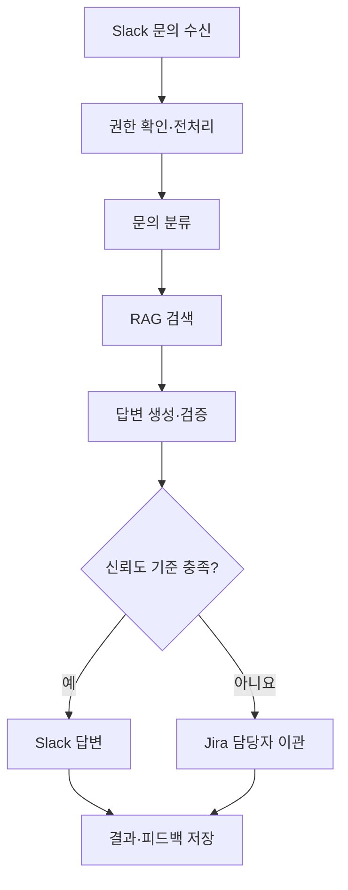

# 노코드 멀티 에이전트 워크플로우 설계 및 운영｜교과목 프로젝트 진행 가이드(1기)

이 페이지는 노코드 멀티 에이전트 워크플로우 설계 및 운영 교과목의 단위프로젝트를 수행하는 훈련생용 가이드입니다.

## 1. 프로젝트 개요

| 구분 | 내용 |
| --- | --- |
| 프로젝트 주제 | 노코드·로코드 기반 기업형 '지능형 기술 지원 자동화(Tech Support)' 워크플로우 구축 |
| 프로젝트 목표 | 노코드·로코드 환경에서 RAG와 도구 노드를 구성하고 멀티 에이전트 오케스트레이션을 구현합니다. 운영 안정화와 예외 처리를 적용한 뒤 주요 시나리오를 시험하고 결과를 검증합니다. |
| 주요 산출물 | 노코드 워크플로우 설계서, RAG 아키텍처 설계서, 워크플로우 실행 결과서 |

## 2. 세부 수행내용

1. 노코드·로코드 기반 RAG 및 도구 노드 구현
2. 멀티 에이전트 오케스트레이션 구현
3. 운영 안정화 및 예외 처리(Error Handling)
4. 서비스 테스트 및 결과 검증

## 3. 권장 진행 순서

### 1단계｜노코드·로코드 기반 RAG 및 도구 노드 구현

- 처리할 기술 지원 문의와 사용할 지식 문서의 범위를 정합니다.
- Trigger부터 최종 출력까지 필요한 노드를 배치합니다.
- RAG 검색과 Slack·Email·Jira·Notion·Database·API 등 실제 사용할 도구 노드를 연결합니다.
- 노드마다 입력값·출력값·인증 방식과 전달 데이터 형식을 확인합니다.

### 2단계｜멀티 에이전트 오케스트레이션 구현

- 문의 분류, 지식 검색, 답변 검증, 담당자 이관 등 필요한 역할을 구분합니다.
- 각 역할이 어떤 조건에서 실행되고 다음 역할로 무엇을 전달하는지 연결합니다.
- 병렬·분기·루프 구조가 설계한 업무 흐름대로 동작하는지 확인합니다.

### 3단계｜운영 안정화 및 예외 처리

- 인증 실패, 호출 한도 초과, 검색 결과 없음, 외부 서비스 장애, 중복 요청 등 예상 가능한 상황을 확인합니다.
- 각 예외 상황에서 재시도·실행 중단·담당자 이관·알림 중 어떤 처리가 실행되는지 설정합니다.
- 개인정보와 접근 권한이 처리 흐름과 실행 로그에 적절히 반영되는지 점검합니다.

### 4단계｜서비스 테스트 및 결과 검증

- 정상 요청과 예외 상황을 포함한 주요 시나리오를 실행합니다.
- 각 시나리오의 입력·기대 결과·실제 결과·실행 노드·처리시간·판정 결과를 기록합니다.
- 실패한 시나리오는 원인과 조치 내용을 기록하고 동일 조건으로 다시 시험합니다.

## 4. 주요 산출물 작성 가이드 및 예시

> 아래 서비스명·연동 도구·모델·설정값·시험 결과는 작성 방법을 보여주기 위한 예시입니다. 팀에서 실제로 구현하고 확인한 내용으로 교체하세요.

### 산출물 1｜노코드 워크플로우 설계서

**포함할 내용**

- Trigger → 처리 → 출력 흐름을 지능형 기술 지원 로직에 맞게 연결
- 병렬·분기·루프 구조를 목적에 맞게 사용
- Slack·Email·Jira·Notion·Database·API 연동의 인증과 오류 처리 구성
- 노드 간 페이로드 스키마와 변환 로직 정의
- 연결선별 필수·선택 필드와 예시 샘플 문서화

**작성 예시**

#### 1. 업무 시나리오

직원이 Slack에서 기술 문의를 등록하면 워크플로우가 문의 유형을 분류하고 사내 지식베이스를 검색합니다. 신뢰도가 충분하면 답변과 근거 문서를 제공하고, 부족하거나 긴급한 문의는 Jira 티켓을 생성하여 담당자에게 전달합니다.

#### 2. 전체 흐름

1. Slack 메시지 수신
2. 사용자·채널 권한 확인
3. 문의 전처리
4. 문의 유형 및 긴급도 분류
5. RAG 검색
6. 답변 초안 생성
7. 근거·정책 검증
8. 신뢰도 기준 분기
9. Slack 답변 또는 Jira 티켓 생성
10. 처리 결과와 피드백 저장

#### 3. 워크플로우 흐름 예시



#### 4. 분기·병렬·루프 예시

- 분기: 신뢰도가 팀 기준값 이상이면 자동 답변, 미만이면 담당자 이관
- 분기: 보안·권한 관련 문의는 자동 답변하지 않고 담당자에게 이관
- 병렬: 문서 검색과 과거 유사 티켓 검색을 동시에 실행
- 루프: 필수 정보가 부족하면 정해진 횟수만큼 보완 질문 후 담당자 이관

#### 5. 외부 연동 노드 예시

| 노드 | 인증 | 입력 | 출력·오류 처리 |
| --- | --- | --- | --- |
| Slack Trigger | OAuth | channel_id, user_id, message, timestamp | 인증 실패 시 실행 중단 및 관리자 알림 |
| Knowledge Search | 서비스 계정 또는 API Key | query, user_permissions, top_k | document_id, chunk_text, score, source_url / 타임아웃 후 담당자 이관 |
| Jira Create Issue | OAuth 또는 API Token | summary, description, priority, requester, evidence | issue_key, issue_url / 원문 메시지 ID로 중복 방지 |

#### 6. 노드 간 페이로드 예시

```json
{
  "request_id": "req-001",
  "user_id": "U102",
  "question": "VPN 접속 오류 해결 방법을 알려줘",
  "category": "network",
  "urgency": "normal",
  "permissions": ["employee"],
  "attempt": 1
}
```

- 필수 필드 예시: request_id, user_id, question
- 선택 필드 예시: category, urgency
- 변환 예시: Slack Markdown 제거, 개인정보 마스킹, 시간대 통일

#### 7. 오류 처리 예시

- OAuth 만료 → 재인증 알림 후 실행 중단
- API 429 → Retry-After 기준 재시도
- RAG 결과 없음 → 답변 생성 중단 후 담당자 이관
- Jira 생성 실패 → 대기열 저장 후 담당자 알림
- 중복 이벤트 → request_id 기준 재처리 차단

### 산출물 2｜RAG 아키텍처 설계서

**포함할 내용**

- 문서 길이·구조·언어에 맞는 청킹 단위, 오버랩, 청크 길이 분포와 선정 근거
- 임베딩 모델 선정 이유를 성능·다국어·도메인 적합성·비용 관점에서 기록
- 벡터 차원과 Cosine·Euclidean 등 거리 계산 방식 명시
- 컬렉션·인덱스 명명 규칙, 파티션·셰딩, 메타데이터 구조 설계
- 백업·복구 정책과 대용량 확장 방안 설계

**작성 예시**

#### 1. 원본 문서

| 항목 | 작성 예시 |
| --- | --- |
| 대상 문서 | 기술지원 매뉴얼, FAQ, 장애 처리 이력 |
| 문서 형식 | PDF, HTML, Notion |
| 언어 | 한국어 중심, 일부 영문 기술 용어 포함 |
| 갱신 주기 | 팀의 실제 운영 기준 입력 |
| 접근 권한 | 문서별 권한 메타데이터 유지 |

#### 2. 전처리 및 청킹 예시

- 제목과 소제목 구조를 보존합니다.
- 표와 코드 블록을 일반 문단과 구분합니다.
- 기본 청크: 500토큰
- 오버랩: 80토큰
- 짧은 FAQ는 질문과 답변을 하나의 청크로 유지합니다.
- 절차 문서는 단계 중간에서 분리하지 않습니다.
- 긴 표는 헤더를 각 분할 청크에 반복합니다.
- 선정 근거 예시: 기술 절차의 문맥 유지와 검색 정밀도의 균형

#### 3. 임베딩 설계 예시

- 사용 모델: 실제 사용 모델 입력
- 선정 기준: 한국어·영어 혼합 문서 성능, 비용과 처리량, 도메인 용어 표현력
- 벡터 차원: 실제 값 입력
- 거리 계산 방식: Cosine Similarity
- top_k: 실제 시험 후 확정값 입력

#### 4. 인덱스 및 메타데이터 예시

- 컬렉션명: `tech_support_kb_v1`
- 메타데이터: document_id, title, section, source_url, updated_at, access_level, product, language
- 검색 전 필터: 사용자 권한과 제품군
- 검색 후 처리: 중복 청크 제거 및 점수 기준 미달 제외

#### 5. 백업·복구 및 확장 예시

- 버전별 컬렉션을 생성하고 검증 완료 후 alias를 전환합니다.
- 원본 문서와 메타데이터를 별도로 백업합니다.
- 재색인 실패 시 이전 인덱스로 롤백합니다.
- 데이터 증가 시 제품군 또는 조직 기준의 파티션을 검토합니다.
- 대량 입력은 배치 처리하고 실패한 문서만 다시 처리합니다.

### 산출물 3｜워크플로우 실행 결과서

**포함할 내용**

- 주요 시나리오별 실행 테스트 로그
- 예외 상황 처리 동작 결과

**작성 예시**

#### 1. 시나리오별 시험 기록

| 시나리오 | 입력·조건 | 기대 결과 | 실제 결과 작성 |
| --- | --- | --- | --- |
| WF-01 정상 FAQ | 사내 VPN 비밀번호 변경 방법 문의 | 관련 문서 검색 후 근거 링크와 절차 제공 | 실제 결과·실행 노드·처리시간·PASS/FAIL |
| WF-02 정보 부족 | “접속이 안 돼요” | 제품·오류 메시지·발생 시점 보완 질문 | 실제 결과·보완 질문 횟수·PASS/FAIL |
| WF-03 검색 결과 없음 | 지식베이스에 없는 문의 | 답변을 추정하지 않고 Jira 티켓 생성 | 실제 Jira Key·PASS/FAIL |
| WF-04 외부 API 장애 | Jira API 500 응답 | 재시도 후 대기열 저장 및 담당자 알림 | 실제 결과·PASS/FAIL |
| WF-05 권한 제한 | 일반 사용자의 관리자 전용 문서 문의 | 제한 문서 미검색 및 담당자 이관 | 실제 결과·PASS/FAIL |

#### 2. 실행 로그 작성 예시

- request_id
- 시작·종료 시각
- 실행된 노드
- 노드별 입력·출력 요약
- 외부 API 상태
- 재시도 횟수
- 검색 문서 ID와 점수
- 최종 분기
- 오류 코드
- 개인정보 마스킹 여부

#### 3. 결과 요약 기입 예시

| 항목 | 실제 결과 |
| --- | --- |
| 전체 시나리오 | ____건 |
| 성공 / 실패 | ____건 / ____건 |
| 자동 답변 / 담당자 이관 | ____건 / ____건 |
| 평균 처리시간 | ____초 |
| 예외 처리 성공률 | ____% |
| 근거 없는 답변 | ____건 |
| 권한 위반 | ____건 |

#### 4. 실패 사례 작성 예시

- 현상: 무엇이 실패했는가
- 재현 조건: 어떤 입력과 환경에서 발생했는가
- 원인: 로그·설정·데이터 중 확인된 근거
- 조치: 워크플로우·프롬프트·파라미터에서 수정한 내용
- 재시험: 동일 조건에서 통과했는가
- 잔여 위험: 해결되지 않은 제한은 무엇인가

## 5. 구현 결과 및 시연 준비

**실행 정보**

- 실행 또는 배포 URL:
- 저장소·협업 URL:
- 워크플로우 실행 화면:
- 사용한 외부 서비스:
- 테스트 계정 또는 인증 방법:

**시연 순서 예시**

1. 정상 기술지원 문의를 입력합니다.
2. 문의 분류, RAG 검색, 답변 생성과 검증 흐름을 보여줍니다.
3. 검색 근거와 최종 답변이 함께 제공되는지 확인합니다.
4. 정보가 부족한 문의의 보완 질문을 보여줍니다.
5. 검색 결과 없음 또는 외부 API 장애 상황의 예외 처리를 보여줍니다.
6. 담당자 이관과 실행 로그를 확인합니다.
7. 시나리오별 결과와 실패 사례를 설명합니다.

## 6. 제출 전 체크리스트

**노코드 워크플로우 설계서**

- [ ] Trigger → 처리 → 출력 흐름이 실제 구현과 일치한다.
- [ ] 병렬·분기·루프 구조의 사용 목적이 명확하다.
- [ ] 외부 연동별 인증 및 오류 처리를 기록했다.
- [ ] 노드 간 페이로드의 필수·선택 필드와 변환 로직을 작성했다.

**RAG 아키텍처 설계서**

- [ ] 청킹 단위·오버랩·길이 분포와 선정 근거를 작성했다.
- [ ] 임베딩 모델 선정 이유와 실제 벡터 차원을 기록했다.
- [ ] 거리 계산 방식과 인덱스·메타데이터 구조를 작성했다.
- [ ] 백업·복구 및 확장 방안을 작성했다.

**워크플로우 실행 결과서**

- [ ] 주요 시나리오별 실행 테스트 로그가 있다.
- [ ] 예외 상황의 실제 처리 결과가 있다.
- [ ] 기대 결과와 실제 결과를 구분했다.
- [ ] 실패 사례와 재시험 결과를 기록했다.

**공통**

- [ ] 세 설계서·결과서의 내용이 실제 구현과 일치한다.
- [ ] 예시 수치를 팀의 실제 측정값으로 교체했다.
- [ ] 인증정보와 개인정보가 문서·로그·저장소에 노출되지 않았다.

## 7. 팀별 작성 영역

- 팀명:
- 팀원 및 역할:
- 프로젝트 기간:
- 저장소·협업 링크:
- 실행 또는 배포 URL:
- 사용한 노코드·로코드 도구:
- 사용한 외부 서비스:
- 운영 매니저 확인사항:
