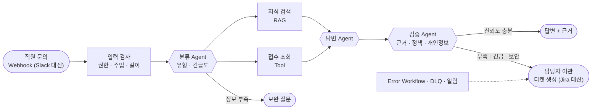

# 단위 프로젝트 안내서 · 지능형 기술 지원 자동화(Tech Support) 워크플로우

- 기간: 80~82일차 (2026-11-05 목, 11-06 금, 11-09 월), 하루 8교시 · 모두 24시간
- **82일차 8교시(17:00~17:50)는 평가 시험 40문제**입니다. 프로젝트 제출(13:50) · 발표(5~6교시) · 총평(7교시) 뒤에 봅니다.
- 교과목: 노코드 멀티 에이전트 워크플로우 설계 및 운영
- 주제: 노코드·로코드 기반 기업형 '지능형 기술 지원 자동화(Tech Support)' 워크플로우 구축 — **이 큰 틀 안에서 팀마다 주제를 정합니다** ([11-TOPIC-GUIDE](11-TOPIC-GUIDE.md))
- 원본 요구: [Req/KSM-REQ.md](../Req/KSM-REQ.md) (교과목 프로젝트 진행 가이드), 평가 기준표 `Req/*.xlsx`
- 이 문서는 원본 요구를 **우리 과정의 환경(n8n · CLI 코딩 에이전트 · 데이터 API · OpenAI)**에 맞춰 풀어 쓴 것입니다. 원본과 이 안내가 다르면 강사에게 묻습니다.



## 1. 무엇을 만드나

> 아래는 **기본 주제(사내 IT 헬프데스크)**로 쓴 설명입니다. 다른 주제(B2B SaaS 고객 기술지원, 제조 설비 유지보수 지원 등)를 고른 팀은 "직원" · "사내 지식 문서"를 자기 주제의 사용자 · 문서로 바꿔 읽습니다. 주제 조건 · 예 · 정하는 순서는 [11-TOPIC-GUIDE](11-TOPIC-GUIDE.md).

직원이 기술 문의를 보내면 워크플로우가 **문의를 분류하고, 사내 지식 문서를 검색(RAG)하고, 근거가 있는 답을 만들어 검증한 뒤** 돌려줍니다. 근거가 부족하거나, 긴급하거나, 보안 · 권한이 걸린 문의는 답을 지어내지 않고 **담당자에게 이관(티켓 생성)**합니다. 외부 서비스가 멈추거나 요청이 이상해도 **정해진 방식으로 실패**하고, 모든 처리는 **기록**으로 남습니다.

64~79일차에 하루씩 만든 것을 **하나의 서비스로 묶는** 프로젝트입니다. 새로 배울 것보다 **이미 만든 것을 엮고, 설계를 글로 쓰고, 시험으로 증명하는** 일이 중심입니다.

| 원본 요구의 세부 수행내용 | 우리가 할 일 | 가져올 실습 |
| --- | --- | --- |
| 1. 노코드·로코드 기반 RAG 및 도구 노드 구현 | 지식 문서 색인 · 검색, 접수 조회 · 티켓 생성 · 알림 도구 | 67 Tool, 71 RAG, 76 티켓 · 알림 |
| 2. 멀티 에이전트 오케스트레이션 구현 | 분류 → 검색 · 답변 → 검증 → 이관, 분기 · 병렬 · 루프 | 68 라우터, 69 역할 분리, 70 모듈 |
| 3. 운영 안정화 및 예외 처리 | 입력 · 출력 검증, timeout · 재시도 · 대체 경로, Error Workflow, DLQ, 중복 방지 | 72 안정성, 73 보안, 76 오류 대응 |
| 4. 서비스 테스트 및 결과 검증 | 공통 시나리오 · 팀 시나리오 · 장애 시험 · 반복, 실행 로그 | 72 재기, 74 배포 관문, 77 로그 분석 |

## 2. 공통 계약 (모든 팀 같음)

계약이 같아야 **공통 시나리오로 모든 팀을 같은 기준으로** 잴 수 있습니다. 내부 구조(노드 · Agent 수 · 프롬프트)는 팀마다 달라도 됩니다. 자세한 칸과 예시는 [04-REFERENCE-ARCHITECTURE](04-REFERENCE-ARCHITECTURE.md) 3절.

**요청**: `POST /webhook/<팀이름>-support` (예: `team1-support`)

```json
{"request_id": "req-001", "user": "박서연", "channel": "it-help", "question": "VPN이 계속 끊겨요. 어떻게 해야 하나요?", "attempt": 1}
```

**응답** (HTTP 200)

```json
{
  "request_id": "req-001",
  "route": "자동 답변",
  "answer": "VPN 클라이언트를 최신 버전으로 업데이트하고 인증서 만료 여부를 확인한 뒤 다시 접속해 보세요.",
  "sources": [{"doc": "remote-work-vpn", "section": "접속 오류", "score": 0.71}],
  "ticket": null,
  "agents": ["triage", "retriever", "writer", "verifier"],
  "security": {"blocked_by": "", "reason": "", "masked": 0},
  "timings": {"total_ms": 2840}
}
```

| `route` | 언제 |
| --- | --- |
| `자동 답변` | 근거 문서가 있고 검증을 통과한 답 |
| `보완 질문` | 정보가 부족함 (제품 · 오류 메시지 · 발생 시점을 되물음, 최대 횟수 뒤에는 이관) |
| `담당자 이관` | 근거 없음 · 신뢰도 부족 · 긴급 · 보안 사고 · 외부 장애로 답할 수 없음 → `ticket`에 티켓 번호 |
| `권한 없음` | 다른 사람의 접수 건 · 권한 없는 문서 |
| `차단` | 프롬프트 주입 같은 공격 |

빈 질문 · 없는 직원 · 너무 긴 질문은 HTTP 400 `{"error": "invalid request", "codes": [...]}` (73일차와 같음).

## 3. 구현 범위

### 필수 (모든 팀)

| 영역 | 기준 |
| --- | --- |
| Trigger → 처리 → 출력 | 위 계약의 Webhook 하나로 들어와 Respond로 끝남. 입력 검사 → 분류 → 검색 → 답변 → 검증 → 분기 → 출력 · 기록 |
| RAG | 기본 주제는 데이터 API의 지식 문서(`/docs`, 8개), 다른 주제는 팀이 쓴 문서 6개 이상 (`knowledge/`)을 청크로 나눠 임베딩 · 검색, 답에 `sources` (문서 · 절 · 점수) |
| 도구 노드 | 접수 조회(`GET /tickets/<id>?requester=`), 티켓 생성(`POST /tickets`, 중복 방지 key), 알림(`POST /alerts`) 세 가지 이상 |
| 멀티 에이전트 | 역할 3개 이상 (분류 · 답변 · 검증 등), 분기 · 병렬 · 루프 구조를 **각각 한 곳 이상** 목적에 맞게 |
| 인증 | 팀 Webhook에 Header Auth, 외부 호출은 n8n Credential (키를 JSON · 문서에 쓰지 않음) |
| 예외 처리 | timeout · 재시도 · 오류 출력, 검색 결과 없음 → 이관, 외부 장애 → DLQ + 알림, 중복 요청 차단, Error Workflow 게시 |
| 보안 | 입력 검증 · 주입 차단, 본인 접수 건만, 출력의 개인정보 가림, 기록에 개인정보 없음 (73일차) |
| 시험 | 공통 시나리오 14유형 모두 (다른 주제는 우리 주제의 질문으로 옮긴 것) + 팀 시나리오 5개 이상, LLM이 들어간 것은 3회 반복 |
| 산출물 | 아래 4절 세 가지 + 팀 헌장 · 데일리 기록 |

### 가산 (선택)

- 실제 외부 서비스(Slack · Email · Jira · Notion) 연동 — 팀 계정이 있을 때만, **회사 · 개인 실서비스 계정의 키를 저장소에 올리지 않음**
- 지속형 벡터 저장소(PGVector · Qdrant 등)로 색인을 보존하고 백업 · 복구를 실제로 시연
- 74일차 배포 관문(`flow.py gate`), 75일차 사용량 · 비용 기록, 77일차 운영 지표, 79일차 Ops Assistant에 프로젝트 로그 연결
- 모델 비교 (같은 시나리오로 품질 · 시간 · 비용)

> **규칙으로 정할 수 있는 것은 규칙(Code · If · Switch)으로, LLM은 꼭 필요한 곳에만.** 72 · 75일차에 잰 것처럼 LLM 호출 하나가 1~2초와 비용을 더합니다. 3일 안에 안정적인 결과를 내려면 판단이 분명한 곳(권한 · 길이 · 중복 · 점수 기준)은 코드로 둡니다.

## 4. 산출물 (원본 요구 4절)

| 산출물 | 템플릿 | 핵심 질문 (평가 기준) |
| --- | --- | --- |
| 노코드 워크플로우 설계서 | [WORKFLOW-DESIGN](templates/WORKFLOW-DESIGN-TEMPLATE.md) | 흐름이 기술 지원 로직에 맞고 분기 · 병렬 · 루프를 목적에 맞게 썼나 · 연동 노드마다 인증 · 오류 처리가 있나 · **연결선마다** 페이로드 스키마 · 변환 · 필수/선택 · 예시가 있나 |
| RAG 아키텍처 설계서 | [RAG-ARCHITECTURE](templates/RAG-ARCHITECTURE-TEMPLATE.md) | 문서 특성에 맞는 청킹 · 오버랩 · 길이 분포와 근거 · 임베딩 선정 이유 · 차원 · 거리 방식 · 컬렉션 명명 · 파티션 · 메타데이터 · 백업/복구 · 확장 |
| 워크플로우 실행 결과서 | [EXECUTION-RESULT](templates/EXECUTION-RESULT-TEMPLATE.md) | 시나리오별 실행 로그 · 예외 처리의 실제 결과 · 기대와 실제의 구분 · 실패와 재시험 |

함께 내는 것: n8n 워크플로우 JSON, 시나리오 파일 · 실행 보고서(`runs/`), [팀 헌장](templates/TEAM-CHARTER-TEMPLATE.md), [데일리 기록](templates/DAILY-LOG-TEMPLATE.md), 저장소 `README.md`. 저장소 구조와 마감은 [08-SUBMISSION](08-SUBMISSION.md).

## 5. 평가 (요약)

평가표는 원본 기준표의 일곱 질문을 그대로 씁니다. 점수 배분은 첫날 강사가 확정해 알립니다 (제안: 워크플로우 설계서 35 · RAG 설계서 30 · 실행 결과서 25 · 발표와 협업 10).

- **문서와 구현이 같아야** 합니다. 설계서에 있는데 워크플로우에 없는 것, 결과서의 숫자가 실행 보고서와 다른 것은 감점입니다.
- **예시 값을 그대로 두면** 감점입니다 (원본 요구 "예시 수치를 팀의 실제 측정값으로 교체").
- 키 · 개인정보가 저장소 · 문서 · 로그에 보이면 크게 감점합니다 (제출 전 `tscan`, 73일차).

## 6. 문서 목록

| 문서 | 내용 |
| --- | --- |
| [11-TOPIC-GUIDE](11-TOPIC-GUIDE.md) | **주제 정하기**: 큰 틀의 조건 5가지 · 주제 예 8개 · 기본 주제와의 차이 · 공통 시나리오 옮기기 |
| [01-SCHEDULE-AND-TEAMS](01-SCHEDULE-AND-TEAMS.md) | 3일 시간표 · 마감 · 팀 역할 · 매일 점검 |
| [02-ENVIRONMENT-AND-SERVICES](02-ENVIRONMENT-AND-SERVICES.md) | 환경, 외부 서비스를 무엇으로 대신하나, 인증 · 키 · 비용 |
| [03-SCENARIOS-AND-DATA](03-SCENARIOS-AND-DATA.md) | 공통 데이터 · 문의 유형 · 권한 · 공통 시나리오 14개 · 팀 시나리오 |
| [04-REFERENCE-ARCHITECTURE](04-REFERENCE-ARCHITECTURE.md) | 역할 · 노드 · 페이로드 · 분기 · 병렬 · 루프 · 64~79일차 매핑 |
| [05-RAG-DESIGN-GUIDE](05-RAG-DESIGN-GUIDE.md) | 청킹 · 임베딩 · 저장소 · 메타데이터 · 백업 · 확장 |
| [06-RELIABILITY-AND-SECURITY](06-RELIABILITY-AND-SECURITY.md) | 예외 처리 표 · 보안 기준 |
| [07-TESTING-GUIDE](07-TESTING-GUIDE.md) | 시나리오 파일 · 반복 · 장애 · 로그 · 결과서 숫자 |
| [08-SUBMISSION](08-SUBMISSION.md) | 저장소 구조 · 제출 · 발표 |
| [09-AGENT-WORKING-RULES](09-AGENT-WORKING-RULES.md) | CLI 코딩 에이전트로 프로젝트하는 법, 팀 `AGENTS.md` |
| [10-FAQ-TROUBLESHOOTING](10-FAQ-TROUBLESHOOTING.md) | 자주 묻는 것 · 막혔을 때 |
| [templates/](templates/) | 주제 제안서 · 팀 헌장 · 데일리 기록 · 설계서 둘 · 결과서 |
