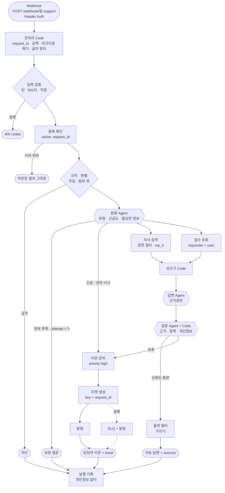

# 참조 구조 · 역할 · 페이로드

이 문서는 "정답 구조"가 아니라 **출발점**입니다. 팀은 이 구조를 바꿔도 되고, 바꾼 까닭을 설계서에 적으면 됩니다. 원본 요구의 작성 예시(Slack → 권한 · 전처리 → 분류 → RAG → 답변 · 검증 → 신뢰도 분기 → 답변 / Jira)를 우리 환경의 노드로 옮겼습니다.

## 1. 전체 흐름

| 단계 | 노드 (n8n) | 원본 요구 | 64~79일차 |
| --- | --- | --- | --- |
| 문의 수신 | Webhook (Header Auth) | Slack 메시지 수신 | 65 · 66 |
| 전처리 | Code | 문의 전처리, 변환(마크다운 제거 · 시간대 통일) | 66 JSON, 73 글자 정리 |
| 권한 · 입력 검증 | HTTP Request(`/employees`) + Code + If | 사용자 · 채널 권한 확인 | 73 입력 검증 |
| 중복 확인 | HTTP Request(`/cache/<request_id>`) + If | 중복 이벤트 재처리 차단 | 72 캐시, 76 중복 방지 |
| 보안 | Code(규칙) + Agent(판별) + If | (보안 · 권한 문의는 자동 답변하지 않음) | 73 |
| 분류 | Agent + Code(JSON 읽기) 또는 Switch | 문의 유형 · 긴급도 분류 | 68 라우터 |
| 검색 | Vector Store(검색) + Embeddings, HTTP Request(접수) | RAG 검색, 과거 유사 티켓 | 67 Tool, 71 RAG |
| 답변 | Agent (Tool 없음, 근거만 받음) | 답변 초안 생성 | 69 역할 분리 |
| 검증 | Agent(판단) + Code(점수 · 출처 · 개인정보 확인) | 근거 · 정책 검증 | 69 검토, 72 답 검사 |
| 분기 | If · Switch | 신뢰도 기준 분기 | 68 |
| 이관 | HTTP Request(`POST /tickets`, `POST /alerts`) | Jira 티켓 생성 | 76 |
| 출력 | Code(출력 필터) + Respond to Webhook | Slack 답변 | 73 |
| 기록 | HTTP Request(`POST /logs`) | 처리 결과 · 피드백 저장 | 73 감사 로그, 77 |
| 오류 | Error Workflow, 오류 출력, DLQ | 오류 처리 | 72 · 76 |

## 2. 에이전트 역할 (최소 3개)

| 역할 | 입력 | 출력 (JSON) | Tool | 하지 않는 것 |
| --- | --- | --- | --- | --- |
| 분류 (triage) | 질문 · 직원 부서 | `{"type", "urgency", "missing": [...], "ticket_id"}` | 없음 | 답하지 않음 |
| 답변 (writer) | 질문 · 검색 결과(근거) · 접수 상태 | 답 글 | 없음 | 근거 밖 내용 · 약속 |
| 검증 (verifier) | 질문 · 답 · 근거 | `{"grounded": true, "policy_ok": true, "issues": [...]}` | 없음 | 답을 새로 쓰지 않음 (고칠 점만) |
| (선택) 판별 (guard) | 질문 | `{"attack", "reason"}` | 없음 | 답하지 않음 |

- 69일차처럼 **역할마다 Agent를 따로** 두고, 역할 카드(목적 · 입력 · 출력 · 하지 않는 것)를 설계서에 둡니다.
- 판단이 분명한 것은 Agent가 아니라 Code로: 점수 기준, 권한, 중복, 길이, 출력 필터. Agent의 출력은 **JSON**으로 받고 Code가 읽으며, 읽지 못하면 안전한 쪽(이관)으로 갑니다 (69 · 73일차 fail-closed).
- 검색(RAG)은 Agent의 Tool로 줄 수도 있지만, **워크플로우가 먼저 검색해 근거를 넘기는** 쪽이 근거를 기록 · 검증하기 쉽습니다 (71일차).

## 3. 공통 계약 · 페이로드

### 3.1 요청 (Webhook 본문)

| 칸 | 필수 | 형식 | 예 | 변환 |
| --- | --- | --- | --- | --- |
| `request_id` | ✔ | 글자, 64자 이하 | `req-001` | 없으면 400 (중복 방지의 키) |
| `user` | ✔ | 직원 이름 | `박서연` | `/employees`로 확인, 없으면 400 `unknown_user` |
| `question` | ✔ | 1~500자 | `VPN이 계속 끊겨요` | 앞뒤 공백 · Slack 마크다운 제거, 글자 정리는 검사에만 |
| `channel` | | 글자 | `it-help` | 기록용 |
| `attempt` | | 1 이상 정수, 기본 1 | `2` | 보완 질문 루프의 횟수 |
| `context` | | 이전 보완 질문의 답 | `"Windows, 오류 809"` | 질문에 붙여 다시 분류 |

### 3.2 응답

| 칸 | 늘 있음 | 뜻 |
| --- | --- | --- |
| `request_id` | ✔ | 요청과 같음 |
| `route` | ✔ | `자동 답변` · `보완 질문` · `담당자 이관` · `권한 없음` · `차단` |
| `answer` | ✔ | 직원에게 보여 줄 글 (가린 뒤) |
| `sources` | ✔ | `[{"doc", "section", "score"}]`, 근거 없으면 `[]` |
| `ticket` | ✔ | 이관이면 `{"ticket_id", "priority", "duplicate"}`, 아니면 `null` (생성 실패면 `null` + `reason`) |
| `agents` | ✔ | 지나간 역할 이름 (`["triage", "retriever", "writer", "verifier"]`) |
| `security` | ✔ | `{"blocked_by", "reason", "masked"}` (73일차) |
| `reason` | | 이관 · 실패의 까닭 (`no_evidence` · `low_confidence` · `urgent` · `tickets_down` · `llm_down`) |
| `timings` | | 단계별 ms (72일차, 결과서의 처리시간) |

### 3.3 연결선마다 페이로드 (설계서 6절에 이렇게)

원본 평가 기준은 "**각 연결선(Edge)별로**" 스키마 · 변환 · 필수/선택 · 예시를 요구합니다. 노드 사이 주요 연결선마다 아래 칸을 채웁니다.

| 연결선 | 필수 | 선택 | 변환 (Mapper · Formatter) | 예시 |
| --- | --- | --- | --- | --- |
| Webhook → 전처리 | `request_id`, `user`, `question` | `channel`, `attempt`, `context` | 없음 (원문) | 위 3.1 |
| 전처리 → 분류 | `request_id`, `user`, `dept`, `clean_question` | `attempt` | 마크다운 제거, 공백 정리, 부서 붙이기 | `{"request_id": "req-001", "user": "박서연", "dept": "재무팀", "clean_question": "VPN이 계속 끊겨요"}` |
| 분류 → 검색 | `query`, `type`, `access_levels` | `ticket_id` | 분류 JSON 읽기, 권한 목록 만들기 | `{"query": "VPN 끊김", "type": "network", "access_levels": ["all"]}` |
| 검색 → 답변 | `evidence: [{"doc", "section", "text", "score"}]` | `ticket` | 점수 기준 미만 빼기, 중복 청크 빼기 | |
| 답변 → 검증 | `answer`, `evidence` | | | |
| 검증 → 분기 | `grounded`, `confidence`, `issues` | | 검증 JSON 읽기, 못 읽으면 `grounded: false` | |
| 분기 → 티켓 | `key`(=`request_id`), `title`, `requester`, `category`, `priority` | `evidence` 요약 | 질문 요약, 개인정보 가림 | |

n8n에서 각 노드의 입력 · 출력은 실행 화면(Executions)에서 바로 볼 수 있습니다. 설계서의 예시는 **실제 실행에서 복사**하고 개인정보를 가립니다.

## 4. 분기 · 병렬 · 루프 (원본 평가 기준)

| 구조 | 어디에 | n8n | 주의 |
| --- | --- | --- | --- |
| 분기 | 신뢰도 · 권한 · 긴급 · 유형 | If · Switch | 기준값은 **재서** 정함 (RAG 설계서), 설계서에 숫자로 |
| 분기 | 보안 · 권한 문의는 자동 답변하지 않음 | Switch | 오탐 시나리오도 함께 (03 문서 5절) |
| 병렬 | 지식 검색 + 접수 조회 (또는 과거 티켓 검색) | 한 노드에서 두 갈래 → Merge 또는 Code에서 모으기 | n8n v1 실행 순서는 갈래를 **차례로** 실행합니다 (66일차). 구조는 병렬이지만 시간은 합. 시간이 중요하면 결과서에 잰 값을 적고, "운영이라면 비동기 · 큐"를 설계서에 |
| 루프 | 보완 질문 (요청 사이) | `attempt` 칸, `attempt >= 3`이면 이관 | 루프의 끝(최대 횟수)을 꼭 정함 |
| 루프 | 검색 재시도 (요청 안) | 점수가 낮으면 질문을 다시 써서 한 번 더 검색 (Code 카운터 + If, 또는 Loop Over Items) | 최대 1~2회, 늘어나는 시간을 잼 |
| 루프 | 외부 호출 재시도 | 노드 설정 `retryOnFail` · `maxTries` | 401 · 403에는 재시도하지 않음 |

## 5. 하위 워크플로우로 나누기 (권장)

| 워크플로우 | 웹훅 | 맡는 사람 |
| --- | --- | --- |
| `<팀>-support` (본체) | `POST /webhook/<팀>-support` | 오케스트레이션 |
| `<팀>-index` (색인) | `POST /webhook/<팀>-index` | RAG |
| `<팀>-search` (검색, 본체가 부름) | `POST /webhook/<팀>-search` | RAG |
| `<팀>-handoff` (티켓 · 알림 · DLQ) | `POST /webhook/<팀>-handoff` | 연동 · 안정성 |
| `<팀>-errors` (Error Workflow) | Error Trigger | 연동 · 안정성 |

본체가 다른 웹훅을 부를 때(79일차 "다른 내 웹훅을 부르기")는 HTTP Request에 timeout과 오류 출력을 둡니다. 하위가 멈추면 본체가 정해진 답을 해야 합니다.
