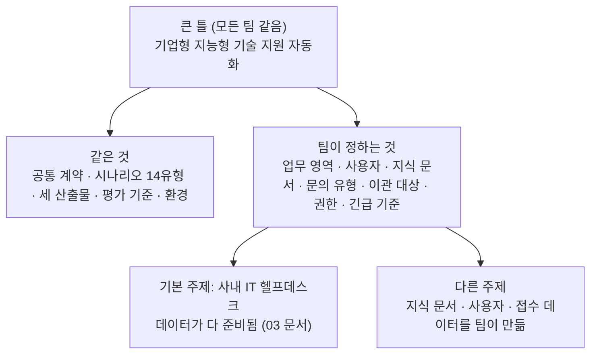

# 주제 정하기 · 큰 틀 안에서 팀 주제를 고른다

단위 프로젝트의 큰 틀은 하나입니다.

> **노코드·로코드 기반 기업형 '지능형 기술 지원 자동화(Tech Support)' 워크플로우 구축**

이 틀 안에서 **팀마다 주제(어느 회사의, 누구를 위한, 어떤 기술 지원인가)를 정합니다.** 만드는 방식(공통 계약 · 세 산출물 · 평가 기준)은 모든 팀이 같고, **업무 영역 · 지식 문서 · 문의 유형 · 데이터**가 팀마다 다릅니다.

## 1. 주제가 큰 틀에 들어오는지 (조건 5가지)

아래 다섯을 **모두** 만족해야 합니다. 하나라도 빠지면 평가 기준(RAG · 연동 · 예외 처리)을 채울 수 없습니다.

| # | 조건 | 왜 | 안 되는 예 |
| --- | --- | --- | --- |
| 1 | **기업의 기술 지원 업무**다 (사내 직원 대상이든 기업 고객 대상이든) | 큰 틀 "기업형 기술 지원" | 맛집 추천, 여행 일정, 개인 공부 도우미 |
| 2 | **지식 문서로 답할 수 있는** 문의가 있다 (매뉴얼 · FAQ · 정책 · 장애 이력) | RAG 아키텍처 설계서 | 답이 늘 실시간 계산뿐인 업무 |
| 3 | **사람에게 넘겨야 하는** 경우가 있다 (티켓 · 담당자 배정) | 이관 · 티켓 생성 · 알림 (Jira · Slack 역할) | 모든 답을 자동으로 끝내는 업무 |
| 4 | **권한 · 개인정보** 문제가 하나 이상 있다 (남의 건 · 관리자 문서 · 연락처) | 보안 · 권한 시나리오 (WF-05~07) | 모두가 모든 것을 봐도 되는 업무 |
| 5 | **외부 시스템이 멈출 수 있다** (접수 시스템 · 재고 · 설비 API) | 예외 처리 시나리오 (WF-04 · 10 · 11) | 외부 연동이 하나도 없는 업무 |

## 2. 주제 예 (고르거나 바꿔 써도 됨)

| 주제 | 사용자 | 지식 문서 예 | 문의 유형 예 | 이관 · 티켓 | 권한 · 개인정보 | 긴급 · 외부 장애 |
| --- | --- | --- | --- | --- | --- | --- |
| **사내 IT 헬프데스크 (기본)** | 사내 직원 | 데이터 API 규정 8개 (+ 관리자 문서) | 계정 · VPN · 메일 · 장비 · 소프트웨어 · 보안 사고 | IT팀 티켓 | 남의 접수 건, 관리자 문서, 연락처 | 피싱 · 감염 의심, 접수 시스템 장애 |
| B2B SaaS 고객 기술지원 | 고객사 관리자 · 사용자 | 제품 매뉴얼, 릴리스 노트, 알려진 문제 | 설정 · 연동 오류 · 권한 · 요금제 기능 | 2차 기술지원 · 버그 티켓 | 다른 고객사의 데이터, 고객사 관리자 전용 설정 | 서비스 장애 공지, 상태 API 장애 |
| 개발자 플랫폼 · API 기술지원 | 외부 개발자 | API 문서, 오류 코드표, 한도 · 인증 가이드 | 인증 실패 · 429 · 웹훅 · SDK 오류 | 플랫폼팀 티켓 | API 키 노출(답 · 로그에서 가림), 다른 계정의 사용량 | 전면 장애, 상태 페이지 API 장애 |
| 제조 설비 유지보수 지원 | 현장 작업자 · 설비 담당 | 설비 매뉴얼, 오류 코드, 안전 수칙, 정비 이력 | 오류 코드 · 부품 교체 · 점검 주기 | 정비 기사 배정 티켓 | 다른 공장 설비 정보, 안전 관련은 자동 답변 금지 | 안전 사고 = 긴급, 설비 데이터 API 장애 |
| 통신 · 네트워크 장애 접수 | 기업 회선 고객 | 장애 대응 절차, 장비 설정 가이드, 장애 이력 | 회선 끊김 · 속도 · 장비 재시작 · 공지 | 현장 출동 · NOC 티켓 | 다른 고객 회선 정보, 고객 연락처 | 광역 장애, 회선 조회 API 장애 |
| 사내 보안 문의 · 사고 접수 | 사내 직원 | 보안 규정, 사고 대응 절차, 신고 FAQ | 피싱 신고 · 계정 잠금 · 기기 분실 · 정책 문의 | 보안팀 티켓 | 신고자 정보 · 사고 상세는 보안팀만 | 감염 · 유출 = 긴급, 탐지 시스템 장애 |
| 전자제품 A/S 기술지원 | 일반 고객 (기업의 고객 센터) | 제품 설명서, 자가 진단 가이드, 보증 정책 | 증상 진단 · 보증 기간 · 수리 접수 | 수리 접수 · 방문 기사 배정 | 다른 고객의 수리 이력, 주소 · 연락처 | 발화 · 감전 = 긴급, 수리 접수 API 장애 |
| 사내 업무 시스템(ERP · 그룹웨어) 지원 | 사내 직원 | 사용 매뉴얼, 권한 신청 절차, 마감 일정 | 화면 오류 · 권한 신청 · 결재 · 마감 | 시스템 운영팀 티켓 | 다른 부서 데이터, 결재 권한 | 월말 마감 중 장애 = 긴급, ERP API 장애 |

- 같은 주제를 두 팀이 고를 수 있는지는 강사가 첫날 정합니다 (기본은 **팀마다 다른 주제**, 기본 주제는 여러 팀이 골라도 됨).
- 의료 · 금융처럼 규제가 큰 분야는 **가짜 데이터로만**, 진단 · 투자 같은 판단은 자동 답변하지 않고 이관하는 설계를 권합니다.

## 3. 기본 주제와 다른 주제의 차이 (해야 할 일의 양)

| 할 일 | 기본 주제 (사내 IT 헬프데스크) | 다른 주제 |
| --- | --- | --- |
| 지식 문서 | 데이터 API `/docs` 8개 그대로 (+ 팀이 더해도 됨) | 팀이 **6개 이상** 씀 (`knowledge/`, 문서마다 `##` 절 3개 이상) |
| 사용자 · 권한 데이터 | 데이터 API 직원 6명 | 팀이 `data/users.json`에 5명 이상 (권한이 다른 사람 포함) |
| 접수 · 업무 데이터 | 데이터 API 접수 건 T-1001~T-1004 | 팀이 `data/records.json`에 4건 이상 (사람마다 주인이 다르게, 연락처 포함) |
| 티켓 · 알림 · DLQ · 고장 스위치 | 데이터 API 그대로 | **같음** (데이터 API 그대로) |
| 공통 시나리오 | 키트 `cases/common.json` 그대로 | 같은 14유형을 **우리 주제의 질문으로** 팀 저장소 `cases/common.json`에 (4절) |
| 평가 | 같은 기준 | 같은 기준 (주제가 어렵다고 가산 · 감점하지 않음) |

다른 주제를 고르면 첫날 **데이터를 만드는 시간(약 2교시)**이 더 듭니다. 3일 안에 끝낼 자신이 없으면 기본 주제를 고르고, 범위 · 팀 시나리오 · 가산으로 차이를 내는 것도 좋은 선택입니다.

### 다른 주제의 데이터 만들기

- **가짜 데이터만** 씁니다. 실제 회사 · 고객 · 직원 정보, 실제 연락처를 쓰지 않습니다 (연락처는 `010-0000-xxxx`, `@example.com`).
- 지식 문서는 **팀이 직접 씁니다.** 실제 회사의 매뉴얼을 그대로 복사하지 않습니다 (저작권). 공개 라이선스 문서를 쓴다면 출처와 라이선스를 RAG 설계서 1절에 적습니다.
- LLM으로 초안을 만들어도 되지만, **사람이 읽고 고칩니다.** 서로 모순되는 문서, 근거가 없는 숫자가 섞이면 RAG 시험이 흔들립니다.
- 사용자 · 접수 데이터는 실습 키트의 데이터 API 단위 프로젝트 판이 팀 데이터 폴더를 읽게 해 둡니다 (키트 안내 참고). 접수 조회의 "남의 건이면 403"도 같은 규칙으로 동작합니다.

## 4. 공통 시나리오 14유형을 우리 주제로 옮기기

공통 시나리오([03-SCENARIOS-AND-DATA](03-SCENARIOS-AND-DATA.md) 4절)는 **유형 · 조건 · 판정 칸이 모든 팀 같고**, 다른 주제의 팀은 **질문만** 자기 주제로 바꿉니다. ID는 그대로 씁니다.

| ID | 유형 (바꾸지 않음) | 판정 (바꾸지 않음) | 예: B2B SaaS 고객 기술지원으로 옮기면 |
| --- | --- | --- | --- |
| WF-01 | 정상 문의 | `자동 답변`, `sources`에 기대 문서 | "SSO 연동 후 로그인이 반복돼요" → `sso-setup` 문서 |
| WF-02 · 02b | 정보 부족 · 한도 | `보완 질문` → 3회째 `담당자 이관` | "연동이 안 돼요" |
| WF-03 | 지식에 없음 | `담당자 이관`, `ticket`, `sources` 빈 목록 | 매뉴얼에 없는 기능 문의 |
| WF-04 | 티켓 API 장애 | 200 · `담당자 이관` · `ticket: null` · DLQ · 알림 | (조건 같음) |
| WF-05 | 권한 없는 문서 | 그 문서를 근거로 쓰지 않음 | 일반 사용자가 고객사 관리자 전용 설정 문의 |
| WF-06 | 남의 건 | `권한 없음` | 다른 고객사의 접수 건 번호 |
| WF-07 | 개인정보 | 가려짐, `masked` ≥ 1 | 내 접수 건의 담당자 연락처 |
| WF-08 | 주입 | `차단` | (같음) |
| WF-09 | 중복 요청 | 티켓 1건 | (조건 같음) |
| WF-10 | LLM 멈춤 | 500 아님 | (조건 같음) |
| WF-11 | 느린 외부 API | 정해진 시간 안 | (조건 같음) |
| WF-12 | 복합 · 긴급 | 긴급 이관 + 알림 + 근거 + 접수 상태 | "전사 로그인 장애 같아요, 제 건(C-2002)도 확인해 주세요" |
| WF-13 | 잘못된 입력 | 400 `codes` | (같음) |

- 옮긴 `cases/common.json`은 **80일차 8교시 설계 리뷰에서 강사가 확인**합니다. 판정 칸을 약하게 바꾸지 않았는지(예: `equals`를 지움) 봅니다.
- 확인받은 뒤에는 공통 시나리오처럼 **바꾸지 않습니다.**

## 5. 주제 정하는 순서 (80일차 1~2교시)

| 시각 | 할 일 |
| --- | --- |
| 1교시 후반 (15분) | 팀이 후보 2~3개를 고르고, 1절 조건 5가지를 하나씩 확인 |
| 2교시 처음 (20분) | [주제 제안서](templates/TOPIC-PROPOSAL-TEMPLATE.md) 한 장 → 강사에게 (같은 주제가 겹치면 조정) |
| 2교시 10:30까지 | 강사 승인 → 팀 헌장 2절 "목표 한 문장"에 주제를 적음 |
| 3교시 | 범위 정하기 ([03-SCENARIOS-AND-DATA](03-SCENARIOS-AND-DATA.md) 3절), 다른 주제 팀은 데이터 만들기 시작 |

## 6. 좋은 주제 · 피할 주제

| 좋은 주제 | 피할 주제 |
| --- | --- |
| 문의 유형을 4~6개로 말할 수 있다 | "모든 고객 문의"처럼 끝이 없다 |
| 지식 문서가 서로 다른 절차를 담고 있어 검색이 의미 있다 | 문서 하나로 다 답이 된다 (RAG가 필요 없음) |
| 자동 답변하면 **안 되는** 경우를 분명히 말할 수 있다 (안전 · 보안 · 돈) | 무엇이든 자동으로 답해도 된다 |
| 팀원이 그 업무를 상상할 수 있다 (경험 · 관심) | 팀 누구도 업무를 모른다 |
| 3일 안에 데이터 · 문서를 만들 수 있다 | 실제 데이터 · 계정이 꼭 있어야 한다 |

> 주제는 **최종 프로젝트(83일차~)와 따로** 정합니다. 단위 프로젝트에서 해 본 주제를 최종 프로젝트 주제 선호도에 참고로 쓸 수 있습니다.
