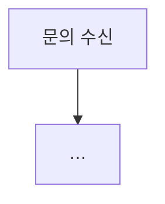

# 노코드 워크플로우 설계서 · <팀이름>

> 원본 요구 [KSM-REQ](../../Req/KSM-REQ.md) 4절 산출물 1의 구조를 따릅니다. `<…>`와 예시를 **우리 팀의 실제 구현 · 측정값**으로 바꿉니다. 노드 이름은 `workflows/*.json`의 실제 이름과 같아야 합니다.

## 1. 업무 시나리오

(누가 · 어디서 · 무엇을 묻고 · 워크플로우가 무엇을 하고 · 언제 사람에게 넘기나, 한 문단)

| 처리할 문의 유형 | 처리 방식 | 근거 문서 | 긴급도 기준 |
| --- | --- | --- | --- |

## 2. 전체 흐름

1. 문의 수신 (Webhook `<팀>-support`)
2. …
(원본 예시 10단계를 우리 구현에 맞게)

## 3. 워크플로우 흐름도



워크플로우 파일:

| 파일 | 웹훅 · 트리거 | 맡은 사람 | 노드 수 |
| --- | --- | --- | --- |

## 4. 에이전트 역할 · 분기 · 병렬 · 루프

### 4.1 역할 카드

| 역할 | 목적 | 입력 | 출력 (JSON) | Tool | 하지 않는 것 | 노드 이름 |
| --- | --- | --- | --- | --- | --- | --- |

### 4.2 구조

| 구조 | 어디 (노드) | 목적 | 기준값 · 최대 횟수 | 확인한 시나리오 |
| --- | --- | --- | --- | --- |
| 분기 | | | 신뢰도 기준 <잰 값> | |
| 병렬 | | | — (잰 시간: ) | |
| 루프 | | | 최대 <N>회 | |

## 5. 외부 연동 노드

| 노드 | 연동 대상 (연습용 → 실제 운영) | 인증 | 입력 | 출력 | 오류 처리 (재시도 · 중단 · 이관 · 알림) |
| --- | --- | --- | --- | --- | --- |
| | 팀 Webhook → Slack Trigger | Header Auth → OAuth | | | 401 |
| | `POST /tickets` → Jira | Header Auth(`X-Api-Key`) → API Token | | | |
| | `POST /alerts` → Slack · Email | | | | |
| | `GET /tickets/<id>` → 사내 API | | | | |

## 6. 노드 간 페이로드 (연결선마다)

| 연결선 (보내는 노드 → 받는 노드) | 필수 필드 | 선택 필드 | 변환 로직 | 예시 (실제 실행에서, 개인정보 가림) |
| --- | --- | --- | --- | --- |

요청 · 응답 계약 (공통):

```json
{"request_id": "…", "user": "…", "question": "…", "channel": "…", "attempt": 1}
```

```json
{"request_id": "…", "route": "…", "answer": "…", "sources": [], "ticket": null, "agents": [], "security": {}, "timings": {}}
```

## 7. 오류 처리

| 상황 | 알아채는 노드 | 처리 | 사용자 응답 | 기록 | 확인한 시나리오 |
| --- | --- | --- | --- | --- | --- |
| 인증 실패 | | | | | |
| 호출 한도 (429) | | | | | |
| 검색 결과 없음 | | | | | WF-03 |
| 외부 API 장애 | | | | | WF-04 |
| 중복 요청 | | | | | WF-09 |
| LLM 멈춤 | | | | | WF-10 |

Error Workflow: `<팀>-errors` (게시 여부 · 지정한 워크플로우)

## 8. 64~79일차에서 가져온 것

| 가져온 것 (일차 · 파일) | 어디에 | 바꾼 것 |
| --- | --- | --- |
